# Design review

## Round 36: properties in live view (2026-10-14)

A designer-agent source and interaction-test review checked naming, panel coordination, view-only gates and
the chrome budget. Live now uses the existing property sheet for nodes, boundaries and connections: double-click,
F2, Enter, Rename / Edit label and Ctrl+K select the Label and expand the inspector. No controls are added.

- **Findings resolved:** the UX policy now distinguishes Live's property sheet from inert annotation text.
  Inputs and Simulations make room for the inspector; a simulation's unsaved working copy survives the switch.
  The seven-angle code review caught reopening an active saved run bypassing that retained copy, and Enter
  consuming a waiting narration's Continue action. Both are fixed with regressions, including presentation.
  The controller regression now runs a saved simulation with setup, traffic, timeline and expectations.
- **Gestures:** guides, box selection and quick-add retain their existing live gates. Empty-canvas double-click
  already opened quick-add in Live and keeps doing so. Annotation text stays inert.
- **View-only:** presenting, read-only embeds and the HTML viewer never open an editor.
- **Simulation:** use the existing inspector update path. Node labels and subtitles already rebuild the engine;
  boundary and connection names leave playback and counters alone. This fix does not change those semantics.
- **Rejected:** widening `editGestures` would enable unrelated gestures; another Properties button duplicates
  existing chrome; changing restart semantics would expand this access fix into simulation behavior.

Production-build regressions cover double-click on cards, boundary labels/outlines and connection labels,
keyboard and contextual naming, panel coordination and draft retention. The live naming regressions fail with
the fix reverted; removing draft retention also fails its regression. Review used source and browser-test
evidence, without a separate screenshot walkthrough.

## Planning P1 review follow-up (2026-10-14)

The required designer-agent source review confirmed focus loss after Apply/Upgrade and hover clipping in short
viewports. Apply now focuses its surviving explanation or the inspector Label when the whole explanation goes;
Upgrade focuses the surviving preview button. Tall hover cards show compact arithmetic and direct people to
Properties for full details. Placement measures both sides and bounds the final screen coordinates after scaling.
No global controls were added. Existing Checks cards follow node configuration so arithmetic and its primary action
remain ahead of structural findings and their ignore/off actions. Browser regressions cover keyboard focus and
short-viewport bounds; synthetic screenshots are refreshed by the planning suite.

## Round 36: planning P1 (2026-10-14)

Reviewed the synthetic P1 Lab fixtures in the production build: Orders, two topic policies sharing
one pool, and a broker without a reader. Top-bar and floating controls are unchanged.

- The original five processor controls stay under Simulation. The explanation has at most five main
  readouts: arithmetic, contributors, growth, chosen target and current-run metrics. One primary action
  applies the shared planner fix; keyboard Enter and one-step Undo are covered. The fix keeps the
  selection/inspector open. Slow motion explains why its action is disabled.
- Read-only Connections names each topic/group policy and one shared pool. HTTP-only inputs have no
  consumer rows. Removal and keyboard reconnection refresh the list without persisting capabilities.
- Hover and keyboard focus show the same explanation through the existing `aria-describedby` tooltip.
  The first screenshot pass found an overly tall card; duplicate processor counters were consolidated,
  and placement now chooses above/below and stays inside the horizontal viewport. Production coverage
  checks bounds and focus. Current-run counters remain distinct from configured estimates.
- The continuation's designer review confirmed the five readouts and keyboard access. Connection
  separators and secondary ink now use the existing theme tokens; a deliberate token regression
  fails production coverage. Inspector screenshots scroll to show the explanation and policy rows.
- Upgrade stays behind a Diagram properties preview, naming nodes and unchanged capacity, explaining
  v2 compatibility and Undo. Legacy export lists losses before download. No wizard or extra toolbar.
- New prose uses `t()` and locale number/list formatting. All new `planning.*` keys currently fall back
  to English in the 37 other languages. Lesson values remain assumptions; existing device figures are
  approximate. Reserved physical-delay/store-slot contracts have no ineffective controls.

Screenshots: [Orders inspector](screenshots/round36/orders-inspector.png),
[connection policies](screenshots/round36/connections.png),
[live hover](screenshots/round36/orders-hover.png),
[upgrade preview](screenshots/round36/upgrade-preview.png).

Rejected/deferred: permanent consumer stencils and per-input slot pools (capabilities are derived);
new top-bar controls (existing context surfaces suffice); vendor quotas and new broker policies (P2/P3);
request timeout/retry propagation (separate approval gate); hardware/vendor capacity claims from generic
latency (workload assumptions remain explicit). Source review covered correctness, architecture,
performance, tests, security, accessibility and types; deliberate regression removals and production
browser coverage accompany the review.

Follow-up: stress hover placement with tall content at narrow viewport sizes; P1's normal fixture
is bounded by production coverage.

## File-dialog localization review (2026-10-14)

Designer-agent review against the UX principles covered the remaining File dialogs and provider prompts.
The existing chrome and progressive disclosure remain; image, HTML and embed settings stay behind Options.
German and Arabic wording received a manual review. Production Chromium checks open every converted dialog
in German, Arabic and the pseudo-locale at 1280 × 800 and audit wrapping, bounds and translated copy.

Logical padding and alignment keep the dialogs readable in Arabic without reversing diagram content or code.
Product names and file syntax stay intact; counts and sizes use Intl. No extra controls or explanatory copy
were added. Library operations wait for their messages, and failed downloads leave a visible retry or error.

Rejected translating generated diagram labels and shared agent diagnostics: those are content and API output.
Rejected moving dialog messages into startup code: they load with the operations that use them.

## Round 35: external discovery (2026-10-14)

P5a follows planning-model §4.1: the existing category becomes **Clients & external**, with quiet
**Clients & webhooks** and **External systems** headings. Generic integrations and six named vendors share the
same library, gallery and Ctrl+K search. A designer-agent screenshot/source review found no blocking clutter or
consistency issues; it flagged ordinary clients matching “external”, which is fixed and regression-tested.

- **Chrome:** no new top-bar controls, category folds or vendor families. New vendors join SaaS; generic fallbacks
  stay in the Generic family. The existing category fold and Vendor overflow remain the way to browse.
- **Responsive:** at 1024 and 1280 the category opens, folds and remembers the fold. Gallery families fit at
  1024, 1280 and 1600; folded families remain selectable and the selected family's chip returns.
- **Discovery:** External API leads called systems; Iterable is the first new vendor. Searches for external,
  Iterable and Stripe work in the rail, gallery, Ctrl+K and WebMCP. Ordinary traffic sources no longer dilute
  external search; inbound Webhook remains discoverable.
- **Rejected:** a separate External category/family would duplicate existing filters; new vendor marks lack a
  verified redistribution grant. Reuse Lucide ISC cloud/megaphone glyphs. Quotas, numeric defaults and endpoints
  belong to later batches and would imply behavior this discovery-only change does not implement.

Production-build Chromium evidence: 66 tests passed (stencils, palette, command palette, gallery, round4-polish
and CSP); 5,190 unit tests passed, four skipped. Unit regressions fail with the catalog and aliases temporarily
reverted; source-client and HTTP API ranking regressions also fail when their fixes are reverted. The drawer
navigation browser regression fails without matching the subgroup display order.

The seven-angle code review found one P1 (HTTP API ranked an inbound Webhook ahead of the called API) and two
P2 coverage gaps (restoring the default closed fold and drawer navigation across subgroups). All are addressed:
External API has an explicit HTTP alias, shared search and agent resolution agree on a terminal API, and browser
tests restore an open fold and traverse Webhook → External API → Webhook. The follow-up architecture review found
no issues; its test review prompted an explicit default-selection browser regression: HTTP API must be first in
both the rail and Ctrl+K, and Enter must create External API. No new resolver or simulation semantics.

Screenshots: [rail at 1024](screenshots/round35/clients-1024.png),
[rail at 1280](screenshots/round35/clients-1280.png), [Ctrl+K Iterable](screenshots/round35/palette-iterable.png),
[gallery families at 1024](screenshots/round35/gallery-1024.png),
[1280](screenshots/round35/gallery-1280.png), [1600](screenshots/round35/gallery-1600.png),
[generic fallback](screenshots/round35/gallery-external-1024.png),
[external vendors](screenshots/round35/gallery-vendors-1280.png),
[Iterable in the gallery](screenshots/round35/gallery-iterable-1280.png).

## Inspector naming reliability (2026-10-14)

A designer agent's source and regression review found no blocking UX issues. Rename focus waits for the selected
target's field, preserving the inspector's drag lifecycle and preventing focus on an old node's name. Naming keeps
its existing Tab order, Enter/Esc return to the canvas and creation undo transaction. Name and accessible-name
changes reuse routes until geometry changes; boundary headers and connection labels still update routing. No
controls or chrome were added. Production browser tests verify the runtime behavior; a Lab fixture holds the
selection frame to cover delayed field mounting. Reverting the focus and routing fixes makes their regressions fail.

The follow-up designer review also found no blocking issues with tabular numerals in live callout counts. They
keep the adjacent action steady as digits change within the same count length, matching existing Live and trace
styling. Placement, wrapping and motion remain consistent. A Lab preview and bounding-box regression cover this
typography fix for an additional unstable Revive button found during repeated production verification.

## Round 34 follow-up: naming review fixes (2026-10-14)

A designer agent reviewed the fixes against `docs/UX-PRINCIPLES.md`: canvas naming, inspector completion and undo,
annotations versus Live, quick-add, route geometry and view-only guards. Source, regression tests and the existing
round 34 public screenshots in both themes were reviewed; no fresh interactive walkthrough was performed by the
designer. Production browser tests provide the runtime verification. No blocking UX findings or new chrome.

- Boundary names still update immediately, with route searches limited to corridors affected by changed geometry.
  Operation counts guard distant cached routes; geometry tests check that a growing header diverts a nearby path
  and shrinking it restores the path, agreeing with a fresh router.
- Clicking away finishes a rename as one undo step. Removing a focused field closes naming too; a connected node's
  creation step ends when the inspector folds, keeping a later rename separate. Regression tests independently
  disable blur and removal cleanup and fail for each path.
- A name explicitly cleared before the inspector opens stays empty, with the caret at its end.
- The action test now asserts `annotation.edit`, present in editing and absent in Live, with a valid annotation.
- All six review findings were valid; three report the same routing defect. Removed the deferred backlog entry.
  Rejected delaying names until completion: immediate saving is the established behavior. Additional completion
  buttons, selection controls and routing settings would add unnecessary chrome.

## Round 34: renaming in the inspector, and selected text you can see (2026-10-13)

The owner's report: "If I add a boundary and want to rename it, I can't double or triple click with the mouse like I
typically do to highlight everything... I think this applies to anything: any place I can type text." Then: "I can
triple-click and then delete it. It just doesn't show that it's highlighted." And a decision: "Double-clicking a
service should open up the property sheet... I don't think we should be doing these in-line rename functionalities.
The name change should be part of the properties sheet." Decision dated 2026-10-13; completed review on 2026-10-14
against `docs/UX-PRINCIPLES.md`. A designer agent reviewed the implementation and the interrupted work's production
screenshots at 1280 × 800 in light and dark, on the Kafka example (`docs/screenshots/round34/`). Production e2e tests
verify the interaction and the highlight's computed colours and painted pixels.

- **The selection was there, just not painted.** The fix for connecting nodes (#36) made selections on the drawing
  transparent with `.react-flow__renderer :not(input, textarea, …)::selection`. Chrome now applies CSS highlight
  inheritance: a field's `::selection` inherits its parent's, so every editor on the canvas (a boundary's name, a
  node's, an edge's, a note) inherited the transparent one. Double- and triple-click did select (typing replaced the
  words), which is why it read as "placeholder text" (`before-boundary-triple-click-light`,
  `before-text-triple-click-dark`). Now one `::selection` everywhere, from two tokens (`--selection-bg`,
  `--selection-text`), and the canvas sets it again on its fields; the drawing itself still never shows a selection
  (`after-text-triple-click-light`, `after-text-triple-click-dark`). The selected words are AAA on the highlight, and
  the highlight is at least 1.5:1 from every surface a field sits on, in both themes (`tokens.test.ts`); a browser's
  default is about 1.45:1 on white.
- **Every other field already selected natively**: the inspector, dialogs, Ctrl+K, quick-add's and the rail's
  searches, the AI panel's request. None cancels `selectstart`, calls `preventDefault` on a press or reselects on a
  click. They now share the same highlight, so a dark-theme selection reads as clearly as a light one.
- **Renaming is in the inspector** (`after-boundary-double-click-light`, `-dark`). A double-click on a node, a boundary
  or a connection, F2, Enter, and the menus' Rename and Edit label select it, open the inspector (even hidden by hand)
  and focus its Label, all selected, as Figma's, Finder's and Explorer's rename do. Enter or Esc is done and gives
  focus back to the thing on the canvas, so the next key acts on it; the field's selection is let go then, so Ctrl+C
  copies the nodes, not the old name. The canvas's three inline editors are gone, with their CSS and the z-index
  raise they needed.
- **Quick-add keeps its one step** (`after-quick-add-name-light`, `after-quick-add-connection-light`): the pick's name
  is selected in the inspector, keys typed before it can take them still name it, and a node made connected shows a
  **Connection** field one Tab after the Subtitle while it's being named (the editor's third field, round 13). The node,
  its connection and their names are still one undo step, and the gate (the Kafka example's right half by keyboard)
  takes the same 58 keys as before.
- **Texts, notes and zones keep editing in place**: their words are the thing, and the inspector would only repeat
  them. A zone remains an annotation and follows its existing text editing behavior.
- **View-only modes open nothing.** Presenting used to open the inline rename on a double-click; it no longer does.
  Live, read-only views, embeds and the HTML viewer also open no editor.
- Fixed on the way: the inspector replayed its last focus request whenever it folded and opened again (a selection
  changing under it), taking focus back from the canvas and selecting the old name; and its retry a frame after
  focusing no longer overrides a key or a click made in that frame.
- Conventions recorded in `docs/UX-PRINCIPLES.md` (Renaming happens in the inspector; Selecting text with the mouse),
  and in the shortcuts sheet's Mouse rows. Tests: `tests/e2e/text-fields.spec.ts` (word, line, typing over it; the
  highlight's colours and its paint, both themes; rename by double-click, F2, Enter and quick-add; a note in place;
  live, presenting and read-only embeds), HTML-export/skill viewer tests, and the inline-editor specs moved to the inspector.
- Naming uses an explicit history transaction: slow typing remains one undo step, and completing a name separates
  the next rename even when it starts immediately. Tests deliberately remove the highlight, transaction, Live
  guard and inspector routing and fail for each regression.
- The seven-angle code review found focus requests replaying after presentation and StrictMode cleanup closing
  naming too soon. Both have regression tests that fail without their fixes. Focus consumption now lives on the
  canvas; cleanup closes naming only when its field is removed. Ctrl+K also reselects an already-focused name.
- P2 routing follow-up resolved on 2026-10-14: boundary names now invalidate only affected route corridors, with
  operation-count and geometry regressions (follow-up above).
- Rejected keeping live renaming, floating node/boundary/edge editors and an extra selection control: they conflict
  with the owner's decisions or add chrome without helping. No global control was added.

## Round 34: nightly reliability #90 (2026-10-14)

Designer-agent source review against `docs/UX-PRINCIPLES.md`: canvas, inspector, Checks, top bar, Share,
Interactive HTML and the related privacy tests. No UX blockers and no added controls, copy or settings.

- **Nothing moves under a drag.** A deferred inspector update checks whether another gesture has begun;
  the inspector waits for that gesture's pointer-up.
- **Commands do what they say.** Opening the lazy Checks card in development no longer stops a simulation
  started from Ctrl+K or the canvas right-click. Closing the card and leaving editing still stop it.
- **Sharing remains deliberate.** The safest choices come first, public choices stay folded, and each
  option states its audience. Splitting the longer tests preserves both cross-tab embed outcomes and
  the Import report's remembered privacy offer.

Rejected extra controls or explanatory text: the existing interactions already express the intended behavior.
This review was source-only; runtime layout, focus and drag behavior are checked separately by E2E tests.

## Round 32 follow-up: second review fixes (2026-10-14)

The designer-agent source review found two remaining gaps: edge inert-property removal needed a surviving field as
its focus fallback, and a saved-down node on first live mount still needed an empty announcement region before its
text changed. Both were fixed, with production Chromium regressions for node and edge removal, and a DOM mutation
check for the initial announcement. That check fails if the region starts populated.

The callout adds no controls: one action and the quiet dismiss stay. Trouble hidden by Inputs keeps its first useful
turn, unrelated overloads cannot hide observed lag, and flat backlog stops being called rising. The 1024 px fallback
and 1440 px canvas with the AI panel open are checked against the title card's actual bounds; both trouble and
capacity callouts use the measured space beside it. Warnings, the heat map and checks share incoming-delivery
semantics, so a down broker fed by another broker correctly says its messages wait upstream.

Review triage and regression details: [second review fixes](research/sim-truth-review-round2.md).

## Round 32: the simulation tells the truth (2026-10-13)

The gate for items 1–6 of the simulation flows review (`docs/research/sim-flows-review.md`): consumers that drain at
their reported capacity, the down-consumer wording, Request edges by default, hidden inert fields, the callout coming on
its own, and limits that match the file format. Self-review against `docs/UX-PRINCIPLES.md` on the production build
(`vite preview`) at 1024 × 768 and 1280 × 800 light and 1440 × 900 dark, on the public Kafka and GCP examples and small
diagrams drawn for it (no private diagrams). Screenshots are in `docs/screenshots/round32/`.

- **The banner and the animation agree.** The GCP example's Pub/Sub topic said "13% · 50/s of 400/s" under "Healthy"
  while its lag climbed; it now holds no lag, and nothing was tuned by hand (`gcp-healthy-1280-light`). A default
  consumer behind a broker drains at the 16/s the heat map says.
- **No dead ends: trouble says so on its own, with one action each.** A node down: "Payments service is down", "Messages
  wait in orders.created.v1 until it's back (31 so far)", **Revive** (`trouble-down-1280-light`). Lost messages:
  "orders is losing messages: 1 dropped", "They ran out of deliveries, and no dead-letter queue keeps them.", **Add
  dead-letter queue**, which adds the same queue the `dead-letter` check's fix adds, one undo step, and brings it into
  view (`trouble-dropping-1024-light`, `trouble-dropping-fixed-1024-light`). A rising lag: "orders is falling behind:
  lag 74 and rising", "Billing doesn't keep up with it.", **Inputs…** (`trouble-lag-1280-light`). The callout is
  the existing one (same place, same colour as an overload), plus a quiet **×**.
- **Don't nag.** Each cause once per run; dismissed, it doesn't come back in that run; over (revived, drained), it
  goes. Never while presenting, recording, in an embed or the Lab, where nobody can act on it. With the heat map on it
  leads the capacity callout only when the plan says something else; where the plan already says the same with its
  own action (over capacity, nobody reads it), the plan's callout stays.
- **One word per idea, everywhere.** The trouble callout and the capacity callout say the same sentence for a down
  consumer ("Messages wait in … until it's back"), from one function; the badge says "Down · 50/s waiting in
  orders.created.v1" (`capacity-down-waits-1440-dark`). "Fail" stays for nodes requests are pushed to.
- **Beautiful (and right) by default.** A database quick-added after a service arrives as a **Request**, solid, and
  the first time a toast says "Request: the caller waits for a reply" with **Make it a message**, like the dependency
  toasts' Make it a flow (`request-toast-1280-light`). It shows once a session.
- **Simple by default: a field shows only where it changes the run.** A gateway has Latency, not Concurrency; a sink has
  no fields and says why ("Messages end here as they arrive"); Consumer group and Dead-letter path show only on edges
  out of a broker. A value already in the file is said in a muted line, "Concurrency 8 is kept in the file, but a
  gateway takes any number of messages at once in the simulation, so it doesn't change the run.", with **Remove**
  (`inspector-inert-gateway-1280-light`, `inspector-inert-edge-1280-light`).
- **Errors say how to fix them.** Past the file's limit the field says "Up to 10,000,000 msg/s: saved as
  10,000,000." (`inspector-limit-1280-light`), and a refused file names the field and the limit.

### Also fixed (found here)

- **The floating callout covered the diagram's name** on narrower canvases (both the capacity callout and the new
  one): centred on the canvas, it sat over the title card's first words. Below 1280 px it now centres in the room right
  of the title card, under the Live toggle.
- **Add dead-letter queue landed off screen** at 1024: it now refits the view as Add a consumer does.
- **The "losing messages" line wrapped to three lines** at 1024; shortened.
- **From the code review:** with a side panel open the canvas left the callout 116 px beside the title card, its
  words under its buttons; both floating callouts now drop below the card at the canvas's width when the room
  beside it is short. A screen reader hears the cause once ("Payments service is down"), not every changing count.
  Dismissing with the keyboard returns focus to the canvas. Revive while paused clears the callout at once.

### Bigger ones, listed for the owner (not built)

- **Partitions and Max deliveries on brokers that have neither** (SNS, Service Bus topics, Pub/Sub…; Kafka's max
  deliveries) are still shown: they're item 7 and 9 of the review (per-broker semantics), not a field rule.
- **The trouble callout has no history**: dismissed or over, a cause is gone for the run. A small "1 earlier" chip
  that reopens it would help long demos; not added, to keep the chrome budget.
- **Requests still don't wait** (review item 10): a Request edge is solid and replies, but a slow database doesn't
  back its caller up yet.

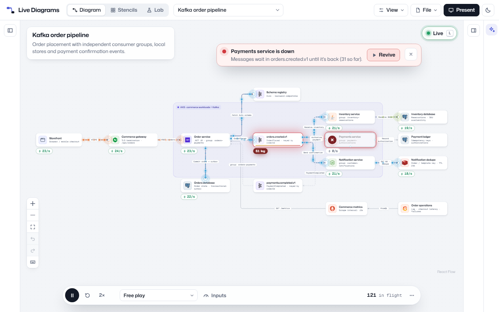
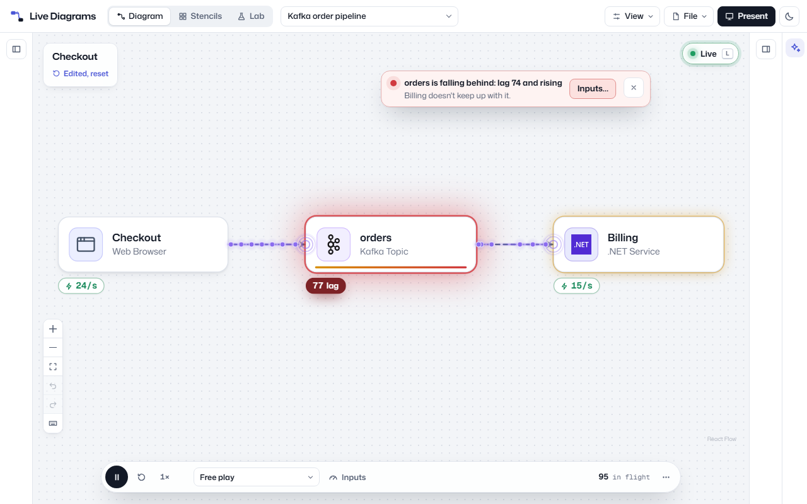
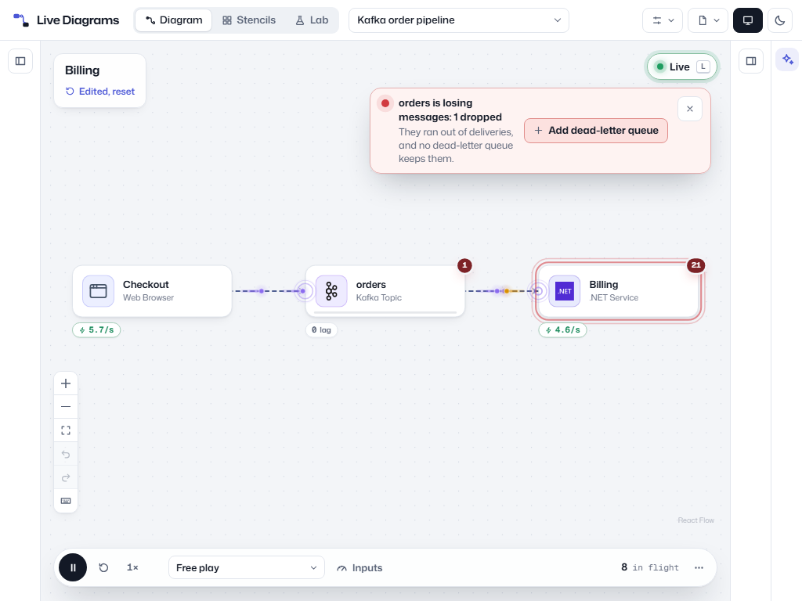
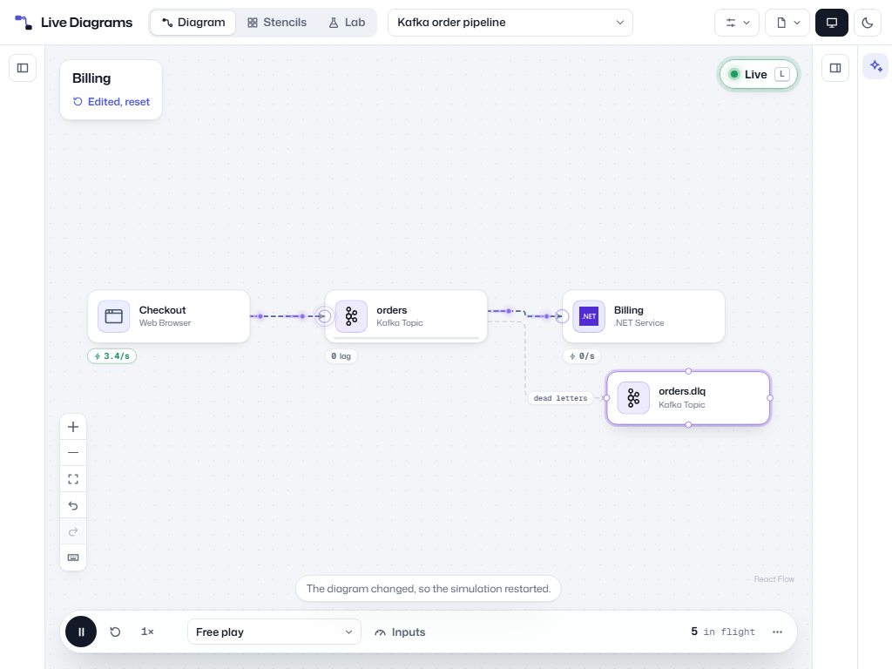
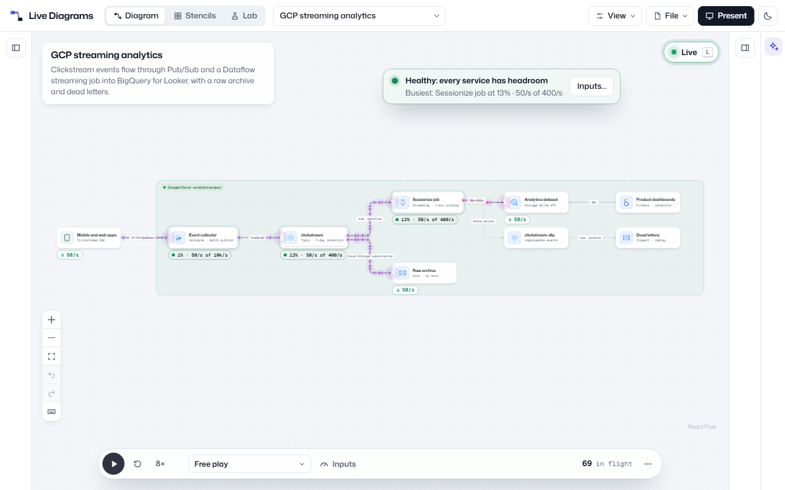
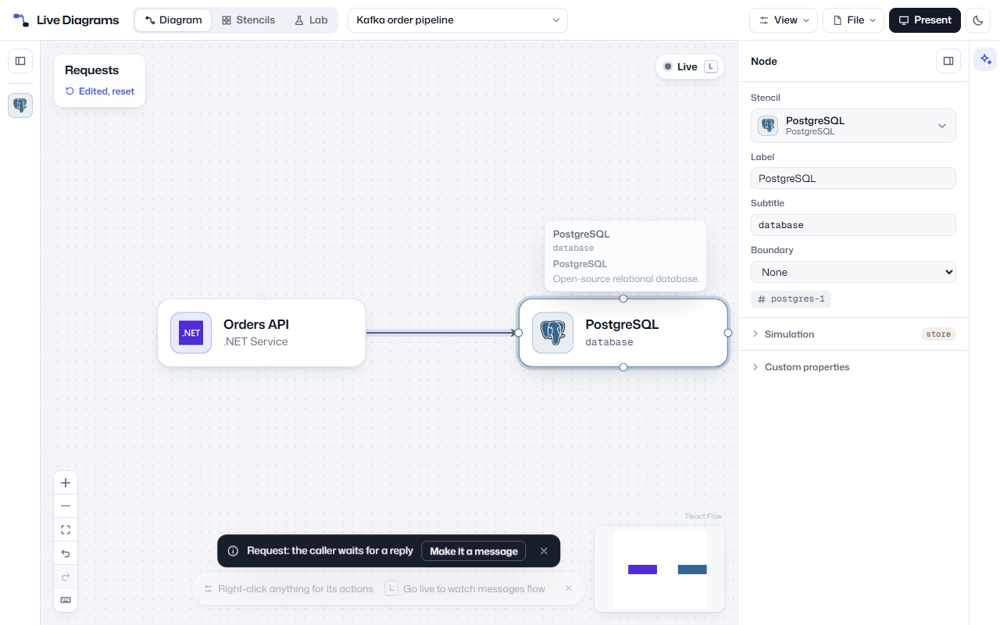
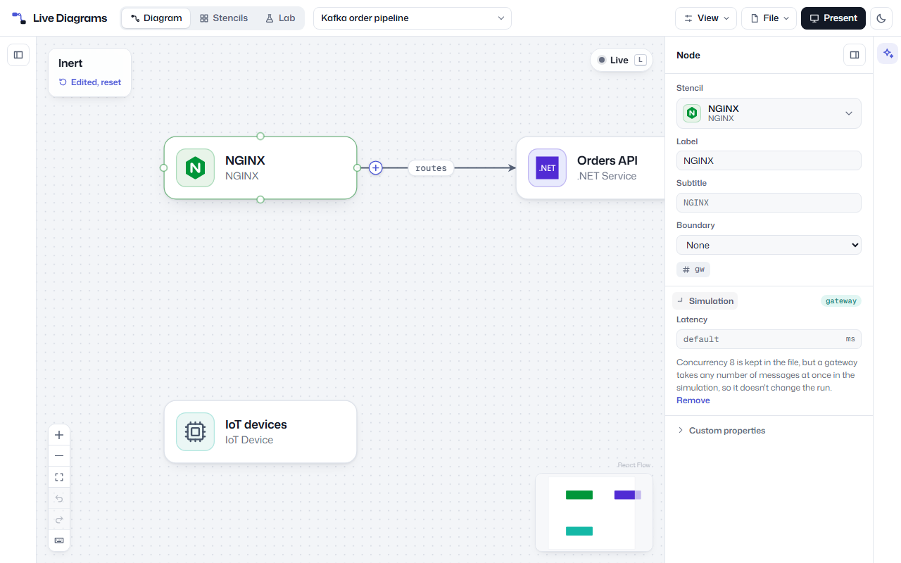

Also: `screenshots/round32/capacity-down-waits-1440-dark.png`, `inspector-inert-edge-1280-light.png` and
`inspector-limit-1280-light.png`.

## Round 33: languages, batch 1 (2026-10-13)

The owner's request: "Switch your language from English to whatever else, and for everything in the app to reflect
that." Research and plan: `docs/research/i18n.md`; how to work with it: `docs/I18N.md`. This batch is the foundation
and the first areas: the start card, the top bar, the File, View and presenting controls, Share…, the shortcuts sheet,
the Private diagram and Clear everything dialogs, and the new Language dialog, in English and 37 machine-translated
languages. Self-review against `docs/UX-PRINCIPLES.md` on the e2e build (`vite preview`) at 1280 × 800 light and
1440 × 900 dark, in German, French, Japanese, Polish, Traditional Chinese, Bulgarian (as the browser's language),
Arabic and Hebrew (right to left), and the pseudo-locale. Screenshots are in `docs/screenshots/round33/`.

- **No new chrome in the top bar.** The language lives where the look does: View ▸ **Language…**, after a separator,
  last (`view-menu-language-1280-light`). The View menu has 10 rows of its 12. Ctrl+K finds **Language…** too.
- **One primary action.** The dialog lists every language by its own name, with its name in the current language
  beside it, **Browser default** first ("Now English"), and a search field. A pick applies at once, the dialog
  included (`language-dialog-en-1280-light`, `language-dialog-de-1280-light`); **Done** closes it. English shows no
  notice; every other language says it's machine-translated and links to **Suggest a better translation** on GitHub.
- **The way back is never in a language you can't read.** In any language but English the View row also says
  "Language" in English (`view-menu-he-rtl-1280-light`), and Ctrl+K always matches "language". Clear everything forgets
  the choice, and its list says so ("Your settings, the language included").
- **Words people use, not literal ones.** German keeps Topic and Consumer, Japanese writes コンシューマー, Bulgarian keeps
  "topic" (тема is the app's colour theme), and every language's glossary is enforced on each message
  (`start-de-1280-light`, `start-ja-1280-light`, `start-bg-browser-1280-light`, `file-menu-privacy-fr-1280-light`,
  `share-de-1280-light`, `shortcuts-pl-1440-dark`, `start-zh-TW-1440-dark`).
- **Right to left mirrors the chrome, never the diagram.** In Arabic and Hebrew the top bar, menus (they open from
  the button's other edge, submenus to the left), dialogs and the start card mirror; the diagram reads exactly as in
  English, upstream on the left (`canvas-ar-rtl-1280-light` against `canvas-en-1280-light`, `file-menu-ar-rtl-1280-light`,
  `start-ar-rtl-1280-light`).
- **Nothing cut off at English + 40%.** In the pseudo-locale every converted surface shows its brackets whole at
  1280 × 800 (`start-pseudo-1280-light`, `file-menu-pseudo-1280-light`, `share-pseudo-1280-light`,
  `shortcuts-pseudo-1280-light`, `clear-pseudo-1280-light`); `tests/e2e/i18n.spec.ts` checks it.
- **The diagram is never translated:** labels, notes, titles, product names and files stay as written.

### What was off (fixed in this round)

- **Menu descriptions were cut with an ellipsis** once a language ran longer than English: "Fichiers, intégrations et
  liens, les plus sûrs d'abord" lost its end. A description now wraps under its title. In English this shows View ▸
  Show dependencies' description whole, on two lines; it was cut at 240 px before.
- **Long gestures in the shortcuts sheet pushed past the dialog's edge** (German "Knoten über den Rand einer
  Begrenzung ziehen"). The gesture now wraps; a key combination never does ("Alt ← ↑ → ↓" stays one badge).
- **File names read backwards in Arabic and Hebrew**: ".diagram.json" showed as "diagram.json." The menus' and Share…'s
  file hints are isolated left to right, and the two catalogs mark the Open row's file name.
- **The diagram's own English title read wrong in Arabic** (its full stop on the left): the title and description
  on the canvas now take their direction from their own words (`dir="auto"`).
- **Japanese headings broke inside a phrase** ("メッセージ / が"). Japanese now breaks between phrases where the browser
  can (`word-break: auto-phrase`).

### Still open (owner's call)

- **The rest of the app is English inside a translated UI** until its batch: the live view, Inputs & capacity, the
  inspector, the checks, the stencils and catalog (all being changed by other work right now), the canvas's hint bar,
  context menus and toasts, the examples' titles and "Untitled diagram". The View menu's Show capacity and Checks rows
  wait for those batches. Order and sizes: `docs/research/i18n.md` § 9.
- **Key names are English everywhere** (Ctrl, Shift): German keyboards say Strg and Umschalt, French Maj. One batch
  should change `formatCombo` and the shortcut texts together.
- **A first visit in another language waits for two small downloads** (the loader, then the catalog: about 5 kB)
  before the app appears; the start-up page shows meanwhile. Preloading the catalog would need its file name in the
  entry.
- **Czech buttons use the infinitive** (Uložit, Zavřít), as Windows and macOS do; the brief said imperative.
- **Size.** The entry grew 0.6 kB and a 0.26 kB startup chunk was added (the runtime, shared with the lazy dialogs),
  over the 0.3 kB asked for: starting in a language, the Language row, right-to-left menus and about 90 converted
  strings. No library came close (Lingui, the smallest, is about 3.2 kB). `docs/I18N.md` § Size.

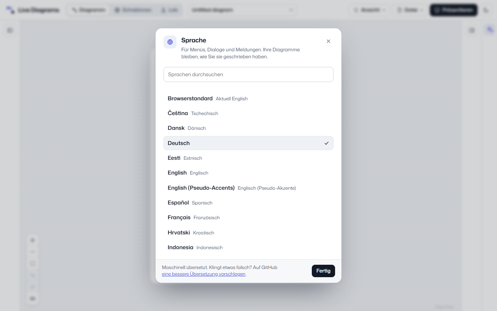
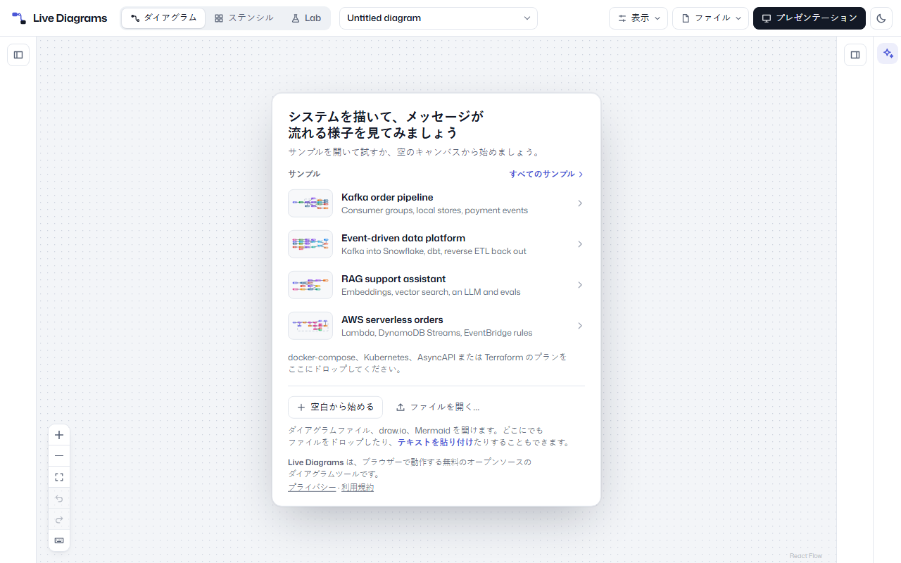
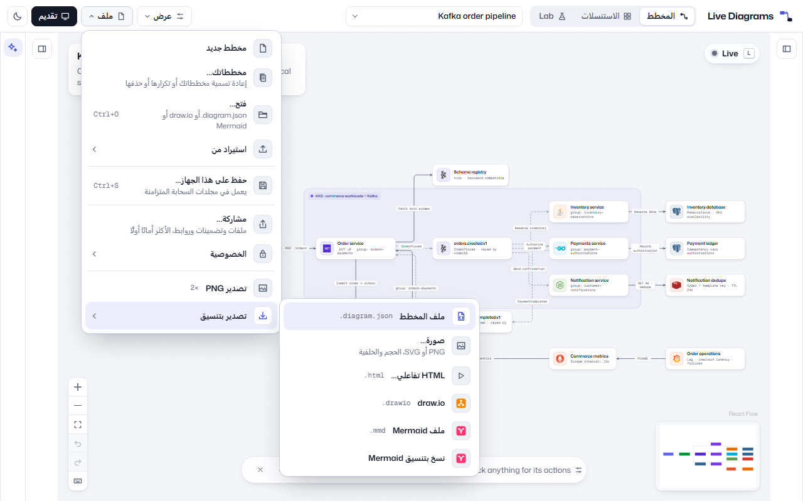
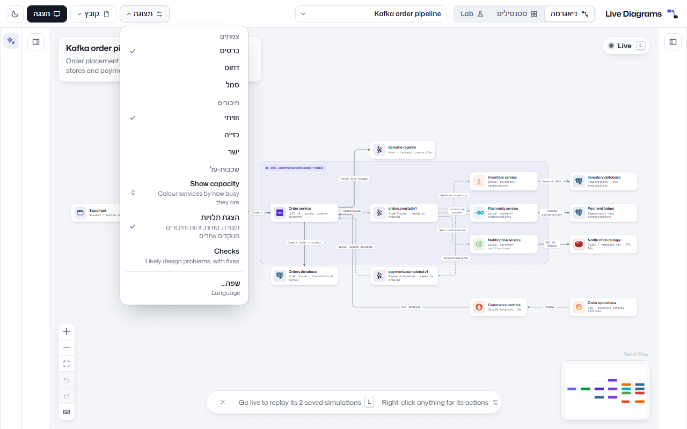
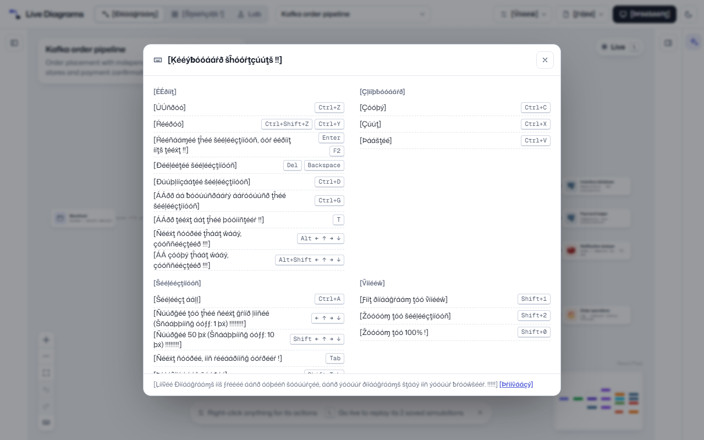
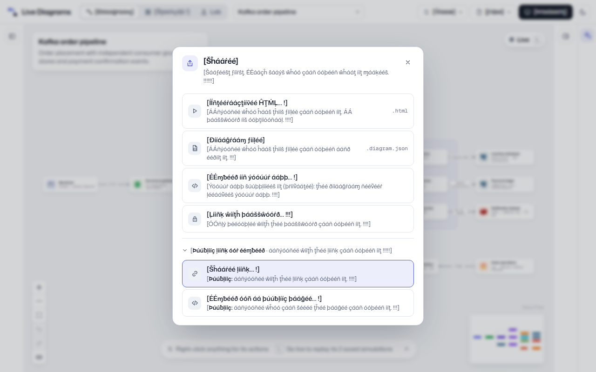
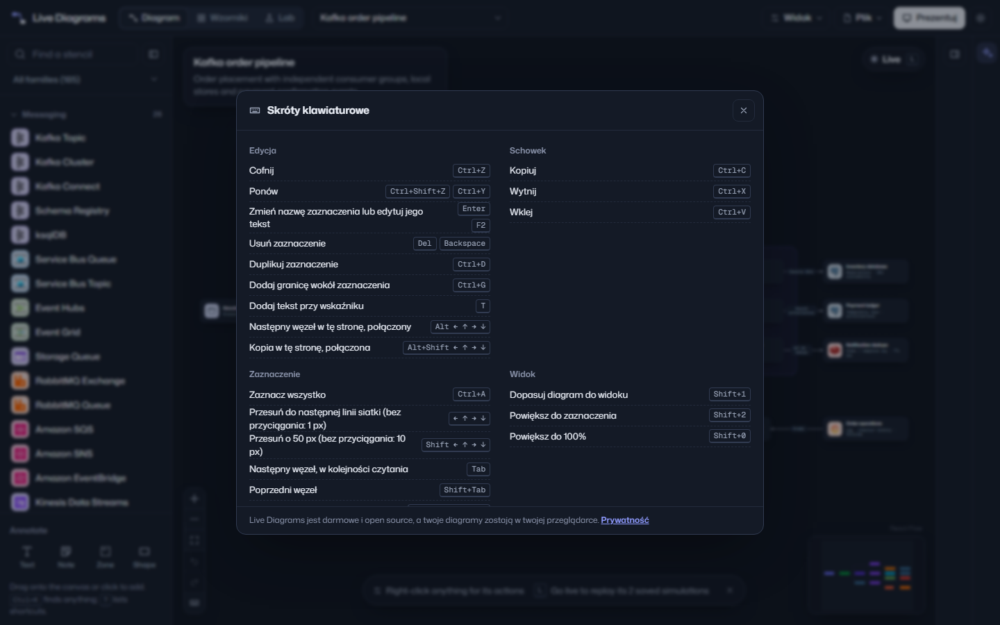

Also: `screenshots/round33/view-menu-language-1280-light.png`, `language-dialog-en-1280-light.png`,
`start-de-1280-light.png`, `start-bg-browser-1280-light.png`, `start-ar-rtl-1280-light.png`,
`start-zh-TW-1440-dark.png`, `canvas-en-1280-light.png`, `canvas-ar-rtl-1280-light.png`,
`file-menu-privacy-fr-1280-light.png`, `share-de-1280-light.png`, `start-pseudo-1280-light.png`,
`file-menu-pseudo-1280-light.png` and `clear-pseudo-1280-light.png`.

## Round 31: on-prem network devices (2026-10-13)

The gate for network infrastructure, batch 1 (`docs/research/network-infrastructure.md`): 19 router, switch, firewall
and ADC stencils, size presets, HA, firewall deny rules, ADC health checks, and the Branch office to data centre
example. Self-review against `docs/UX-PRINCIPLES.md` on the e2e production build (`vite preview`) at 1280 × 800 light
and 1440 × 900 dark, public examples only. Screenshots are in `docs/screenshots/round31/`.

- **Simple by default, and nothing new in the chrome.** No top-bar control, menu or panel was added:
  - **Finding a device** is the rail's search and the gallery: "3825" finds Cisco ISR (`palette-3825-1280-light`).
    The **On-prem network** category sits under Network (`gallery-1280-light`).
  - **Settings** are a device's **Simulation** section, folded like every node's.
  - **The firewall rule** sits in the connection's inspector, under Relationship.
- **One primary action per surface.** The device section's lead is **Size**: a select that names its model and its
  throughput ("Campus: PA-3440, 20 Gbps"). Under it, the throughput's placeholder is the preset's, and a note says what
  that is in messages ("About 39k messages/s per unit at 64 kB each. From the PA-3440 datasheet: approximate.").
  High availability, units, latency, message size and failover follow, each with a hint
  (`inspector-firewall-1280-light`, `inspector-firewall-1440-dark`).
- **Never colour alone.**
  - **On the canvas,** a deny rule is a "no entry" glyph just after the firewall plus a muted red line
    (`example-1280-light`, `edge-rule-1280-light`).
  - **In live view,** blocked messages are a neutral, dashed chip with the same glyph, "⊘ 20 blocked". It's never the
    red count, and the particles don't flash as they do for a failure (`live-blocked-1280-light`).
  - **The hover breakdown** says "Blocked by a deny rule" and the units ("2 · Active-standby pair")
    (`live-detail-1280-light`).
  - **A failing-over pair** says **failing over** in amber beside its rate (`live-failover-1280-light`).
- **Context over chrome.** Failing a unit is a row in the device's live **Behaviour ▸** menu ("Fail the active unit",
  then "Bring back every unit (2)"), shown only for a pair or a cluster (`live-behaviour-1280-light`). The Behaviour
  submenu has at most six rows.
- **Capacity reads the datasheets.** Show capacity colours each device against its ceiling: "1% · 440/s of 39k/s" on
  the firewall pair, "2% · 40/s of 2k/s" on the branch router (`live-capacity-1440-dark`). The heat map's words and
  the panel are unchanged.
- **Words.** Size, Units, High availability (Standalone, Active-standby pair, Active-active cluster), Firewall rule
  (Allow, Deny) and blocked are added to the vocabulary in `docs/UX-PRINCIPLES.md`. "Dropped" and "lost" are never
  used for a deny rule's work: the trace card's status reads **Blocked**, and slow motion's caption reads "Blocked ·
  by a deny rule".

### What was off (fixed in this round)

- **Size was a three-way toggle at first, and "Data centre" wrapped to two lines** in the 280 px inspector. It's a
  select now, which also has room for the model and its throughput, so the choice says what it means.
- **The rate note read "2k/s".** It says "messages/s" now, and where the number comes from.
- **The example was a nine-column line**, unreadable when fitted (about 35% zoom). It's drawn top to bottom, the way
  network diagrams usually run (internet and branch at the top, servers at the bottom), and fits at about 60%. The
  deny rule leaves the firewall's right side, so it doesn't cross the fabric.
- **A selected deny connection's end handle covered the glyph.** The glyph now sits 34 px along the connection.
- **A firewall's connection showed Consumer group and Dead-letter path,** which mean something only leaving a broker.
  They step aside where the Firewall rule shows.
- **Live counts of blocked messages were sampled dots** ("2 blocked" for 20). They're real messages now, like every
  other count.

### Code review (PR #86, first round)

- **A deny rule leaked on two paths:** a broker's deliveries and dead letters went around it. Every downstream
  delivery now goes through one place that blocks it, retries included, and capacity analysis blocks a broker's
  denied share too.
- **Blocked is its own outcome everywhere.** A trace step of its own kind, `block`, replaces "a drop with a special
  reason". The journey counts it apart, the sequence diagram's note is neutral and its summary says "1 blocked by a deny
  rule", slow motion ends on "Blocked by a deny rule" with no red flash, and the trace card says Blocked. A connection's
  accessible name, and the Ctrl+Alt edge announcement, say "deny rule: blocked".
- **A capacity multiplier no longer starts a failover.** Only a pair's own unit count going down during a run does.
- **Fractional throughput keeps its remainder.** A 60/s ceiling plays at 60/s at every sampling scale, not 50.
- **Custom properties hide a setting only where a control shows it.** An nginx with `gbps`, or a service's connection
  with `deny`, keeps it there to see, change or remove.
- **The "failing over" chip** uses `--warning-ink`: 4.5:1 or better in both themes (it was about 2.6:1 in light).

### Code review (PR #86, second round)

- **A denied route out of a broker isn't a consumer.** It took a partition and waited behind a full consumer group;
  now it takes neither, and capacity analysis treats it as the unbounded exit it is in playback. A topic whose only
  route is a deny rule reads "Nobody reads": its only route out is a deny rule, so every message is blocked.
- **One planner sizes devices.** Live view's capacity fix and the check's both come from the shared planner, and
  Save to diagram keeps a device's units under Capacity ×.
- **The Firewall rule is a named radio group:** one Tab stop, the arrow keys, Home and End move the choice. So are Flow
  direction and Text size, which use the same control.
- **Numbers stay in range:** a negative throughput becomes 0, a zero message size the smallest allowed, before the
  diagram sees them. Health checks stay in Custom properties on a device that isn't a load balancer.
- **The event log's kind column fits "blocked".**
- **A malformed `deny` in a file reads as deny,** with a warning: a firewall rule never quietly turns into Allow.

### Still open (owner's call)

- At 1280 the gallery's family chips fold **Network vendors** (and Generic & clients, as before) into Vendor ▾'s
  "More families". That's the row's designed overflow, but the new family is one more chip there.
- Devices use glyphs, not logos (`docs/ICONS.md`). If logos are wanted, a small vendor badge from Simple Icons could
  sit on the glyph for the six brands it covers; four (Check Point, Arista, HPE Aruba, NetScaler) have none.

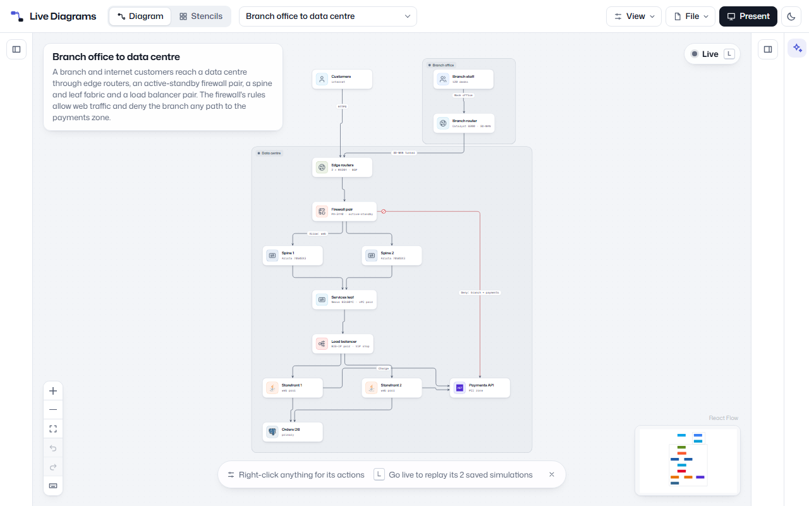
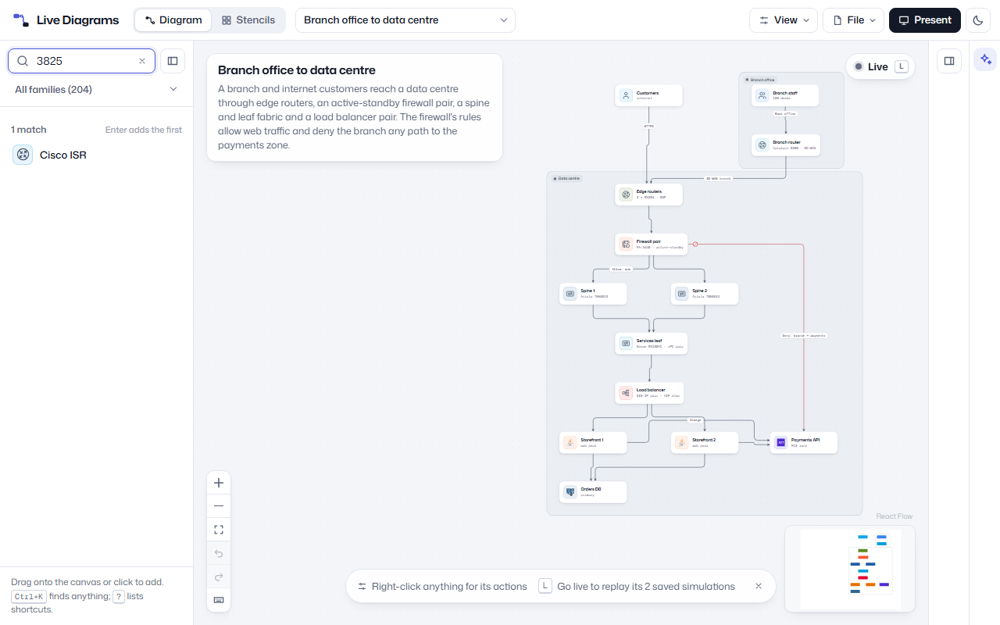
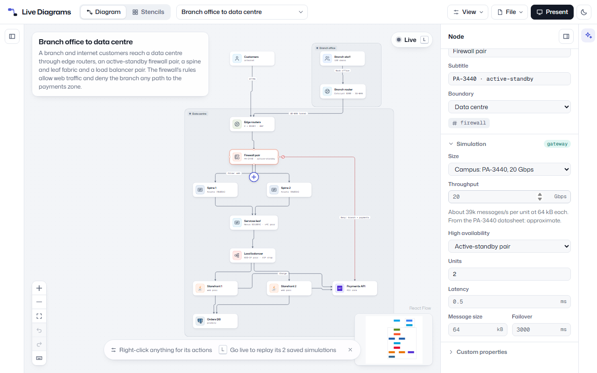
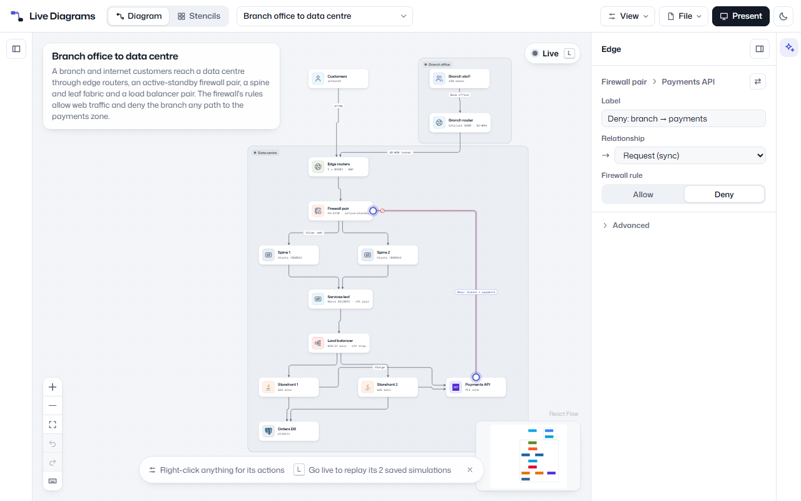
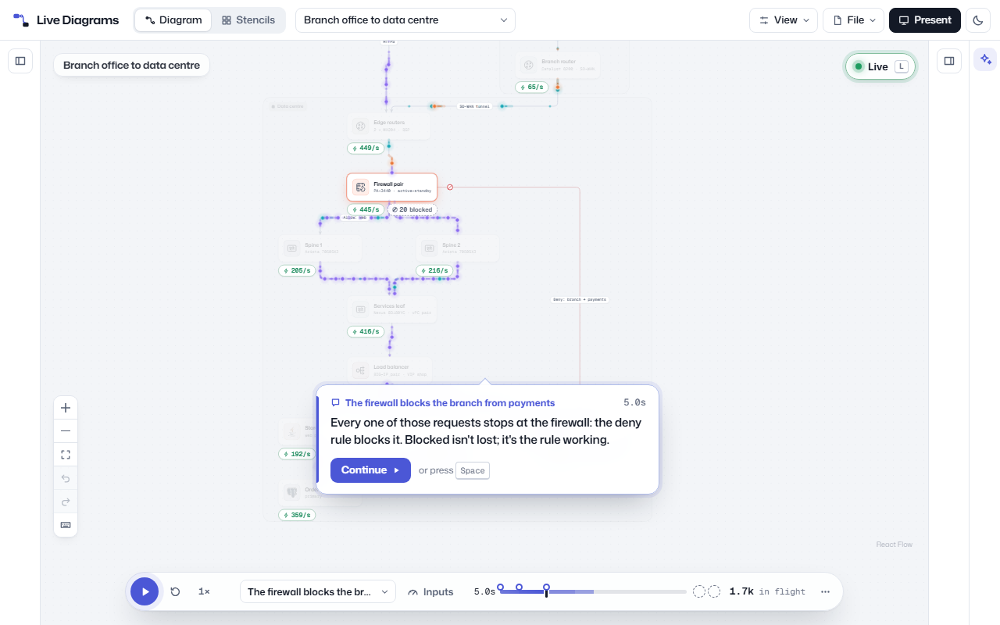
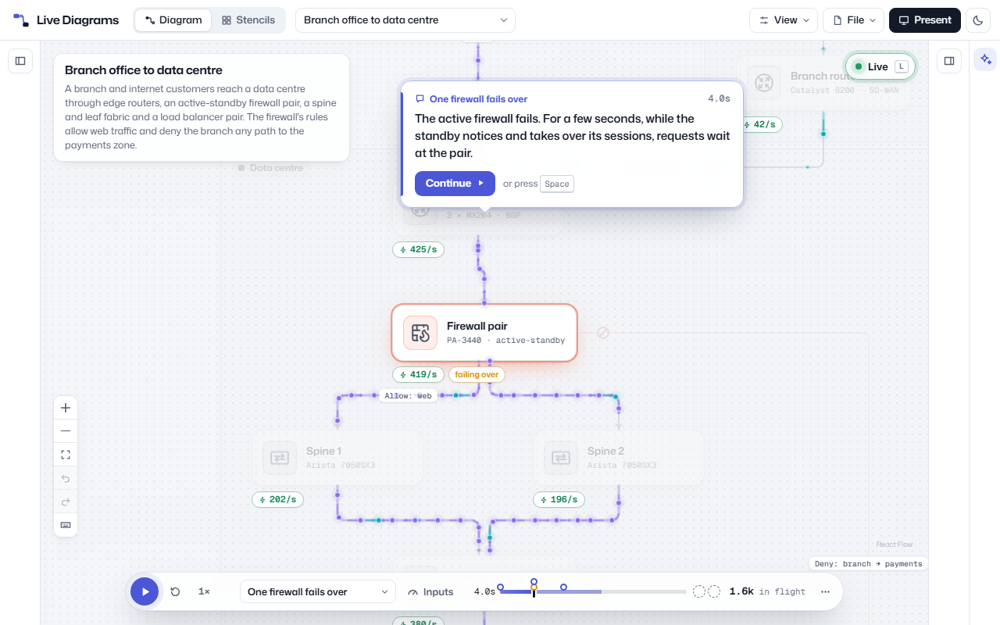
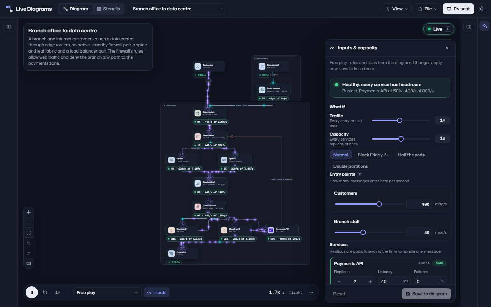

Also: `screenshots/round31/inspector-firewall-1440-dark.png`, `live-detail-1280-light.png`,
`live-behaviour-1280-light.png` and `gallery-1280-light.png`.

## Round 30: the live simulation explains itself (2026-10-13)

The owner built a small diagram and went live: Incoming traffic (2/s) → .NET Service → Kafka Topic, and .NET Service →
App Configuration → Key Vault. Live said "Kafka Topic can't keep up at all. It's paused or down, or no consumer can take
its messages", the topic showed "No capacity · 2/s waiting" and a lag that kept climbing, raising partitions from 3 to
9000 changed nothing and nothing said why, and every request went through App Configuration (the edge was drawn while
the node was generic, and stayed a flow when it became App Configuration). Self-review against
`docs/UX-PRINCIPLES.md` on the production build (`vite preview`) at 1024 × 768 and 1280 × 800 light and 1280 × 800 and
1440 × 900 dark, on the owner's diagram rebuilt by hand and a queue and a stream variant of it (no private diagrams).
Screenshots are in `docs/screenshots/round30/`.

- **Say what it is, not what it isn't.** A topic nobody reads isn't overloaded: Kafka keeps what's published, and lag
  is per consumer group, of which it has none. The banner now says **Nobody reads Kafka Topic**, "It keeps what's
  published, but nothing consumes it. Partitions can't change that: add a consumer." The badge says **Nobody reads this
  yet · 15 kept**, the hover card **Kept** with one line on why there's no lag, and the heat map paints it amber, a
  warning, never the pulsing red of an overload; its backlog glow stays faint (`nobody-reads-1280-light`,
  `nobody-reads-hover-1280-light`). An Event Hubs or Kinesis stream reads the same (`stream-nobody-reads-1280-dark`).
- **A queue keeps its waiting words**, because its messages do pile up: **11 queued**, **No consumer · 2/s waiting**,
  in red, with the same headline and action (`queue-nobody-reads-1024-light`).
- **One primary action, named for the change.** The callout's one button is **Add a consumer**: a service one gap
  downstream, reading the topic, named for it ("Kafka Topic consumer"), in the stencil of the service that publishes
  to it, one undo step, with a toast and Undo. The view refits to show it, clear of the Inputs panel when that's open.
  The run restarts with the consumer, and the topic's ring turns green (`add-consumer-1280-light`). It's offered
  editing and live, never presenting or in the read-only viewer.
- **Paused and down keep their own words** ("Kafka Topic is paused"), separate from nobody reading it. "Can't keep up
  at all" is left for a broker whose consumers can't take any of its messages.
- **Teach in place: partitions.** The inspector says under Partitions, in the app's voice: "How many consumers in one
  group can work in parallel. It doesn't speed up publishing." (`partitions-note-1280-light`). The Inputs panel, once
  partitions are raised past the saved value where they can't help, says why under the stepper: "Nobody reads it yet,
  so more partitions change nothing." or "Its consumer group has 1 replica: partitions past 1 add no speed."
  (`partitions-raised-panel-1440-dark`). It says nothing at the saved value, so the default 3 partitions with one
  consumer replica isn't nagged about.
- **No surprises: a stencil change re-infers its edges, with Undo.** Turning a generic node into App Configuration
  turns the flow from the service into **Config**, in the same undo step as the stencil, and the toast says so: "1
  connection is now Config: no messages flow over it", **Undo** (`reinfer-toast-1280-light`). A node that stops being
  a config store turns what was inferred back into flows ("1 connection is a flow again: messages flow over it in
  Live"). A relationship someone chose (the Relationship menu, the inspector, Make it a flow) never changes by itself:
  edges remember who set it (`relationOrigin`). The same happens from the inspector (one node or a bulk edit), Change
  stencil on the right-click and in Ctrl+K, and the agents' `update` op, whose result lists the connections.
- **Why nothing flows over Config and Secret.** The edge's tooltip and inspector say "Read at startup and refreshed,
  not on every request, so no messages flow over it." (`config-note-inspector-1280-light`). The Secret menu hint
  matches: "Secrets it loads, then refreshes" (it said "usually once").
- **Everywhere the state appears says the same.** Slow motion: "kept in Kafka Topic: nobody reads it", ending on "Kept
  in Kafka Topic, unread"; the trace card's status **Kept** (a queue: **Waiting**); the Checks' `no-reader`: "it keeps
  every message, unread" for a topic, "messages pile up" for a queue; `check_diagram` uses that rule, and
  `describe_diagram` now names a dependency's relationship ("config dependency") instead of its unused kind.

### Also fixed (found here)

- **A live hover card was painted under the node below it**: each metric badge is its own stacking context, so a later
  node's status or capacity ring showed through the card (the owner's report). The hovered badge comes first now; so
  does a node with its dependency list open, and, live, the edge label layer while a config edge's settings card shows
  (`hover-above-node-1440-dark`; `tests/e2e/hover-stacking.spec.ts`, both themes).
- **Slow motion called a service's backlog "lag"** ("Still waiting at Payments service · lag 1,240"). It's "1,240
  waiting" now; a queue's is "queued"; only a topic's or stream's is lag.

### Bigger ones, listed for the owner (not built)

- **Add a consumer restarts the run**, as every topology edit in live view does, so what the topic kept isn't read by
  the new consumer: the count starts again from zero. Real Kafka would read it only with `auto.offset.reset=earliest`.
  Carrying broker state across a topology change is engine work.
- **A stencil change keeps the node's name**: a generic "Service" that becomes App Configuration is still called
  "Service" (its subtitle shows the stencil). Renaming a node that still has its old stencil's default name would be
  small, but it's a naming rule of its own.
- **An agent's `connect` without `relation` makes a flow** even into Key Vault (documented: "Leave out for a flow"),
  where drawing on the canvas infers the dependency. Changing that changes the op contract.
- **Imports that infer dependencies** (Terraform, AsyncAPI, Kubernetes) don't mark them `inferred`, so a later stencil
  change leaves them as they are (the safe direction).
- **Dependencies never fail in the simulation**: a Key Vault or App Configuration outage changes nothing
  (`docs/research/diagram-semantics.md`, phase 3).

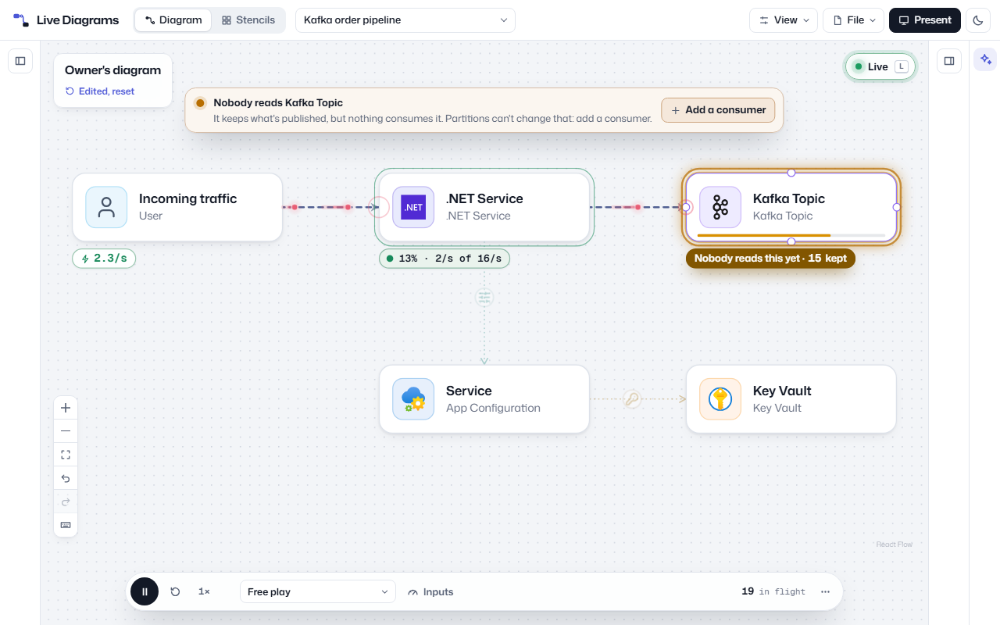
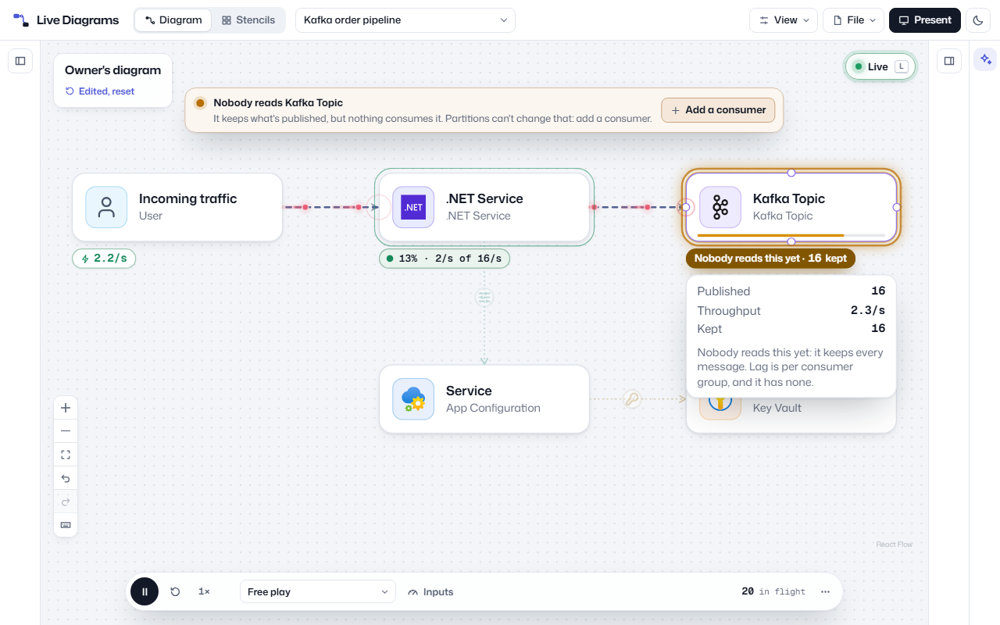
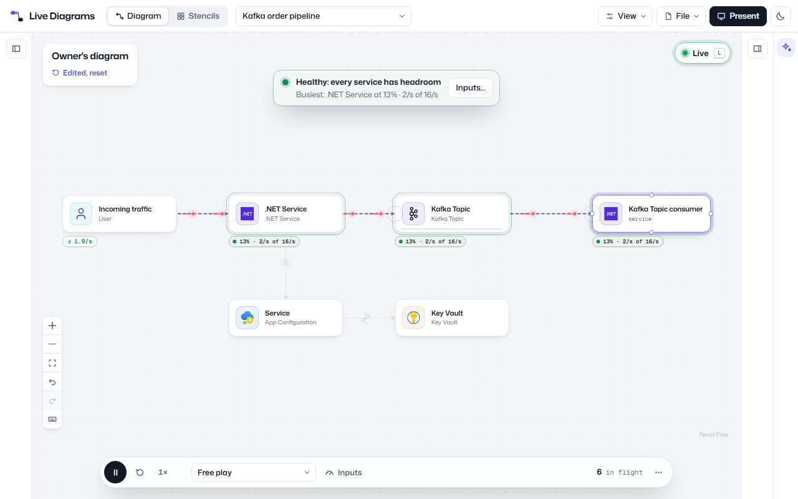
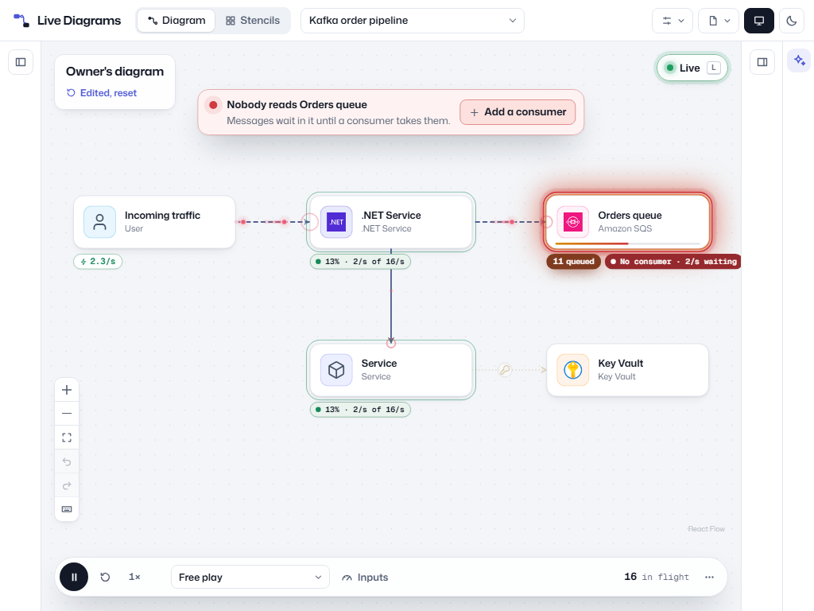
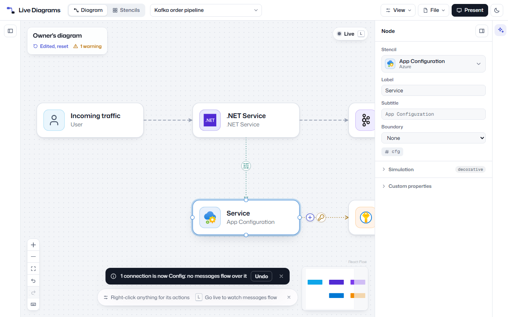
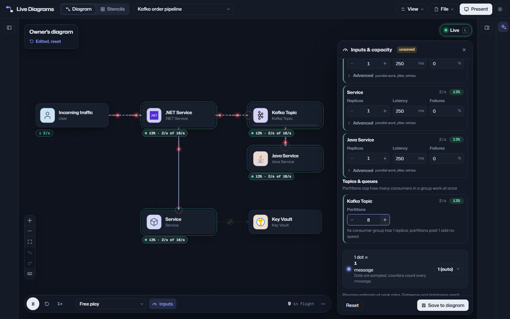

Also: `screenshots/round30/stream-nobody-reads-1280-dark.png`, `partitions-note-1280-light.png`,
`config-note-inspector-1280-light.png` and `hover-above-node-1440-dark.png`.

## Round 28: checks, the owner's decisions (2026-10-13)

The gate for the owner's four decisions on the checks (`docs/research/architecture-checks.md`, "Owner's decisions
(2026-10-13)"): one identity per service by default, Run simulations never fixing, Run simulations from Ctrl+K and the
canvas right-click, and `entry-gateway` staying quiet without a drawn gateway (no change). Self-review against
`docs/UX-PRINCIPLES.md` on the production build (`vite preview`) at 1024 × 768 and 1280 × 800 light and 1440 × 900
dark, public examples only: Notification fan-out (two services read Key Vault), Kafka order pipeline as it is, and
Kafka order pipeline with its payments consumer retrying in place (the one change that makes a simulation lose
messages). Screenshots are in `docs/screenshots/round28/`.

- **One primary action per surface holds.** The identity row's one button is now one identity for each service, **Add
  managed identities**; sharing is the quiet chip under it, **or One shared identity** (`identity-each-1280-light`).
  Applied, the toast names what it added ("Added Email sender identity, SMS rate limiter identity · Undo"), and each
  identity lands beside its service in the boundary they share (`identity-each-applied-1280-light`).
- **Run simulations reports; the static checks fix.** "Messages are lost at orders.created.v1" says what was lost,
  where and how many, with the topic and the consumer that failed as chips, and no button and no fix chips: the row
  ends at ⋯ (`dropped-no-fix-1280-light`). A count on a static finding keeps that finding's own fix.
- **Context over chrome.** Run simulations reaches Ctrl+K (`palette-run-1280-light`) and the canvas right-click, under
  Check diagram with the simulations' bolt (`canvas-menu-run-1280-light`), only while editing a diagram with saved
  simulations. No top-bar control, no View menu row: View holds toggles, and Run simulations is an action. From either
  place the card opens and the run plays in it, so the result reads where it always did
  (`palette-run-played-1280-light`); while it plays the same row says **Stop simulations**.
- **Budget.** The canvas menu has 11 rows of its 12 on a diagram with saved simulations (Add node here, Annotate, AI
  panel, Paste here, Select all, Auto-layout, Check diagram, Run simulations, Diagram properties, Show, Export), 10
  without. The next row there means folding one.
- **Words.** "Run simulations" and "Stop simulations" match the card's link (which says "Stop" beside its own status
  line). "One shared identity" says the difference from the button; with services on two clouds it's "One shared per
  cloud".
- **Widths and themes.** At 1024 the 290 px card keeps the button on one line (`identity-each-1024-light`); dark reads
  as light does (`identity-each-1440-dark`).

### What was off (fixed in this round)

- **A long fix label widened the row past the card.** The first label, "Add a managed identity for each service", was
  wider than the 290 px card's row: the row grew, and the message and chips were cut off at the card's right edge, at
  1280 and worse at 1024. Two fixes: the label is the plural, "Add managed identities" (IAM roles, service accounts;
  the chip says what's different), and a row is now one column that never grows past the card, its fix button
  wrapping its words instead (`checks.css`). The second also covers any long label to come ("Go through …" with a
  long gateway name).

### Still open (owner's call)

- A run started from Ctrl+K or the right-click doesn't move focus to the card's link. Its status line is a polite live
  region, so progress is still announced, and Esc on the canvas stops it first, as from the card.
- The canvas right-click is one row from its budget.

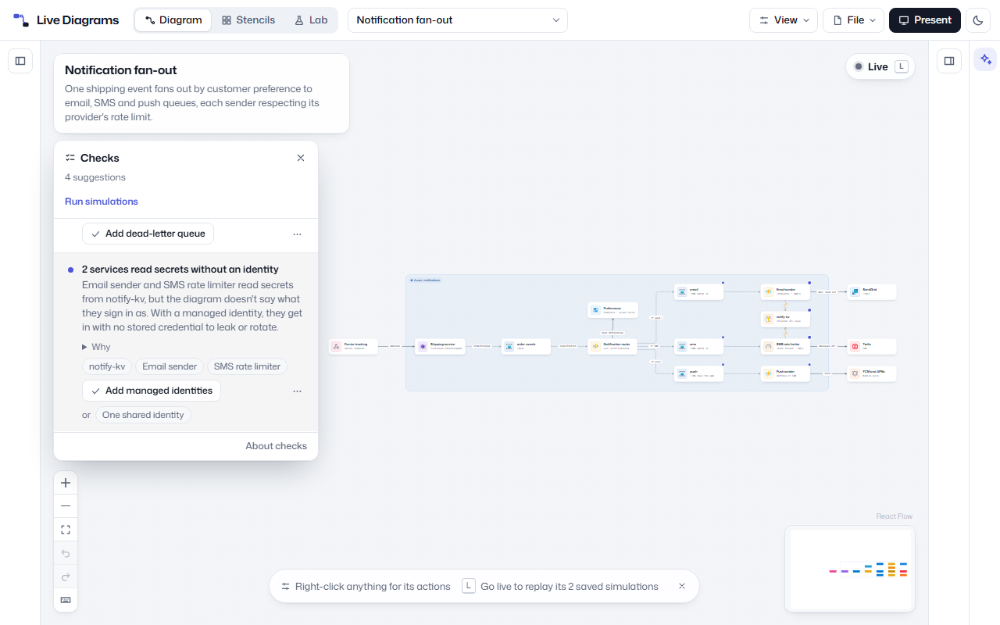
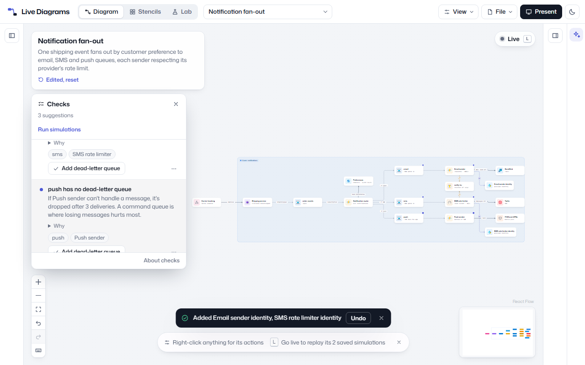
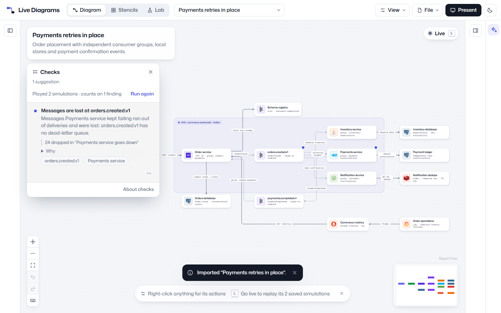
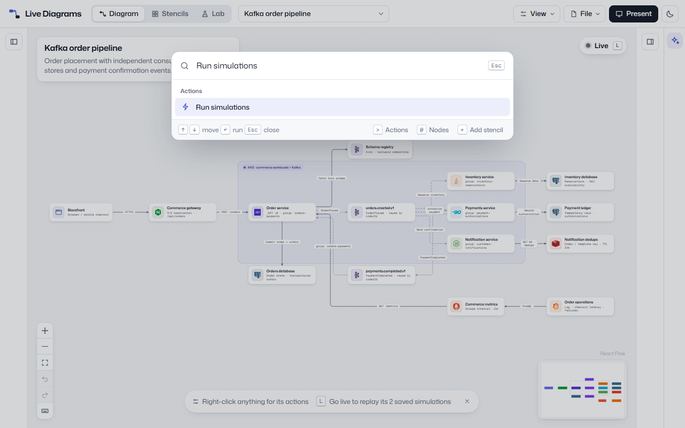
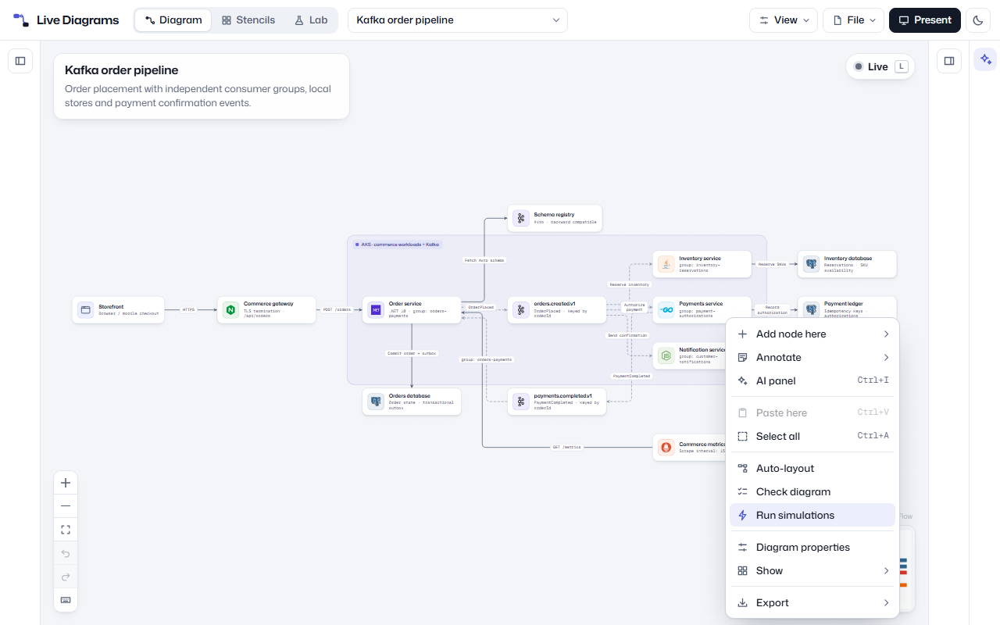

Also: `screenshots/round28/identity-each-1024-light.png`, `identity-each-1440-dark.png` and
`palette-run-played-1280-light.png`.

## Round 29: full screen while presenting (2026-10-13)

A friend's request: "in presenter mode, we should have a toggle for full screen." Self-review against
`docs/UX-PRINCIPLES.md` on the production build (`vite preview`) at 1024 × 768 and 1280 × 800 light and 1440 × 900
dark, mouse and keyboard, on the public Kafka order pipeline. Screenshots are in `docs/screenshots/round29/`.

- **No new chrome outside presenting.** The top bar, menus and Ctrl+K are unchanged. Presenting gains one icon button
  beside **Exit presentation**, in its style: the same height, border and slightly quiet opacity (0.9), full on hover and focus
  (`present-1280-light`, `present-hover-1280-light`, `fullscreen-on-focus-1280-light`). It sits left of Exit, so
  Exit stays in the corner where people already reach for it.
- **The icon says the state.** Corners out for **Full screen** and corners in for **Exit full screen**. That's also
  the button's accessible name and its tooltip, which names the key: "Full screen (F)" (`fullscreen-on-1280-light`).
  The name changes rather than `aria-pressed`, so a screen reader never hears "Exit full screen, pressed".
- **F, because presentations use it.** It's free in presenting: L is Live, C is capacity, Space plays and the arrows
  step slow motion. While editing, F does nothing (an editing shortcut would surprise; T adds text). The shortcuts
  sheet's **Live and presenting** rows list it, and Esc's row now starts with full screen (`shortcuts-1280-light`).
- **Esc stays one level.** Browsers take the first Esc themselves to leave full screen. Where one passes it on, the
  app does the same and stops it there, so the same press never also leaves the presentation; the next Esc does.
  The Esc order in the principles now starts with full screen. Leaving the presentation any other way (Exit
  presentation, Back, opening another diagram) leaves full screen too.
- **It follows the browser.** The button listens to `fullscreenchange`: leaving with the browser's Esc, F11 or its
  own "Exit full screen" bar flips it back.
- **The whole page goes full screen** (the document element), not the canvas. The live simulation, slow motion, the
  trace card, dialogs and toasts (some portalled to `<body>`) keep working and stay on screen, and the theme's own
  background fills it, so there's no `::backdrop` to style (`live-fullscreen-1440-dark`). A diagram shown whole is
  refitted to the bigger pane; one the presenter zoomed into stays put.
- **Not offered where it can't work.** When `document.fullscreenEnabled` is false (iOS Safari, an iframe without
  `allow="fullscreen"`) there's no button and F does nothing: the bar is as it was (`unavailable-1280-light`).
- **Embeds and the HTML viewer: no.** Neither has a presentation, so there's no presenter's full screen to offer. The
  embed snippets don't gain `allow="fullscreen"`, and `docs/EMBEDDING.md` is unchanged.
- **Policy.** The Permissions-Policy doesn't name `fullscreen`: its default allowlist is `self`, which is what the app
  needs. `csp.spec.ts` now checks `allowsFeature("fullscreen")` and goes full screen under the policy with no
  violation.

### What was off (fixed in this round)

- **The Live toggle sat 3 px from Exit presentation** while presenting, tighter than the 8 px between the bar's
  buttons. It's 8 px from whichever is next to it, with or without the full-screen button (`live-present-1024-light`).
- **"Present: full screen for meetings"** was the Present button's tooltip, but presenting only hides the editing
  chrome. It's "Present: the diagram alone, for meetings (Esc to leave)" now; full screen is the new button.

### After code review (PR #81)

Seven P2s from the Codex review, in three themes. All verified; each fix has a test that fails without it.

- **Esc's order depended on which listener was added first** (3 findings). Window capture listeners run in the order
  they were added, so a layer listening from before the presentation (slow motion started first, say) got an Esc the
  browser passed on before full screen did, and backed out of itself instead. The full-screen Esc is now one listener
  added before any other code runs (`src/lib/fullscreenEscape.ts`, imported first by `src/main.tsx`), so it's first
  by construction, whatever was entered first; it costs the entry 71 B gzip. Headless Chromium usually takes
  Esc itself while full screen (as browsers do), so the tests send Esc to the page as a browser that passes it on
  would: one with slow motion started before presenting, one with a stand-in layer that claims Esc. Both fail with the
  listener added on the presentation's mount.
- **A full-screen request still on its way when the presentation ended** (2 findings) arrived afterwards and left the
  editor full screen with no button. Entering now checks, when it arrives, that the presentation is still on, and
  leaves at once if not (unit test with a request held open).
- **The icon read at 2.4:1 at rest** in the light theme (opacity 0.55). Exit presentation's words, at the same
  opacity, read at 2.4:1 too. Both rest at 0.9 now: the icon at about 5:1 and the words above 4.5:1 in both themes,
  measured as composited over the canvas by a test.
- **The refit had no test.** One squeezes the pane and checks every node fits again after going full screen and after
  coming back; another zooms by hand and checks the view is kept both ways (on a paused clock run past the refit).

### Still open (owner's call)

- Presenting doesn't go full screen by itself. It could on entry (a click on Present is a user gesture), but a
  presenter sharing one window in a call often doesn't want the whole screen. One click or F is cheap.
- There's no Ctrl+K entry for full screen: the button and F are on the presenter's screen already, and an entry
  would only apply while presenting.

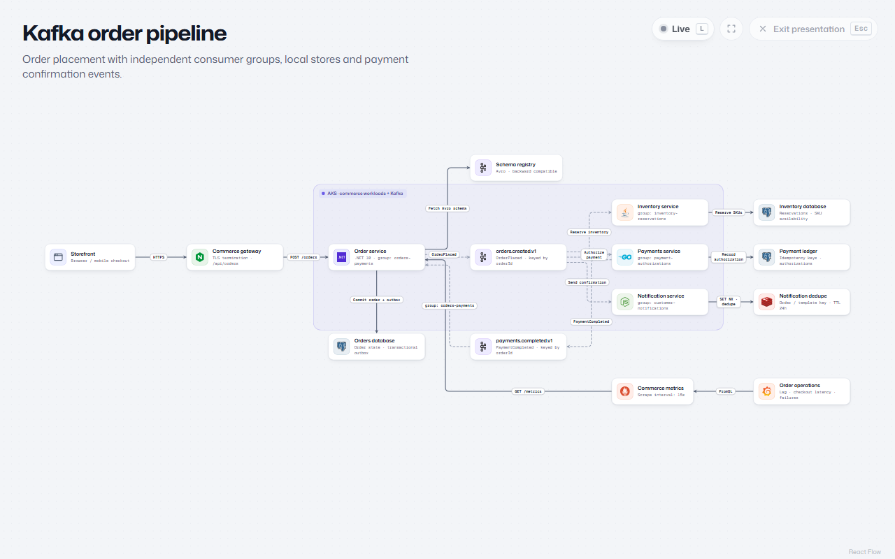
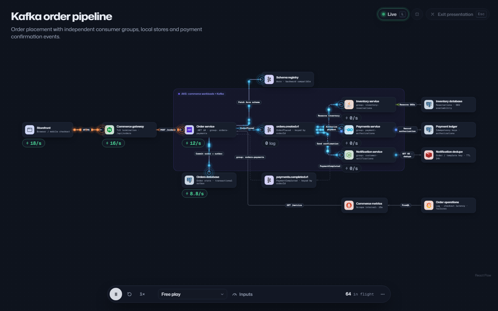
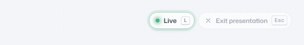
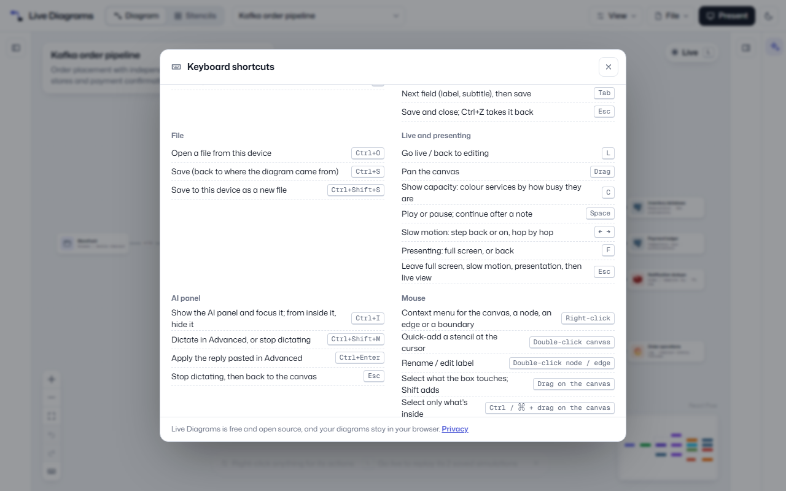

Also: `screenshots/round29/present-hover-1280-light.png`, `fullscreen-on-1280-light.png`,
`fullscreen-on-focus-1280-light.png` and `live-present-1024-light.png`.

## Round 27: Share…, safest first (2026-10-13)

The gate for Round 21's three sharing proposals, which the owner approved: "the safe options up top. As long as we have
a way to make it public, you can opt into having it public, but private should be the first option." One **Share…**
chooser instead of three File menu rows, the password link above the plain link, and **New diagrams are private**
offered at the first infrastructure import. Self-review against `docs/UX-PRINCIPLES.md` on the production build
(`vite preview`), Chrome driven by Playwright, at 1024 × 768, 1280 × 800 light, 1440 × 900 dark and a 390 px phone,
mouse and keyboard; and on a build with the internal switches (no share links, new diagrams Private). The Kafka example,
a private copy of it, and the public docker-compose test fixture. Screenshots are in `docs/screenshots/round27/`
(`before-*` is the build before this round).

- **The File menu shrinks.** Copy share link, Copy link with password… and Embed code… are one row, **Share…** ("Files,
  embeds and links, safest first"), beside Privacy: 11 rows to 9 (`before-file-menu-1280-light`,
  `file-menu-1280-light`). The right-click's Export ▸ goes from three link rows to the same **Share…**
  (`before-rightclick-export-1280-light`, `rightclick-export-1280-light`), and Ctrl+K finds it as "share" or "link".
- **Safe first, and the keyboard lands there.** A dialog, **Share** ("Safest first. Each says who can open what it
  makes."), with one row per way out, each saying who can open what it makes: **Interactive HTML…** ("Anyone who has
  this file can open it. A password is optional."), **Diagram file**, **Embed in your app…** ("Your app supplies it
  (private): the diagram never leaves your app.") and **Link with password…** (`chooser-1280-light`,
  `chooser-1440-dark`, `chooser-1024-light`). Focus is on Interactive HTML, so Enter does the safest thing; the arrows,
  Home and End walk the rows. No primary button: the list is the choice, as in the draw.io page picker.
- **Public takes a deliberate step, every time.** Below a rule, one quiet line, **Public link or embed · anyone with the
  link can open it**, folded. Enter (or a click) on it shows **Share link…** and **Embed on a public page…**, each
  saying **Public:** first, and keeps the keyboard on the line, so nothing is made or copied by the step itself
  (`chooser-public-1280-light`, `chooser-public-1440-dark`, `chooser-public-390-light`). Share… opens folded again each
  time. Folded rather than just below the rule: there, ArrowDown from Link with password would walk straight into
  Share link; folded, no key reaches a public row until the step is taken.
- **A Private diagram lists what it allows, and says why.** Interactive HTML, Diagram file and Embed in your app, then
  one line: **Links and public embeds are off for a private diagram. Make it not private…**, which opens the Private
  diagram dialog (Keep private its default) (`chooser-private-1280-light`, `chooser-private-1440-dark`). The File menu
  row says "Files, or an embed your app supplies" (`file-menu-private-1280-light`). The off rows of before, faded in
  place (`before-private-file-menu-1440-dark`), are gone: the line says it once.
- **Links off (a company's own copy): the three rows, nothing else.** No Link with password, no public line, and no
  sentence about links, since this copy has none to explain (`chooser-internal-1280-light`). With only link opening
  off, Share… is as on the public site.
- **Each row reuses its dialog**, which takes Share's place. Embed code opens on one kind: Embed in your app shows only
  the host-supplied embed, with no source switch (`embed-private-1280-light`); Embed on a public page shows In the
  link, and Example by name for a pristine public example (`embed-public-1280-light`). The Share link dialog's Copy
  link now says who can open it in its toast, as the one-click copy used to (`share-link-1280-light`).
- **Ask about Private when it matters.** The first Import report of an infrastructure file shows, under **Make it
  private**, an unticked **New diagrams are private · File ▸ Privacy** (`before-import-report-1280-light`,
  `import-report-offer-1280-light`, `import-report-offer-1440-dark`). Ticked, it's that setting. It's asked once (the
  report that shows it remembers that it asked), never while the setting is on (the internal build), and Clear
  everything on this device asks again. It never turns on by itself: Private turns AI off.

Every entry point still works:

| Before                                           | Now                                                                                                                             |
| ------------------------------------------------ | ------------------------------------------------------------------------------------------------------------------------------- |
| File ▸ Copy share link (one click, toast)        | File ▸ Share… ▸ Public link or embed ▸ Share link… (the dialog's Copy link)                                                     |
| File ▸ Copy link with password…                  | File ▸ Share… ▸ Link with password…                                                                                             |
| File ▸ Embed code…                               | File ▸ Share… ▸ Embed in your app…, or ▸ Public link or embed ▸ Embed on a public page…                                         |
| Right-click Export ▸ the same three              | Right-click Export ▸ Share…                                                                                                     |
| Ctrl+K "Export › Copy share link" (and the rest) | Ctrl+K "Export › Share…" (found by "share", "link", "password", "embed")                                                        |
| A keyboard shortcut                              | There was none for Copy share link, and none is added                                                                           |
| The refusal toast's Interactive HTML…            | Unchanged; a link dialog that closes because the diagram turned private now offers it too                                       |
| WebMCP `get_share_link`                          | Unchanged for agents                                                                                                            |
| The AI panel                                     | Nothing in it pointed at the rows; "Your coding agent" now says the skill replies with an HTML file, the diagram file or a link |

### What was off (fixed in this round)

- **One thing, two names.** The new row said Link with password… and its dialog was titled "Copy link with password",
  as was the Share link dialog's alternative. The dialog, its loading frame and the alternative now say **Link with
  password**.
- **The Diagram file toast didn't say who can open it** ("Exported 15 nodes and 15 edges."). It adds "Anyone who has
  this file can open it." From Share… the row saves at once, so the toast is where it's said after the click.
- **A link dialog closed by a diagram turning private said why, but offered nothing.** The plain refusal now carries
  **Interactive HTML…**, like the refusal that used to follow a one-click copy.
- **The public embed's note pointed at a source its dialog no longer had** ("choose Your app supplies it"). It says
  "use Share… ▸ Embed in your app."
- **The fold's `aria-controls` named an element that wasn't there** while folded. It's set only while open.
- **At phone width the rows' file extensions squeezed their words** to three lines. Under 480 px they're hidden.

### After code review (PR #83, five findings, all fixed)

- **A public embed could turn into the private kind.** Open on a diagram another tab made private, Embed on a public
  page swapped itself for the host-supplied embed: a different integration from the one picked. The dialog's kind is
  now fixed when Share… opens it; a public one closes, with the refusal's **Interactive HTML…**, and Embed in your app
  stays, saying the diagram is private.
- **The file hints fell under 4.5:1 on a focused or hovered row** (both themes). They take the darker muted colour
  there, and the a11y scan now opens Share… from the keyboard with one row focused and another hovered.
- **Opening Share… exported the whole diagram and threw it away** (a big one, before the list could show). It checks
  only that a diagram is on the canvas; the row picked reads it.
- **Tests:** the share link's round trip copies with **Copy link** and opens what the clipboard holds, and Share… is
  shown to close when another diagram opens (Back or Forward), whether loaded or still downloading. A dev-server test
  counts the export's own read (`getOriginal`) to show opening Share… makes none.

### Decisions, so they can be revisited

- **Esc from a dialog Share… opened closes it** and gives the keyboard back to where Share… was opened (the File
  button), rather than returning to Share…: picking a row is the choice, and a dialog that closes after its action
  (Download HTML) would otherwise bring the chooser back.
- **Refusal toasts keep pointing at Interactive HTML…**, the first row, not at Share…: one click to the safe way.
- **The offer lives in the report**, not the import toast, whose one action is Details. "Asked once" means shown once:
  an import whose report is never opened hasn't asked.
- **Bundle.** The chooser is its own chunk (1.6 kB gzip, and 0.7 kB of CSS), warmed with the other dialogs when the
  File menu opens. The entry grew 54 B gzip (102,658 to 102,712): the one-click copy's code left it, and the privacy
  gates (`src/lib/localOnly.ts`), already loaded at startup as a preloaded chunk, now sit in the entry, one request
  fewer (`src/lib/bundleSplit.build.test.ts`'s pinned list says so).

### Which option should I use (as Share… lists it)

| You want to…                                          | Where                                                       | Who can open it                                   | Private diagram |
| ----------------------------------------------------- | ----------------------------------------------------------- | ------------------------------------------------- | --------------- |
| Send a work diagram to colleagues to look at and play | Share… ▸ **Interactive HTML…**                              | Anyone who has the file                           | Yes             |
| …and it may be forwarded beyond them                  | Share… ▸ **Interactive HTML…** ▸ **Require a password**     | Anyone with the file and the password             | Yes             |
| Let someone keep editing it                           | Share… ▸ **Diagram file** (or Save)                         | Anyone who has the file                           | Yes             |
| Show it in your intranet or app, behind its sign-in   | Share… ▸ **Embed in your app…**                             | Whoever your app lets in; never in a URL          | Yes             |
| A link for a few people                               | Share… ▸ **Link with password…**                            | Anyone with the link and the password             | No (says why)   |
| A quick link for a public or personal diagram         | Share… ▸ Public link or embed ▸ **Share link…**             | Anyone with the link                              | No (says why)   |
| Show it on a public page (blog, docs)                 | Share… ▸ Public link or embed ▸ **Embed on a public page…** | Anyone who can see the page                       | No (says why)   |
| A picture                                             | **Export PNG** / Export as ▸ **Image…**                     | Anyone who has the file                           | Yes             |
| Keep it in your own cloud storage                     | **Save to ▸** Google Drive, OneDrive or Dropbox             | Your account, and whoever you share it with there | No (says why)   |

A company's own copy without share links (docs/SELF-HOSTING.md) lists only the two files and Embed in your app. The
skill offers the same order (`skills/livediagrams/reference/outputs.md`).

### Still open (owner's call)

- **Copy share link's one-click habit is gone**, as Round 21 said it would be: a public link is now File, Share…, the
  public line, Share link…, Copy link. That's the deliberate step; a shortcut or a palette command straight to it
  would undo it.
- **Pictures and cloud saves aren't in Share….** They stay File ▸ Export PNG / Export as and Save to ▸; adding them
  would make Share… a second File menu.
- **`public/privacy.html` keeps its effective date**: it now names Share… and orders the ways out safest first, but no
  practice changed.

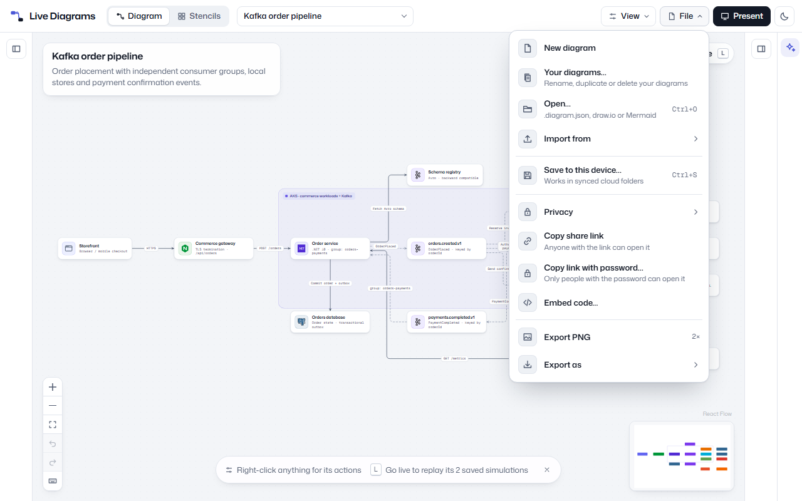
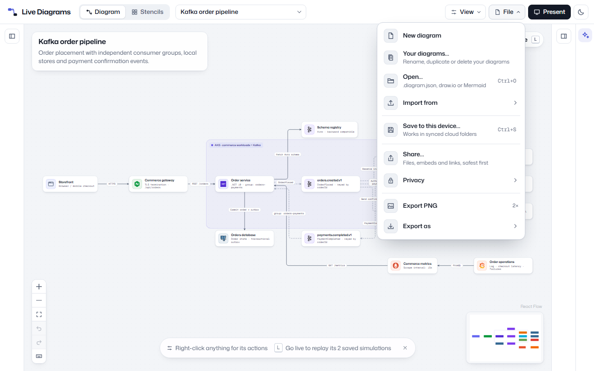
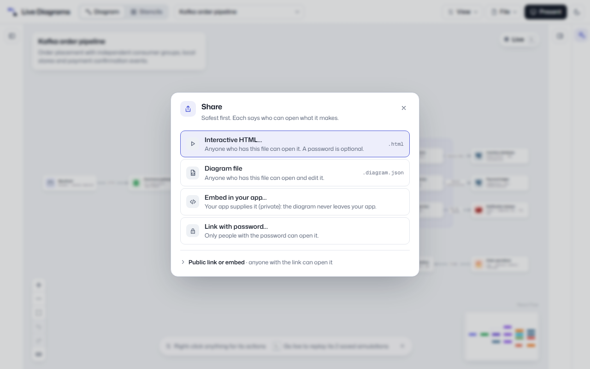
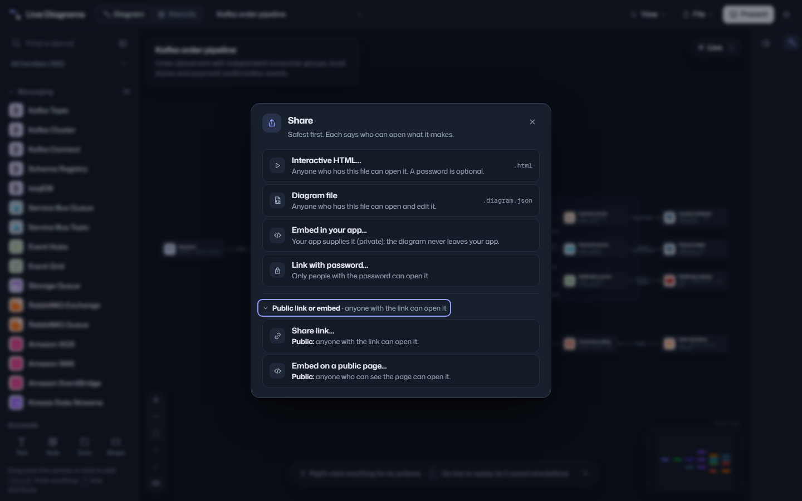
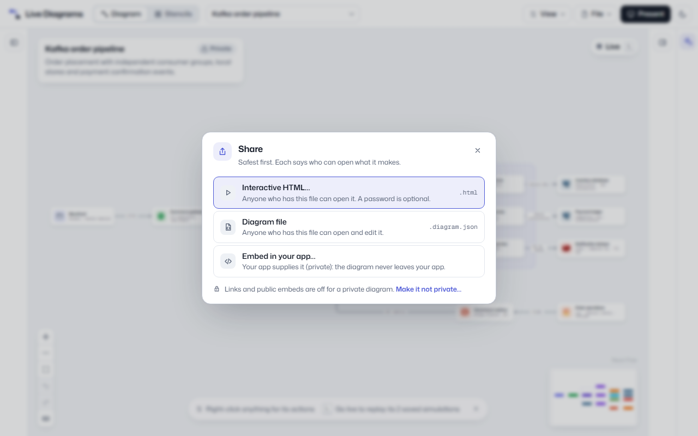
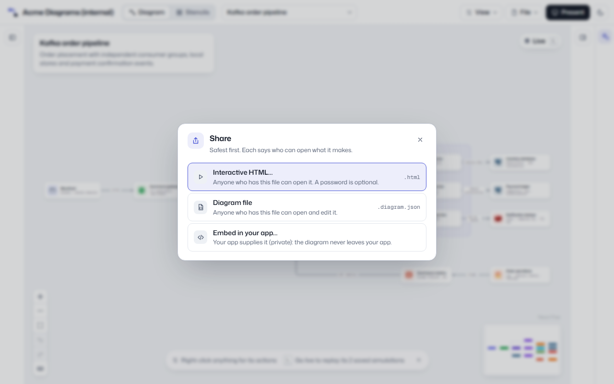
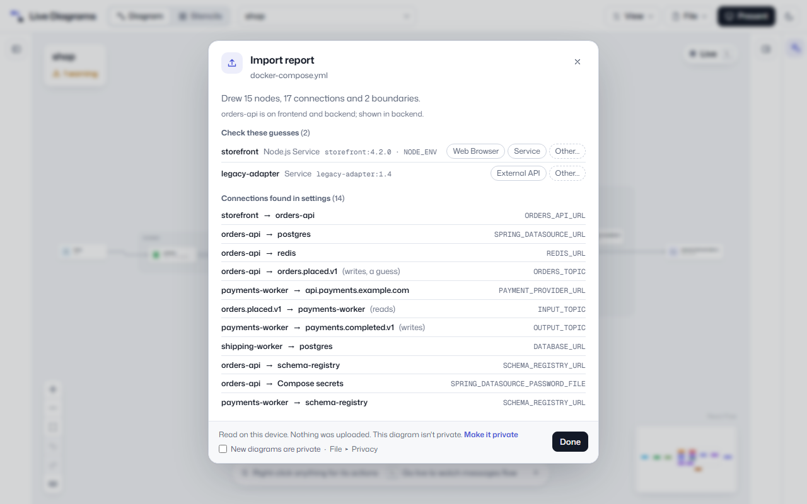

Also: `screenshots/round27/before-rightclick-export-1280-light.png`, `before-private-file-menu-1440-dark.png`,
`before-import-report-1280-light.png`, `rightclick-export-1280-light.png`, `file-menu-private-1280-light.png`,
`chooser-1440-dark.png`, `chooser-1024-light.png`, `chooser-public-1280-light.png`, `chooser-public-390-light.png`,
`chooser-private-1440-dark.png`, `embed-private-1280-light.png`, `embed-public-1280-light.png`,
`share-link-1280-light.png`, `password-link-1280-light.png` and `import-report-offer-1440-dark.png`.

## Round 26: checks, batch 5: Run simulations (2026-10-12)

The gate for **Run simulations** in the Checks card and the `dropped` suggestion (`docs/research/architecture-checks.md`,
"Batch 5: as built"). Self-review against `docs/UX-PRINCIPLES.md` on the production build (`vite preview`) at 1024 × 768
and 1280 × 800 light and 1440 × 900 dark, mouse and keyboard. On the public examples as they are the run finds nothing
to count (the right answer, see the plan's table), so the counts are shown on public examples with one change each: the
Kafka order pipeline with its payments consumer retrying in place, and the invoice example without its commands DLQ. The
playing state is shown on the e2e fixture (1,500 generated nodes), the only diagram whose run lasts long enough to see.
Screenshots are in `docs/screenshots/round26/`.

- **No new chrome.** No top-bar control, menu row or palette entry: one quiet link under the card's summary, only when
  the diagram has saved simulations (`card-ready-1280-light`). The count under the title, the markers and the
  inspector row are the checks' own, and a `dropped` finding uses them like any other (`inspector-dropped-1440-dark`).
- **One primary action per surface holds.** In each row the fix is still the one button; Run simulations, Stop and Run
  again are the same link, card-level and quieter (`card-dropped-1280-light`).
- **Quiet by default holds.** Nothing plays until asked, the count under the title never moves (counts never raise a
  warning), and a deliberate outage reads as what it is: "On purpose: 96 dropped at Load balancer, which “Region outage
  and failover” takes down" (`card-on-purpose-1280-light`), muted, never a finding or a marker.
- **Words.** The line says what it's doing ("Playing 1 of 3: “Rush 1”…", `card-playing-1280-light`), what it did
  ("Played 2 simulations · counts on 1 finding"), and why it stopped ("Stopped.", "Stopped: the diagram changed.",
  `card-stopped-esc-1280-light`). A count names its simulation in the app's quotes ("24 dropped in “Payments service goes
  down”") and sits under the finding's message, set off by a thin rule; a run cut at the minute says "in the first
  minute of". The new suggestion's title names the place ("Messages are lost at orders.created.v1") and its message the
  consumer that failed and why it's lost.
- **Stale is visible, never wrong.** An edit a simulation would see hides the counts at once and says so, with Run again
  beside it (`card-stale-1280-light`); moving or selecting things doesn't, and Undo brings them back. After a fix, the
  run's counts go with the diagram they were about (`fix-dropped-toast-1280-light`).
- **Keyboard.** The link keeps focus from Run simulations to Stop to Run again. Esc stops a run first (one level), and
  the next Esc closes the card; the Esc order in the principles says so. The line is a polite live region.
- **Widths and themes.** At 1024 the 290 px card wraps the line and the row cleanly (`card-dropped-1024-light`); dark
  reads as light does (`card-dropped-1440-dark`). A warning with a count reads as a suggestion with one does
  (`card-counts-warning-1280-light`).

### What was off (fixed in this round)

- **A spinner cost every keystroke.** The first build had a small spinner beside "Playing…". The card's blurred
  background made the browser repaint the canvas behind it every frame: typing in the card while it played took a
  median 104 ms a key against 32 ms idle (the e2e comparison caught it). There's no spinner; the words say it's playing.
- **Run simulations looked like a fix.** As an outlined button it matched the rows' fix buttons, a second primary
  action. It's a link now, as Run again and Stop were.
- **The icon meant something else.** Counts and the link had the traffic icon, which the hint bar under the canvas uses
  for "Right-click anything". The counts are set off by a thin rule instead, with no icon.
- **A topic's finding named every consumer.** "Messages are lost at orders.created.v1" had four chips (the topic and
  all three consumers) though only Payments failed. It names the consumers that failed in the simulations that lost
  messages there, in its chips and its message.
- **"Load balancer" could be either.** The multi-region example has two nodes of that name; the on-purpose line named
  one without saying which. The name is a link that selects the node it means.
- **"Played 0 simulations · no messages lost".** When the time ran out before any simulation finished, the line said
  nothing was lost. It says "Out of time: the simulations are too big to play here." (A run of the large fixture that fit:
  `card-played-large-1280-light`.)
- **A simulation that takes a node down but expects nothing lost there** read as on purpose. An expectation of none now
  wins: the loss is a finding.

### After code review (PR #76)

- **Focus survived only half the time.** With no findings the line sat in the card's empty-state branch; a run that
  added the first finding moved it to the other branch, React made a new link, and focus fell to the page. The line
  now has one place in the card either way, and an e2e test presses Enter on it through both changes.
- **The words for a run that can't play.** "This browser can't play them in the background, and the diagram is too
  big to play here." (no worker, a large diagram), "Out of time: the simulations are too big to play here." (a worker
  that outlasted its budget) and "“…” starts too much traffic to play here: not counted." (a simulation over the
  start-work bound). Each says what happened and leaves Run simulations to try again.

### Still open (owner's call)

- "Failed requests to … are lost" is a Suggestion without a fix: a queue in front and a retry upstream are both
  reasonable, and real clients often retry. Ignore here, with a reason, covers a diagram that means it.
- Run simulations lives in the card only (no Ctrl+K entry or right-click row). The card is where its counts show; a
  palette entry would be one more control for an occasional action.
- The run stops at 15 s of wall-clock time. A diagram whose simulations don't fit gets the ones that did, and the card
  says which didn't. Raising it is a trade against a busy laptop.

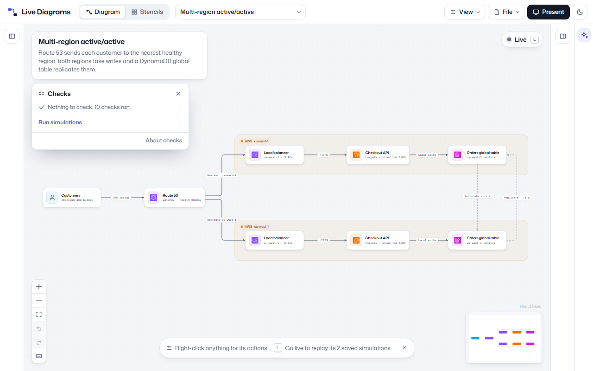
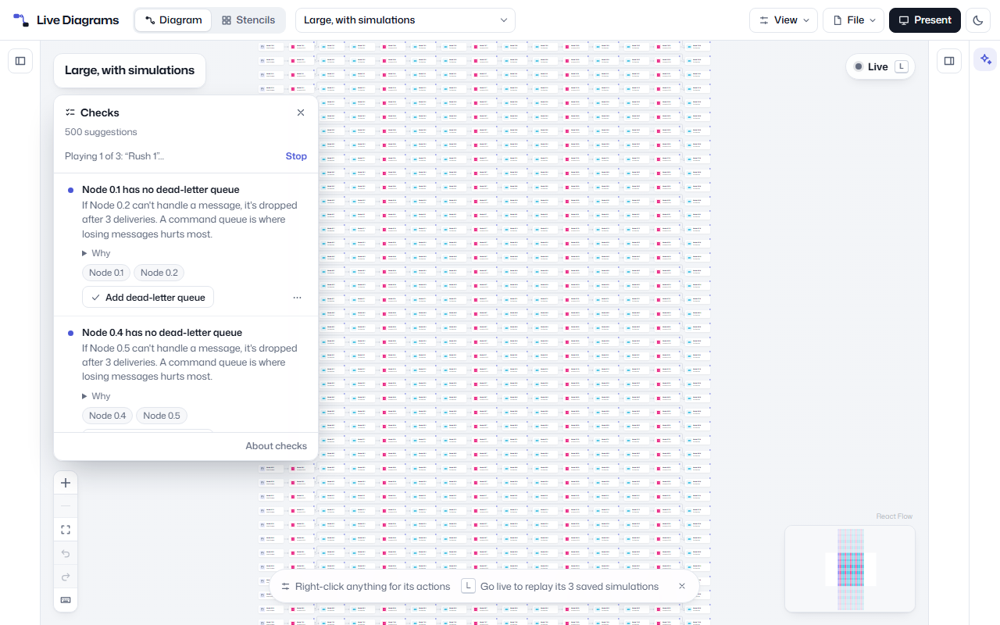
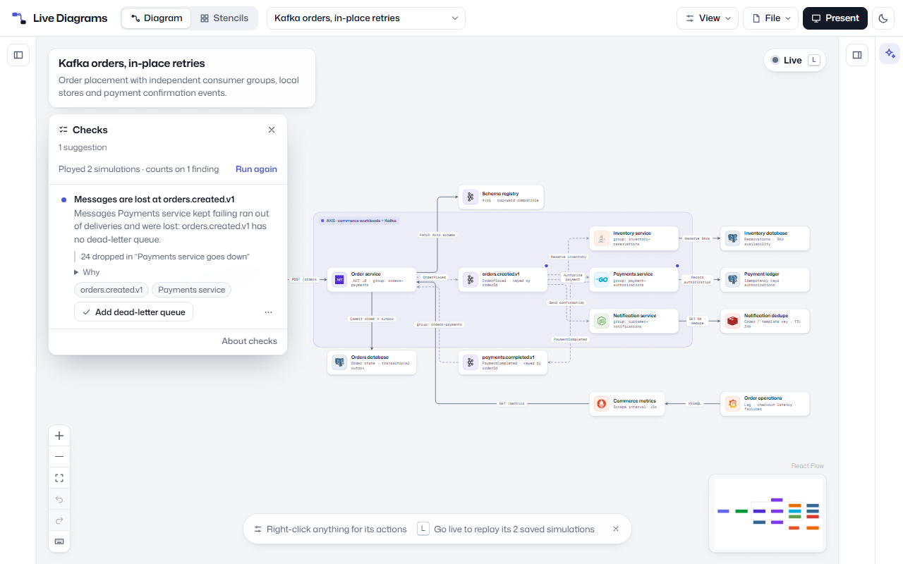
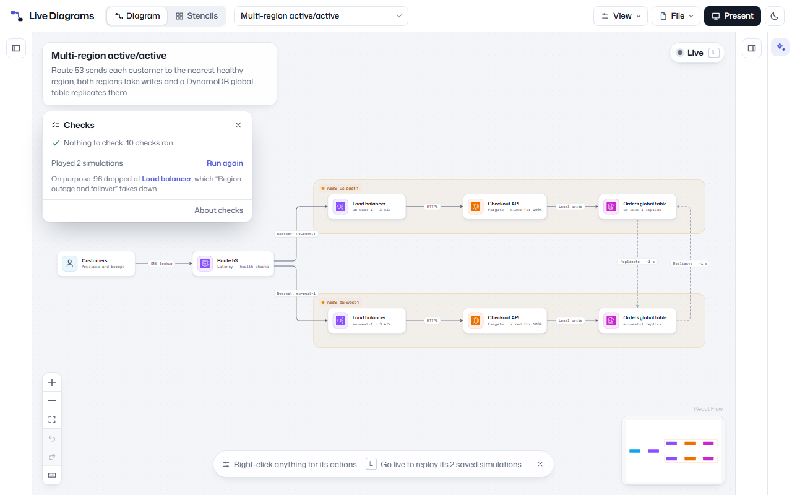
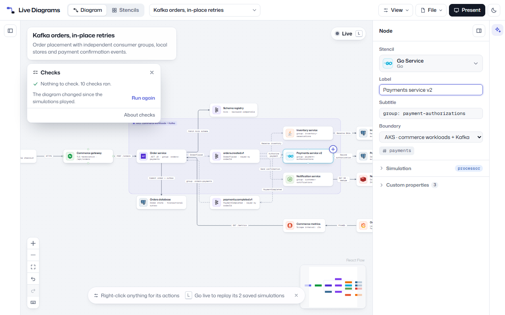

Also: `screenshots/round26/card-dropped-hover-1280-light.png`, `card-dropped-1024-light.png`,
`card-dropped-1440-dark.png`, `inspector-dropped-1440-dark.png`, `card-counts-warning-1280-light.png`,
`fix-dropped-toast-1280-light.png`, `card-stopped-esc-1280-light.png` and `card-played-large-1280-light.png`.

## Round 25: Interactive HTML with a password (2026-10-12)

The gate for **Require a password** in the Interactive HTML export and the file's password prompt
(`src/export/lock.ts`, `docs/INTEROP.md`). Self-review against `docs/UX-PRINCIPLES.md` on the production build
(`vite preview`), Chrome driven by Playwright, at 1024 × 768 and 1280 × 800 light and 1440 × 900 dark, and the file
from disk at those sizes and on a 390 px phone; mouse and keyboard. The Kafka example only (public). Screenshots are in
`docs/screenshots/round25/`.

- **One control, where the choice is made.** A checkbox, **Require a password**, under the line that says who can open
  the file, off by default (`dialog-1280-light`). It isn't behind Options: for a work diagram that may be forwarded it's
  the decision that matters, and Options holds presentation (title, banner, theme, simulations). Checked, it shows the
  password link's own field (`PasswordField`, shared now: at least 8 characters, the strength hint, Show, no confirm
  field) and puts the keyboard in it (`dialog-password-empty-1280-light`). **Download HTML** stays the one action, off
  until the password is long enough (`dialog-password-short-1280-light`), and Enter in the field downloads, as Enter in
  Copy link with password… copies.
- **Who can open it, said where it's chosen.** The line becomes **Only people with the password can open it.** Send
  the password separately, not with the file. (`dialog-password-ready-1280-light`), and the toast says the same
  (`toast-1280-light`). One line under the field says what's encrypted, that the password is never stored or sent, and
  that a lost one means exporting again.
- **The file says nothing until it's opened.** It's titled **Diagram (password protected)** and named for it with a random suffix. The prompt is a
  card in the dialogs' style: **This diagram is password-protected**, "It's checked in this file; nothing is sent
  anywhere.", one field (focused) and **Open** (`viewer-1280-light-locked`, `viewer-390-light-locked`). A wrong
  password says **That password doesn't open this file. Check it and try again.**, keeps the text selected so typing
  replaces it, and marks the field invalid (`viewer-1280-light-wrong`, `viewer-1440-dark-wrong`). The theme is the
  file's, from the first paint.
- **Once open, it's the same file.** The banner, footer, live bar and keys as before, and the page title becomes the
  diagram's (`viewer-1280-light-unlocked`, `viewer-1440-dark-unlocked`).
- **Widths and themes.** With Options open the dialog still fits 1280 × 800 (768 px tall) and scrolls its body at
  1024 × 768 with the footer in view (`dialog-password-options-1024-light`). The weak hint reads in dark
  (`dialog-password-weak-1440-dark`). Copy link with password… is unchanged by the shared field
  (`password-link-1280-light`).

### What was off (fixed in this round)

- **Protected exports overwrote each other** (the code review). Every one was named "Diagram (password
  protected).html", so the skill's `export-html.mjs` into one folder replaced one diagram's file with another's. Each
  name now ends in five random letters and digits (nothing from the diagram, nor the time), and the skill never replaces
  a file: a taken default name gets the next free one, a named `--out` that exists is refused, `--force` replaces. The
  browser never overwrote (downloads get " (1)"), but two files now tell themselves apart.
- **The summary line wrapped.** "· password protected" at its end pushed it to two lines at 480 px, and repeated the
  line just under it. It's gone from the summary; the callout and the checkbox say it.
- **After unlocking, the keyboard was nowhere.** The field it was in went away, so focus fell to the page and a screen
  reader heard nothing. The diagram (its `main`, named "Diagram: …") now takes focus, and the arrow keys pan at once.
- **The prompt never opened in a sandboxed frame.** It was a `<form>`, and a frame sandboxed without `allow-forms` (as a
  wiki may frame the file) never submits one: Enter and Open did nothing. It's Enter on the field and a plain button
  now; `tests/e2e/html-export.spec.ts` unlocks a Private diagram's file in such a frame.
- **On a page with no WebCrypto it asked anyway.** A file on a plain `http://` host can't decrypt; the prompt used to
  say so only after a password. It says so first, with what to do (open it from disk), and Open stays off.
- **Icons went missing after unlocking** (a Windows build only). The viewer build swapped in its icon map by a
  backslashed path, so the bundle carried two copies of that module and the unlocked icons went into the one the
  canvas didn't read. The swap's path is normalized, and `src/export/template.build.test.ts` checks there's one copy.

### Which option should I use (round 21's map, with the password)

Superseded by round 27's map, as Share… lists the ways out.

| You want to…                                          | Use                                                  | Who can open it                                   | Private diagram      |
| ----------------------------------------------------- | ---------------------------------------------------- | ------------------------------------------------- | -------------------- |
| Send a work diagram to colleagues to look at and play | File ▸ Export as ▸ **Interactive HTML…**             | Anyone who has the file                           | Yes                  |
| …and it may be forwarded beyond them                  | **Interactive HTML…** ▸ **Require a password**       | Anyone with the file and the password             | Yes                  |
| Let someone keep editing it                           | **Save** / Export as ▸ **Diagram file**              | Anyone who has the file                           | Yes                  |
| A link for a few people                               | **Copy link with password…**                         | Anyone with the link and the password             | No (off, says why)   |
| A quick link for a public or personal diagram         | **Copy share link**                                  | Anyone with the link                              | No (off, says why)   |
| Show it in your intranet or app, behind its sign-in   | **Embed code…** ▸ **Your app supplies it (private)** | Whoever your app lets in; never in a URL          | Yes (the only embed) |
| Show it on a public page (blog, docs)                 | **Embed code…** ▸ **In the link** / Example by name  | Anyone who can see the page                       | No                   |
| A picture                                             | **Export PNG** / Export as ▸ **Image…**              | Anyone who has the file                           | Yes                  |
| Keep it in your own cloud storage                     | **Save to ▸** Google Drive, OneDrive or Dropbox      | Your account, and whoever you share it with there | No (off, says why)   |

For a work diagram the safe choices are, in order: Interactive HTML (with a password when it may travel), the diagram
file, a link with a password, an embed your app supplies. A company's own copy with links off keeps Require a password:
it's a file (docs/SELF-HOSTING.md). The skill offers the same (`skills/livediagrams/reference/outputs.md`), and never
asks for the password in the chat: the user types it in their own terminal.

### Still open (owner's call)

- **No agent tool sets or reads the password**, because none does for password links either: the page's WebMCP tools
  can't make a link with a password or an Interactive HTML file at all. The skill's `--password` reads it from the
  environment or a terminal prompt, never from an argument.
- **A Diagram file with a password** would be the same crypto on the `.diagram.json`; not built, since the app's
  Open would then need a prompt too.
- **The file's size** still shows roughly how big the diagram is. Padding it would hide that at a cost in size; not
  done.

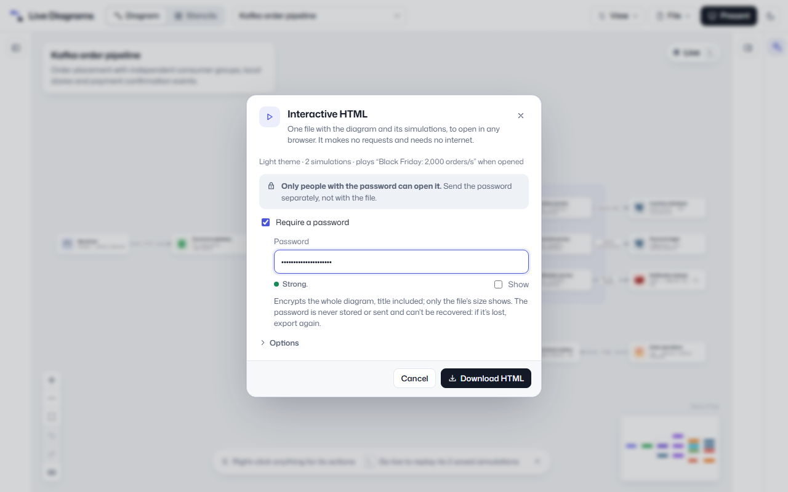
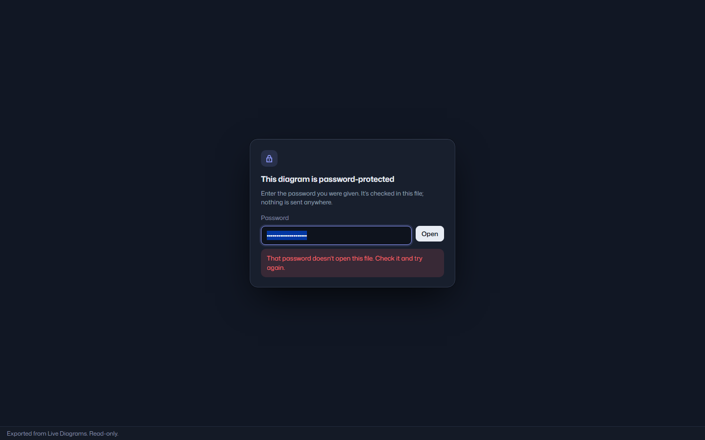

Also: `screenshots/round25/dialog-1280-light.png`, `dialog-password-empty-1280-light.png`,
`dialog-password-short-1280-light.png`, `dialog-password-weak-1440-dark.png`, `dialog-password-ready-1440-dark.png`,
`dialog-password-options-1024-light.png`, `toast-1280-light.png`, `viewer-1280-light-locked.png`,
`viewer-1280-light-wrong.png`, `viewer-1440-dark-unlocked.png` and `password-link-1280-light.png`.

## Round 24: import follow-ups (2026-10-12)

The gate for the import follow-ups: replicas, Round 20's two open items (long module addresses, Draw everything's
spread), the picker for big imports, and Strimzi KafkaUser ACLs. Self-review against `docs/UX-PRINCIPLES.md` on the
production build at 1024 × 768, 1280 × 800 and 1440 × 900, light and dark, mouse and keyboard, with the public import
fixtures and two generated inputs (a 40-namespace cluster, a KafkaUser set), written in the tests.

- **No new chrome.** Nothing in the top bar, a menu or the palette. The picker lives in the Import report, where
  Draw everything already is, and only for an import that's too big; the toast says so in its own words ("300 of 400
  nodes") and stays 7 s, as it does when there's something to check.
- **The picker is one list and one button.** "Boundaries (30 of 40 drawn)", one line saying why only some are drawn
  and what ticking does, then a row per boundary: its checkbox and name, and "10 nodes · 9 flows" on the right, the
  most flows first (`pick-report-1280-light`). The list scrolls on its own after seven rows, so **Draw these (300
  nodes)** sits right under it and the rest of the report stays in reach: at first, 40 rows pushed the button and
  every other section below the fold. The button is a secondary one (Done stays the dialog's one primary action),
  unavailable until the ticks change, and counts what it would draw as you tick (`pick-report-changed-1280-light`:
  310). It opens a new diagram, like Draw everything, so the first drawing is never lost. Dark (`pick-report-1280-dark`)
  and 1024 (`pick-report-1024-light`) read the same. Checkboxes are real inputs: Space ticks them, and the e2e test
  drives one from the keyboard.
- **"Boundary", not "namespace" or "module".** The section is the same for every format, and boundary is the
  vocabulary's word for the box; each row's name says which namespace or module it is.
- **Addresses wrap between their parts** (`report-terraform-wrap-1280-light`, `-1280-dark`, `-1024-light`):
  `module.streaming.` / `aws_lambda_event_source_mapping.analytics` instead of `…mappi` / `ng.analytics`. The address
  can now be selected (the app is otherwise unselectable) and copies as one string.
- **Draw everything is compact.** The AWS plan's everything diagram fitted at under a fifth before (cards about 33 px
  wide at 1280; Round 20's `terraform-everything-canvas-1440`); now it fits at a readable size
  (`everything-aws-1280-light`): the flows on top, the module boundary first in its column, the helpers in a grid
  below. The Azure state's helpers pack inside their resource group instead of one tall column
  (`everything-azure-1280-light`). The cause was the layered layout spacing every row by its tallest unit (the
  boundary), and helpers entering it before they were moved; both are fixed for every import, so the compose,
  Kubernetes, AsyncAPI and Terraform imports were re-checked: each reads as before or straighter (Users and the
  kafka block now centre on the shop block, `kubernetes-canvas-1440`), with no overlaps in the Lab's audits.
- **KafkaUser ACLs** read like any found connection (`kafkauser-report-1280-light`): "orders-app → orders.v1
  (writes) · KafkaUser orders-app", under "Connections found in settings and KafkaUser ACLs" (it said "in settings"
  at first, which a KafkaUser isn't). A prefix ACL is one note; a user nothing here uses is a Not drawn row that
  says why. On the canvas they're ordinary message flows (`kafkauser-canvas-1280-light`).
- **"managed identity"** now shows on the Azure state's Function App → Key Vault connection
  (`terraform-azure-canvas-1440`): the grant goes to the app's own identity, which has no node. Small, mono, on the
  dependency's line, like other connection labels.

### What was off (fixed in this round)

- The picker's list pushed its button and the rest of the report out of view (above).
- The first wording, "too many to draw at once", wasn't true: the picker draws up to 5,000. It now says "more than a
  diagram reads well, so only some boundaries are drawn".
- The grid the helpers pack into used a column count meant for cards, so 26 namespaces of ten made a strip 8,000 px
  wide; rows are now sized by the grid's area, never narrower than the flows above.
- Batch 4's `secret-identity` raised three false findings on the Terraform fixtures (see the "Imports" addendum in
  `docs/research/architecture-checks.md`); the import now says what it knew.

### After code review (fixed)

- **Draw everything draws everything again** (up to 5,000): the picker had made it draw an automatic 300.
- **Nothing is out of reach.** Components in no boundary (a Terraform root module) are one more entry, **Not in a
  boundary**; before, a large root module could only come along with a boundary it connected to.
- **An oversized boundary no longer blocks the import.** The first entry used to be taken whatever its size, so one
  over 5,000 failed the whole import; it's skipped and listed now, and a smaller one opens.
- **The picker speaks.** A status line beside the button ("310 nodes ticked.", "5,200 nodes ticked, over the 5,000 an
  import draws: untick some.") is announced politely and describes the checkboxes and the button, which is now
  unavailable rather than disabled, so it stays in the Tab order.
- **A picked diagram is named by what it draws** ("shop (team-05 and team-39)"), so Your diagrams doesn't list two
  with one title, and a picked Terraform diagram keeps Draw everything.
- **Deny ACLs win**, as in Kafka; allows for some hosts only are listed, not drawn. Two consumers of one KafkaUser
  share its group in Live. A managed-identity label survives an earlier reference to the vault.

### Still open (owner's call)

- A picked diagram of 300 nodes doesn't fit 1280 × 800 at the canvas's smallest zoom (`pick-canvas-1280-light`).
  That's the size, not the layout: 300 is the plan's threshold, and a lower one would draw less by default.
- A KafkaUser's Secret is drawn "not in these files", which is true (Strimzi makes it) but could say "made by
  Strimzi".

Also: `screenshots/round24/pick-report-1280-dark.png`, `pick-report-1024-light.png`, `pick-canvas-1280-light.png`,
`report-terraform-wrap-1280-light.png`, `report-terraform-wrap-1024-light.png`, `everything-azure-1280-light.png`,
`kafkauser-canvas-1280-light.png`, and the import canvases at 1440: `compose-canvas-1440.png`,
`kubernetes-canvas-1440.png`, `asyncapi-canvas-1440.png`, `terraform-aws-canvas-1440.png` and
`terraform-azure-canvas-1440.png`.

## Round 23: checks, batch 4 (2026-10-12)

The gate for architecture checks batch 4: `secret-identity` and `schema-registry`, each with its fix
(`docs/research/architecture-checks.md`, "Batch 4"). Self-review against `docs/UX-PRINCIPLES.md` on the production
build at 1024 × 768, 1280 × 800 and 1440 × 900, light and dark, mouse and keyboard. Of the 16 public examples, only
notification-fanout raises a new finding (the identity suggestion), so it's the main subject; the schema registry
warning fires on no example, so it's shown on the test fixture `tests/fixtures/checks/payments-ledger.diagram.json`
(a payments API writing Avro to Kafka, a ledger function reading it, both reading Key Vault).

- **No new chrome.** No control, menu row or palette entry: both rules show in the same count, card, markers and
  inspector row, and the identity fix's alternative uses batch 3's chips ("or One for each service",
  `card-identity-hover-1280-light`).
- **Quiet by default holds.** Across the 16 examples the count is unchanged (2 warnings): the new finding there is a
  suggestion, one row for the whole diagram rather than one per service. The Azure invoice example, whose vault says
  "managed identity", stays clean of it (`card-azure-invoice-said-1280-light`). On the fixture the count says
  "1 warning" (`count-ledger-1280-light`), the registry; the identity suggestion waits in the card
  (`card-ledger-1280-light`).
- **Words.** Titles name the count or the thing ("2 services read secrets without an identity", "Avro on
  payments.v1, but no schema registry"); the message says who reads what ("Email sender and SMS rate limiter read
  secrets from notify-kv"), and the button names the change in the cloud's own words ("Add a managed identity"; an
  IAM role on AWS, a service account on Google Cloud).
- **Fixes land where they belong.** The shared identity goes into the Azure boundary beside its services
  (`fix-identity-toast-1280-light`: "Added Managed Identity · Undo"); the chip adds one per service, named for it
  (`chip-identity-toast-1280-light`: "Added Email sender identity, SMS rate limiter identity"). The registry lands
  between the services it serves, with dotted Depends on lines (`fix-registry-toast-1280-light`). Each is one undo step.
- **Widths and themes.** At 1024 the 290 px card wraps the row and its chip cleanly
  (`card-notification-1024-light`); dark reads as light does (`card-notification-1440-dark`), and selecting the row
  selects the vault and both services (`card-identity-selected-1440-dark`). The inspector carries both findings for a
  selected service, warning first (`inspector-ledger-1440-dark`).

### What was off (fixed in this round)

- **The element chips repeated the Secret connections.** The identity row listed "Email sender → notify-kv" and "SMS
  rate limiter → notify-kv" after the vault and both services: five chips for three things. The finding's elements are
  now the vaults and the services, and the markers sit on those nodes only.
- **The shared identity landed on the boundary's edge.** Added outside any boundary, it was placed beside its
  services and straddled the Azure box's border. A new identity now goes in the boundary its services share (the
  registry in its topics' one), which grows to hold it.
- **New nodes read "Schema Registry / Schema Registry".** With no sublabel, a card shows the stencil's name under its
  label, which repeated it. The registry's sublabel is "schemas" and an identity's "workload identity".

### Still open (owner's call)

- The precision gate trades a Vault-on-AWS sketch with no boundary (no finding) for silence on every Vault sketch; see
  "Batch 4: precision gate".
- The shared identity is the default and one per service is the chip, as the plan had it. Least privilege argues for
  the reverse; the default keeps a diagram with many services to one new box.

Also: `screenshots/round23/card-notification-1280-light.png`, `card-notification-1024-light.png`,
`card-notification-1440-dark.png`, `card-identity-selected-1440-dark.png`, `chip-identity-toast-1280-light.png`,
`card-azure-invoice-said-1280-light.png`, `count-ledger-1280-light.png` and `inspector-ledger-1440-dark.png`.

## Round 22: checks, batch 3 (2026-10-12)

The gate for architecture checks batch 3: four more rules (`sync-chain`, `shared-database`, `entry-gateway`,
`single-point`), each with its fix, and fixes with other options as chips (`docs/research/architecture-checks.md`,
"Batch 3"). Self-review against `docs/UX-PRINCIPLES.md` on the production build at 1024 × 768, 1280 × 800 and
1440 × 900, light and dark, mouse and keyboard. The public examples raise none of the new findings (that's the
precision gate), so the card is shown on a small test fixture, `tests/fixtures/checks/checkout-shortcuts.diagram.json`
(a mobile app calling the order service around the gateway, and billing reading the order service's database), and
on the Kafka example, which stays clean under all eight checks.

- **No new chrome.** No control, menu row or palette entry: the new rules show in the same count, card, markers and
  inspector row. The only new element is the chips row under a fix that has other ways to make it ("or Firewall /
  WAF · Kong Gateway"): quiet chips in the style of the row's element chips, after an "or", under the one primary
  button, so the row still has one obvious action (`card-row-hover-chips-1280-light`). Each chip is a button with the
  full change as its name ("Put Kong Gateway in front"), is off while the check is stale, and applies as one undo
  step with the usual toast (`chip-fix-toast-1280-light`: the gateway lands between the app and the service).
- **Quiet by default holds.** The count shows the new warning only (`count-1280-light`: "1 warning"); the bypass is a
  suggestion and shows only in the card. On the 16 examples the count is unchanged (2 warnings in total), and the
  Kafka example's card says "Nothing to check. 8 checks ran." (`card-clean-kafka-1280-light`).
- **Words.** Titles name the things ("Billing uses Order service's database", "Mobile app calls Order service
  directly", "4 requests deep", "Every request goes through one Order service"); the message says what's wrong here
  and the button names the change ("Ask Order service instead", "Go through Commerce gateway", "Set replicas to 2").
  "Uses", not "reads": the flow can be a write. About checks lists all eight (`card-about-1280-light`).
- **Widths and themes.** At 1024 the 290 px card wraps the chips and the element chips cleanly
  (`card-batch3-1024-light`); dark reads as the light theme does (`card-batch3-1440-dark`). The inspector's version
  carries the chips too (`inspector-finding-chips-1440-dark`), and a selected outside service shows the
  database finding with its fix (`inspector-finding-1280-light`).

### What was off (fixed in this round)

- **Hovering a row flew its markers away from their nodes.** The hovered finding's markers grew with `scale` on the
  positioned box, which also scaled its translate: a marker 500 px into the diagram jumped about 175 px further, onto
  empty canvas (the first screenshots). It came with batch 2 and showed on every rule. The mark inside the box grows
  now; `tests/e2e/checks-rules.spec.ts` checks a hovered marker stays at its node's corner.
- **The fixture's description read like a test** in the diagram card. It now describes the diagram.

### Still open (owner's call)

- The element chips list a connection by its label ("Read order totals") before the nodes, since a finding's target
  comes first and `shared-database`'s target is the connection. Clear enough with the marker on the connection; a
  reorder would put nodes first everywhere.
- `entry-gateway` gives up rag-assistant's real gap (no gateway anywhere) for silence on sketches that leave ingress
  out; see the precision gate.

Also: `screenshots/round22/count-1280-light.png`, `card-batch3-1024-light.png`, `card-batch3-1440-dark.png`,
`card-about-1280-light.png`, `inspector-finding-1280-light.png` and `card-clean-kafka-1280-light.png`.

## Round 21: sharing, export, embed and privacy, together (2026-10-12)

Private diagrams, password links, Interactive HTML, file exports, the three embeds, cloud saves, the skill's "which
output?" and self-hosting each had their own review. This round walks them **together**, as someone with a work
diagram would: can they pick the safe option quickly, and does every way out say who can open what it makes?

**How.** The production build (`pnpm build`, `vite preview`), Chrome driven by Playwright, at 1280 × 800 light and
1440 × 900 dark, mouse and keyboard only. One regular diagram (the Kafka example) and one Private diagram (a private
copy of the Azure invoice example), both public. Screenshots are in `docs/screenshots/round21-sharing/`
(`before-*` is the build before this round's fixes).

### Which option should I use (as the app presents it now)

| You want to…                                          | Use                                                  | Who can open it                                   | Private diagram      |
| ----------------------------------------------------- | ---------------------------------------------------- | ------------------------------------------------- | -------------------- |
| Send a work diagram to colleagues to look at and play | File ▸ Export as ▸ **Interactive HTML…**             | Anyone who has the file                           | Yes                  |
| Let someone keep editing it                           | **Save** / Export as ▸ **Diagram file**              | Anyone who has the file                           | Yes                  |
| A link for a few people                               | **Copy link with password…**                         | Anyone with the link and the password             | No (off, says why)   |
| A quick link for a public or personal diagram         | **Copy share link**                                  | Anyone with the link                              | No (off, says why)   |
| Show it in your intranet or app, behind its sign-in   | **Embed code…** ▸ **Your app supplies it (private)** | Whoever your app lets in; never in a URL          | Yes (the only embed) |
| Show it on a public page (blog, docs)                 | **Embed code…** ▸ **In the link** / Example by name  | Anyone who can see the page                       | No                   |
| A picture                                             | **Export PNG** / Export as ▸ **Image…**              | Anyone who has the file                           | Yes                  |
| Keep it in your own cloud storage                     | **Save to ▸** Google Drive, OneDrive or Dropbox      | Your account, and whoever you share it with there | No (off, says why)   |

For a work diagram the safe choices are, in order: Interactive HTML, the diagram file, a link with a password, an
embed your app supplies. A company's own copy (docs/SELF-HOSTING.md) can remove the link rows altogether and start
every diagram Private. The skill offers the same order (`skills/livediagrams/reference/outputs.md`).

### What's good

- **Private is easy to see and hard to undo by accident.** The lock badge beside the title, "This diagram is private"
  under File ▸ Privacy, and one confirmation with **Keep private** as the default (`privacy-dialog-1280-light`).
- **Interactive HTML and the password link already said who can open them**, in bold, and the private embed's promise
  comes first in its callout (`html-dialog-1440-dark`, `password-dialog-1280-light`, `embed-host-1440-dark`).
- **No gate leaks.** With the diagram Private, every link row is off, Embed code… opens on the private source only,
  the right-click's Export ▸ matches (`private-rightclick-export-1280-light`), and no step of the walk made a URL.

### Findings

**High**

1. **Copy share link didn't say who can open it.** It's one click, first among the sharing rows, and the link carries
   the whole readable diagram. The row had no line, and the toast said "The diagram travels inside the link." Only
   the Details dialog said "Anyone with the link gets their own editable copy" (`before-file-menu-1280-light`,
   `before-share-toast-1280-light`). **Fixed:** the row says **Anyone with the link can open it**, the password row
   **Only people with the password can open it**, and the toast **Share link copied. Anyone with the link can open the
   diagram.** (`file-menu-1280-light`, `share-toast-1280-light`, `share-dialog-1440-dark`).
2. **Embed ▸ In the link didn't say the diagram is public.** It's the default for any diagram of your own (not a
   pristine example). The code holds the whole diagram, and the viewer offers "Open in Live Diagrams"; the dialog
   said only "Paste this into a blog post, wiki or docs page" (`before-embed-inline-1280-light`). **Fixed:** one
   callout, in the Interactive HTML dialog's pattern: **Anyone who can see the page can open this diagram.** It's
   inside the code. For a work diagram, choose Your app supplies it (private). (`embed-inline-1280-light`). The
   preview is 50 px shorter on that source, so the dialog still fits 1280 × 800.

**Medium**

3. **The keyboard skipped a Private diagram's off rows, so their reason was never heard.** The File menu's off rows
   were native `disabled` buttons: the arrow keys and screen readers went straight from Privacy to Embed code….
   **Fixed:** off rows are `aria-disabled` and stay in the arrow-key order (as the right-click menu's already were);
   Enter on one does nothing (`keyboard-private-off-row-1280-dark`).
4. **Contrast: the reason faded with its row.** The whole row was at 45% opacity, so "Private diagrams can't be
   shared as links…" read at 1.9:1 in light and 2.1:1 in dark (`before-private-file-menu-1440-dark`). **Fixed:** the
   icon and name fade; the reason stays at the muted text colour (5.2:1 light, 5.3:1 dark)
   (`private-file-menu-1440-dark`).
5. **Esc did nothing in the Share link dialog opened from the toast's Details.** Copy link (its autofocus) is off while
   the link is made, so focus stayed on the toast and then the page, outside the dialog's keys. The Embed dialog did
   the same for your own diagrams. **Fixed:** a dialog whose first action isn't ready focuses itself, then hands focus
   to the action when it is, so Esc and Tab work at once.
6. **Esc in the embed preview didn't close anything.** Tab goes into the preview (the real viewer, every node in turn),
   where the dialog's Esc never arrives. **Fixed:** the preview stays a Tab stop, so keyboard users can try it (the
   private embed has no Open viewer), and Esc inside it backs out one level, to the preview's frame in the dialog;
   the next Esc closes the dialog, and Tab carries on from the frame. (The first fix took the preview out of the Tab
   order; the code review rightly said that left keyboard users unable to try it.)
7. **"Export a file instead" didn't say which file, and the safe way to share was never named.** Interactive HTML, the
   option the skill recommends for work, sits two levels down (File ▸ Export as ▸), and nothing in the sharing rows,
   the Privacy submenu or the Private dialog pointed to it (`before-privacy-dialog-1280-light`). **Fixed by
   wording:** the off rows say **Private diagrams can't be shared as links. Export Interactive HTML instead.**, the
   Privacy submenu's note **To share a private diagram, export Interactive HTML.**, and the Private dialog **To share
   it, export Interactive HTML or the diagram file.** The refusal toast's action is now **Interactive HTML…** (it
   exported the diagram file). Moving it up the menu is a proposal (below).

**Low**

8. **The Private dialog said "No share links or embed codes"**, but Embed code… is on for Private diagrams (the private
   kind). **Fixed:** "No share links; embeds only where your own app supplies it" (`privacy-dialog-1280-light`).
9. **One thing, three names.** The menu says Embed code…, the dialog was titled "Embed", and the privacy policy said
   "Embed → Your app supplies it". The File menu's "Your app supplies it" sat in the monospace hint column, where file
   extensions go. **Fixed:** the dialog is **Embed code**, the row's line reads **Your app supplies it (private)** (the
   source's own name), and the policy and docs/EMBEDDING.md say **Embed code… ▸ Your app supplies it (private)**.
10. **A Private diagram's off embed source looked like a choice.** "In the link" kept the normal ink; only a hover
    tooltip said why (`before-private-embed-1280-light`). **Fixed:** off segments use the disabled ink, and the
    subtitle says **A private diagram embeds only where your own app supplies it.** (`private-embed-1440-dark`).
11. **The skill never mentioned links with a password**, so "I want a link" for a work diagram had only the open link.
    **Fixed:** SKILL.md and outputs.md point to **File > Copy link with password…** in the app (no script makes one)
    and say a Private diagram gets no link at all.
12. **Focus fell to the page** after the Share link dialog opened from a toast's Details closed: the toast goes as its
    button acts. **Fixed:** a dialog opened from a toast, or from nothing, gives the keyboard back to the canvas.
13. **A password link could replace the diagram you moved to.** Moving to an example while its password was being
    checked cancelled the result only once the example had downloaded; if the check finished first, the shared diagram
    opened over the one you'd asked for. **Fixed:** the result is dropped (the prompt says "Another diagram opened…")
    whenever another diagram is open _or asked for_. Found while chasing a flaky test, which now waits for the diagram
    rather than the picker.

After the code review (five findings, all fixed): the refusal toast's **Interactive HTML…** runs the same guarded
command as the menu, so with no diagram on the canvas it says "Open a diagram on the canvas first." instead of failing
silently, and the tests hold link making to check Esc while a link is pending and the refusal toast's action end to
end.

### Proposals (all three built in round 27, at the owner's direction)

- **One "Share…" chooser.** One File menu row (replacing Copy share link, Copy link with password… and Embed code…, so
  the menu shrinks) opening a dialog that lists the ways out with who can open each, safest first: Interactive HTML,
  Diagram file, Link with password, Embed in your app, then Share link and the public embed. A Private diagram shows
  the first two and the private embed. It would make the decision map above the UI itself, but it ends Copy share
  link's one-click habit, so it's the owner's call.
- **The password link first.** Swap the two link rows, or make **Copy link with password…** the File menu's one link,
  with "No password" inside its dialog. The vocabulary puts it under Copy share link today.
- **Ask about Private at the moment it matters.** The first import of an infrastructure file (Terraform, Kubernetes,
  docker-compose) could offer **New diagrams are private** once, beside the Import report's Make private.

Also: `before-share-toast-1280-light.png`, `before-embed-inline-1280-light.png`, `before-privacy-dialog-1280-light.png`,
`before-private-embed-1280-light.png`, `share-dialog-1440-dark.png`, `password-dialog-1280-light.png`,
`embed-example-1440-dark.png`, `embed-host-1440-dark.png`, `html-dialog-1440-dark.png`, `privacy-menu-1280-light.png`,
`private-file-menu-1440-dark.png` and `private-rightclick-export-1280-light.png`.

## Round 20: imports (batch 4, Terraform) (2026-10-12)

Terraform plan and state JSON on the shared pipeline and report. Self-review against `docs/UX-PRINCIPLES.md` at
1024 × 768, 1280 × 800 dark and 1440 × 900, with the AWS plan and the Azure state fixtures.

- **No new chrome.** The start-card line now reads "Drop a docker-compose, Kubernetes, AsyncAPI or Terraform plan
  here." (one line at 1280; "Have a …, AsyncAPI or Terraform plan file? Drop it here." wrapped and left "it here."
  alone). The drop overlay gains a "Terraform plan" chip, which still fits one row at 1440, and the paste dialog
  and Open…'s file type name it. Nothing says Terraform "isn't supported yet" any more. A `.tf` file gets one
  sentence that says what to run, not a JSON error.
- **The canvas** (AWS plan) reads SNS → SQS → Lambda along the top lanes, with the DynamoDB stream into the
  projector and the nightly schedule beside it; the `module.streaming` boundary (AWS-toned) holds MSK and its
  consumer, "analytics ×2". The role, the secret and the parameter sit in one row under the flows, joined by
  Identity, Secret and Config. The Azure state reads as two resource groups: Service Bus → the Function App →
  Event Hubs, with Event Grid from the storage account, and the shared Key Vault in its own group below. The Lab's
  overlap audit counts no node or label overlaps on either.
- **The report** keeps the batch 1 layout; only the connections heading changes, to "Connections from
  subscriptions, mappings and grants", each row naming the resource that made it
  (`aws_sns_topic_subscription.orders_queue`), so a surprising edge can be traced to its line in the plan. Two
  notes: the plan's changes in Terraform's own words ("Plan: 28 to add, 0 to change, 1 to destroy") and one line that summarises what isn't
  drawn by kind. Not drawn is grouped by type ("azurerm_resource_group ×2 · not a component").
- **Draw everything** is a quiet link at the end of the Not drawn heading, not a button in the foot: it's for the
  few who want the resource graph, and it opens a new diagram ("aws-plan (everything)") rather than changing this
  one, so the curated import is never lost. Resources with no flows pack in a grid under the flows instead of one
  tall column.
- **Secrets** never show: no variable, output, `sensitive_values` attribute, `constant_value`, ARN, account id,
  principal or URL userinfo reaches the canvas, the report or the file; an outside SNS endpoint is drawn by its
  host alone.
- **Open:** long module addresses wrap mid-word in the report's evidence column at 1440
  (`module.streaming.aws_lambda_event_source_mapping.analytics`); acceptable for a monospace address. Draw
  everything on a plan with many flows still spreads its first column; Tidy up tightens it. The 300-node picker
  isn't built (as in batch 3).

Also: `screenshots/round20/import-report-terraform-1024.png`, `import-report-terraform-1280-dark.png`,
`terraform-everything-canvas-1440.png`, `drop-overlay-1440.png` and `start-card-1280.png`.

## Round 19: private embeds (2026-10-12)

**Embed ▸ Your app supplies it (private)**: the page that embeds the viewer fetches the diagram from its own server,
behind its own sign-in, and hands it over with `postMessage`; the diagram is never in a URL and never reaches this
site (docs/EMBEDDING.md). Self-review against `docs/UX-PRINCIPLES.md` on the production build at 1280 × 900 (the
dialog, light and dark) and on a host page at 1280 and 760 px, on the Kafka example.

- **No new chrome.** The Embed dialog's source switch gains a third segment (it now always shows: Example by name
  for pristine public examples, **In the link**, **Your app supplies it (private)**). The menus are unchanged:
  Embed code… simply stays enabled for Private diagrams, hinted "Your app supplies it", and opens on that source
  with the other two disabled.
- **The dialog, private source.** One callout says the promise first, in bold: **The diagram never leaves your app.
  Live Diagrams only provides the viewer.**, then what to do (serve the file behind your sign-in). Under it a
  two-way switch, **Web component** (the default: two lines) or **iframe + postMessage** (twenty lines, for pages
  that won't load our script), the code, and a live preview that is the real viewer fed by `postMessage`, so what
  you see is what your page gets. **Diagram file** (secondary, bottom-left) saves the file to serve; **Copy code**
  stays the one primary action. The file's path, the height (default **Fits the diagram**) and the simulation sit
  behind **Options** (the path got a row of its own after the first screenshots squeezed it into a select-sized
  box).
- **The viewer in a host page** is the read-only embed with the live bar, and one quiet link, **Made with Live
  Diagrams**, to the site (no payload, no "Open in"). It rises above the live bar while live: in the first
  screenshots it sat on the bar's ⋯ at both widths, which this round fixed. Auto-height fits the diagram to the
  frame's width (477 px for Kafka at 916 px, 388 px at 696 px); a live frame never goes below 380 px, so the
  narration and the bar leave the diagram some room.
- **The host drives it** (play, pause, speed, simulation, highlight rings, theme) without new UI in the frame: the
  highlight is the accent ring the app uses for focus, a little wider, and it pans and zooms with the diagram.
- **Dark** (`theme="dark"` or `setTheme`) reads as the app's dark theme; the host page's own background frames it.
- **Open:** at narrow widths the narration callout still covers the Live toggle (live view's own layout, the same in
  the app at that width); a host that wants the toggle visible can set `height`.

## Round 18: imports (batch 3, Kubernetes) (2026-10-12)

Kubernetes manifests on the shared pipeline and the batch 1 report. Self-review against `docs/UX-PRINCIPLES.md`
at 1024 × 768, 1280 × 800 dark and 1440 × 900, with the five fixture files dropped together.

- **No new chrome.** The start-card line now reads "Have a docker-compose, Kubernetes or AsyncAPI file? Drop it
  here.", the drop overlay gains a Kubernetes chip, and the paste dialog and Open…'s file type name it. Only
  Terraform still says it can't be imported yet. A Helm chart's templates get one sentence that says what to do
  ("Run “helm template” and import its output."), not a YAML error.
- **The canvas** reads Users → the NGINX Ingress → the shop namespace → the kafka namespace: two Kubernetes-toned
  boundaries, with the ConfigMap and both Secrets in one row under the shop lane and the Managed Identity below the
  boundary, outside it, as the plan says. Ids stay readable when names repeat (`orders-api`,
  `configmap-orders-api-config`, `secret-orders-db`, `identity-orders-api`, `ingress-shop`). The Lab's overlap audit
  on "Imported: Kubernetes" counts no node or label overlaps.
- **The report** has no guesses for the fixture (every workload's stencil is sure), five connections found in
  settings, and two not-drawn rows that say why ("Kafka shop-kafka · shown through its topics", "ServiceMonitor
  orders-api · unknown kind (monitoring.coreos.com)"). Two notes carry what isn't on the canvas: the Service with
  no workload, and KEDA's replica range. Not-drawn rows are grouped by kind ("PersistentVolumeClaim ×4"), so a
  `kubectl get all` dump stays short.
- **Secrets** show their key names only, as lock-marked settings on the Secret relationship; values never reach
  the canvas, the report or the file.
- **Open:** payments-worker sits in the shop block's first column, because its only input (the KEDA topic) is in
  the kafka block to the right, so that dashed edge crosses the block. Tidy up fixes it in one step; placing a
  boundary's members by flows from other blocks is a candidate for the layout work. The 300-node picker from the
  plan isn't built: imports up to 5,000 nodes draw, and beyond that fail with the budget message.

Also: `screenshots/round18/import-report-kubernetes-1024.png`, `import-report-kubernetes-1280-dark.png`,
`drop-overlay-1440.png` and `start-card-1280.png`.

## Round 15: checks UI (2026-10-12)

The gate for architecture checks batch 2: the count under the title, the Checks card, markers, the inspector's
finding, fixes, Ignore and Turn off (`docs/research/architecture-checks.md`, "Batch 2: as built").

**How.** Dev server, Chrome (Playwright), at 1024×768, 1280×800 and 1440×900, light and dark; mouse and keyboard.
Public examples only: Azure invoice integration (one warning, two suggestions), AKS (clean), Outbox and saga
(one suggestion). Overlap measured from bounding boxes at 1024; responsiveness with Event Timing on a generated
1,500-node diagram on the production build. Screenshots are in `docs/screenshots/round15/`.

### What's great

- **Quiet by default.** A clean diagram shows nothing; one with only suggestions shows nothing either
  (`card-suggestions-only-1280-dark` is opened by hand). The count is one muted amber line under the title
  (`count-1280-light`), and it's gone in live view and presenting.
- **The fix is the row's one button**, named for the change, and its toast says what it added with Undo
  (`fix-toast-1280-light`). One Ctrl+Z takes the queue and its route back, and the warning returns.
- **You meet the finding where you work.** Selecting the queue shows its finding at the top of the inspector, with
  the same fix (`inspector-finding-1280-light`).
- **Typing doesn't wait on checks.** In a 1,500-node diagram a keystroke costs the same with checks running between
  keys in the worker as with them held (the e2e test compares the two in one run).

### What was off (fixed in this round)

- **The card ran over the canvas controls** in the bottom-left corner, and at 1280 it reached the hint along the
  bottom. It now stops above the controls, measured, at any height (`card-open-1024-light`).
- **The card hid part of a fitted diagram.** Opening it over a diagram that was all in view now refits the diagram
  clear of it, as opening a side panel does (rule 10). A view you panned or zoomed stays put.
- **Ctrl+K showed "Add something to check first"** beside Check diagram even when there was something to check. The
  hint now shows only when the action is off (`palette-check-diagram-1280-light`).
- **A big diagram drew every finding.** Hundreds of rows made the card slow to open; rows now draw 40 per group with
  **Show more**, and a row names only the chips it draws, from one index per check.
- **At 1024 the refit left the diagram small** (`card-open-1024-light`). The card is 290 px wide in windows up to
  1,100 px (the owner's call after the first review).
- **Keyboard (after the code review).** Home and End in the Ignore reason box move the caret; Esc closes a finding's
  options before the card; closing the card puts focus back on what opened it (the count, else the canvas).

### Still open (owner's call)

- Markers are deliberately small (14 px); on a zoomed-out dark diagram they're easy to miss
  (`card-open-1440-dark`). The rows' heads are the way in; a marker is a hint.
- The Ignore reason box is one line in a 290–340 px card (`card-ignore-reason-1280-light`): long reasons scroll.

## Round 17: Interactive HTML export (2026-10-12)

File ▸ Export as ▸ **Interactive HTML…**: one self-contained file for sharing a diagram inside a company, with no
public URL (docs/INTEROP.md, "Interactive HTML"). Self-review against `docs/UX-PRINCIPLES.md` on the production
build at 1280 × 800 (the dialog) and 1440 × 900 and 900 × 560 (the file), light and dark, on the Kafka example.

- **No new chrome.** It's one row in Export as ▸ (now six), one in the right-click's Export ▸ (eleven with the
  separator) and Ctrl+K ("Interactive HTML…"). The File menu's top level is unchanged.
- **The dialog** has one primary action, **Download HTML**, a summary line that says what you'll get ("Light theme ·
  2 simulations · plays “Black Friday: 2,000 orders/s” when opened") and one callout: **Anyone who has this file can
  open it.** with where to keep it. Title, Banner, Theme, Simulations and When opened sit behind **Options**. The
  defaults need no change: the app's theme, every simulation, the first one playing.
- **Private diagrams** export like Save to this device; the callout is the same line for every diagram, so nothing
  reads as a warning that only some diagrams get.
- **The file** is the embed's read-only canvas with the live bar, plus a banner strip (amber, centred) and a muted
  one-line footer: "Exported from Live Diagrams on October 12, 2026. Read-only." and the keys. No link out (see
  INTEROP for why). Zoom in, Zoom out and Fit view sit bottom-left and rise above the live bar while it shows:
  at 900 px they first sat on the play button, which this round fixed.
- **Keyboard.** Arrows pan, + and − zoom, Shift+1 fits, Shift+0 is 100%; Space, the speed and simulation selects
  and ⋯ work as in the app. Tab visits every node (each read as "Order service, .NET Service, processor"), then
  the Live toggle and the bar, as in an embed.
- **Dark** reads well: the banner keeps its amber tint, the footer its muted text.
- **After the code review:** the editing-only panels are stubbed out of the template (1,305 → 1,220 kB raw, 438 →
  415 kB gzip; the stencil search stays, since quick-add's code still names it), Fit view is the canvas's own,
  viewport moves honour reduced motion, the keys line uses `--text-3` (4.5:1), and the Theme radios are one Tab
  stop with arrow keys.
- **Open:** Tab through 15 nodes before the controls is long; a "skip to controls"
  link, or the app's one-Tab-stop canvas in read-only mode, would help embeds too.

## Round 16: imports (batch 2, AsyncAPI) (2026-10-12)

AsyncAPI 2.x and 3.x import on the shared pipeline and the batch 1 report. Self-review against
`docs/UX-PRINCIPLES.md` at 1024 × 768, 1280 × 800 dark and 1440 × 900, with the three fixtures dropped together.

- **No new chrome.** The start-card line now reads "Have a docker-compose or AsyncAPI file? Drop it here.", the
  drop overlay gains an AsyncAPI chip and the paste dialog names it. Kubernetes and Terraform still say they can't
  be imported yet, without listing AsyncAPI.
- **Ready to Go live.** Each import saves an **Imported traffic** simulation (1 msg/s for 2 minutes where messages
  start). The report has an **Imported traffic** section with the entry point, its message type and the rate, and
  one note: "Go live and pick “Imported traffic” to watch messages flow." Live shows typed messages from Order
  service through the Kafka topics to Shipping, and through RabbitMQ to Notification.
- **Layout.** The first pass put the Kafka boundary first: request and reply loops between apps and brokers left
  the layered layout no clear start, so Order service ended above the topics it feeds. The importer now starts
  from where traffic starts, so the diagram reads left to right: Order service, then the Kafka and RabbitMQ
  boundaries, then Shipping and Notification. The Lab's overlap audit on "Imported: AsyncAPI" counts no node or
  label overlaps.
- **The report** keeps its density: notes for channels with no producer and for the exchange that feeds a queue,
  counted schemas and security schemes under Not drawn, and protocols with no stencil of their own (Solace, IBM
  MQ, HTTP, WebSocket) as guesses with chips.
- **A file that can't be drawn** (only cycles and remote `$ref`s) fails with one sentence that names the first
  reference and why, instead of opening an empty diagram.
- **Open:** a joined title is "3 services" (the plan's wording); renaming it is one click on the title.

Also: `screenshots/round16/import-report-asyncapi-1280-dark.png`, `asyncapi-canvas-1440.png`,
`asyncapi-imported-traffic-live-1440.png` and `drop-overlay-1440.png`.

## Round 14: imports (batch 1) (2026-10-12)

docker-compose import and the shared import core (`docs/research/imports.md`, batch 1). Self-review against
`docs/UX-PRINCIPLES.md` at 1024 × 768, 1280 × 800 dark and 1440 × 900, on the compose fixture.

- **No new chrome.** Open…, the drop and Paste text take compose files; no menu item or top-bar control was added.
  The only new on-screen text is one muted start-card line, "Have a docker-compose file? Drop it here.", plus a
  `docker-compose.yml` chip in the drop overlay and the paste dialog's subtitle. The plan's longer copy names
  Kubernetes, AsyncAPI and Terraform too; it waits for the batches that import them, so nothing promises a format
  that would fail (rule 6).
- **The toast** reads "Imported “shop” from docker-compose: 15 nodes, 17 connections. 2 guesses." with
  **Details**, and stays 7 s when there's something to check. Ctrl+K "Import report" is the way back while the
  diagram stays open; the action is hidden otherwise.
- **The Import report** has one primary action (**Done**). Changes made while reviewing it:
  - Node names were accent links, so 14 connection rows read as a wall of blue. They're now plain text that turns
    accent on hover and focus; the variable names sit right-aligned in mono, muted.
  - **Other…** search results got their own ids and leave out the chips already shown, so a stencil never
    appears twice in a row.
  - Sections with nothing in them aren't shown (the fixture has no "Couldn't read").
  - The list scrolls inside the dialog (at most 56% of the window), so the foot with "Read on this device.
    Nothing was uploaded." and **Make it private** is always in view at 1024 × 768.
- **Layout.** Dependency targets (Schema Registry, the Kafka cluster with no topics named, Compose secrets) first
  went "below their user", which in a crowded lane stepped them far to the right. They now form one row under the
  flow lane, so the backend boundary is compact. The Lab's overlap audit on "Imported: compose" counts no
  node-node or label overlaps.
- **Dark theme**: chips, mono variable names and the foot read well; no contrast issue found.
- **Open:** a compose stack is deep (Users → gateway → storefront → orders-api → topic → worker → topic is seven
  layers), so the whole diagram fits at a small zoom on first view. Fit view, Zoom to selection and selecting a
  node from the report work as usual. A top-to-bottom option for long chains is a candidate for the AsyncAPI batch.

Also: `screenshots/round14/import-report-1280-dark.png`, `import-canvas-1440.png`, `drop-overlay-1440.png` and
`start-card-1280.png`.

## Round 13: UX gate after drawing, privacy and AI (2026-10-12)

The gate after the biggest run of changes since round 7. It covers drawing batches 1–4 (rounds 8–11), Private
diagrams and password links (round 12), the agents-first AI panel with the on-device box, lazy dialogs, the rename
and the canvas that never scrolls. All of it was reviewed as one product. (The brand note below is also numbered 13;
it came first the same day.)

**How.** Dev server on port 5721, Chrome (Playwright), at 1024×768, 1280×800 and 1440×900, light and dark. Inputs
were mouse, trackpad-style wheel and keyboard only. Public examples only: Kafka, AKS and AWS fan-out, plus a private
copy of Kafka. The AI states used page fakes (`addInitScript`): no WebMCP and no model; then WebMCP plus an
available `LanguageModel` with an agent edit. Measurements were bounding boxes for overlap, the accessibility tree
and Tab order for the screen-reader pass, computed cursors over each surface, and Event Timing for hovers at 4× CPU.

The flows: first run, then a diagram from scratch by each creation path (double-click, the "+", Alt+arrow, a
dropped connection, a rail click, Ctrl+K, `T`). Then structure: leaving a boundary, box select, bulk edit, Tidy
up and Select similar. After that live, trace, slow motion, present, private and every way to share, a password
link round trip, the AI panel, Ctrl+K and the shortcuts sheet. Screenshots are in `docs/screenshots/round13/`.
Besides the ones the findings cite, the walk-through shots are:

- first run: `start-1024-light`, `start-1440-dark`;
- menus: `canvas-menu-1280-light`, `live-node-menu-1280-light`;
- the AI panel idle, without and with WebMCP and the model: `ai-idle-plain-1280-light`,
  `ai-idle-webmcp-ondevice-1280-light`;
- presenting: `present-1024-light`;
- a Shift+box mid-drag: `after-shift-box-adds-mid-1440-light`.

### What's great

- **Drawing feels like a modern tool.** The wheel pans, a drag selects, and a dropped connection asks what comes
  next. Alt+arrow, the "+" and the connection's label field mean a flow can be built without the mouse
  (`connection-field-1024-light`). Copies never land on anything.
- **Boundaries explain themselves.** The join and leave outlines and the leave toast with Undo make membership
  visible (`leave-toast-1280-light`). Bulk edit's Mixed fields are clear, and Tidy up moves only what you picked.
- **Private is honest and easy to find.** The lock badge sits beside the title, the File menu explains every row
  that is off ("Private diagrams can't be shared as links. Export a file instead."), and the dialog keeps Keep
  private as the default (`private-file-menu-1280-light`, `private-dialog-1280-light`). Ctrl+K "share" shows the
  link as off, marked Private.
- **Password links read safely.** There's a strength hint, the "Send the password separately" callout, and an
  unlock prompt that fails clearly and keeps the field focused (`password-link-copied-1440-light`,
  `password-prompt-1440-light`, `password-wrong-1440-light`).
- **The AI panel tells the truth.** It is folded to a rail with a change count ("AI panel, 1 new change") and a
  toast only while folded (`ai-agent-folded-badge-toast-1280-light`). "Ways to use AI here" gives three short
  answers, and the status line never overclaims.
- **Menus are within budget everywhere**, and right-click covers every surface. The canvas menu has 9 rows, a node
  12, a flow edge 12, a selection up to 12, a boundary 8, the live node menu 9, the live edge 4, live ⋯ 6, File 11
  and View 8. Submenus: Show 6, Export 9, Privacy 2.
- **The top bar is 7 controls** in production (Diagram, Stencils, the picker, View, File, Present, theme; Lab is
  development only), within budget for the first time since round 6.
- **Responsive.** Hovering every node and edge label in edit and live at 4× CPU: p50 32 ms (about 8 ms unthrottled).
  The canvas menu opens in 232 ms throttled. Nothing felt laggy.
- **Esc layering works end to end.** It steps from slow motion to live, then closes the trace, then leaves live.
  Space+drag in live pans without toggling play.

### Findings

**P1: broken, confusing or overlapping (all fixed)**

1. **Double-click quick-add left the new node unnamed, and typing went to the canvas's shortcuts.** Decision 3 says
   quick-add opens the name, and every other quick-add does. Typing "orders.created" after a double-click pick
   added a Text at the pointer ("t"); a name starting with L went live. Seen at 1024 in
   `before-quick-add-no-name-1024-light`.
   - Fix: the pick goes through the same `pickNamed` as Alt+arrow, via a new `editor.addNamed`. It is tagged, so the
     node and its name are one undo step, and keys typed before the editor mounts are kept for it
     (`after-quick-add-names-1024-light`).
   - Test: `round13-polish.spec.ts` › double-click quick-add.
2. **An Undo toast outlived its change.** After a node left AKS, Ctrl+Z put it back, but "Payments service left AKS
   · Undo" stayed for its full 6 s (`before-stale-undo-toast-1280-light`). Its Undo would then have reversed the
   step before, a change the toast never mentioned.
   - Fix: toasts whose action is the editor's Undo carry `undoes: true`: membership, text moved, an agent's change
     and an applied capacity fix. Any undo or redo dismisses them. This is wired where the canvas hands history to
     the editor, not in the history code.
   - Test: `round13-polish.spec.ts` › an Undo toast goes once Ctrl+Z undoes.
3. **With Advanced open under the on-device box, the AI panel's conversation shrank to 58 px at 1280×800.** One
   turn was cut after its first line, under three text boxes and two mics (`before-ai-advanced-1280-light`).
   - Fix: the foot (the on-device box, the status line and Advanced) is one region, `ai-foot`, capped at 60% of the
     panel. It scrolls inside past that, so the conversation keeps the rest (`after-ai-advanced-1280-light`,
     `after-ai-advanced-1440-dark`).
   - Test: `round13-polish.spec.ts` › the AI panel's foot leaves the conversation its room.

**P2: clutter or inconsistency**

Fixed (cheap and clear):

4. **Shift+box replaced the selection, though Shift+click adds.** With Schema registry selected, a Shift+drag
   around Notification service left only the box's pick. Now a box started with Shift held adds to what was
   selected (`after-shift-box-adds-1440-light`). The sheet's row and `UX-PRINCIPLES` say so. Test:
   `round13-polish.spec.ts` › Shift+drag.
5. **Ctrl+K couldn't find Present.** "present" returned nothing, though the palette's footer says it "finds
   anything". It is now "Present" in Actions while the canvas isn't presenting (`after-palette-present-1440-light`).
6. **Focus fell to the page.** Three cases, all fixed:
   - **Esc on a selected node.** React Flow blurs the node it unselects a frame later, so Tab restarted from the top
     bar. Worse, once focus stayed, a second Esc on the focused node selected it again (React Flow's Esc toggles).
     Now focus stays on the node and Esc never selects.
   - **Presenting.** The Present button that had focus disappears. Focus now goes to the canvas.
   - **Copy link with password.** The Copy link button that had focus gives way to Copy again and Done, and focus now
     goes to Done.

   Tests: `round13-polish.spec.ts` (Esc, Present, the password link's Done).

7. **The shortcuts sheet missed keys the menus show.** It had no Ctrl+O, Ctrl+S or Ctrl+Shift+S (the File menu
   shows all three), and no slow motion ← →. Its Esc row didn't mention slow motion. Added: a File section, a slow
   motion row, and "Leave slow motion, presentation, then live view" (`before-shortcuts-1280-dark`,
   `after-shortcuts-file-live-1280-dark`).

Proposals (larger):

8. **Quick-add covers the node it grew from on a narrow pane.** At 1024 at 100% zoom with the stencils open, the
   "+" menu has room on neither side of the outline, so it flips over the origin card
   (`plus-quick-add-over-origin-1024-light`). A connection dropped in the lower half clamps the menu up over its
   source (`drop-quick-add-over-origin-1440-dark`). Proposal: when neither side fits, pan (as Alt+arrow already
   does) or zoom out one step before opening; failing that, open below the outline.
9. **Selecting a node at 1440 hides the diagram's right column** (round 7's P3, still open). The inspector takes
   296 px and the fitted Kafka loses Inventory database, Payment ledger, Notification dedupe and Order operations
   (`inspector-hides-right-column-1440-light`). The same happens with the AI panel and inspector at 1280
   (`private-ai-and-inspector-1280-light`). Proposal: refit a still-fitted view when a side panel opens, but only
   after the pointer is up and not during a double-click. Or open the inspector as an overlay that the fit
   accounts for.
10. **Two "describe a change" boxes.** With the on-device model, the panel's foot has "Describe a change…" (sent to
    Chrome's model). Advanced has a second box with its own mic, for copying a prompt. In live view the first stays
    as a disabled box, "Back to editing to change the diagram", about 140 px
    (`ai-live-disabled-box-1280-light`). Proposal: one box, whose Send says where it goes (on this device, or Copy
    prompt). In live view it becomes a one-line note.
11. **At 1024 in live view with the AI panel and the event log open, the log covers half the diagram.** The pane is
    560 px, the fitted diagram is tiny, and the log sits over its left half (`panels-live-ai-1024-dark`). Proposal:
    opening the event log folds the AI panel to its rail below 1280 px, as live view folds the stencils. Or dock the
    log under the live bar.
12. **Capacity and Dependencies have two homes.** They are in View ▸ Overlays ("Show capacity", "Show
    dependencies") and in the canvas's Show ▸, which also has Grid, Snapping, Minimap and Inspector. Proposal: View
    keeps the look (node and edge style), and Show ▸ owns every on/off. Or View lists the same six.
13. **Enter on a disabled palette row does nothing.** "Export › Copy share link · Private" gives no feedback. Round
    12 promised the "Private diagrams can't be shared as links…" toast for any other way in; the palette should give
    it too.

**P3: polish**

14. Fixed:
    - The Live toggle's accessible name was "Live L" (its key read as part of the name). It is "Live", with
      `aria-keyshortcuts="L"`.
    - The stencils sidebar was an unnamed landmark. It is "Stencils".
    - The sheet said C colours "nodes"; the View menu says "services". Both say "services" now.
    - The View button's tooltip said only "Node and edge style", though the menu also has the overlays.
15. Proposals:
    - React Flow's zoom buttons are named "Zoom In" and "Zoom Out", in title case beside "Fit view".
    - The unlock prompt's field has no visible label (the copy dialog's says "Password").
    - The two example requests name different nodes: "after Inventory service" in the browser assistant card,
      "after Storefront" in Advanced.
    - In slow motion, a focused node's breakdown card sits under the canvas controls
      (`slowmo-breakdown-under-controls-1280-light`).
    - Several Mouse rows of the sheet wrap to two lines at 1280.
    - Presenting fits the diagram high, leaving the bottom quarter empty at 1440 (`present-1440-dark`).
16. Keys that may collide (not changed; worth a note):
    - Ctrl+Alt+arrows rotate the screen on Windows PCs with Intel's graphics hotkeys on.
    - Ctrl+Shift+M (dictate) is Chrome's profile menu when focus isn't in the box.
    - AltGr is Ctrl+Alt on Windows, so Ctrl+Alt+[ and ] need checking on layouts that type brackets with AltGr.

**Undo (proposals only; undo itself is being changed on `fix/undo-keeps-selection`)**

- An Undo toast's button reverses whatever is newest, not the change it reports. Fix 2 closes the Ctrl+Z case, but
  an edit made while the toast shows would still be the one undone. Tie the toast to its step: show Undo only while
  `undoTarget()` is that step's tag, as the AI panel's turns already do.
- Re-check fix 2's dismissal and the stale-toast test once undo restores the selection.

### Chrome count

| Surface                                     | Count                                                                                                 | Budget    |
| ------------------------------------------- | ----------------------------------------------------------------------------------------------------- | --------- |
| Top bar (production)                        | 7                                                                                                     | ~7        |
| Canvas right-click, edit / live             | 9 / 9                                                                                                 | ≤ 12      |
| Node / edge (flow) / selection / boundary   | 12 / 12 / ≤ 12 / 8                                                                                    | ≤ 12      |
| Live node / live edge / live ⋯              | 9 / 4 / 6                                                                                             | ≤ 12      |
| File / View / Show ▸ / Export ▸ / Privacy ▸ | 11 / 8 / 6 / 9 / 2                                                                                    | ≤ 12      |
| Ways to open the AI panel                   | 4: rail, Ctrl+I, canvas right-click, Ctrl+K (7 in round 7)                                            |           |
| Side panels open at once                    | 3 (stencils, inspector, AI), at most 2 unfolded below 1680 px                                         |           |
| Surfaces at once, worst case (live, 1024)   | 9: stencil rail, inspector rail, AI panel, live bar, event log, trace card, toast, diagram card, hint |           |
| Text boxes in the AI panel, worst case      | 3 (on-device, Advanced's describe, paste the reply), 2 mics                                           | 1 (P2.10) |

### Simplify before adding

| What                                          | Do                                                                            | Why                                   |
| --------------------------------------------- | ----------------------------------------------------------------------------- | ------------------------------------- |
| The on-device box and Advanced's describe box | **Merge** into one box whose Send says where it goes (10)                     | Two boxes and two mics for one intent |
| The disabled on-device box in live view       | **Replace** with a one-line note (10)                                         | 140 px that do nothing                |
| View ▸ Overlays and Show ▸                    | **One home** for on/off (12)                                                  | Capacity and Dependencies are in both |
| Inspector rail and AI rail at the right edge  | **Merge** into one rail with two buttons (round 7's A1, half done)            | 92 px of rails on a 1024 window       |
| Live node menu's two trace rows               | **Merge** into Trace from here ▸ (round 7, still open)                        | Two long rows that differ by one idea |
| Minimap                                       | **Default off** below 1440 px or with a side panel open (round 7, still open) | A toast obstacle that covers a corner |
| "React Flow" attribution                      | **Move** under the canvas controls (round 7's P5, still open)                 | Floats over the canvas                |

### Round 7's open proposals

| Proposal                                    | Status                                                                                                          |
| ------------------------------------------- | --------------------------------------------------------------------------------------------------------------- |
| A1 one way to show AI at the right edge     | **Half done.** The top-bar button is gone (7 controls); the two rails remain side by side.                      |
| A2 no toast for a turn the panel shows      | **Done.** Shown, the panel announces the turn; folded, a toast carries Undo.                                    |
| A3 stale chips on reverted turns            | Not re-checked this round.                                                                                      |
| A4 placeholder names a real node            | **Done**, but the two example requests name different nodes (P3).                                               |
| A5 nested landmarks                         | **Done.** One complementary landmark, "AI panel".                                                               |
| P1 Tab order: nodes before edges            | **Done** (round 11): one roving stop, nodes in reading order, edges by Ctrl+Alt+[ ].                            |
| P2 first-run hint, toast and live bar       | **Open.** They stack correctly; the hint still shows until dismissed or after going live.                       |
| P3 refit when the inspector opens           | **Open**, now finding 9.                                                                                        |
| P4 slow motion at 1024 with a fan-out       | Not re-checked; at 1280 the hop at work stays clear of the trace card.                                          |
| P5 React Flow attribution                   | **Open.**                                                                                                       |
| P6 palette noise ("slow")                   | **Half done.** No fuzzy stencils now, but "slow" in the editor finds nothing rather than pointing to live view. |
| Merge the live node menu's trace rows       | **Open.**                                                                                                       |
| Merge the inspector's settings box and list | Not re-checked.                                                                                                 |
| Minimap default off below 1440 px           | **Open** (on at 1280).                                                                                          |

### Checks

The [round 13 section of the release notes](RELEASE-NOTES.md) has the two habit changes: double-click quick-add
names, and Shift+box adds. The new spec is `tests/e2e/round13-polish.spec.ts`.

All of these passed:

- `pnpm typecheck`, `pnpm lint` and `pnpm format:check`;
- `pnpm test`: 3404 tests;
- `pnpm build`;
- `pnpm size`: entry 107.5 kB gzip, 87% of budget;
- on the production build, 301 e2e tests in 23 specs: the new one, plus editor, drawing, flow building, precision,
  structure and bulk, the AI panel, layout, agents, on-device and how-to, password links, private diagrams, palette,
  chrome, a11y, live, slow motion, capacity, inline editing, CSP and round 7.

### Round 13 follow-up: the review of PR #58

The Codex review (`.reviews/20261012-123022`) had 1 P1 and 9 P2. Each one was reproduced before it was fixed, and
none was rejected. Five shared two root causes, so the table groups them.

| #        | Finding                                                                            | Verdict   | What changed                                                                                                                                                                                                                                                                                                                                                                                                                                                                                                                                                                                                                                                                                                                                                                                                                                                                                                           |
| -------- | ---------------------------------------------------------------------------------- | --------- | ---------------------------------------------------------------------------------------------------------------------------------------------------------------------------------------------------------------------------------------------------------------------------------------------------------------------------------------------------------------------------------------------------------------------------------------------------------------------------------------------------------------------------------------------------------------------------------------------------------------------------------------------------------------------------------------------------------------------------------------------------------------------------------------------------------------------------------------------------------------------------------------------------------------------- |
| 1, 4, 10 | Creation and naming need a history transaction (P1, P2 ×2)                         | Confirmed | Naming more than 1.85 s after a quick-add (debounce plus merge window) made two steps. Undo then restored the default name and left the node. Built on #56's `HistoryController`: `begin(tag)` opens a creation transaction when any node is made (`addNode`, `createConnected`, `insertNode`), and commits under that tag merge into its step whatever the elapsed time. The node editor's save, or Esc, calls `end(tag)`, which records its write and closes the transaction. Another edit, Undo, Redo or a replacement closes it too. An editor opened with Enter on a node still in its transaction (a rail or Ctrl+K "Add") joins it. The time window still applies everywhere else. Unit tests: `historyController.test.ts`. E2E with 2.5 s pauses: double-click quick-add, Alt+arrow with node and connection names, Ctrl+K Add then Enter, and an edit in between. All three pause tests fail without `begin`. |
| 3, 5, 9  | Shift+box completes from the box's pick only; an empty one loses the frame (P2 ×3) | Confirmed | Reproduced: two boxed nodes, then a Shift-drag over empty canvas, and React Flow's selection frame (drag it, right-click it) disappeared. The release now decides the frame from the combined set the gesture applied. The suggested `useBoxSelection` extraction is left out: one result now drives both the flags and the frame, which was the root cause, and the hook would only move code. E2E: an empty Shift-drag keeps the frame (fails without the fix).                                                                                                                                                                                                                                                                                                                                                                                                                                                      |
| 2        | The tooltip reopens when focus comes back after Esc (P2)                           | Confirmed | Reproduced by keyboard: Esc hid it, the focus restore reopened it. `useNodeTipKeyboard` remembers the node Esc dismissed it on, and doesn't reopen it when focus returns there. Focus moving anywhere else re-arms it. The Esc test reaches the node by keyboard, sees the tooltip, then checks it stays hidden (fails without the fix).                                                                                                                                                                                                                                                                                                                                                                                                                                                                                                                                                                               |
| 6        | Toast expiry could satisfy the Undo-toast test (P2)                                | Confirmed | Its 7 s assertion outlasted the toast's 6 s. The toast must now close within 1.5 s of Ctrl+Z and under 4 s after it showed, so expiry can't pass the test, and the node must be back inside AKS. This uses a short bound rather than a held clock: pausing the clock would also stop the history debounce. The test fails without the dismissal.                                                                                                                                                                                                                                                                                                                                                                                                                                                                                                                                                                       |
| 7        | The AI-layout test never had the on-device box (P2)                                | Confirmed | It waits for `ai-ondevice` before and after opening Advanced, polls the layout, and checks the turn stays in view while Advanced's last control (`ai-apply`) is reachable.                                                                                                                                                                                                                                                                                                                                                                                                                                                                                                                                                                                                                                                                                                                                             |
| 8        | Shift+box tests checked counts, not identities or edges (P2)                       | Confirmed | They assert exact selected ids. "Shift box preserves a selected edge" and "Shift box selects edges between old and newly selected nodes" are new. They use the public Kafka example rather than Lab presets, since its edges cover both cases.                                                                                                                                                                                                                                                                                                                                                                                                                                                                                                                                                                                                                                                                         |

## Round 13: brand verification and the name Live Diagrams (2026-10-12)

The OAuth providers' reviewers need the home page, without sign-in, to show the app's name exactly as on the
consent screen, say what it does and link the privacy policy. Google rejected "LiveDiagrams" against a site that
said "Diagrams", so the product is now **Live Diagrams** everywhere it's named. The common noun ("Your
diagrams"), identifiers, the format and the providers' **Apps › Diagrams** folder are unchanged.

- **No new chrome.** The start card gains one muted footer line: "**Live Diagrams** is a free, open-source
  diagram tool that runs in your browser", with **Privacy** and **Terms** beside it. Both open in a new tab, as
  the shortcuts sheet's Privacy link does, so the open diagram stays. The top bar is unchanged apart from the
  longer wordmark. At 1024 × 768 it still fits with no overflow, and the card clears the canvas controls; the
  footer wraps its links to a second line (`tests/e2e/brand.spec.ts`).
- **Before the app starts.** `index.html` carries a quiet start-up page with the mark, the name, one line and
  the two links, in the theme's colours. It shows while the script loads, and in place of the app without
  JavaScript. React replaces it on mount, and embeds hide it (`theme.js` marks `?embed`). It's a loading state,
  not a page, so it adds no layout jump to the app.
- **Checked:** start card light and dark at 1024 and 1440, and the page without JavaScript
  (`tests/.output/verify-shots/`).

## Round 12: Private diagrams (design note before building, 2026-10-12)

The owner, verbatim: "What can we do in order to make things private, or is there any concern there. I'm
thinking for example, if I want to have diagrams for work. I know the diagrams themselves are part of the URL."
Approved plan: a **Private diagram** switch that turns the existing local-only protection (until now only for
the built-in, development-only private examples) into a setting for any diagram.

**The honest answer first.** Nothing is uploaded today: diagrams live in this browser, and a share link carries
the diagram in its `#` fragment, which browsers never send to a server. The exposure is the link itself (chat
history, synced browser history, whoever gets it), cloud saves, and AI agents reading the page. Private closes
those three doors for one diagram; it can't stop the person exporting a file, the browser's own extensions
reading the page, or someone with access to the device.

**One decision, one word.** `src/lib/localOnly.ts` stays the single privacy decision. `privacyOf()` answers
`"local-only"` (a built-in private example, a copy of one, or in development content matching one; always
private, no switch), `"private"` (the person's switch, or inherited) or `null`. Every gate asks it:
`isLocalOnly` (AI), `canShareAsLink` (every link, so password-protected links compose through the same gate),
`canSaveToCloud` and `canUseOnDevice`. The user-facing word is **Private** everywhere (menus, badge, panel,
dialog, library, docs); "local-only" stays an internal name for the built-in ones, whose behaviour and copy are
unchanged.

**Where the switch lives (fewest clear places).**

- **File ▸ Privacy ▸** (one new File-menu row, so the menu stays at 12 with cloud storage): **Private diagram**
  (checked when on) and **New diagrams are private** (one remembered setting, off by default), with a note:
  "Export a file to share a private diagram." The row's line reads "This diagram is private" while it is.
- **The lock badge** beside the title on the diagram card ("Private"). Clicking it opens the **Private diagram**
  dialog: what's off (links, cloud, AI), a link to the privacy page, and **Keep private** (the default) or
  **Make not private**. That dialog is the one confirmation for turning it off, wherever that starts.
- **Ctrl+K**: "Make this diagram private" / "Make this diagram not private…".
- **Your diagrams** marks private rows ("Private · 4 nodes · edited…"), no new button. The inspector stays as it is.

Making an example or a shared diagram private saves a private copy in Your diagrams (they aren't yours to change).

**What Private does.**

- **Links:** Copy share link and Embed code… stay in the File menu, off, saying "Private diagrams can't be shared
  as links. Export a file instead."; the canvas right-click's Export ▸ shows them off with "Private"; any other
  way in (a shortcut, a stale menu) gets that sentence as a toast with **Export file**. The page's
  `get_share_link` refuses too. If the address bar still holds a `#` fragment when a diagram becomes private,
  it's cleared.
- **Cloud:** Save to ▸ Google Drive / OneDrive / Dropbox are off ("Off for private diagrams"); Ctrl+S on a
  diagram bound to a cloud file says so and offers **Save to this device**. Files on this device (Save, Save as,
  Export) are the person's own act and stay.
- **AI:** the page's WebMCP tools unregister; Copy for AI is off ("Private"); Advanced's boxes stay, off, with
  "Off for this private diagram."; agent turns can't happen. The panel says **AI is off for this private diagram**
  ("Agents, Copy for AI and copied prompts can't read it.") and, where Chrome's model can run, offers **Allow the
  on-device model (stays on this device)**, per diagram, off by default. Allowed, the box comes back; its
  dictation listens only with on-device speech (otherwise it says why and doesn't start), since the browser's
  speech service would send audio away.
- **Provenance:** Duplicate, Save a copy, a private copy and an export → import round trip stay private. A file
  says `"private": true` (`public/schema/diagram.v1.json`, the skill's format page and `llms.txt` know it; the
  skill's `share-link.mjs` refuses such a file), and the library keeps the flag in the entry, never in the stored
  document. Copying nodes from a private diagram marks the clipboard (in-app and the system clipboard's JSON), and
  pasting them makes the target private, with a toast saying so; an example or a shared diagram refuses the
  paste instead. "New diagrams are private" covers what's started, opened from this device, imported or pasted
  (a file opened from cloud storage keeps saving back there).
- **The privacy page** (`public/privacy.html`) gains "Private diagrams" with the limits above.

**Out of scope:** encryption at rest (the browser's storage isn't ours to encrypt meaningfully without a
password the person must keep), and private flags for examples.

## Round 11: structure and bulk (batch 4) (2026-10-12)

Batch 4, the last of `docs/research/drawing-ux.md`: D12 boundaries that keep up, D11 bulk edit in the inspector
and Select similar, D15 tidy the selection, and D14 keyboard selection between nodes. Decision 5 applies: a
boundary grows on drop to hold a node dropped into it and never shrinks by itself; Fit to contents stays (the
right-click and the boundary's inspector both have it). The three habit changes (boundaries, Tab, Route ▸) are in
`docs/RELEASE-NOTES.md`.

**What changed**

- **Membership you can see (D12).** One rule, as before: a node belongs to the boundary around its centre (the
  inner one, when boundaries nest). While nodes are dragged, the boundary that will hold them on drop shows a solid
  outline in its tone and a stronger tint (`boundary-join-1440-light`, `boundary-hold-1440-light`); one they'd
  leave shows a dashed outline (`boundary-leave-1280-dark`). Solid against dashed, so it never rests on colour
  alone. It's painted on the boundaries' elements once a frame, so a drag re-renders nothing.
- **Growth on drop (D12).** A member dropped so it pokes out (its centre still inside) grows its boundary to hold
  it with the usual 40 px padding, on the sides it pokes out of only, onto the grid, in the drop's undo step
  (`boundary-grown-1440-light`). It never grows onto another boundary or onto a node that isn't its own: then the
  drag shows it dashed and it stays as it is (`boundary-blocked-1440-dark`: Order service poking out of AKS
  towards Commerce gateway). A node added inside a boundary (quick-add, a dropped connection, Alt+arrow, the rail,
  Insert node, a paste or a duplicate) grows it the same way.
- **Leaving is explicit (D12).** Today's complaint was a node near the edge silently dropping out. Now the
  boundary shows dashed during the drag, and on drop a toast says so with Undo: "Payments service left AKS ·
  commerce workloads + Kafka" (`boundary-left-toast-1280-dark`). Several at once: "3 nodes left Payments".
- **Resizing adopts and releases (D12).** Resizing a boundary takes in the nodes whose centre is now inside it and
  lets go of members now outside, with a toast and Undo ("Added 1 node to Shipping"), in the resize's undo step.
- **Bulk edit (D11).** The multi-selection's inspector leads with **Arrange** (the six Align buttons; at three or
  more, Distribute and **Tidy up**), then one compact section per kind present, headed by its count: **3 nodes**
  (Stencil, Boundary, and a collapsed Simulation with the settings their roles share), **2 edges** (Relationship,
  Label), **1 annotation** and **1 boundary** (Colour), then Add boundary and Delete (`bulk-mixed-1280-light`).
  Where values differ the field reads **Mixed**: the stencil button, a disabled "Mixed" option in a select, an
  empty field with a "Mixed" placeholder, and "Mixed" under the swatches' label with none ticked
  (`bulk-nodes-stencil-1440-dark`). Every change is one undo step: each click gets its own tag, and typing in a
  shared field coalesces as typing in one field does.
- **Select similar (D11).** On a node's and an edge's right-click, and in Ctrl+K: every node of that stencil, or
  every edge of that relationship (Message, Request, or that one dependency; hidden dependencies stay out)
  (`select-similar-menu-1440-light`, `select-similar-done-1440-light`).
- **Tidy up (D15).** On the selection's right-click (three or more nodes), the inspector's Arrange and Ctrl+K. The
  layered layout runs on just the selected nodes and the edges between them. Its layers close up to fit the
  selection's box where an 80 px gap along the flow and 40 px across it allow (a gap a named edge crosses keeps
  its label's room), and its top-left stays. Nothing else moves; if the result would cover anything (cards,
  notes, shapes), the tidied nodes move together to the nearest free place. Members stay in their boundaries,
  which grow to hold them. One undo step (`tidy-before-1440-light`, `tidy-menu-1440-light`,
  `tidy-after-1440-light`).
- **Align and Distribute never stack.** Aligning the tops of a column used to put every card on the same spot;
  now what would land on another steps along the line, 40 px apart. Distributing more than fits the span does the
  same.
- **Keyboard selection (D14).** The canvas is one Tab stop: only the node last focused (else the first in reading
  order) is in the page's Tab order, and edges are out of it. Inside, Tab and Shift+Tab step through nodes in
  reading order (rows from the top, each left to right; columns in a top-to-bottom diagram), meeting each boundary
  just before its first member; past the last node Tab leaves the canvas, so it's never a trap.
  **Ctrl+Alt+arrows** go to the nearest node that way (within 45° of the arrow, distance across it counting
  double; else the nearest on that side), and **Ctrl+Alt+]** and **[** to the node's outgoing and incoming edges,
  again for the next (`keyboard-nav-1440-dark`, `keyboard-edge-1440-dark`). Selection and focus move together, the
  view pans if it must, and a polite live region says what's selected: "Payments service, Go Service, processor,
  in AKS · commerce workloads + Kafka. 7 of 16. 2 out, 1 in." for a node, "Payments service to Payment ledger,
  request: Record authorization. Outgoing 1 of 2." for an edge, "Nothing above." at an edge of the diagram.
- **Menus within budget.** Select similar takes the node menu to 12 rows. The edge menu was already at 12, so Route
  from side and Route to side fold into one **Route ▸** row (From side ▸, To side ▸, each showing its current side)
  (`edge-menu-route-1280-dark`). Tidy up takes the selection menu to at most 12. The palette names the folded leaves
  in full ("Route from side › Top").
- **Docs.** The shortcuts sheet has five Selection rows (Tab, Shift+Tab, Ctrl+Alt+arrows, Ctrl+Alt+], Ctrl+Alt+[)
  and two Mouse rows (dragging across a boundary's edge, a boundary's corner) (`shortcuts-selection-1280-light`).
  `docs/UX-PRINCIPLES.md` has Membership, Bulk edit, Select similar, Tidy up and Moving between nodes in the
  vocabulary, and the same two Mouse rows.

**Chrome count**

| Surface                             | Before                                         | After                                                     | Budget   |
| ----------------------------------- | ---------------------------------------------- | --------------------------------------------------------- | -------- |
| Node right-click (edit)             | 11                                             | **12** (Select similar)                                   | ≤ 12     |
| Edge right-click (edit, a flow)     | 12                                             | **12** (Select similar in, Route from/to folded to Route) | ≤ 12     |
| Selection right-click               | up to 11                                       | **up to 12** (Tidy up, three or more nodes)               | ≤ 12     |
| Canvas right-click                  | 9                                              | 9                                                         | ≤ 12     |
| Multi-selection inspector, 1280×800 | count, Align, Distribute, Add boundary, Delete | Arrange + one section per kind; fits with room to spare   | 1 screen |
| Top bar, rails, floating bars       | unchanged                                      | unchanged                                                 |          |

The gate: a mixed selection (three nodes, two edges, a note and a boundary) at 1280×800 shows every section with
the inspector's body not scrolling, its last button above the window's bottom (`structure-bulk.spec.ts`, "fits one
screen"); in `bulk-mixed-1280-light` (three nodes, two edges and the AKS boundary) the panel ends with 180 px to
spare.

**What I checked** (dev server and the production build, public Kafka example, 1280×800 and 1440×900, light and
dark): every shot above; the e2e suite on the production build; the drag in live view (no outline: the watch runs
only while editing); presentation and embeds (no roving tab stops in embeds, which stay as they were); the AI panel's
turns (applyDiagram is untouched); relationships (Select similar keeps hidden dependencies out, bulk Relationship
uses the same one-step `applyChoice` as the right-click); batches 1–3 (their specs pass unchanged, apart from the
edge menu's Route row).

**Findings, fixed in this batch**

1. **A member poking out on one side grew its boundary on every side.** Inventory service dragged to poke out of
   AKS's right edge sat 40 px below its top, closer than the padding and label row, so the top grew too, onto
   Schema registry, and the growth was refused (the drag showed dashed for a move that only needed 50 px on the
   right). Now only the sides it pokes out of move.
2. **Tidy up let its own members go.** The tidied row was wider than its boundary, so the members' centres landed
   outside and the centre rule took them out. Tidy up rearranges members; it keeps them in, and the boundary grows.
3. **Tidy up squashed named edges.** Closing the gaps to fit the box took a labelled gap down to the 80 px minimum,
   where round 10 saw labels truncate. A gap a named edge crosses now keeps the room the layered layout gave it.
4. **Closing up across the flow could overlap layers.** The layered layout centres short layers, so a per-row
   squeeze moved slots of different layers into each other. Across the flow everything now draws together by one
   factor, never closer than 40 px within a layer.
5. **Tab trapped focus.** Stepping in reading order with every node still a Tab stop meant Tab past the last node
   landed on another node, and so on forever. The roving tab stop (one node in the page's order) fixes it.
6. **Boundaries in the middle of Tab's order.** By their centres, a boundary came after the first row of its own
   members. Tab now meets it just before its first member.

**Deviations from the plan**

- **A toast when a member leaves.** D12 has the dashed outline; the batch's brief asked that leaving be explicit,
  and a drop that ends with the card still half over the boundary isn't. The toast carries Undo, and only leaving
  says so (joining is visible).
- **Blocked growth keeps the member.** D12 says not to grow onto another boundary and to show it dashed; the node
  stays a member (its centre decides), poking out. A neighbouring node that isn't a member blocks growth too.
- **Tidy up keeps members in their boundary** (finding 2) and moves the whole result to the nearest free place
  rather than refusing when it doesn't fit; Align and Distribute gained the no-stacking rule.
- **Ctrl means the Control key** for Ctrl+Alt+arrows and brackets, on a Mac too (⌃⌥): ⌘⌥+arrows switch the
  browser's tabs there. With VoiceOver on, ⌃⌥ is its own key; VoiceOver users have its navigation.
- **From an edge,** Ctrl+Alt+] cycles the edges leaving its source, Ctrl+Alt+[ those arriving at its target,
  Tab carries on from its source, and an arrow goes from its middle.
- **Mixed edges** show the Relationship and Label only; the edge's simulation fields stay per edge.

**Left for later**

- **Undo forgets the selection.** History restores the selection each step was saved with, so after undoing a bulk
  change the multi-selection is gone and the panel with it. Keeping the current selection across undo is a
  history-wide change for its own batch. Done since: Undo selects what the step changed, as it was
  (UX-PRINCIPLES, "Undo and the selection"; `src/editor/historySelection.ts`, `undo-selection.spec.ts`).
- Nudging a member out with the arrow keys doesn't change membership (only a drop does).
- Guides while resizing a boundary (from round 9).

### Round 11 follow-up: the review of PR #45

The Codex review (`.reviews/20261012-072522`, 7 P1, 10 P2). Each was reproduced before fixing; none rejected.
Several shared a root cause and were fixed once:

| #         | Finding                                                                         | Verdict   | What changed                                                                                                                                                                                                                                                                                                                                                                        |
| --------- | ------------------------------------------------------------------------------- | --------- | ----------------------------------------------------------------------------------------------------------------------------------------------------------------------------------------------------------------------------------------------------------------------------------------------------------------------------------------------------------------------------------- |
| 1         | Validate simultaneous growth against the resulting boundaries (P1)              | Confirmed | `settleMembership` plans all growth at once: proposals in id order, each checked against the others as they will be (accepted growth included). The drag's preview and the drop use the same plan. Unit tests: the review's two layouts, and the same plan whatever order the nodes come in.                                                                                        |
| 2, 3      | Tidy commits positions its boundaries can't hold (P1 ×2)                        | Confirmed | Tidy plans positions and boundaries together (`planKeep`): a candidate place is accepted only if each member's boundary can grow to hold it without reaching another boundary or a non-member, and each node's centre then sits in its own boundary (or in none). The planned positions and growth commit as one step, or nothing does.                                             |
| 4, 6      | Tidy's search scans every obstacle per candidate; its work is unbounded (P1 ×2) | Confirmed | One search, `findClearTranslation` in `placement.ts`: the obstacles within its reach indexed once on a grid in flat arrays (no allocation per test), each candidate's boxes translated once, and a work budget (400,000 box tests, 200 `accept` calls). The review's 200 + 600 node case takes 5 ms (it took 14 s). `perfBudget` tests in placement and tidy.                       |
| 5         | Overlap spreading is cubic when aligning a row (P1)                             | Confirmed | `spreadOverlaps` is one pass: each box, in order, jumps past the furthest earlier box in its band if it overlaps one. 1,000 boxes aligned onto one spot: 6 ms (505 ms before). A test under `perfBudget`.                                                                                                                                                                           |
| 7, 10, 12 | An exhausted search commits an overlapping layout (P1, P2 ×2)                   | Confirmed | A search that runs out returns null: Tidy keeps every node where it was and says "Couldn't find room. Nothing moved." Unit tests with the review's layouts and an e2e test. A selected shape or note, which stays put, now counts as an obstacle too.                                                                                                                               |
| 8         | Share the guaranteed fallback with placement (P2)                               | Confirmed | `findFree` (and so `placeFree` and `clearOffset`) and Tidy share `findClearTranslation`. Copies keep their guaranteed `pastAll` fallback; Tidy treats failure as failure.                                                                                                                                                                                                           |
| 9         | Simultaneous growth, the correctness view (P2)                                  | Confirmed | As 1.                                                                                                                                                                                                                                                                                                                                                                               |
| 11        | The preview copies growing buckets every frame (P2)                             | Confirmed | Buckets are made once per call and appended to. 5,000 members of one boundary: 4 ms a frame (21 ms before).                                                                                                                                                                                                                                                                         |
| 13        | Colour edits tested with one item of each kind (P2)                             | Confirmed | New e2e: two notes (yellow, blue) and two boundaries (azure, AWS), Mixed for both, every item set, one undo per edit restoring every original value.                                                                                                                                                                                                                                |
| 14        | Tidy's undo doesn't check boundaries (P2)                                       | Confirmed | The Tidy e2e checks every member's boundary after Tidy, and that one Undo restores every node and boundary exactly.                                                                                                                                                                                                                                                                 |
| 15        | Mixed drags skip membership for unrelated nodes (P2)                            | Confirmed | Only the members a dragged boundary carries are left alone; every other dragged node (its copy, for an Alt-drag) is previewed and settled. While a boundary moves, the preview reads boundaries each frame. New e2e.                                                                                                                                                                |
| 16        | Boundary-only diagrams have no keyboard entry (P2)                              | Confirmed | The roving Tab stop is the first thing in Tab's order, boundaries included, and Ctrl+Alt+arrows with nothing selected start there too. New e2e.                                                                                                                                                                                                                                     |
| 17        | Descendant buttons stay in the Tab order (P2)                                   | Confirmed | A node's dependency pips and an edge's settings label are `tabindex="-1"` (inline editors keep focus while open). Their list opens while the node or edge has keyboard focus, and the announcement reads it ("Dependencies: Config · orders-config", "4 settings · 2 secret"). New e2e: Tab through a diagram with dependencies hidden stops only on nodes, then leaves the canvas. |

## Round 10: flow building (batch 3) (2026-10-12)

Batch 3 of `docs/research/drawing-ux.md`: D3 the "+" and Alt+arrow quick-add with Alt+Shift+arrow
clone-and-connect, D8 reconnecting an edge's end and inserting a node by dropping it on an edge, and D13 the
stencil rail's drag preview and selection-aware clicks. Decision 3 applies (nodes made by Alt+arrow and the "+"
open their name; rail and palette clicks don't), and decision 4 (a rail click with exactly one node selected
adds after it, connected). The one habit change, the rail click, is in `docs/RELEASE-NOTES.md`.

**What changed**

- **The "+" (D3).** A single selected node shows one "+" chip, 20 px on screen at any zoom, 16 px off its
  downstream side (right, or below in a top-to-bottom diagram). Never on hover, never on two selected nodes,
  never in live view, presentation, embeds or exports. When a neighbour or an edge label is on that side it
  moves to the first free side (below, above, then upstream); in a dense diagram where all four are taken it
  sits on the card's own top-right corner. A click opens quick-add for the next node; a drag from it is a connect
  gesture, like any handle (it is one), so a drop on empty canvas opens quick-add there and a drop on a node
  connects.
- **Alt+arrow (D3).** With one node selected (or a shape, which takes edges), Alt+→ and Alt+↓ open quick-add for
  a node downstream that way, Alt+← and Alt+↑ for one upstream (it connects into the selected node). Quick-add
  opens beside a faint outline of where the node will land (left of it when growing left, so it never covers
  the node), and the view pans first if it must, to show the node, the outline and the menu. The pick arrives
  there, connected, with its name selected for typing; keys typed meanwhile are kept. Alt+arrow never nudges,
  and on the canvas it never goes back or forward in the browser.
- **Alt+Shift+arrow (D3).** Skips the menu: a copy of the node (stencil, name, subtitle, settings) lands there,
  connected the same way, its name selected.
- **Where the next node lands.** One gap that way: 160 px along the flow (room for the connection's label, as in
  the examples) and 80 px across it. A fan-out steps into a column (or a row), and the spot is then checked
  against every node, note, shape and drawn edge with the copy margin, as batch 1's copies are, so it never
  lands on anything. Ctrl+K's "Add … after" and a rail click after a selected node use the same placement.
- **Naming the connection.** A node just made connected (a dropped connection's quick-add, Alt+arrow, the "+"
  and Alt+Shift+arrow) opens its editor with a third field, the connection's label, one Tab after the
  subtitle. Naming the node and its connection joins the add's undo step, so one Ctrl+Z takes the lot.
- **Reconnect (D8).** A selected edge shows a round end on each side (accent ring, 12 px on screen, a 24 px hit
  area). From the keyboard: the edge's menu (and Ctrl+K) **Reconnect ▸ From / To**, a searchable list of nodes. Dragging
  one draws a dashed line from the end that stays, lights up the node a drop would move it to (anywhere on it),
  and keeps the crosshair; `not-allowed` over a text, note, zone or the other end's node. Dropped on a node, that
  end moves there and the edge keeps its id, label, relationship, kind and settings (the side pinned for that
  end belonged to the old node, so it's cleared). Dropped anywhere else, or Esc, it snaps back. One undo step.
- **Insert on drop (D8).** A single node with no edges of its own, held over an edge for 300 ms, lights the
  edge's line up; dropped there, the edge splits into A→N and N→B. A→N keeps the edge's id, label and source
  side; both keep its kind, relationship and settings (each its own copy); N→B takes the target side. That's
  the AI's `insert_between`, with the id kept. Passing over an edge, or dropping with Ctrl/⌘ held, never splits;
  the drag and the split are one undo step.
- **The rail (D13).** Dragging a stencil shows the node card it makes, at the canvas's zoom
  (`setDragImage`), not the browser's picture of the row. Over empty canvas a faint outline shows where it will
  land (snapped); over a node, the node lights up and the drop goes after it, connected; held over an edge, the
  edge lights up and the drop goes in between. A rail click (or Enter in its search) with exactly one node
  selected adds after it, connected, and the footer says so: "A click adds after **Payments service**,
  connected. Drag to place it anywhere." In live view the rail keeps adding a node by itself.
- **Quick-add search** ranks stencils the way the rail's search does, aliases included: "pg" finds PostgreSQL,
  "go" the Go service, "nod" Node.js. It used to list matches in catalogue order ("go" found Google Pub/Sub
  first).
- **Docs.** The shortcuts sheet has Alt+arrow and Alt+Shift+arrow under Edit, and three Mouse rows (the "+", a
  selected edge's end, holding a node on an edge). `docs/UX-PRINCIPLES.md` has Quick-add, The next node,
  Reconnect and Insert in the vocabulary, the connection field under Editing text, three Mouse rows and rule
  10's "one gap beside it".

**The gate: the right half of the Kafka example, keyboard only, in 58 keys** (target: under 60)

From a bare URL (a blank diagram), with nothing clicked: orders.created.v1 feeding Inventory, Payments and
Notification services, each writing to its store. That's the topic plus six nodes and six named edges, all
of the example's stencils and names. Every key counts, searches included; the names themselves are content,
the same in any tool, so they aren't counted:

| Step                                      | Keys                                                                             | Count               |
| ----------------------------------------- | -------------------------------------------------------------------------------- | ------------------- |
| Inventory database (PostgreSQL)           | Ctrl+K `p` `g` Enter · Enter “Inventory database” Enter                          | 6                   |
| Inventory service (Java), upstream        | Alt+← `j` `a` `v` Enter “Inventory service” Tab Tab “Reserve SKUs” Enter         | 8                   |
| orders.created.v1 (Kafka topic), upstream | Alt+← `k` `a` `f` Enter “orders.created.v1” Tab Tab “Reserve inventory” Enter    | 8                   |
| Payments service (Go), from the topic     | Alt+→ `g` `o` Enter “Payments service” Tab Tab “Authorize payment” Enter         | 7                   |
| Payment ledger (PostgreSQL)               | Alt+→ `p` `g` Enter “Payment ledger” Tab Tab “Record authorization” Enter        | 7                   |
| Back to the topic                         | Ctrl+K `o` `r` `d` Enter                                                         | 5                   |
| Notification service (Node.js)            | Alt+→ `n` `o` `d` Enter “Notification service” Tab Tab “Send confirmation” Enter | 8                   |
| Notification dedupe (Redis Cache)         | Alt+→ `r` `e` `d` ↓ Enter “Notification dedupe” Tab Tab “SET NX · dedupe” Enter  | 9                   |
| **Total**                                 |                                                                                  | **58** (+ 13 names) |

Building upstream first (store, service, topic) leaves the topic selected for its fan-out, so only one trip
back to it is needed. The fan-out lands as a column, the stores beside their services, nothing overlapping
(`gate-result-1440-light`). The sequence is a test (`tests/e2e/flow-building.spec.ts`, "gate"), which fails
at 60 keys or more. Before this batch each connected node from the keyboard was Ctrl+K "Add … after" (13 keys
for "kafka topic", F1), the fan-out needed a trip back per branch, and an edge couldn't be named from the
keyboard at all.

**What I checked** (production build, public Kafka example, 1280×800 and 1440×900, light and dark):

- **The "+".** On Payments service at the fitted 1280 view, every side has a neighbour or a label, so the chip
  sits on the card's corner (`plus-chip-1280-light`); on Order operations, with room on its right, it's 16 px
  off the card (`plus-chip-side-1440-dark`).
- **Alt+arrow.** Alt+↓ on Order operations at the bottom of the view: the view pans up, the outline shows below
  the node and quick-add opens beside it, covering neither (`alt-arrow-quick-add-1440-light`). Alt+↓ on
  Notification service, "pg", then Tab, Tab into the connection's field (`new-node-connection-1280-dark`).
  Alt+Shift+↑ on Inventory service (`clone-and-connect-1440-dark`).
- **Edges.** The ends of a selected edge (`edge-ends-1280-light`); dragging one onto Commerce metrics, lit up,
  with the dashed line from the end that stays (`reconnect-drag-1440-light`). A new Redis cache held over the
  "Commit order + outbox" edge (`insert-on-edge-1280-dark`) and dropped (`insert-on-edge-done-1280-dark`).
- **The rail.** The footer with Payments service selected (`rail-after-footer-1440-light`); a stencil dragged
  over empty canvas, its outline and (placed by hand, since a headless browser can't capture a drag image) the
  card it drags (`rail-drag-outline-1440-dark`).
- **The sheet.** Edit rows (`shortcuts-flow-1280-dark`) and Mouse rows (`shortcuts-mouse-1440-light`).
- **Live, presentation, embeds and exports.** No "+", no edge ends and no Alt+arrow in live view (tested); the
  chip is a handle, which image exports already leave out, and the edge ends, the outline and the insert line
  are left out by class. The AI panel's turns, relationships (an edge into Key Vault added by Alt+arrow is
  still inferred as a dependency) and batch 1 and 2 (drop to create, copies, guides, editing keys) pass their
  specs unchanged.
- **Responsiveness.** Selecting renders the "+" for the selected node only; other nodes' selector is a constant.
  The stencil rail doesn't re-render on select, drag or undo (its footer follows the selection by itself:
  `perf.spec.ts` checks it). The insert check runs only while a single unconnected node is dragged, against the
  routes as drawn when the drag began (no layout reads per move).

**Findings, fixed in this batch**

1. **The "+" hid under edge labels in a dense diagram.** Labels draw above nodes, and at the fitted Kafka view
   every side of Payments service has a neighbour or a label. Now, with no free side, the chip sits on the card's
   own corner, where nothing else ever is. It is placed again whenever edges change (an insert moves labels).
2. **Quick-add covered the node it grew from** near the bottom of the view (it was clamped up over the outline
   and the node). It now opens beside the outline, and the view pans first when the node, the outline and the
   menu don't fit.
3. **The edge to insert into lit up away from the node.** Edges route around nodes, so the moment a node covers
   an edge, the edge steps aside, and the highlight (and the hit test) followed the detour. The hit test now
   uses the routes as they were when the drag began, and the line it will split is drawn lit through the node.
4. **Quick-add closed itself after fast naming.** The new node's reveal pans a moment later, and any viewport
   move closed menus. Moves the app makes no longer close menus; a pan by hand still does.
5. **The first key after a quick-add pick could be lost.** Between the type-ahead handing over and the editor
   mounting, a key reached the canvas. The editor now mounts in the same task.
6. **Ctrl+K "Add …" left focus on the page,** so Enter didn't name the new node and Alt+arrow didn't grow from
   it. The new node takes focus once drawn.
7. **The rail re-rendered on every selection** (its new footer was a prop). The footer now follows the
   selection by itself (`perf.spec.ts`).
8. **Named edges between hand-added nodes truncated their labels** ("Reserv…") at the 80 px gap Ctrl+K used.
   Nodes added beside a node now leave 160 px along the flow, as the examples do.
9. **Two Edit rows wrapped in the sheet**; their labels are shorter. The connection field's hint says what it
   is ("The connection's label · Enter saves").

**Deviations from the plan**

- **The connection's label in the new node's editor.** D7 has Tab go from label to subtitle; a node just made
  connected gets a third field. Without it an edge can't be named from the keyboard until D14 (batch 4), and
  the gate asks for named edges.
- **Insert only for a node with no edges of its own.** Moving an already wired node and pausing over a line
  shouldn't rewire the diagram. New nodes and rail stencils (the common case) insert as specified.
- **A stencil dropped anywhere on a node goes after it**, not only on its handle (D13): as D2 made a drop
  anywhere on a node connect.
- **A stencil dropped on empty canvas that lands on something moves to the nearest free place** (batch 1's
  rule for copies), so the outline shows the drop spot and a crowded drop steps clear.
- **Alt+Shift+arrow copies only the node**, connected to it the same way as Alt+arrow. "Duplicate with
  connections" (the copy taking the original's other edges) isn't in; a copy beside its original reads as a
  fan-out from it.
- **Quick-add's search ranking** and the **wider gap** are new here (findings 8 and the gate); AI placement and
  live view's entry points keep their 80 px gap.

**Left for later batches**

- D14 keyboard selection between nodes (Tab, Ctrl+Alt+arrows, edges by Ctrl+Alt+[ ]): the gate's one trip back
  to the topic goes through Ctrl+K's node search today.
- Quick-add ranking "downstream" stencils after the recents (from round 8).
- Boundaries that grow to take a node added next to a member (D12): a copy placed above a boundary's top row
  lands outside it.

### Round 10 follow-up: CI and the review of PR #44

**CI** failed on all three retries of `drawing-basics.spec.ts:269` (drop to create, then one undo takes the node
and its edge). The trace showed Undo restoring "Kafka Topic": the add and the name were two undo steps. History
records a step once edits pause for 350 ms, and the add was only joined by its name when the name came sooner.
Batch 3 adds work as the new node appears (the "+" mounts and measures on it, the editor has three fields),
and on the CI runner the name came 554 ms after the add. That was the real fault: one step had only ever been
luck. Now every connected node is made by one editor command, tagged for undo, and its name (and its
connection's label) carries the same tag, so they are one step whatever the timing (within the history's
1.5 s merge window, after which a late name is its own step). A test names a node 800 ms after the add.

**The review** (`.reviews/20261012-051950`, 6 P1, 8 P2), each checked first:

| #   | Finding                                                                                                  | Verdict             | What changed                                                                                                                                                                                                                                                                                                                                                         |
| --- | -------------------------------------------------------------------------------------------------------- | ------------------- | -------------------------------------------------------------------------------------------------------------------------------------------------------------------------------------------------------------------------------------------------------------------------------------------------------------------------------------------------------------------- |
| 1-4 | Connected nodes read React Flow state not yet committed (architecture, correctness, security, types; P1) | Confirmed (one bug) | A unit test with React-like queued setters gave "flow" for Key Vault. `createConnected` builds the node and edge from one snapshot, inferring the relationship from both stencils; drop to create, the "+", Alt+arrow, Alt+Shift+arrow, the rail and Ctrl+K after a selection, and a stencil dropped on a node all use it. `insertNode` does the same for an insert. |
| 5   | Reconnect has no keyboard entry point (P1)                                                               | Confirmed           | Edge menu and Ctrl+K: **Reconnect ▸ From / To**, a searchable node list. One submenu, so the flow edge's menu stays at 12 items.                                                                                                                                                                                                                                     |
| 6   | Insert on edge is drag-only (P1)                                                                         | Confirmed           | Edge menu and Ctrl+K: **Insert node ▸** (stencil search); the node lands in free space near the middle and its name opens, as quick-add's does.                                                                                                                                                                                                                      |
| 7   | The "+" has low contrast on some stencils (P2)                                                           | Confirmed           | The chip uses the app's accent, not the stencil's: 5.9:1 (light) and about 7:1 (dark) on the surface; hover inverts with the accent's own ink.                                                                                                                                                                                                                       |
| 8   | Reconnect ends are a 12 px target (P2)                                                                   | Confirmed           | A 24 px hit area around the 12 px dot, at any zoom.                                                                                                                                                                                                                                                                                                                  |
| 9   | The split duplicates `insert_between` (P2)                                                               | Confirmed           | One rule, `src/model/edgeSplit.ts` over `DiagramEdge`; the AI op and the canvas adapter call it, and a contract test checks both give the same two edges (only the ids differ, by design).                                                                                                                                                                           |
| 10  | Every selected node rescans the selection (P2)                                                           | Confirmed           | The single selected node is worked out once per store change and shared.                                                                                                                                                                                                                                                                                             |
| 11  | The "+" doesn't re-place on zoom (P2)                                                                    | Confirmed           | It re-places (and re-measures as a handle) when the zoom moves a step.                                                                                                                                                                                                                                                                                               |
| 12  | The Esc test never pressed Esc (P2)                                                                      | Confirmed           | New test: Esc over a lit node, then release: nothing changes, no undo step, the line and highlight go.                                                                                                                                                                                                                                                               |
| 13  | Drag measured before the view settled (P2)                                                               | Confirmed           | Measured after the reveal's pan; the test also checks the node moved and the edges didn't.                                                                                                                                                                                                                                                                           |
| 14  | The gate test didn't check topology (P2)                                                                 | Confirmed           | It checks all six (from, to, label) triples and every node's stencil from the saved diagram.                                                                                                                                                                                                                                                                         |

Also found while repeating the gate test: after saving a name, the editor handed focus back to the node a frame
later, even when a key pressed meanwhile had opened Alt+arrow's quick-add, so the search lost its keys. Focus now
goes back only if nothing else took it.

None rejected. The palette names each Reconnect leaf in full ("Reconnect to › Billing") through a new
`paletteLabel` on menu items, since "Reconnect › Billing" would be ambiguous.

## Round 9: drawing precision (batch 2) (2026-10-12)

Batch 2 of `docs/research/drawing-ux.md`: D6 smart guides, equal spacing and grid-true nudges, and D7 one set
of text-editing rules, type-ahead and a preloaded palette. Decision 2 applies: Esc saves a node's label, and
Ctrl/⌘+Z takes it back. Decision 3 (from batch 1) is unchanged: only quick-add, drop-on-empty and, later,
Alt+arrow open a new node's label editor. Both habit changes (Esc, and the nudge steps) are in
`docs/RELEASE-NOTES.md`.

**What changed**

- **Smart guides (D6).** While a node or a selection is dragged, its left edge, centre and right edge (and
  top, middle and bottom) line up with the nodes, notes, texts and shapes in view, within 6 px on screen and
  600 px across. One thin accent line per axis shows it: the centre when it lines up (same-size cards share
  all three), else the edge that does. Boundaries and zones never guide (they're backdrops), but they snap
  when you drag them, and a boundary's members move by exactly the same amount.
- **Equal spacing (D6).** The drag also snaps to the gap of its row or column: centred between its two
  neighbours, or one gap past a pair. The two gaps show as short ticked lines, each with a small "=". When an
  alignment and an equal gap agree, both show.
- **Snapping (D6).** Guides first, then the 10 px grid. Ctrl/⌘ held during a drag places freely (Alt stays
  Alt-drag's). Guides engage once the pointer slows below about 1000 px/s, and catch up 90 ms after a fast
  drag stops, so flinging a node across the canvas isn't sticky. Show ▸ Snap to grid is now **Show ▸
  Snapping** (grid and guides). Undo takes a drag back in one step, as before.
- **Grid-true nudges (D6).** With Snapping on, an arrow key moves the selection's corner to the next 10 px
  grid line, and Shift+arrow 50 px onto the grid; with it off, 1 px and 10 px as before. The dots are drawn
  every 10 px from 100% zoom and every 20 px below, so the dots and the snap agree where they can be told
  apart.
- **Guides only while editing.** The guide layer exists only while editing and draws only during a drag. It
  isn't rendered in presentation, live view or embeds, so recordings (always presentation view) can't show
  it, and it sits outside the viewport an image export renders. A drag in live view snaps to the grid alone.
- **One set of editing keys (D7).** Every inline editor (a node's label and subtitle, an edge's label, a
  boundary's name, a text, note, shape or zone) follows the same rules, kept in one place (`editKeys.ts`):
  Enter saves (a text or note adds a line; Ctrl/⌘+Enter saves), Tab goes from Label to Subtitle and saves
  after the last field, Shift+Tab goes back, and Esc saves. A save from the keyboard puts focus back on the
  thing edited, so Enter edits it again and Ctrl/⌘+Z undoes the edit. An edit that changed nothing writes
  nothing.
- **Enter edits (D7).** Enter on a single selected node, edge, boundary or annotation opens its editor (F2
  still works). On a focused node that isn't selected, Enter selects it first, as before. In live view Enter
  keeps its meaning there (continue after a note). Typing a letter never starts editing: T, L and C stay
  shortcuts.
- **Readable editors (D7).** Below 100% zoom every inline editor scales up by 1/zoom, so it reads at least at
  its CSS size: the node editor is 260 px wide with 13 px text on screen at any zoom (its text was 6 px at the
  fitted zoom). An edge label's field is 12 px while typing. Zoomed out, the node editor is wider than its
  card, so it moves left to stay inside the canvas (never under the inspector) and opens above the card near
  the bottom. A text, note or shape keeps its line breaks and gets a plain surface while it's magnified.
- **Type-ahead and the palette (D7).** Keys typed after Ctrl+K but before its search exists go into the
  search: "Ctrl+K kafka topic" typed fast searches "kafka topic" instead of making a Text reading "o". An Enter
  among them runs the best match, and an Esc closes. Quick-add's search keeps early keys the same way. The
  palette's code now loads on the first pointer move or Ctrl/⌘ press, not after 3 s, and once loaded it opens
  in the same frame as the key.
- **Docs.** The shortcuts sheet has an **Editing text** section (Enter, Ctrl/⌘+Enter, Tab, Esc), Mouse rows
  for dragging a node and for Ctrl/⌘ while dragging, Enter beside F2, and the new nudge steps.
  `docs/UX-PRINCIPLES.md` has Snapping and Editing text in the vocabulary, the Esc line, and two Mouse rows.

**What I checked** (production build, public Kafka example, 1280×800 and 1440×900, light and dark):

- **Guides.** Dragging Commerce metrics up into the payment events row, under Notification service: a line
  along the row and one down the column, and both ways the gaps match their neighbours', so four "=" gaps
  show (`guides-align-1280-light`). That's the busiest a drag gets, on a diagram laid out on a grid; most
  moves show one line. Dragging Order operations up its column: the line along the row and the two equal
  gaps above it (`guides-equal-gaps-1440-dark`).
- **Editors at the fitted zoom.** Enter on Order service (`node-editor-fitted-1280-light`); Tab into the
  subtitle of Payment ledger at the right edge, where the editor moves left to stay clear of the inspector
  (`node-editor-at-edge-1440-light`); the HTTPS edge's label (`edge-editor-fitted-1440-dark`); the AKS boundary's name
  (`boundary-editor-fitted-1280-dark`).
- **Palette.** Ctrl+K and "kafka topic" typed at 25 ms a key straight after (`palette-typeahead-1280-light`).
- **Menus and sheet.** Show ▸ Snapping (`show-snapping-1440-light`); the sheet's Editing text section and
  Mouse rows (`shortcuts-text-1280-dark`).
- **Responsiveness** (the batch's gate). `scripts/perf/drag-latency.mjs` drags a node along a fixed path at
  about 60 moves a second, slowing at the end, on a production (e2e) build at 1440×900: Order service on the
  Kafka example, and n75 on the Lab's generated 150-node diagram. Event Timing (16 ms threshold), frame gaps
  and long animation frames, 16 runs each, alternating master and this branch in one session:

  | Drag                   | Worst event p50 / p90 / max (ms) | Frames p50 / p90 / max (ms) | Longest LoAF p50 / p90 (ms) |
  | ---------------------- | -------------------------------- | --------------------------- | --------------------------- |
  | Kafka, 4×, master      | 32 / 40 / 40                     | 17 / 17 / 33                | 51 / 58                     |
  | Kafka, 4×, this branch | 32 / 32 / 48                     | 17 / 17 / 33                | 0 / 54                      |
  | 150 nodes, 4×, master  | 56 / 64 / 64                     | 17 / 50 / 83                | 93 / 102                    |
  | 150 nodes, 4×, branch  | 56 / 64 / 64                     | 17 / 33 / 83                | 91 / 103                    |
  | Kafka, 1×, both        | 16 / 24 / 24                     | 17 / 17 / 17                | 0 / 0                       |
  | 150 nodes, 1×, master  | 16 / 24 / 32                     | 17 / 17 / 17                | 0 / 0                       |
  | 150 nodes, 1×, branch  | 24 / 32 / 32                     | 17 / 17 / 17                | 0 / 0                       |

  At 4× (the gate) it's no worse, and the 150-node drag drops fewer frames (p90 33 against 50 ms): a move
  that snaps to where the node already is now costs nothing. At 1× the 150-node drag's worst event is one
  8 ms bucket higher (pointer-out events early in the drag), still under two frames. In both builds the worst
  events are the press and the drop, not the moves.

**Findings, fixed in this batch**

1. **The first guides cost a frame on large diagrams.** Measuring found four costs, all removed:
   - React Flow's grid snapping skipped moves that didn't change the snapped spot; the new snapping passed
     every move on. A move that lands where the node already is now changes nothing.
   - The guides drew on a pane-sized canvas (the plan's suggestion): about 8 ms a redraw at 4× on 150 nodes.
     They're now one thin SVG path per line, in a 1 px layer that draws outside itself; a pane-sized layer
     over the moving nodes cost a few ms a frame even when empty.
   - Switching React Flow's grid snapping off and on with `setState` woke every node's and edge's store
     subscription twice a drag. It's switched in place now: React Flow reads it on each move, and nothing
     subscribes to it.
   - The equal-spacing index found every box's neighbours when a drag started (quadratic). It now finds the
     one or two it needs, on first use.
2. **Three guide lines per axis read as clutter** when same-size cards line up (top, middle and bottom at
   once). Now there's one line per axis.
3. **Esc in live view hid the next hover's breakdown.** Saving with Esc puts focus back on the node, and in
   live view a focused node's breakdown beat a hovered one's. Now whichever moved last wins.
4. **The magnified node editor ran under the inspector** for a node near the canvas's right edge. It now moves
   left to stay inside the canvas, and opens above its card near the bottom.
5. **The shortcuts sheet started 270 px down a 1280×800 window and ran off its bottom** (already in round 8's
   shots; the Editing text section made it worse). Its height was capped by a grid row that grew to the
   sheet's whole content. It's capped by the window now, and the body scrolls (`shortcuts-text-1280-dark`).

**Deviations from the plan**

- **No Alt+arrow 1 px nudge.** D6 lists it, but D3 (batch 3) gives Alt+arrow to "add the next node that way".
  Fine steps are Snapping off (1 px, Shift 10 px) or a Ctrl/⌘ drag.
- **An SVG layer, not a canvas,** for the guides: measured above.
- **Texts, notes, shapes and zones** read at their CSS size too while edited (D7 names the node, edge and
  boundary editors only): every editor is readable.

**Left for later batches**

- Guides while resizing (an annotation's or a boundary's edge lining up), and in the stencil rail's drag (D13,
  batch 3).
- Quick-add's ranking of "downstream" stencils (from round 8).

## Round 8: drawing basics (batch 1) (2026-10-12)

Batch 1 of `docs/research/drawing-ux.md`: D4 navigation, D5 selection gestures, D1 drop to create, D2
hittable handles with connect feedback, D9 copies that never overlap, D10 zoom to selection. Decision 1
applies: wheel-pans and drag-selects ship together, with no setting. The habit change is announced in
`docs/RELEASE-NOTES.md`; the app has no "what's new" surface, and this batch didn't add one.

**What changed**

- **Navigation (D4).** In the editor, live view and presentation, the wheel and a two-finger swipe pan on
  both axes (Shift+wheel sideways), and Ctrl/⌘+wheel and pinch zoom at the pointer. Space+drag and the middle
  button pan, even when the drag starts on a node; Space shows `grab`, then `grabbing`. Embeds keep their
  rule: the wheel scrolls the host page, and pinch or Ctrl+wheel zooms.
- **Selection (D5).** While editing, a drag on empty canvas draws the selection box. It picks what it
  touches, or with Ctrl/⌘ held only what's wholly inside. Boundaries and zones are picked only when wholly
  inside, so a box drawn among a boundary's nodes doesn't pick the boundary. Edges come along only when
  both ends are picked. Shift+click toggles, like Ctrl/⌘+click. Below 1680 px the inspector waits for the
  pointer-up. Live view, presentation and embeds keep drag-to-pan. The empty canvas shows the arrow
  cursor, not React Flow's hand.
- **Drop to create (D1).** A connection dropped on empty canvas opens quick-add at the drop point.
  Recently used stencils come first: at most three, so the menu stays within budget, and search shows each
  stencil once. The pick lands centred on the drop, connected, and opens its label editor with the name
  selected (decision 3). The whole thing is one undo step. Esc or a click away adds nothing. Over empty
  canvas the dashed line ends in a "+".
- **Handles and connect feedback (D2).** On a hovered or selected node, each handle has a hit area of at
  least 20 px on screen at any zoom, sitting just outside the card. A press inside the card near its edge
  still moves the node, and the area never takes clicks meant for an edge next to an unhovered node. A drop
  anywhere on a card connects to it, and the side follows the geometry, as for every floating edge. The
  card a drop would connect to wears the selection outline. The cursor stays `crosshair` throughout the
  drag (`not-allowed` over a text, note or zone).
- **Copies (D9).**
  - **Ctrl+D** puts the copy one gap beside the original. It tries downstream first, then across the flow,
    then the other two sides, and takes the nearest free place if all four are taken. Ctrl+D again on the
    copy repeats the step, or repeats the gap you chose by moving the copy.
  - **Ctrl+V** centres the paste on the pointer over the canvas, or on the view's centre when the pointer
    is elsewhere.
  - **Alt+drag** drags copies away and leaves the originals (the cursor is `copy` while Alt is held over a
    selected node).
  - Every copy lands clear of the other nodes, notes and shapes, and of edges. New copies, pastes and
    dropped nodes are panned into view, clear of the inspector and of floating chrome such as the minimap.
- **Zoom to selection (D10).** Shift+2 fits the selection, or the hovered node when nothing is selected,
  at no more than 125% and clear of the panels. It's also in Ctrl+K and in the shortcuts sheet.
- **Docs.**
  - The shortcuts sheet's Mouse section was rewritten, and "Drag: pan the canvas" was added under Live and
    presenting.
  - `docs/UX-PRINCIPLES.md` gained vocabulary for Quick-add, the selection box, pan and zoom, Duplicate,
    Paste and connecting, plus a Mouse and trackpad table.
  - No onboarding hint mentioned drag-to-pan or wheel-zoom, so none changed.

**What I checked** (production build, public Kafka example, 1280×800 and 1440×900, light and dark):

- **Trackpad-style wheel.** Six small wheel steps of (4, 12) panned exactly −24 / −72 px at an unchanged
  zoom, and Ctrl+wheel zoomed at the pointer (0.49 → 0.52 at 1280). A mouse wheel notch pans 100 px.
- **Connecting.** Dragging from Order operations to empty canvas showed the "+"
  (`connect-empty-plus-1280-light`). Quick-add opened at the drop (`quick-add-at-drop-1280-light`), and the
  pick arrived connected with its editor open (`new-node-naming-1280-light`). Dropping on Schema registry's
  body lit it up and connected (`connect-target-lit-1440-dark`).
- **Selection box.** Mid-drag, six nodes and the edges between them were picked while the inspector stayed
  folded (`box-select-mid-drag-1440-light`). On release it opened (`box-select-done-1440-dark`).
- **Copies and zoom.**
  - Two Ctrl+Ds on Payments service, in a column with no free side, landed clear and in view
    (`duplicate-twice-1280-dark`).
  - A paste aimed at Order service stepped clear of it (`paste-on-node-steps-clear-1440-light`).
  - Shift+2 on Inventory database: `zoom-to-selection-1440-light`.
  - The sheet: `shortcuts-mouse-1280-dark`, `shortcuts-mouse-1440-light`.
- **The overlap audit.** `tests/e2e/layout.spec.ts` passes over every example. The new specs check the
  bounding boxes of every node after Ctrl+D ×2, Ctrl+V ×3 (one aimed at a node) and an Alt-drag dropped
  onto a node.
- **Responsiveness.** Dev build, Kafka example, 1280, Event Timing with a 16 ms threshold and five runs
  each, alternating with master in the same session:
  - **Node drag at 4×:** the worst pointer event was 120–160 ms here against 136–144 ms on master, with the
    same frame percentiles (p50 17 / p90 50 ms). No pointer move reached 16 ms in either.
  - **Box select:** the press is now under 16 ms and the release 24–40 ms (master's Shift+drag, 24–32 ms).
    A frame where the picked set changes costs up to about 50 ms at 4× (p90), because the box picks what it
    touches and re-renders the selection as it changes; moves that don't change it cost nothing extra.
  - Two costs were found in the walk and fixed. First, opening the inspector moved from the press to the
    release, which made the release 208 ms; it now waits for the next frame. Second, a state flag
    re-rendered the canvas on every press; it's a ref now.

**Findings, fixed in this batch**

1. **A node made from a drop near the right edge landed under the inspector it opened, and its label
   editor with it.** Keep-in-view skipped it because it wasn't measured yet. Fixed: new copies, pastes and
   dropped nodes are revealed once measured.
2. **A dropped node near the bottom sat under the minimap,** because keep-in-view ignores floating chrome.
   Fixed: a second, minimal pan clears the overlays, leaving room for the label editor below the card
   (`panClearOf`, unit-tested).
3. **Ctrl+D in a dense column jumped two rows into the next column,** where the copy read like a downstream
   node. That came from stepping `placeNextTo` across the flow. Fixed: the four sides are tried in order,
   then the nearest free place.
4. **The Mouse rows wrapped to three lines** in the sheet at 1440. Fixed: shorter rows, one idea each.

**Left for later batches**

- **Text editing (D7).** The inline editor's text is still tiny at the fitted zoom (visible in
  `new-node-naming-*`). A fast typist's first key after Enter in quick-add can still reach the canvas while
  the card is being measured (F9).
- **Quick-add ranking (D1).** It doesn't yet rank "downstream" stencils after the recents.

## Round 7: UX gate after relationships, Ask AI, slow motion and examples (2026-10-11)

Reviewed against `docs/UX-PRINCIPLES.md` after the biggest batch so far: relationship kinds (dotted
dependencies, Show ▸ Dependencies, Relationship ▸, pips, settings), edge-label pills above particles,
storage providers, Ask AI (Build with AI, the docked panel, turns with Undo / Revert, Change with AI…,
live Simulate / Explain, dictation, Ctrl+I, WebMCP), slow motion and calmer speeds below 1×, the inline
editor drawn on top, and 15 examples with a themed picker and a start card.

Walked on the dev server (port 5501) in Chrome, at 1024×768, 1280×800 and 1440×900, light and dark,
public examples only. Interactions were driven with the Chrome DevTools MCP and scripted Playwright
walks: real right-clicks, hovers and key presses. Overlap was measured with `getBoundingClientRect`,
sampled every 250 ms through a whole slow-motion replay. Menu hovers were traced in Chrome's performance
panel and timed with the Event Timing API, with and without 4× CPU throttling. The flows:

1. **First visit:** the start card, All examples, three examples opened from it (AKS, Kafka,
   Event-driven data platform) and the picker.
2. **Editing:** add, connect and rename inline. Right-click the canvas, a node, an edge (Relationship ▸)
   and a selection, then Esc out.
3. **Relationships:** the AKS example. Settings on hover, Show ▸ Dependencies off (pips), the inspector's
   settings editor, and presentation.
4. **Ask AI:** open and closed. A thread of three pasted replies, hovering a turn, Revert to here,
   Connect a model, Build with AI from the start card and Change with AI… on a selection.
5. **Live:** play, pause and speed, 0.25×, trace, slow motion, then Ask AI with a trace open.
6. **Keyboard only:** Tab order, Esc layering, Ctrl+K, ? and the menus' keys.

Screenshots: `docs/screenshots/round7/`. Findings cite `before-*` and `after-*`. The walk-through shots:

- start: `start-all-examples-1280-dark`, `picker-1440-light`;
- editing and relationships: `aks-relationships-1280-dark`, `edge-relationship-menu-1280-dark`,
  `selection-menu-1280-light`, `shortcuts-1280-dark`;
- Ask AI: `change-with-ai-1280-light`, `ai-turn-hover-1280-dark`;
- live: `live-default-1280-dark`, `live-more-1280-dark`, `live-canvas-menu-1280-dark`, `live-slow-1280-dark`;
- presentation: `present-aks-1280-light`.

Mid-review the lead changed Ask AI's direction: model keys go away, WebMCP browser agents become the main
path, and copy and paste moves behind "Advanced". That rework is happening in `src/ai/` in parallel, so
this round changes nothing there. Its Ask AI findings are proposals (A1–A5 below).

### What's great

- **Relationships read at a glance.** Dotted, glyph-marked dependencies next to solid and dashed flows make
  the AKS example explain itself. Relationship ▸ is one clean submenu: Message and Request first with
  "async" and "sync" as hints, then the six dependencies with a check on the current one. Show ▸
  Dependencies is one remembered setting in both places.
- **Slow motion is the best way yet to explain a system.** "Slow motion · live paused" says what's going
  on, the captions name each hop, and Esc goes back to live exactly where it left off. 0.25× draws a calm
  sample, and the counts stay exact.
- **The start card is a real front door.** Four featured examples with thumbnails, "All examples" grouped
  by theme in place, and a picker grouped the same way.
- **Ask AI turns are honest.** "+1 node, +1 connection", hovering a turn outlines what it touched, Revert to
  here is itself a turn you can undo, and an unsure stencil offers its alternatives as chips.
- **App, not page.** No browser menu anywhere, the menus are keyboard-complete, presentation hides Ask AI,
  and Esc backs out of presentation, then live view.
- **Menus are quick.** A trace of hovering the canvas menu in real Chrome showed no slow interactions.
  Submenus open after the menu's 110 ms hover delay. Under 4× CPU throttling the first open of Add node here
  takes about 250 ms; after that, about 65 ms.

### Scorecard

Scores are out of 5. "Before" is the app at the start of this round (round 5 ended at 4–4.5).

| Principle                       | Before | After | Why                                                                                                                                                                    |
| ------------------------------- | :----: | :---: | ---------------------------------------------------------------------------------------------------------------------------------------------------------------------- |
| 1. Beautiful by default         |   4    |  4.5  | Hover cards shrank to 5 px text; the dependency list wrapped a word per line. With Ask AI open at 1440, Kafka was fitted at 32%.                                       |
| 2. Progressive disclosure       |   4    |  4.5  | Settings, pips and Relationship ▸ stay one step away. The start card's fourth button is now a link.                                                                    |
| 3. Context over chrome          |  4.5   |  4.5  | Unchanged. Change with AI… and Relationship ▸ act on the thing itself.                                                                                                 |
| 4. One primary action / surface |   4    |   4   | Unchanged. The start card still has no single primary action (examples are the point).                                                                                 |
| 5. Budget the chrome            |  3.5   |   4   | The canvas menu was at its 12 cap, with three rows that repeat the canvas controls. The top bar stays at 8 (A1).                                                       |
| 6. No dead ends                 |  4.5   |  4.5  | Unchanged. Revert to here is a turn you can undo; Clear conversation is undoable.                                                                                      |
| 7. Consistent names             |   4    |  4.5  | "Save to device…", and "Depends on · depends on".                                                                                                                      |
| 8. App, not page                |  3.5   |  4.5  | Esc didn't clear a clicked node. Tab order is still edges before nodes (proposal P1).                                                                                  |
| 9. Teach in place               |  4.5   |  4.5  | Unchanged. The settings card says what a lock means; the panel says how to connect a model.                                                                            |
| 10. Nothing overlaps            |  2.5   |  4.5  | Toasts over the Ask AI panel and the minimap, the trace card over the hop being visited, the start card on the controls, and half a live diagram past the pane's edge. |
| 11. Presentation first-class    |   4    |  4.5  | Dependencies faded to 35% on stage. Ask AI stays out of presentation.                                                                                                  |

### Chrome count

| Surface                          | Before                                                                                         | After                                  | Budget |
| -------------------------------- | ---------------------------------------------------------------------------------------------- | -------------------------------------- | ------ |
| Top bar                          | 8 (tabs, picker, Ask AI, View, File, Present, theme; as counted in round 6)                    | 8                                      | ~7     |
| Right edge                       | Inspector rail (52 px) and Ask AI rail (40 px), side by side                                   | Same                                   |        |
| Canvas right-click, edit         | 12: Undo, Redo and Keyboard shortcuts repeat the canvas controls                               | **9**                                  | ≤ 12   |
| Canvas right-click, live         | 10                                                                                             | **9**                                  | ≤ 12   |
| Node / edge / selection (edit)   | 11 / 8 / 10                                                                                    | Same                                   | ≤ 12   |
| Live node / live ⋯               | 9 / 6 rows                                                                                     | Same                                   | ≤ 12   |
| File / View / Show ▸ / Export ▸  | 10 / 8 / 6 / 8                                                                                 | Same                                   | ≤ 12   |
| Start card actions               | 4 buttons over 2 rows at every width                                                           | **3 on one row** ("paste text" inline) |        |
| Ways into Ask AI                 | 7: top bar, rail, Ctrl+I, canvas right-click, Ctrl+K, Change with AI…, Build with AI           | Same (A1 proposes 6)                   |        |
| Surfaces open at once (live, AI) | Up to 8: stencils, inspector rail, Ask AI, trace card, side panel, narration, event log, toast | Same                                   |        |

Net: 4 menu rows removed (3 in edit, 1 in live) and 1 start-card button moved inline. Nothing added.

### Findings

**P1: confusing, broken or overlapping (all fixed)**

1. **Esc never cleared a clicked node's selection.** "Esc backs out one level: … selection" didn't work
   for the most common case: click a node, press Esc. The canvas cleared the selection first, then React
   Flow's own Esc handler on the focused node saw it unselected and selected it again. The canvas now
   clears after React Flow's handler (`src/editor/useCanvasShortcuts.ts`).
   - Test: `round7-polish.spec.ts` › Esc clears the selection.
2. **Toasts covered the Ask AI panel, the inspector rail and the minimap.** The toast was centred on the
   window. With the dock open, the window's centre is near the canvas's right edge.
   - At 1024 the AI toast sat over the panel's reply box
     (`before-ai-toast-over-panel-1024-light.png`).
   - At 1280 and 1440 it sat on the minimap (`before-ai-toast-minimap-1280-dark.png`,
     `before-ai-reverted-1440-dark.png`).
   - Toasts now centre on the canvas pane (`data-toast-area`) and stay inside it. The minimap joins the
     bars a toast stacks above (`data-toast-avoid`). See `after-ai-toast-*.png`.
   - Test: `round7-polish.spec.ts` › a toast stays in the canvas pane, at 1024 and 1440.
3. **In slow motion the trace card hid the hop being visited.** On Kafka at 1280, the Schema registry card
   was fully under the trace card while the card's current row read "→ Schema registry"
   (`before-slowmo-card-1280-dark.png`). The camera's fallback centred a fan-out that couldn't sit beside
   the card. At 1024 the camera didn't follow at all, because a fit that left nodes under the card still
   counted as a fit. Now (`src/live/slowmo/camera.ts`):
   - a fit that leaves path nodes under the card switches to following;
   - while following, the camera keeps the node at work and the next targets clear of the card first, then
     the whole frontier.
   - At 1280 and 1440, sampled every 250 ms, the current hop is never under the card. At 1024, one fan-out
     (three copies leaving Order service at once) still lands a target under the card while the dots
     travel (proposal P4). See `after-slowmo-card-1280-dark.png`.
   - Tests: unit tests in `camera.test.ts`, and `round7-polish.spec.ts` › slow motion keeps the hop at
     work out from under the trace card.
4. **Opening Ask AI in live view left half the diagram past the pane's edge.** With a trace open at 1280, 8
   of Kafka's 15 nodes ended up beyond the canvas's right edge (`before-live-trace-askai-1280-dark.png`).
   The editor's dock refit doesn't apply in live view, whose fits keep clear of the trace card. Live view
   now refits itself when the dock opens, closes or is resized (`after-live-trace-askai-1280-dark.png`).
   - Test: `round7-polish.spec.ts` › live view with a trace refits when Ask AI opens.
5. **Settings and dependency hover cards were unreadable.** They're drawn inside the diagram, so they
   shrank with the zoom. At the AKS example's fit at 1440, the 11 px settings text was about 5 px on
   screen (`before-settings-card-1440-light.png`). Worse, the dependency list (Show ▸ Dependencies off,
   hover the pips) put every word on its own line, "orders-" above "config". Its text sat in the 14 px icon
   column of a two-column grid (`before-pips-card-1440-light.png`). Now:
   - both cards scale by 1/zoom, so they're never smaller than their CSS size;
   - the dependency list is one line per dependency with its glyph, and it opens under the pips instead of
     over the node's own title (`after-settings-card-1440-light.png`, `after-pips-card-1440-light.png`).
   - A readable card can reach over a neighbouring pill while it is open (it closes when the pointer leaves).
     The gap-bridge under it stays unscaled, so a card never covers its own pill.
   - Test: `round7-polish.spec.ts` › hover cards read at their size.

**P2: clutter or inconsistency (fixed: cheap and clear)**

6. **The canvas right-click repeated the canvas controls.** Undo, Redo and Keyboard shortcuts each have an
   always-visible button and a shortcut. Rule 5 already keeps Fit view out of menus for that reason. They're
   `paletteOnly` now, so Ctrl+K still finds them. The canvas menu goes from 12 to 9 rows, and live from 10
   to 9 (`before-canvas-menu-1280-dark.png`, `after-canvas-menu-1280-dark.png`).
7. **Ask AI left the diagram at a third of its size.** At 1440 the stencils (248 px), the inspector rail and
   the dock left Kafka 780 px, fitted at 32%. Below 1680 px an open dock now folds the stencils to their
   rail, as live view does, until you open them by hand. At 1440 Kafka goes from 32% to 41%. At 1280
   (`before-askai-kafka-1280-dark.png`, stencils opened earlier) it was 25%; now it is 34%.
   - Test: `round7-polish.spec.ts` › below 1680px Ask AI folds the stencils.
8. **"Save to device…"** broke the Storage vocabulary ("This device", mid-sentence "this device"). It now
   reads **Save to this device…**.
9. **The start card's four actions wrapped onto two rows at every width,** leaving "Paste text…" alone on
   the second row (`before-first-run-1280-dark.png`). Paste text is now a link in the note ("You can also
   drop a file anywhere, or paste text"). Build with AI steps aside while Ask AI is open, because the panel
   itself says "Build with AI" (`after-start-card-1440-light.png`).
10. **At 1024 with Ask AI open, the start card touched the canvas controls** and overlapped them by 2 px
    (`before-build-with-ai-1024-dark.png`). The card now keeps 64 px each side on a narrow pane
    (`after-build-with-ai-1024-light.png`).
    - Test: `round7-polish.spec.ts` › the start card keeps one row of actions.
11. **Dependencies all but vanished in presentation.** In live view they recede to 35% so the particles lead.
    On a projector their labels ("4 settings · 2 secret", "runs as") were unreadable, though the AKS
    example's description points at them (`before-present-live-1280-light.png`). While presenting they're
    65%: still the quieter line (`after-present-live-1280-light.png`).

**P3: polish (fixed)**

12. A plain setting in the inspector's list showed a closed (grey) lock, the same picture as a secret. It's an
    open lock now (`lock-open`, documented in `docs/ICONS.md`).
13. The Depends on glyph's tooltip and accessible name read "Depends on · depends on". It's "Depends on" now.
14. React Flow's zoom buttons had no `data-testid`. They're tagged `zoom-in-button` and `zoom-out-button`.

**Ask AI proposals (the panel is being reworked in parallel)**

- **A1. One way to show Ask AI at the right edge, not two.** The top bar's Ask AI button and the rail's
  spark do the same thing, and the right edge carries two rails side by side (the inspector's 52 px and
  Ask AI's 40 px; `before-first-run-1280-dark.png`). Merge them into one rail with two buttons (Inspector,
  Ask AI), or drop the top-bar button now that the rail keeps AI in sight. Either way the top bar returns to
  its budget of 7.
- **A2. No toast for a turn the panel already shows.** With the dock open, an applied change shows both the
  toast ("AI: +1 node, +1 connection · Undo") and the turn ("+1 node, +1 connection · Undo this change"):
  two Undos for one change (`before-ai-toast-minimap-1280-dark.png`). Toast only when the panel is folded,
  for example when a WebMCP agent edits.
- **A3. Stale chips on reverted turns.** After Revert to here, an earlier turn's stencil choices stay as
  dimmed chips under "This node changed or was removed". Drop the chips and keep the one line.
- **A4. The placeholder names a node the diagram doesn't have.** "e.g. Add a dead-letter queue after
  billing-worker" on Kafka. Use one of the diagram's own node names, or a generic example.
- **A5. Nested landmarks.** The dock is a `region` "Ask AI" inside another `region` "Ask AI". Keep one.

### Simplify before adding

| What                                      | Do                                                                                                                                                  | Why                                                      |
| ----------------------------------------- | --------------------------------------------------------------------------------------------------------------------------------------------------- | -------------------------------------------------------- |
| Canvas right-click Undo, Redo, ? sheet    | **Removed** (done): Ctrl+K only                                                                                                                     | Always-visible controls and shortcuts (rule 5)           |
| Start card "Paste text…" button           | **Moved** into the note as a link (done)                                                                                                            | Four buttons wrapped onto two rows                       |
| Start card Build with AI with Ask AI open | **Hidden** while the dock is open (done)                                                                                                            | The panel says the same thing                            |
| Top-bar Ask AI and the Ask AI rail        | **Merge** (A1): one rail, two buttons, or no top-bar button                                                                                         | Two rails, and a top bar over budget                     |
| AI toast with the dock open               | **Remove** (A2)                                                                                                                                     | The turn shows the change and its Undo                   |
| Live node menu's two trace rows           | **Merge** "Trace next message from here" and "Watch one message in slow motion from here" into **Trace from here ▸** (Next message, In slow motion) | Two long rows that differ by one idea                    |
| Inspector settings: text box and list     | **Merge** into one list with inline add and edit, and the lock as the toggle                                                                        | The same four keys are listed twice, one above the other |
| Minimap                                   | **Default off** below 1440 px or with Ask AI open                                                                                                   | 168×112 px of a 560–780 px pane, and a toast obstacle    |

### Proposals for the lead to schedule

- **P1. Tab order: nodes before edges.** From the top bar, Tab reaches the stencil toggle, then all 15 of
  Kafka's edges, then the nodes; the Live toggle and canvas controls come after every node. Make the canvas
  one tab stop with arrow keys between nodes (and Alt+arrows along edges), or at least put nodes first.
- **P2. Live view's first-run hint, toast and live bar all want the bottom centre.** They stack correctly
  now, but three layers there is busy. Retire the hint once someone has gone live (it already does) _and_
  once they've right-clicked once.
- **P3. The inspector doesn't refit when a selection opens it below 1680 px.** Selecting a node on the
  right of a wide diagram keeps it in view, but the rest is cut off at the inspector's edge. Consider the
  dock's rule: refit a fitted view whenever a side panel changes the pane.
- **P4. Slow motion at 1024 with a fan-out.** The camera doesn't pan while dots travel, so with three copies
  leaving at once one target can still sit under the trace card. Either let the card show only its header
  and current hop while slow motion follows on a narrow pane, or allow one gentle pan as a fan-out starts.
- **P5. "React Flow" attribution** floats over nodes when the camera zooms in (slow motion). Move it under
  the canvas controls, or into the shortcuts sheet's footer if the license allows.
- **P6. Palette noise.** Ctrl+K "slow" in the editor lists "Change stencil › Snowflake" and nine more
  stencils. When nothing matches as a word, say "Slow motion is in live view (L)" rather than fuzzy stencils.

### What changed, in numbers

- **Removed:** Undo, Redo and Keyboard shortcuts from the canvas right-click (edit 12 → 9, live 10 → 9);
  the start card's Paste text button (now an inline link); Build with AI on the start card while the dock
  is open.
- **Renamed:** Save to device… → **Save to this device…**; the Depends on tooltip loses its echo.
- **Moved:** toasts from the window's centre to the canvas pane's; the dependency list from over the node to
  under its pips.
- **Better defaults (no new controls):**
  - Esc clears a clicked node;
  - hover cards are readable at any zoom;
  - the slow-motion camera keeps the hop at work clear of the trace card;
  - live view refits around the dock;
  - Ask AI folds the stencils below 1680 px;
  - dependencies read in presentation;
  - plain settings show an open lock.

## Round 6: Ask AI everywhere (design note before building, 2026-10-11)

The owner, verbatim: "I don't know that there's AI available, not unless I want to build something new",
then: "it should be an always visible on the side thing so that you can be in any diagram and always ask
quick to change things around [...] as well as be able to undo or revert things so it should be part of the
tooling itself". Before this round the AI panel ("Build with AI") floated over the canvas, was reachable only
from File, the canvas right-click and Ctrl+K, and worked only by copying a prompt to another tab.

### Direction change: agents first, no API keys

The owner, after round 6 shipped: AI here "was supposed to be something that we could primarily use with
the browser built-in agents or anything that could browse our site and not for manual interactions", and
"we don't accept API keys". So:

- **Removed:** Connect a model (the header's key, "Or connect your own model…"), the Claude, OpenAI and
  Gemini adapters and the agent loop that called them, key storage and its redaction. A one-time cleanup
  on load deletes the key a visitor may have stored while that shipped.
- **The panel shows what agents did.** Every WebMCP call that changes the diagram (`edit_diagram`,
  `set_simulation`, `new_diagram`) is a turn: the agent's note (the tools' new optional `summary`), what
  changed, Undo this change (bound to its own history step), Revert to here and the hover highlight,
  recorded even while the panel is folded. Idle, the panel says how to use AI here ("Ask your browser's AI
  assistant, or any agent that can use this page…") and a status line says whether this browser offers
  the page's tools, linking agents that drive pages to llms.txt when it doesn't.
- **No request box in the main view.** Without a model, a box that "sends" would be dishonest. The selection
  right-click's Change with AI… became **Copy for AI**: the elements' ids and labels on the clipboard, for
  the request the person gives their agent. It never opens a fake composer.
- **Advanced** (closed by default, remembered) keeps the copy-and-paste flow, Explain and live Simulate,
  fully working. **Build with AI** left the start card and the File menu; Ctrl+K keeps it as the one
  discreet entry, opening Advanced on a blank diagram.
- **Name:** it's the **AI panel**: "Ask AI" promised a conversation the panel no longer has.
- **Folded in from the round-7 review:** the top bar's Ask AI button is gone (the bar is back to 7; the
  always-visible rail, Ctrl+I, the canvas right-click and Ctrl+K open the panel, and with the panel now an
  activity log there's no need to push it from the top bar). While the panel is open an AI change shows no
  toast (the turn has the Undo; one Undo, not two). Stencil-choice chips leave a turn once its node changed
  (undo, revert, an edit) instead of sitting there disabled. Advanced's placeholder names a node that's in
  the diagram. The dock's frame is no longer a second landmark around the panel's region.
- **Lead review:** an idle open panel spent about 360 px of a 1024 screen on explanation, so the panel
  starts folded to its 40 px rail on a first visit (then stays as the person left it). An agent's change
  never opens it or moves the canvas; while folded, the rail's spark shows a count of the agent changes not
  yet seen in this diagram ("AI panel, 2 new changes"), cleared by opening the panel. No AI change toasts
  while the panel is open, for any tool, and a toast left from a change made while folded goes when the
  panel opens (its turn has the Undo). With Build with AI off the start card, round 7's rule hiding it
  while the panel is open went too.

Chrome: the top bar goes from 8 to 7, the start card and the File menu lose an item each, the node, edge
and selection menus swap Change with AI… for Copy for AI (same count), and the panel's composer moves
into Advanced.

### Decision: a docked column, beside the inspector

**Ask AI** is a column at the window's right edge, outside the canvas: stencil rail | canvas | inspector |
Ask AI. The canvas shrinks to make room; nothing floats over the diagram. Folded, it is a 40 px **rail**
with the spark, so AI is always in sight. Open state and width (300–640 px, drag or ←/→ on its edge) are
one remembered setting.

Layouts considered:

1. **Tabs in one right column with the inspector.** Rejected: you select a node to point the AI at it, and
   selection opens the inspector, so the conversation would keep tabbing away mid-request.
2. **AI on the left.** Rejected: the stencil rail lives there, and people know chat panes at the right edge
   (VS Code, Cursor).
3. **Stacked under the inspector.** Rejected: both get half of 900 px; the composer and the inspector's
   fields would both scroll.
4. **Chosen: its own column, right of the inspector.** The inspector is about the selection and sits next to
   it; Ask AI is about the whole diagram and spans the editor and live view. Below 1280 px an open dock
   keeps the inspector folded to its 52 px rail until it's opened by hand (one click), so at 1024 the canvas
   keeps about 560 px: 1024 − 52 (stencil rail) − 52 (inspector rail) − 360 (dock).

### Entry points

| Where                       | What                                                                                     |
| --------------------------- | ---------------------------------------------------------------------------------------- |
| Top bar                     | **Ask AI** (spark and label; icon-only below 1100 px, same tooltip and accessible name)  |
| Right edge                  | The rail's spark when folded; the panel's **Hide Ask AI** chevron when open              |
| Keyboard                    | **Ctrl+I** shows and focuses it; from inside it, hides it (Ctrl+Shift+M stays dictation) |
| Canvas right-click, Ctrl+K  | **Ask AI…** (edit and live)                                                              |
| Node, edge, selection menus | **Change with AI…**: the selection becomes a removable chip on the request               |
| Start card, File, Ctrl+K    | **Build with AI**: a new blank diagram with Ask AI ready                                 |
| Hidden                      | Presenting, embeds (`?embed=1`), the Stencils tab and the Lab (there's no diagram there) |

### The panel per context

| Context                  | Empty-state heading        | Suggestion chips (thread empty)                                               | Intent             |
| ------------------------ | -------------------------- | ----------------------------------------------------------------------------- | ------------------ |
| Empty canvas, start card | Build with AI              | Three starter systems                                                         | none               |
| Editor                   | Change this diagram        | Add a cache, a dead-letter queue, group into boundaries; Explain this diagram | Change · Explain   |
| Selection chip           | Change the selection       | Scale it out, add a retry queue; Explain it                                   | Change · Explain   |
| Live view                | Simulate a scenario        | A storm at 9am, a failing dependency, a slow ramp; What's happening?          | Simulate · Explain |
| Local-only diagram       | AI is off for this diagram | none: the note says why, and nothing is sent                                  | none               |

- **Change / Simulate** apply as one undo step and add a turn. In live view the reply is a simulation
  (`set_simulation`): it's saved to the diagram, appears in the live bar's picker and plays at once.
- **Explain** never changes anything. With a connected model the answer is a turn of text; with copy and
  paste the prompt is copy-only (the reply box and Apply step aside). In live view it includes the running
  numbers.

### The conversation

One per diagram, in this browser only (never in the file, exports or share links). A turn shows the request,
the AI's words (plain text, never HTML) and "+3 nodes, +2 connections". The latest turn offers **Undo this
change**; earlier turns offer **Revert to here** (one undo step, and a turn of its own, so it can be undone
too). Hovering or focusing a turn outlines what it touched. **Clear conversation** is undoable from its
toast. Caps: 40 turns; the newest 10 keep their snapshot for Revert.

### Engines (superseded: see "Direction change" above)

- **Your model** (optional): **Connect a model**: Claude (Haiku 5.5 by default, or Sonnet 5.5), OpenAI or
  Gemini, called from the browser with the user's key. The key stays in this browser ("Stored only in this
  browser and sent only to Anthropic"), with **Forget key**; it never reaches files, links, logs or error
  text. The model edits through the same validated ops as WebMCP (`describe_diagram`, `find_stencils`,
  `edit_diagram`, `set_simulation`) on a draft, and the whole request lands as one undo step. Its words
  stream into the turn.
- **Copy and paste** (always there): **Copy prompt**, paste the reply, **Apply**. With a key, **Copy prompt
  instead** keeps it one click away.

### Copy

Ask AI · Hide Ask AI · Build with AI · Change with AI… · Change this diagram · Simulate a scenario ·
Explain · Copy prompt · Paste the reply · Apply · Send · Undo this change · Revert to here · Undone ·
Clear conversation · Connect a model · Forget key · AI is off for this diagram.

### Chrome count

| Surface                        | Before                                 | After                                               | Budget |
| ------------------------------ | -------------------------------------- | --------------------------------------------------- | ------ |
| Top bar                        | 7                                      | 8 (Ask AI)                                          | ~7     |
| Right edge                     | Inspector                              | Inspector and Ask AI (a 40 px rail when folded)     |        |
| Canvas right-click (edit/live) | 11 / 9 ("Build with AI…" in edit only) | 11 / 10 ("Ask AI…" in both)                         | ≤ 12   |
| Node right-click (edit)        | 10                                     | 11 (Change with AI…)                                | ≤ 12   |
| Edge right-click (edit)        | 9                                      | 10 (Change with AI…)                                | ≤ 12   |
| File menu                      | Build with AI… (opened the panel)      | Build with AI… (a new diagram), next to New diagram | ≤ 12   |

The top bar goes one over its ~7 budget, on the owner's explicit request that AI be visible on every
screen; below 1100 px the button is an icon, and the bar is checked for overlap at 1024. If the bar grows
again, fold the theme toggle into View.

### Built, then checked

Built as designed, then walked in Chrome at 1440, 1280 and 1024, light and dark: the empty canvas with the
start card, the editor with a two-turn thread (hovering a turn outlines its nodes), a selection chip, live
view after a pasted scenario (saved, picked and playing), Explain in live view, and Connect a model. At 1024
the top bar keeps every control in one row with no overlap (Ask AI is an icon), and with the dock open and a
node selected the inspector stays on its rail, leaving the canvas about 560 px. `tests/e2e/ai-context.spec.ts`
measures both with bounding boxes.

The lead's review then fixed three overlaps, each checked with bounding boxes at 1024 and 1440
(`tests/e2e/ai-layout.spec.ts`):

- **Toasts stack** above the canvas's bottom bars (the first-run hint, the live bar) instead of covering
  them: one bottom-centre stack. Bars opt in with `data-toast-avoid`; the toast follows them while it shows.
- **The first-run hint never cuts a word.** It sizes to the pane, not the window: a narrow pane keeps the
  live hint only ("Go live to …"), and a very narrow one lets it wrap.
- **The dock keeps the diagram in view.** Opening, closing or resizing it (by 40 px or more) refits a fitted
  view to the new pane; a view the user panned or zoomed is panned just enough to keep the selection (or,
  with none, the diagram's centre) in view.

Connecting a model was only a key icon; the copy-and-paste composer now also says **Or connect your own model
to apply changes directly**, and an unknown model's error says to check the model name.

## Round 5: UX gate after message trace and sequence diagrams

Reviewed 2026-10-11 against `docs/UX-PRINCIPLES.md` on a production build (`pnpm build && pnpm preview`,
public examples only), in Chrome at 1920×1080, 1440×900 and 1024×768, dark and light, in the editor and
in presentation. Three personas walked the real app:

1. **Presenter explaining one order:** Kafka example → Live → trace a message → watch it fan out →
   Sequence diagram → Copy as Mermaid. Is it obvious, beautiful and readable at a distance?
2. **Incident review:** Azure "Poison invoices" → Trace a message ▸ One that dead-lettered. Can you
   say why it died in under 30 seconds?
3. **Returning engineer:** recount the live chrome: both live menus, ⋯, the palette entries, and the
   panels that can be open together (trace card, Inputs & capacity, inspector, narration).

Overlap was measured with `getBoundingClientRect` against the labels the renderer now reports on the
live canvas (`data-trace-labels`), sampled every 60–80 ms through a whole fan-out.

Screenshots: `docs/screenshots/ux-gate5-before-*.png` and `ux-gate5-after-*.png`.

### Scorecard

Scores are out of 5. "Before" is the app at the start of this round (round 4 ended at 4–4.5).

| Principle                       | Before | After | Why                                                                                                                                                                                         |
| ------------------------------- | :----: | :---: | ------------------------------------------------------------------------------------------------------------------------------------------------------------------------------------------- |
| 1. Beautiful by default         |  3.5   |  4.5  | Trace labels sat on node cards and badges at 9 px. The sequence dialog was a fixed 1180 px window onto a 2170 px picture.                                                                   |
| 2. Progressive disclosure       |  4.5   |  4.5  | Unchanged. The hop list, the sequence diagram and its exports stay one step away.                                                                                                           |
| 3. Context over chrome          |  4.5   |  4.5  | Unchanged. Click a particle, right-click a node, or Trace a message ▸ on the canvas.                                                                                                        |
| 4. One primary action / surface |   4    |   4   | Unchanged. Sequence diagram on the card, Copy as Mermaid in the dialog.                                                                                                                     |
| 5. Budget the chrome            |  4.5   |  4.5  | Nothing added: ⋯ keeps 6 rows, the live canvas menu 9. Fit, pinning and stacking are defaults, not controls.                                                                                |
| 6. No dead ends                 |   4    |  4.5  | "Nothing has dead-lettered yet" stayed up beside a card already saying Dead-lettered.                                                                                                       |
| 7. Consistent names             |   4    |  4.5  | ⋯ "Trace a message" only traced the next message; the same words on the right-click and in Ctrl+K offer three choices.                                                                      |
| 8. App, not page                |  4.5   |  4.5  | Unchanged. The sequence view now always opens at its top-left corner.                                                                                                                       |
| 9. Teach in place               |  4.5   |  4.5  | Unchanged. ⋯'s hint names both ways to trace (right-click a node, click a moving message).                                                                                                  |
| 10. Nothing overlaps            |  2.5   |  4.5  | Labels covered node titles. With Inputs open the card sat over the diagram and the narration covered the card. Opening the card shrank the diagram by 30–50% to clear a full-height column. |
| 11. Presentation first-class    |  3.5   |  4.5  | Tracing an order dropped a 1440 view from 58% to 41% zoom, and 1024 from 39% to 20%: unreadable from the back of a room. Labels were 9 px.                                                  |

### Chrome count

| Surface                         | Before                                                           | After                                                             | Budget |
| ------------------------------- | ---------------------------------------------------------------- | ----------------------------------------------------------------- | ------ |
| Top bar                         | 7                                                                | 7                                                                 | ~7     |
| Live canvas right-click         | 9 (Trace a message ▸ with 3)                                     | 9, unchanged                                                      | ≤ 12   |
| Live node right-click           | 7 (with Trace next message from here)                            | 7, unchanged                                                      | ≤ 12   |
| Live edge right-click           | 3 (Highlight this path, Edit label, Properties)                  | 3, unchanged                                                      | ≤ 12   |
| Live ⋯ menu                     | 6 rows; "Trace a message" = next message only                    | 6 rows; "Trace a message" unfolds the same 3 choices in place     | ≤ 12   |
| Palette, trace                  | Trace a message (drill) + 3; End trace while tracing             | Unchanged                                                         |        |
| Trace card                      | Sequence diagram (primary), close                                | Unchanged                                                         |        |
| Sequence dialog                 | Copy as Mermaid (primary), SVG, PNG                              | Unchanged (fit and pinned participants are automatic)             |        |
| Floating surfaces open together | Trace card, side panel, narration, event log, bottleneck callout | Same five; the trace card heads the side panel's column when open |        |

Net: no control added or removed. One row changed behaviour (⋯ Trace a message); the rest are defaults.

### Findings

**P0 (all fixed)**

1. **Trace labels covered node cards and each other.** Labels tried four corners around their particle
   and skipped a corner only if another label was there, so on the Kafka fan-out `OrderPlaced`,
   `PaymentCompleted` and `InventoryReserved` sat on the Payments, Inventory and Notification cards
   (titles included) and on their throughput badges. Labels now (`src/live/traceLabels.ts`, unit-tested):
   - merge copies with the same words close together (`OrderPlaced ×3`);
   - try 8 spots around the particle at 5 distances, and past the first ring draw a leader line back to it;
   - never cover a node card, its badges, another label or floating chrome (card, bar, panels, title),
     and avoid edge labels and other traced particles when there's a choice;
   - keep last frame's spot while it stays free, so they don't hop between corners;
   - leave a label out when there's no room (the card lists every hop);
   - go dead letters first, then retries, then the newest copy, and never drop below 11 px.
2. **The sequence dialog lost its participants.** Scrolling down a 13-participant journey took the
   names away, and the fixed 1180 px window showed half the picture. Now:
   - the participant boxes stay pinned at the top while the journey scrolls under them (a copy of the
     picture's header, so it lines up to the pixel; the exported SVG and PNG are unchanged);
   - the view always opens at its top-left corner;
   - the dialog is as wide as the journey needs, up to the window. A journey a little too wide shrinks
     to fit (down to 80%); a much wider one scrolls at full size. 13 participants fit at 84% at 1920.
3. **Tracing shrank the diagram.** The card reserved a full-height 400 px column, so on the wide Kafka
   example the view went from 58% to 41% zoom at 1440 and from 39% to 20% at 1024. The fit now keeps
   clear of the card's first rows only (a wide diagram moves down instead of shrinking), and the card
   grows down to the first node under it, its hops scrolling. Now 58% → 57% and 39% → 38%.
4. **With Inputs & capacity open, the card covered the diagram and the narration covered the card.**
   The card moved 456 px in from the right, onto the canvas, where the narration card (which didn't
   know about it) landed on top. With a side panel open the card now heads the panel's column and the
   panel starts below it. The narration card keeps clear of the trace card everywhere.

**P1 (fixed)**

5. **⋯ "Trace a message" only traced the next message.** The incident reviewer looks in the visible
   chrome first, and "One that dead-lettered" wasn't there. The row now unfolds the same three choices
   as the right-click's Trace a message ▸ (Next message, Slowest so far, One that dead-lettered). ⋯ still
   has 6 rows.
6. **A stale notice.** "Nothing has dead-lettered yet: the next message that does will be traced"
   stayed up to 3 s after the card already said Dead-lettered. It now goes as soon as the trace has its
   message.

**Verified, no change needed**

- **Highlight this path vs Trace a message:** both stay. They differ in target (an edge vs a message),
  icon (route vs trace) and result (a static downstream view now, vs one real message's hops and
  timings). The names share no word.
- **Incident review:** right-click → Trace a message ▸ One that dead-lettered, and in about 15 seconds the
  card reads: Dead-lettered (red), 4 retries (amber), "Ledger worker: attempts 1–5 failed", "dead-lettered
  after 5 deliveries", then the DLQ hop. The narration names the cause (a schema mismatch).
- **Presenter:** Copy as Mermaid is the dialog's one primary action and toasts "Copied the sequence
  diagram as Mermaid." SVG and PNG are secondary. In presentation the labels scale up with the particles.
- **Light and dark:** labels are white on the message colour in both; leader lines take the same colour.
- **Esc** still backs out one level: dialog, selection, trace, live view.

**P2 moved to the backlog**

- A narration close-up (e.g. Poison invoices at 1440) crops nodes at the left under the rail and the zoom
  controls; the note fit only guarantees the focused nodes.
- On Azure, a node's badge ("29 queued") can sit on an edge label ("After 5 failed deliveries").
- At 1440 a 13-participant sequence scrolls sideways (fitting it would take 63%, too small to read).
  A "whole journey" zoom could help presenters, if anyone asks.
- In presentation at 1920, wide diagrams show node titles at about 9 px; a camera that follows the
  traced path would read better at a distance.
- Hop rows in the trace card truncate "as PaymentCompleted" at 352 px.

### What changed, in numbers

- **Removed or merged:** nothing removed. ⋯ "Trace a message" now holds the same three choices as the
  right-click (one row, as before).
- **Renamed:** none.
- **Moved:** the trace card, from over the canvas to the top of the side panel's column while a panel
  is open.
- **Better defaults (no new controls):**
  - de-collided trace labels with leader lines and merged copies
  - a trace fit that costs no zoom on wide diagrams, and a card that stops above the first node
  - pinned participants, start-of-journey scroll and fit-to-width in the sequence dialog
  - the narration card keeping clear of the trace card
  - the stale dead-letter notice clearing itself

## Round 4: UX gate after annotations and Record video

Reviewed 2026-10-11 against `docs/UX-PRINCIPLES.md` on a production build (`pnpm build && pnpm preview`,
so private examples never load), in Chrome at 1920×1080, 1440×900 and 1024×768, dark and light. Three
personas walked the real app:

1. **Explainer:** annotates the Kafka example for a design doc (a title, two notes, a zone, a shape),
   then exports a PNG.
2. **Presenter:** records a narrated simulation for Slack, from finding "Record video…" through the
   countdown, Stop, review and download.
3. **Returning engineer:** after four feature batches, is the app still calm? The chrome was counted
   again with a script that opens each menu and reads its rows, and one that reads the inspector for
   each kind of selection.

The exported PNG was captured in the page and viewed at full size; overlap was measured with
`getBoundingClientRect`.

Screenshots: `docs/screenshots/ux-gate4-before-*.png` and `ux-gate4-after-*.png`.

### Scorecard

Scores are out of 5. "Before" is the app at the start of this round (round 3 ended at 4–4.5).

| Principle                       | Before | After | Why                                                                                                                                                                                               |
| ------------------------------- | :----: | :---: | ------------------------------------------------------------------------------------------------------------------------------------------------------------------------------------------------- |
| 1. Beautiful by default         |  3.5   |  4.5  | The exported PNG drew every edge and every shape as a black blob. Text set to XL wrapped and spilled out of its box. In dark mode a yellow note read as one more node card.                       |
| 2. Progressive disclosure       |   4    |  4.5  | The rail showed 8 annotate tiles for 4 kinds. A Text showed a Size row it doesn't need, a zone a Text size, and Record video asked about presentation view on every take.                         |
| 3. Context over chrome          |  4.5   |  4.5  | Unchanged. Annotations are edited in place, with handles, and in the inspector.                                                                                                                   |
| 4. One primary action / surface |   4    |   4   | Unchanged. Start recording, then Download, are each dialog's one primary action.                                                                                                                  |
| 5. Budget the chrome            |   4    |  4.5  | The canvas menu sat at its 12-item cap. It's 11 now (live 8), with room for the next feature.                                                                                                     |
| 6. No dead ends                 |  4.5   |  4.5  | Unchanged. Discarding a recording is undoable; an emptied text removes itself (undoable).                                                                                                         |
| 7. Consistent names             |  3.5   |  4.5  | "Add node here" sat over a bare "Add ▸" while the rail said "Annotate". The rail said "Box" where the menu says Rectangle. The zone label was tracked capitals. Record video had two icons.       |
| 8. App, not page                |  4.5   |  4.5  | Unchanged. Inline editing commits on Esc, Ctrl+Enter or a click away; menus and dialogs are keyboard-complete.                                                                                    |
| 9. Teach in place               |  3.5   |  4.5  | The Annotate group was the rail's last section, below 25 Messaging stencils: off-screen on a first visit at every width. It's now a pinned row.                                                   |
| 10. Nothing overlaps            |   3    |  4.5  | A click in the rail dropped annotations at the view's centre: on the busiest nodes, stacked on each other, and (notes, shapes) pushing edges into detours. At 1024 the diagram card covered Live. |
| 11. Presentation first-class    |  3.5   |  4.5  | Live dimmed annotations to 60%, in presentation and in recordings. A selected zone kept its resize handles on stage. Empty notes showed "Double-click to write" in the PNG and in presentation.   |

### Chrome count

| Surface                               | Before                                                                                  | After                                               | Budget |
| ------------------------------------- | --------------------------------------------------------------------------------------- | --------------------------------------------------- | ------ |
| Top bar                               | 7                                                                                       | 7                                                   | ~7     |
| Stencil rail sections                 | 8 categories + Annotate (8 tiles, last, below the fold)                                 | 8 categories + a pinned Annotate row (4 tiles)      |        |
| Canvas right-click, edit / live       | 12 / 9                                                                                  | 11 / 8 (Fit view: control, Shift+1 and Ctrl+K only) | ≤ 12   |
| Canvas "Add ▸", now "Annotate ▸"      | 4 (Text, Note, Zone, Shape ▸ with 5)                                                    | 4, same rows                                        | ≤ 12   |
| Live ⋯ menu                           | 4 (Continuous traffic, Step ¼ second, Event log, Record video…)                         | 4, unchanged                                        | ≤ 12   |
| Inspector, node / edge / boundary     | 4 fields + 2 sections / 4 + 2 sections / 2                                              | Unchanged                                           |        |
| Inspector, text / note / zone / shape | 4 / 4 / 4 + 2 notes / 5 fields                                                          | 3 / 4 / 3 + 1 note / 5                              |        |
| Record video setup options            | 2 checkboxes (1 in free play)                                                           | 1 (only with a simulation; none in free play)       |        |
| Side panels                           | 6: stencils, inspector, Inputs & capacity, simulation editor, event log, narration card | 6, unchanged                                        |        |
| Dialogs                               | 9 + shortcuts sheet + palette (Record video and Your recording are new)                 | Unchanged                                           |        |
| Ways to add an annotation             | Rail, right-click, palette, T                                                           | Unchanged                                           |        |

Net: 6 fewer controls (4 rail tiles, 1 canvas-menu row, 1 record option) and 2 fewer inspector rows
(Size on text, Text size on zones), with one help note merged. Nothing was added to any surface; every
fix is a better default.

### Findings

**P0 (all fixed)**

1. **The PNG export drew edges and shapes as black blobs.** html-to-image copies computed styles onto
   HTML elements only; SVG children keep just their attributes, so every edge path, arrowhead and
   annotation shape lost its CSS fill and stroke and rendered black. It wasn't new with annotations: edges
   are painted by CSS, so every PNG export was affected. Export now writes each SVG child's
   computed paint onto it for the shot and restores it afterwards (`src/interop/image.ts`).
   - The picture also leaves out editing state: selection outlines, resize handles and an empty
     note's "Double-click to write".
2. **Click-to-add stacked everything at the view's centre.** A click on a rail tile (or a palette
   command without a target) put the new annotation or node at the centre of the view. On the Kafka
   example that's inside the boundary, over edges. Text, a zone and a shape landed on one spot. A note
   or shape there is a routing obstacle, so nearby edges detoured around it.
   - Now it goes to the free place nearest the centre: clear of nodes, boundaries, other annotations
     and edges, by 32px (`placeFree` in `src/canvas/placement.ts`, unit-tested).
   - A right-click or a drop still puts it exactly where you pointed.
3. **A new text size didn't resize the text.** Text is 200×30 at M. At XL a one-line title wrapped to
   two lines and spilled out of its box, past the selection outline and the export bounds. Changing
   the size now scales the box with the type (one undo step), so a title stays one line.

**P1 (fixed)**

4. **Annotations were dimmed while presenting.** Live view dims annotations to 60% so the messages
   lead. That also applied in presentation and in recordings, so the author's title and notes looked
   disabled on stage. They're at full strength when presenting; only the editing live view keeps them
   quiet.
5. **Selection chrome on stage.** A selected zone kept its resize handles and solid border in
   presentation. Presentation hides annotation handles, outlines and placeholders.
6. **The Annotate group was buried.** It came last in the rail, under 25 Messaging stencils, so a
   first visit never saw it at any width. Its 8 tiles gave shapes 5 of 8 slots, and the rectangle was
   called "Box". It's now one row of four, **Text, Note, Zone, Shape**, pinned under the list, so it's
   always in view.
   - Shape starts as a rectangle; the inspector, the right-click's Shape ▸ and the rail search
     ("ellipse", "cylinder") pick an outline directly.
7. **"Add node here" sat over a bare "Add ▸".** The submenu is now **Annotate ▸**, the rail's word.
   The palette reads "Annotate › Note".
8. **The canvas menu was at its 12-item cap.** Fit view is always on screen (canvas controls) and on
   Shift+1, so it left the right-click: 12 → 11, live 9 → 8. It's still in Ctrl+K: the registry's new
   `paletteOnly` flag keeps an action out of menus and in the palette.
9. **The zone label was tracked capitals** ("OBSERVABILITY"), the one label left breaking sentence case.
   It's now plain sentence-case words in the zone's colour.
   - Zone vs boundary still reads at a glance: a dashed edge and plain words against a solid edge and a
     label chip with a swatch.
10. **Menu-added text was centred on the click,** so a title right-clicked near the left edge started
    under the stencil rail. Text now starts where you clicked, as `T` does.
11. **Record video asked about presentation view every time.** Nobody wants editing chrome in a Slack
    video, so every take is in presentation view and the option is gone. The setup now says what's
    captured: "Only the diagram is recorded, in presentation view (no editing controls, larger text),
    without sound." With a simulation picked, the one option left is to play it from the start.
12. **At 1024 the diagram card covered the Live toggle** with both side panels open (the canvas is
    480px wide there). The card now leaves room for it at any width, in presentation too.
13. **The annotation inspector showed more than it needed.**
    - A Text sizes itself, so its Size row is gone (handles still set its width).
    - A zone's label has one size, like a boundary's, so its Text size row is gone.
    - The zone's two help notes are now one: "A zone only marks an area: nodes don't move with it. To
      keep nodes together, use a boundary."
14. **Record video had two icons:** a monitor in the right-click and a record dot in ⋯. Both use the
    record dot now.
15. **Dark-mode notes read as node cards.** They were dark grey with a thin colour band. The paper now
    carries a little more of its colour, so a yellow note reads as a note.

**Verified, no change needed**

- **Record flow (presenter):** "Record video…" is in the live ⋯ menu and the live right-click. The
  steps are setup, the browser's share prompt, a 3-2-1 countdown ("Esc cancels") and a small pill
  (time, Stop). The live bar and the Live toggle stay out of the take. **Your recording** has a
  preview, the duration and size, Download as the primary action, and Discard with Undo. With a
  simulation picked, "Play from the start" stops by itself; pausing notes hold 5 seconds.
- **Inline editing:** double-click edits in place, Enter adds a line (a zone label is one line), and
  Esc, Ctrl+Enter or a click away commits. Emptying a text removes it (undoable).
- **Resizing:** corner and edge handles on the selection, with min sizes per kind.
- **Colour:** six swatches, the same component as boundary colours.
- **Smaller round-3 follow-ups:**
  - Timeline markers are clickable.
  - Expectation results stay readable in a narrow live bar.
  - Traffic into X places the entry point beside the node.
  - The narration card avoids nodes and chrome.
  - No overlap at 1024 in live with a simulation.

**P2 moved to the backlog**

- The PNG has no title, so explainers add a Text by hand. The export could include the diagram's
  title and description, as presentation does.
- A text that grows (a bigger size, a longer line) can run over an edge, because text isn't a routing
  obstacle. Consider nudging it clear, as placement does.
- With nodes selected, "Annotate ▸ Zone" could draw the zone around them.
- Typing a longer text in the inspector doesn't grow a Text's box; typing in place does.
- At 1024, selecting an annotation near the right edge opens the inspector over half of it; check
  `useKeepSelectionInView` covers annotations.
- In the Lab (no presentation mode) the Record setup still says "in presentation view".

### What changed, in numbers

- **Removed or merged:**
  - 4 annotate tiles (5 shape tiles became 1)
  - Fit view from the canvas right-click (edit and live)
  - the Record video "Presentation view" option
  - Size on Text and Text size on zones in the inspector
  - one of the zone's two help notes
  - the 60% dimming of annotations while presenting
- **Renamed:** Add ▸ → Annotate ▸ (palette: Annotate › …). Box → Shape (Rectangle in search). The
  zone label, from tracked capitals to sentence case. The right-click's Record icon matches ⋯.
- **Moved:** the Annotate group, from the end of the rail's list to a pinned row under it.
- **Better defaults (no new controls):**
  - free-space placement for click-to-add
  - text that scales with its size
  - PNG export with real edge and shape paint and no editing state
  - presentation without selection chrome
  - recording always in presentation view
  - a diagram card that never covers Live

## Round 3: UX gate after Inputs & capacity, the command palette and Your diagrams

Reviewed 2026-10-11 against `docs/UX-PRINCIPLES.md` on a production build (`pnpm build && pnpm preview`,
so private examples never load), in Chrome at 1920×1080, 1440×900 and 1024×768, dark and light. Four
personas walked the real app:

1. **First-time visitor:** the start card, the library and the examples.
2. **Engineer:** builds `Kafka Topic → Go / Java / Node.js` from a blank canvas with Ctrl+K only (add a
   stencil, `@` to select a node, add the next one connected downstream), then saves, renames and finds
   the diagram again in Your diagrams.
3. **Capacity planner:** "I have 5k msg/s into orders and 3 services. Where's my bottleneck?"
4. **Presenter:** share link → present → live → scrub back → narration.

Menus were counted with a script that opens each context menu and reads its rows. Overlap was measured
with `getBoundingClientRect` on the bar, the panels, the event log and the narration card.

Screenshots: `docs/screenshots/ux-gate3-before-*.png` and `ux-gate3-after-*.png`.

### Scorecard

Scores are out of 5. "Before" is the app at the start of this round. Round 2 ended at 4–4.5
everywhere; the new features pulled several of those back.

| Principle                       | Before | After | Why                                                                                                                                                                                                                                                            |
| ------------------------------- | :----: | :---: | -------------------------------------------------------------------------------------------------------------------------------------------------------------------------------------------------------------------------------------------------------------- |
| 1. Beautiful by default         |   4    |  4.5  | One look at Inputs turned the heat map on for good, so every diagram (edit mode too) wore rings, chips and a callout. Now the panel shows it for that session only; only an explicit toggle is remembered.                                                     |
| 2. Progressive disclosure       |  3.5   |  4.5  | The stencil rail opened all 155 stencils. A first visit now opens Messaging only, so the rail reads as eight categories with counts. Search ignores folding.                                                                                                   |
| 3. Context over chrome          |   4    |  4.5  | "Where does traffic enter?" offers **Traffic into X** inside the panel, instead of sending the planner off to find a source stencil.                                                                                                                           |
| 4. One primary action / surface |   4    |   4   | Unchanged. Save is the panel's primary action; Apply fix stays the callout's one action.                                                                                                                                                                       |
| 5. Budget the chrome            |  3.5   |  4.5  | The canvas menu had reached its 12-item cap. The File menu showed two identical save rows. The Inputs panel repeated the heat-map toggle. All three are back under budget (table below).                                                                       |
| 6. No dead ends                 |   3    |  4.5  | Two dead ends: the panel said "No sources or traffic yet." with no way on, and "Edited, reset" on your own diagram reset it to blank. Both are fixed.                                                                                                          |
| 7. Consistent names             |  3.5   |  4.5  | The palette said "Toggle live" where the toggle says Go live / Back to editing. "Save as…" sat next to an identical "Save to device…". The principles now define the Inputs and capacity words.                                                                |
| 8. App, not page                |  4.5   |  4.5  | Unchanged. Library, palette and dialogs are keyboard-complete; Esc backs out one level.                                                                                                                                                                        |
| 9. Teach in place               |   4    |  4.5  | Ctrl+K was taught only in the shortcuts sheet. The stencil rail's footer now names it. The palette teaches `>` `@` `+` once, with its footer chips, not twice.                                                                                                 |
| 10. Nothing overlaps            |  2.5   |  4.5  | At 1440 and below the event log sat on play / pause. At 1024 the live bar ran under the Inputs panel, hiding ⋯ and squeezing the simulation name to 1px. Narration focus went under the panel. Opening the stencil rail pushed nodes under the inspector rail. |
| 11. Presentation first-class    |  3.5   |  4.5  | The leaked heat map put "Healthy: every service has headroom" over an outage story. The scrubber got 120px of an 820px bar at 1920; it now gets 194px.                                                                                                         |

### Chrome count

| Surface                            | Before                                                             | After                                                        | Budget |
| ---------------------------------- | ------------------------------------------------------------------ | ------------------------------------------------------------ | ------ |
| Top bar                            | 7                                                                  | 7                                                            | ~7     |
| Live bar                           | 10, overflows at 1024 with a panel open                            | The same 10, shedding readouts by width (never overflows)    | 1 row  |
| Live side panels open at once      | 1 (Inputs or simulations) + event log + narration; inspector folds | Same; the log sits above the bar, narration refits beside it |        |
| Canvas right-click, edit / live    | 12 / 9                                                             | 11 / 8 (Show capacity moved under Show ▸)                    | ≤ 12   |
| File menu (no file bound)          | 10, with "Save as…" duplicating "Save to device…"                  | 9 ("Save as…" appears once there's a file to save to)        | ≤ 12   |
| Inputs & capacity panel            | Heat-map switch + presets + rows                                   | Switch removed (−1)                                          |        |
| Ways to toggle the heat map        | 4: View menu, right-click, C, panel switch                         | 3: View menu, Show ▸ Capacity, C                             |        |
| Ways to open Inputs & capacity     | 2: live bar Inputs, callout "Inputs…"                              | 2 (unchanged)                                                |        |
| Stencil rail rows on a first visit | 155 + 8 headers                                                    | 25 + 8 headers                                               |        |
| Palette prefix hints               | Placeholder and footer                                             | Footer chips only                                            |        |

Net: four fewer always-visible or menu-level controls. One contextual control was added (Traffic into
X). It appears only when a diagram has no entry point, and it replaces a dead-end sentence.

### Findings

**P0 (all fixed)**

1. **The event log covered play / pause** at 1440 and below: both sat at `bottom: 18px` on the left.
   The log now sits above the bar. Covered by `live.spec.ts` (live overlap, 1024 and 1440).
2. **The live bar ran under the Inputs panel at 1024.** The ⋯ menu was hidden and the simulation picker
   shrank to 1px. The bar is now a size container that sheds readouts in this order:
   - "In flight" goes first while a simulation runs (the scrubber shows progress).
   - Then the clock and the Inputs label.
   - Then the expectation dots (the Done badge still reports them).

   The picker keeps 112px. Covered by the same e2e test.

3. **The capacity planner hit a dead end.** When traffic enters at a processor or a topic (for example
   `Order API → orders → 3 services`), the diagram has no source. The panel then said "No sources or
   traffic yet." and the callout said "Set a rate on an entry point", but there wasn't one to set.

   Now the panel asks **Where does traffic enter?** and lists up to three root nodes as **Traffic into
   X**. One click adds an "Incoming traffic" source in front of X, connected to it, as one undoable edit.
   It brings the node into view and puts the cursor in its msg/s field. The planner types `5k` and sees
   the bottleneck with Apply fix: three actions, well under a minute. Covered by `capacity.spec.ts`.

4. **Opening Inputs once turned the heat map on everywhere, for good:** in edit mode, on every diagram
   and in presentation. Now opening the panel shows the heat map for that live session only
   (`capacityOverlay.showForSession`). Leaving live view or reloading restores the remembered choice.
   Only View › Show capacity, Show ▸ Capacity and C change that choice. Covered by `capacity.spec.ts`.

**P1 (fixed)**

5. **"Edited, reset" on your own diagrams** threw away all your work, because a blank diagram's original
   is empty. It now shows only on examples and shared diagrams; undo covers your own.
6. **Narration focus went under the Inputs panel** when the panel opened during a note. The camera now
   refits to the note's focus beside the panel.
7. **Opening or closing the stencil rail pushed nodes under the inspector rail.** Toggling either side
   panel now refits the diagram, if the whole of it was in view (a fit, not a view you panned or zoomed).
8. **File menu: "Save as…" duplicated "Save to device…"** until a file was bound: both opened the same
   picker. "Save as…" now appears once there's a file. Ctrl+Shift+S always works.
9. **The canvas menu sat at its 12-item cap** after "Show capacity" was added. It now lives under
   **Show ▸ Capacity (C)**, with Grid, Snap, Minimap and Inspector. The palette finds it as "Show ›
   Capacity" or by searching "heat map".
10. **The Inputs panel repeated the heat-map switch.** The panel shows the heat map while it's open, so
    the switch is gone.
11. **The scrubber was starved in presentation:** 120px at 1920. With "in flight" shed while a
    simulation runs, it's 194px.
12. **Palette words:** "Toggle live" is now **Go live** / **Back to editing**, the toggle's own words.
    The placeholder no longer repeats the footer's `>` `@` `+` chips.
13. **Ctrl+K wasn't taught in place.** The stencil rail's footer now reads "Drag onto the canvas or click
    to add. Ctrl+K finds anything; ? lists shortcuts." It replaces the double-click tip, which is still
    in the shortcuts sheet.
14. **The catalogue nearly doubled, from 81 to 155 stencils.** A first visit opens only the first
    category (Messaging). The gallery's family track, category sidebar and section headers absorbed the
    growth unchanged. The details drawer now credits Simple Icons, Devicon and theSVG for the 15 new
    icons that showed "gilbarbara/logos".

**Verified, no change needed**

- **Start card:** still calm, with one job. Your diagrams come first (the three most recent, then
  "All"), then examples with real thumbnails, then Start blank / Open / Paste.
- **Your diagrams:** Rename, Duplicate and Delete have the same names everywhere, and the picker follows
  a rename at once. A blank diagram joins the library on its first edit.
- **Scrub-back:** dragging the scrubber back replays deterministically to the same note.
- **Panels:** Inputs and the simulation editor are mutually exclusive, and the inspector folds while
  live. The capacity panel starts below the Live toggle.

**P1 and P2 moved to the backlog**

- P1 The bottleneck callout is a static plan. While the timeline has Payments down, it still says
  "Healthy: every service has headroom". It should account for nodes that are down or paused in the run.
- P2 Timeline markers (notes, chaos) aren't clickable. Presenters could jump to one with a click.
- P2 On a blank diagram "Untitled diagram" shows three times: picker, title card and inspector. The title
  card could wait for the first node.
- P2 The diagram card's "15 nodes, 15 edges" repeats the inspector's counts.
- P2 Your diagrams always shows the storage meter. It could wait until storage is half full.
- P2 At 1024 the gallery's family track scrolls behind a fade. Below 1100px, fold the last families into
  the Vendor menu.
- P2 The narration card can still cover dimmed, unfocused nodes. It should prefer free space (from round 2).

### What changed, in numbers

- **Removed or merged:**
  - the Inputs panel's heat-map switch
  - "Show capacity" from the top level of the canvas menu (merged into Show ▸)
  - "Save as…" before a file is bound
  - the prefix hints in the palette placeholder
  - "Edited, reset" on your own diagrams
  - the persisted heat map after opening Inputs
- **Renamed:** Toggle live → Go live / Back to editing. Show capacity on the diagram → Show ▸ Capacity.
- **Moved:** the event log, above the bar.
- **Added:**
  - "Where does traffic enter?" with Traffic into X (only when there's no entry point)
  - a refit when a side panel toggles over a fitted view
  - a refit to a note's focus when a panel opens
  - responsive shedding in the live bar
  - credits for three more icon sets

### Round 2 follow-up

| Round 2 item                                            | Status                                                                |
| ------------------------------------------------------- | --------------------------------------------------------------------- |
| P1 Keep the selection in view when the inspector opens  | Resolved before this round (`useKeepSelectionInView`); no regression. |
| P1 "Your diagram" is one slot                           | Resolved: the Your diagrams library; every Open or Import adds one.   |
| P1 Picker label doesn't follow title edits              | Resolved; verified with Rename in Your diagrams.                      |
| P1 Live bar picker says "Free play" while editing a sim | Resolved (editing a simulation runs it).                              |
| P2 React Flow attribution under the live bar            | Resolved (lifted while live).                                         |
| P2 Narration card covers neighbouring nodes             | Improved (placement avoids the panel); still in the backlog.          |
| P2 "Story & chaos"                                      | Resolved: Timeline.                                                   |
| P2 Start-card thumbnails                                | Resolved: rendered thumbnails.                                        |
| P2 "Continuous traffic" icon differs                    | Not regressed; left as is.                                            |

## Round 2: UX gate after the live, interop and routing batch

Reviewed 2026-10-11 against `docs/UX-PRINCIPLES.md`, in Chrome at 1920×1080, 1440×900 and 1024×768,
dark and light, on a production build (so private examples never appear). The app was walked as three
personas:

1. **First-time visitor** from latchkostov.com: understand it and make a diagram in about a minute.
2. **Engineer**: add nodes, connect them, set a consumer group and a DLQ, add a boundary, run a storm,
   save and share.
3. **Presenter**: open a share link straight into presentation and live with a saved simulation, step
   through the narration, recover when something goes wrong.

Menus were counted with a script that opens every context menu and reads its rows. Cursors were
re-audited with the round 1 script (no regressions).

Screenshots: `docs/screenshots/ux-gate-before-*.png` and `ux-gate-after-*.png`.

### Scorecard

Scores are out of 5.

| Principle                       | Before | After | Why                                                                                                                                                    |
| ------------------------------- | :----: | :---: | ------------------------------------------------------------------------------------------------------------------------------------------------------ |
| 1. Beautiful by default         |   4    |  4.5  | Below 1680px the inspector waits for a selection, so examples fit about 1.4× larger at 1440. A blank canvas is calm: no empty minimap, no Live toggle. |
| 2. Progressive disclosure       |  2.5   |   4   | The inspector showed 10 node fields and 9 edge fields at once. Simulation tuning, routing and raw properties now sit behind collapsed sections.        |
| 3. Context over chrome          |   3    |   4   | Live menus lead with live actions. The canvas menu no longer repeats the File menu.                                                                    |
| 4. One primary action / surface |  3.5   |   4   | The start card has one job (pick a way in). The live bar lost its second exit button.                                                                  |
| 5. Budget the chrome            |  2.5   |   4   | Canvas menu 14 → 11 items (live 17 → 9), node menu 13 → 10 (live 12 + a submenu → 6). Every menu level is now within 12.                               |
| 6. No dead ends                 |   2    |   4   | There was no way to start a blank diagram, and the first screen was the stencil catalogue. Now: a start card, File > New diagram, and Undo on replace. |
| 7. Consistent names             |  2.5   |   4   | One word per idea (below). Right-click and File menu items share names.                                                                                |
| 8. App, not page                |  3.5   |  4.5  | Native `title` tooltips on nodes are replaced by an app tooltip. Esc now backs out of live view.                                                       |
| 9. Teach in place               |   3    |   4   | A one-time hint (right-click, L), live keys in the shortcuts sheet, and a Live toggle tooltip that names the saved simulations.                        |
| 10. Nothing overlaps            |   3    |   4   | The simulation panel covered the Live toggle; it now starts below it. Two side panels no longer squeeze the canvas at 1440. Two P2s remain (below).    |
| 11. Presentation first-class    |   4    |   4   | Unchanged and good: a share link opens straight into presentation and live, notes wait for Space, Esc steps out one level at a time.                   |

### Chrome count

| Surface                              | Before                                  | After                             | Budget |
| ------------------------------------ | --------------------------------------- | --------------------------------- | ------ |
| Top bar (canvas)                     | 7                                       | 7                                 | ~7     |
| Live bar                             | 6 controls, one row                     | 5, one row                        | 1 row  |
| Canvas right-click (edit / live)     | 14 / 17                                 | 11 / 9                            | ≤ 12   |
| Node right-click (edit / live)       | 13 / 12 + "Simulation" submenu          | 10 / 6, live actions at top level | ≤ 12   |
| Edge right-click (edit / live)       | 9 / 10                                  | 9 / 3                             | ≤ 12   |
| File menu (top level / formats)      | 7 / 8 (with Save as and Embed misfiled) | 9 / 5                             | ≤ 12   |
| Inspector, node, fields shown        | 10 + raw properties                     | 5 + 2 collapsed sections          |        |
| Inspector, edge, fields shown        | 9 + raw properties                      | 4 + "Advanced"                    |        |
| Inspector open with nothing selected | always at ≥ 1440                        | only at ≥ 1680 (or by hand)       |        |
| Ways to leave live view              | Live toggle, L, × in the bar            | Live toggle, L, Esc               |        |
| Ways to export                       | 2, with different names                 | 2, same names                     |        |

### Findings

**P0 (all fixed)**

1. **The first screen was the stencil catalogue** ("Gallery"), not a diagram. A visitor saw 81 cards
   and no obvious start. Now the bare URL opens the canvas. The tabs read **Diagram | Stencils**,
   diagram first.
2. **No way to start a blank diagram** (persona 2 dead end). Added **File > New diagram** (with an
   Undo toast when it replaces work) and a **start card** on any empty diagram: the five public
   examples (each with three of its stencils as a preview), **Start blank** (opens the stencil panel
   with the cursor in its search), **Open a file…** and **Paste text…** (draw.io, Mermaid or JSON).
   The picker always lists **Your diagram** first, then **Examples**.
3. **The canvas right-click repeated the File menu** under different names ("Save…", "Import ▸",
   "PNG image", "Image… PNG / SVG"), pushing it to 14 items. Save and Import are gone from the
   right-click (File menu, Ctrl+S, Ctrl+O). **Export ▸** stays, with File-menu names.
4. **Live menus buried live actions** one level down under "Simulation" and kept 12 editing items.
   Live menus now lead with the live actions (Inject, Start a storm here…, Behaviour, Kill) under a
   "Live" header, followed by Rename and Properties only. The rest returns in edit mode (L).
5. **Esc didn't leave live view.** Esc now backs out one level at a time: menu, dialog, selection,
   trace, presentation, then live view.
6. **Two side panels squeezed the canvas at 1440** (about 50% of the width; labels unreadable).
   Below 1680px the inspector opens on selection, and **Diagram properties** is on the canvas
   right-click.

**P1 (fixed)**

7. **Inspector density.** Node: Stencil, Label, Subtitle, Boundary and the id as a **copy chip**.
   **Simulation** and **Custom properties** are collapsed sections that remember being opened. Edge:
   Label, Kind, Consumer group and Dead-letter path. Sides, travel time, filter, rename and raw
   properties are under **Advanced**. Fields are 28px (was 32), and sections have 12px padding.
   "1 boundaries" is now pluralised everywhere (inspector, diagram card).
8. **Sentence case everywhere.** Context-menu headers, Lab headings, the narration card, simulation
   editor sections, the lag breakdown and the Paused pill no longer use tracked capitals.
9. **Native `title` tooltips on nodes** are replaced by a designed tooltip (full label, subtitle, what
   the stencil is) after a 550ms hover. It's off while live (badges have their own detail).
10. **The empty-canvas hint ignored the palette.** It now says "open the stencil panel on the left"
    when the panel is collapsed. It's only shown after Start blank, since the start card covers
    the rest.
11. **The simulation panel covered the Live toggle**, the way out of live view. It now starts below it.
12. **The live bar had two exits** (× and the Live toggle). The × is gone.
13. **Live toggle discoverability.** The tooltip names the saved simulations ("replay 2 saved
    simulations"). The one-time hint says the same and retires on dismiss, on the first right-click
    or on going live.
14. **Terminology** (one word per idea):

    | Was                                          | Now                       |
    | -------------------------------------------- | ------------------------- |
    | Gallery / Canvas tabs                        | Stencils / Diagram        |
    | Group into boundary, Group (inspector)       | Add boundary              |
    | Ungroup                                      | Remove boundary           |
    | Delete with contents                         | Delete boundary and nodes |
    | Tone                                         | Colour                    |
    | Sublabel, Edit sublabel                      | Subtitle, Edit subtitle   |
    | Reset simulation (menu) vs Restart (bar)     | Restart                   |
    | "Simulation" menu header (the mode is Live)  | Live                      |
    | Imported: X / your imported diagram          | Your diagram              |
    | More formats (holding Save as and Embed)     | Export as (formats only)  |
    | PNG image (right-click) vs Export PNG (File) | Export PNG                |

    "Live" is the mode, and a "simulation" is a saved, scripted run you replay in it.

15. **Shortcuts sheet** gains a "Live and presenting" group (L, Space, Esc).
16. Removed from the node menu: **Copy id** (now the inspector chip), and **Bring to front / Send to
    back** (still on multi-selections; layering is rare when nothing overlaps). Removed from the
    canvas menu: **Zoom to 100%** (Shift+0 still works and is in the shortcuts sheet).

**P1 and P2 moved to the backlog**

- P1 Opening the inspector on selection narrows the canvas without keeping the selection's
  neighbourhood in view; pan so the selected element and its edges stay visible.
- P1 "Your diagram" is one slot: Open and Import replace it without the Undo that New diagram has.
  Consider a small local library ("Your diagrams") listed in the picker and on the start card.
- P1 The picker's "Your diagram" label doesn't follow title edits until the slot is re-read.
- P1 While a simulation is open in the editor panel, the live bar's picker still says "Free play".
- P2 The React Flow attribution sits under the live bar and the first-run hint (bottom centre).
- P2 The narration card in presentation covers neighbouring nodes; place it in free space when
  there is some.
- P2 "Story & chaos" in the simulation editor is playful; "Timeline" says what it is.
- P2 Start-card examples could show a tiny rendered thumbnail instead of three stencil tiles.
- P2 "Continuous traffic" uses a different icon in the live ⋯ menu and in the right-click menu.

### What changed, in numbers

- **Removed or merged:** live bar ×; canvas right-click Save… and Import ▸; Zoom to 100% from
  the canvas menu; node Copy id, Bring to front and Send to back; the live "Simulation" submenu level;
  8 editing items from live node menus and 6 from the live canvas menu; native title tooltips; the
  Live toggle, minimap and "0 nodes, 0 edges" on a blank canvas; the always-open Diagram inspector
  below 1680px.
- **Renamed:** the terminology table above.
- **Moved:** Save as… and Embed code… out of "More formats" to the File menu top level; Diagram
  properties to the canvas right-click.
- **Added:** the start card (only on an empty diagram), File > New diagram, the one-time hint,
  the node tooltip (replaces a native one), two inspector disclosure headers, and the live keys in
  the shortcuts sheet.

Net: fewer controls on every always-visible surface; the additions appear only on an empty diagram,
once, or on hover.

### Round 1 follow-up

| Round 1 item                     | Status                                                                     |
| -------------------------------- | -------------------------------------------------------------------------- |
| P0 Top bar overflow below 1100px | Resolved earlier (View menu, icon-only labels); verified at 1024.          |
| P0 Diagrams fit too small        | Resolved: panels fold below 1440 (palette) and 1680 (inspector, idle).     |
| P0 Toasts for actions            | Resolved earlier (`notify`), now also used for New diagram with Undo.      |
| P1 Real "New diagram"            | Resolved: File > New diagram and the start card, no reload.                |
| P1 Prefix labels on selects      | Resolved earlier by the View menu.                                         |
| P1 Minimap size                  | Resolved earlier (168×112, hidden below 1100); now also hidden when blank. |
| P1 Inspector polish              | Resolved this round.                                                       |
| P1 One label style               | Resolved this round (sentence case).                                       |
| P2 Native title tooltips         | Resolved this round.                                                       |
| P2 Empty-canvas copy             | Resolved this round.                                                       |

## Round 1 (Phase 3)

Reviewed 2026-10-11 in Chrome at 1440×900, 1920×1080 and 1024×768, dark and light: Gallery, Canvas
(every public example), Lab, context menus, inspector and presentation mode. Cursors were audited
with a script that walks every visible element and compares `getComputedStyle(el).cursor` with what
the element does (click, drag, edit, copy).

Screenshots: `docs/screenshots/design-before-*.png` (before) and `design-after-*.png` (after).

## What's great

- **The node is the hero.** Card, compact and icon renderers are crisp in both themes, brand accents
  carry colour, and the chrome stays out of the way. Keep this restraint.
- **Type and rhythm.** Mona Sans with a little width (`font-stretch: 106–112%`) on headings and
  Geist Mono for ids and sublabels gives a confident, technical voice without shouting.
- **Dark mode depth.** Inset top highlights plus long soft shadows read as real elevation.
- **Menus.** The context menu is keyboard-complete, edge-aware and searchable. It's now reused by
  the gallery (tile menu, vendor menu).
- **Editor affordances.** Handles fade in on hover, a dashed connection line, and grouped dragging
  all feel considered.

## What was off (and is now fixed in the design lane)

| Issue                                                                        | Fix                                                                                                                                                                                                                                                                                                                                                                                            |
| ---------------------------------------------------------------------------- | ---------------------------------------------------------------------------------------------------------------------------------------------------------------------------------------------------------------------------------------------------------------------------------------------------------------------------------------------------------------------------------------------- |
| 31 vendor chips in one scrolling row: overwhelming, and it doesn't scale     | Seven **families** in one quiet segmented track (All, Azure, AWS, Google Cloud, Kafka & streaming, Open source, SaaS, Generic & clients) with live counts, plus a **Vendor** menu (families, then vendors, searchable) for the long tail. Mapping in `src/lib/vendorFamilies.ts`.                                                                                                              |
| Search matched a description substring, so "sb" or "pg" found nothing useful | Ranked search over label, vendor, id, role, category, family and an alias table (`src/lib/stencilSearch.ts`): "sb" finds Service Bus, "pg" Postgres, "k8s" Kubernetes, "lambda" puts AWS Lambda first. Two-letter tokens must start a word.                                                                                                                                                    |
| Gallery tiles only displayed                                                 | Tiles open a **details drawer** (all three node variants, description, sim role explained, id/accent copy, icon source and licence, add / new diagram / copy JSON, ←/→ to step). Tiles **drag** (grab cursor; a drop dock appears, and dropping into an editor pastes a JSON node), have a hover **+** quick add, and an app **context menu** (Add, View details, Copy id, Copy as JSON node). |
| Text cursor and accidental selection everywhere                              | Lead's global defaults plus a full pass (table below).                                                                                                                                                                                                                                                                                                                                         |
| Light-mode `--text-3` was 3.1:1 on white; dark 3.5:1                         | Now about 4.6:1 in both themes. `--text-4` added for placeholders and decorative counts only.                                                                                                                                                                                                                                                                                                  |
| Platform scrollbars with arrows inside panels                                | Thin, theme-coloured scrollbars app-wide.                                                                                                                                                                                                                                                                                                                                                      |
| Disabled controls kept the arrow or pointer                                  | `not-allowed`, plus consistent 45% opacity on `.btn` / `.icon-btn`.                                                                                                                                                                                                                                                                                                                            |
| No press states                                                              | Buttons, rail links, family chips, palette rows and section headers get a pressed tone (and `.btn` a half-pixel drop).                                                                                                                                                                                                                                                                         |
| "Loading…" flashed on every view switch                                      | Views fade in; the loading note only appears after 350 ms.                                                                                                                                                                                                                                                                                                                                     |
| Canvas palette was one long list                                             | Search first (Enter adds the top hit), family filter, collapsible categories (remembered), **Recently used** pinned on top (also shown in the collapsed rail).                                                                                                                                                                                                                                 |

### Cursor model (now enforced)

| Element                                                             | Cursor                                                        |
| ------------------------------------------------------------------- | ------------------------------------------------------------- |
| Buttons, links, selects, checkboxes, menu buttons                   | `pointer`                                                     |
| Gallery tiles, palette items, recent tiles                          | `grab` / `grabbing`                                           |
| Canvas nodes, boundary labels, multi-selection box                  | `move`                                                        |
| Empty canvas, minimap                                               | `grab` / `grabbing` (pans)                                    |
| Node handles                                                        | `crosshair`                                                   |
| Edges and edge labels                                               | `pointer`                                                     |
| Stencil ids, accent hex and other copy chips                        | `copy`                                                        |
| Disabled controls                                                   | `not-allowed` (menu items keep the arrow, as native menus do) |
| Inputs, textareas, search fields (whole field), the Lab's share URL | `text`                                                        |
| Everything else                                                     | `default`, no text selection                                  |

Covered by e2e: `gallery.spec.ts` (tiles grab, ids copy, nothing in the gallery shows `text`),
`palette.spec.ts` (items grab, nodes move).

## Prioritised recommendations for other lanes

**P0**

1. **Top bar overflows below ~1100px** (Import/Export lane, `TopBar.tsx`). At 1024 the bar scrolls
   sideways and Export, Present and the theme toggle fall off-screen. Below 1280 fold the Node and
   Edge pickers into one "View" menu button (reuse `ContextMenu` with checked items); below 1100 make
   Import/Export icon-only (the `.label-optional` class already exists in `app.css`).
2. **Diagrams fit too small with both panels open** (Live lane, `CanvasView.tsx`). At 1440 the Kafka
   example fits at about 50% and at 1024 about 30%, where labels are unreadable. Suggest: start the
   inspector collapsed when nothing is selected and the window is under 1440px (open it on
   selection), keep the palette collapsed under 1280px, and lower the `FIT` top padding from 150px
   to about 110px.
3. **Confirm actions with a toast** (Import/Export lane: `App.tsx` or `src/interop/ui/toast.tsx`).
   "Add to current diagram" switches views silently. Expose a tiny `notify(text, action?)` event so
   the Gallery and canvas can say "Added Amazon SQS to Kafka order pipeline" with Undo. The gallery
   then drops its own `.gallery-note`.

**P1**

4. **Real "New diagram"** (Import/Export lane). The gallery's "New diagram with this" writes the
   imported-diagram slot and reloads (`openNewDiagramWith` in `src/lib/canvasBridge.ts`) because
   `App` only reads the imported diagram on start. It asks before replacing an existing imported
   diagram. Replace with a storage API (`createDiagram(seed)`) plus App re-reading its options on
   `popstate`/`storage`, then delete the reload.
5. **Prefix labels on the top-bar selects** (Import/Export lane). "Node" and "Edge" look clickable
   but clicking the prefix doesn't open the select. Stretch the `<select>` over the whole label or
   switch to a menu button.
6. **Minimap size** (Live lane, `canvas.css`). It's about 220×160 and covers nodes at 1024. Use 168×112
   and hide it below 1100px, or make it toggle-only.
7. **Inspector polish** (lead / editor lane, `Inspector.tsx`). "1 boundaries" needs pluralising.
   The 14px section padding and 32px fields make it the densest-looking surface. Try 28px fields and
   12px gaps, and render the node id as a `copy-chip` (the class is global now).
8. **One label style** (Lab lane and `ContextMenu.tsx`). The Lab sidebar and inspector use tracked
   ALL CAPS headings ("NODES", "CONTROLS"), and so does `.cm-header`. Everywhere else uses sentence
   case at 12px/600 in `--text-3`. Use one style.

**P2**

9. **Native `title` tooltips on nodes** (`canvas/nodes/variants.tsx`) pop up the description after a
   delay on every hover over the canvas, which feels like a web page. Drop them on the canvas
   (the inspector shows the description) or replace them with a designed tooltip.
10. **Empty-canvas copy** (`CanvasView.tsx`) says "Drag a stencil from the left" even when the
    palette is collapsed. Say "Open the stencil panel or double-click to add one" in that case.

## Tokens added (`src/styles/tokens.css`)

For the Live view (all theme-aware):

| Token                                                                     | Use                                                                          |
| ------------------------------------------------------------------------- | ---------------------------------------------------------------------------- |
| `--status-up`, `--status-paused`, `--status-down`                         | Node status ink (dot, ring, label)                                           |
| `--status-up-soft`, `--status-paused-soft`, `--status-down-soft`          | Status backgrounds / badges                                                  |
| `--success`, `--warning`, `--danger` (+ `-soft`), `--info`, `--info-soft` | Expectations pass/fail, alerts                                               |
| `--live-backlog`, `--live-dlq`, `--live-throughput`                       | Metric colours (backlog = paused amber, DLQ = down red, throughput = accent) |
| `--particle-core`, `--particle-glow-blur`, `--particle-glow-opacity`      | Particle centre and glow; particle hue stays the stencil accent              |

General:

| Token                                           | Use                                                                                    |
| ----------------------------------------------- | -------------------------------------------------------------------------------------- |
| `--text-4`                                      | Placeholders, decorative counts. Never body text.                                      |
| `--focus-ring`                                  | Box-shadow ring for custom focus (tiles); `:focus-visible` outlines now use `--accent` |
| `--hover`, `--press`                            | Translucent overlays for rows, chips and quiet buttons                                 |
| `--surface-raised`, `--shadow-1/2/3`, `--scrim` | Elevation: cards, popovers, drawers                                                    |
| `--ease-out`, `--dur-1/2/3`                     | Motion (120/180/260 ms). The global reduced-motion rule turns animation off.           |
| `--sp-1` … `--sp-9`                             | 4px spacing scale (4–48)                                                               |

New global classes: `.btn-ghost`, `.icon-btn-quiet`, `.btn-danger-solid`, `.btn.is-pressed`,
`.field-clear`, `.copy-chip`, and `label.field` (the whole field focuses its input).

## Slow motion UX review — 2026-10-11

Passed after addressing two findings: returning from replay to a waiting watch now restores live
speed, and the command palette disables simulation switching during slow motion.

- Replay starts at 1×, its pace remains adjustable, and exit restores the previous live speed.
- Visited offsets are smaller, muted and increasingly faint with age. They never cover node cards,
  existing labels, captions or each other; crowded offsets wait for room.
- Folded retries show a compact `↻ ×N` chip beside the retrying node only during that beat.
- Engine-changing actions share registry availability and the hint "Exit slow motion (Esc) first".
  Trace, event inspection, sequence diagrams and recording remain available. Open Inputs fields and
  Apply fix wait until replay ends.
- Existing play, replay, speed and timeline controls serve slow motion. No toolbar control was added;
  context menus and the palette retain progressive disclosure.

Regression coverage includes pace restoration and the waiting fallback, painted offset styling and
collision checks, retry-chip timing, registry and palette availability, and the browser flows.

## Cross-lane hooks I added (small, isolated)

- `src/lib/canvasBridge.ts`: the Gallery queues stencil ids in `sessionStorage` and switches to the
  canvas with `history.pushState` + a `popstate` event (the existing URL-state hook picks it up).
  The canvas **palette** drains the queue 260 ms after mount, once React Flow has fitted the view,
  and records the open diagram's slug so "current diagram" means the last one you had open.
  There are no edits to `CanvasView.tsx` or `App.tsx`. `STENCIL_DND_MIME` lives here now; `Palette.tsx`
  re-exports it.
- Cursor-only rule edits in `canvas.css` (controls/inspector disabled buttons, group label, an
  appended "cursors" block) and `lab.css` (disabled buttons, share URL).

## AI panel — 2026-10-11

The panel stays inside the canvas beside the inspector, restores keyboard focus on close, and uses readable status ink in the light theme. Local-only diagrams show an exclusion note and cannot be sent through AI prompts or tools. Choices from earlier turns disable when their node changes or disappears and explain how to continue. Full-layout replies can apply without edit operations. Existing contextual entry points and the chrome budget remain sufficient. Geometry, focus, contrast, provenance and stale-choice browser regressions cover these interactions.

The privacy follow-up preserves the existing Duplicate, Save a copy, Import and Paste flows without adding controls. Library provenance and development content matching use the same AI exclusion decision; the existing inline note explains it. The source review found no blocking UX issues, and synthetic browser regressions verify blocked prompts and tool registration after copying, importing and reloading.

## Example loading — 2026-10-11

The picker, start card and palette retain their existing titles, groups and thumbnails with no added
controls. Opening an example keeps the current canvas and its edits visible until the download finishes;
the first deep-link load shows the existing loading status. A failed download keeps the current diagram
and uses a toast explaining how to recover. Lab previews load only their selected examples inside the
stage. Source review and browser coverage of delayed loads, failures, thumbnails and navigation found no
blocking UX issues.

## Self-hosting switches — 2026-10-12

No controls added. In a self-hosted copy built without share links, the link rows go entirely (the File menu, the
canvas right-click's Export ▸ and Ctrl+K), rather than staying disabled: there's nothing to explain, and Privacy and
the exports keep their places. **Embed code…** stays, with the private embed as its one source (the URL ones aren't
shown, rather than shown off), and the menu hint "Your app supplies it" says which. File ▸ Import from ▸ Share link…
stays while links people send can still open. Without
AI tools, the AI panel keeps only the on-device model: no how-to, status line or Advanced, and its empty state says in
one line that agents and copied prompts are off here. With the on-device model off too, there's no rail, Ctrl+I or
menu entry at all. The brand name replaces "Live Diagrams" in the top bar and the page title only; the start card
still says what the software is. A screenshot pass on the internal build (File menu, AI panel, a new Private diagram)
found no clutter or dead ends; `tests/e2e/self-host.spec.ts` and `self-host-locked.spec.ts` cover each state.

## File dialog review fixes — 2026-10-14

The designer's source review found no blocking UX regressions. Saves, downloads and native pickers act
independently of optional notifications. Cancel and Esc stop deferred dialog imports. Retained import
diagnostics follow language changes while diagram content stays as written. Shared cloud errors keep
provider-specific permission guidance and recovery steps. No controls, layout changes or focus targets
were added, so the existing chrome budget and primary actions remain intact. Browser regression coverage
checks these flows; this source review did not inspect layout or contrast.

## File extraction English compatibility — 2026-10-14

The designer's source review passed: errors again identify their provider or image format and keep the
folder guidance that helps find files. Pagination, library detail spacing, report conjunctions, lists,
count words and number presentation match the previous English. No controls, focus targets or chrome
were added. Historical singular wording stays for compatibility; a grammar change belongs in a deliberate
copy update. The precision-helper suggestion was applied: English traffic values retain their original
string interpolation, including small rates and fractional minutes. This review did not inspect the browser.

## AI and keyboard localization — 2026-10-14

Source review and production-browser checks cover the dock, idle help, tool-help disclosure, Advanced,
dictation notices, on-device controls and conversation actions. No controls or focus targets were added;
Advanced and the existing scrollable conversation keep their places. German, Finnish, Arabic and the
pseudo-locale fit at 1280 × 800. The panel subtitle and menu titles wrap when labels grow. Arabic mirrors
the dock, microphone and disclosure arrows while keyboard combinations stay left to right.

The English audit retains original punctuation, list separators, ungrouped counts and historical Mac
prose hints. Shortcut matching, agent prompts, schemas and tool results are unchanged. Requests,
dictation and pasted replies work during a pending or failed catalog request, and switching language
keeps a dictation session and its draft. Translation catalogs remain marked as machine-translated.

## AI localization review fixes — 2026-10-14

The designer's source and production screenshot review (German, Finnish, Arabic and pseudo-locale at 1280 × 800)
found no blocking issues in the changed AI surfaces. Language changes preserve drafts and original requests while
updating app-generated copy. No controls, layout changes or focus targets were added; the existing chrome budget
and recovery actions remain. Help text and actions wrap within the dock; long help content still scrolls vertically.
Arabic mirrors the dock and chrome without mirroring the diagram. Automated assertions cover retained errors,
reverts and native-tooltip isolates; screenshots do not show those states. This was not a whole-app walkthrough,
screen-reader audit or narrow/dark layout review. The existing RTL JSON textarea direction is a separate follow-up.

All seven P2 findings in the review were accepted; the two stored-model-error findings describe the same defect.
Failures now use typed reasons independent of the agent-facing English, and new reverts persist neutral labels.
Regression checks temporarily restored the faulty behavior: metadata validation, failure wording, retained
microphone/model errors, revert language switching, Arabic/Hebrew isolation, Windows-only assertions on a Mac
and premature WebMCP checks all failed as expected. The WebMCP test holds the bridge chunk until the host is read,
so static tool help cannot conceal missing registration. Native-key checks run with explicit Windows/Mac platforms.
