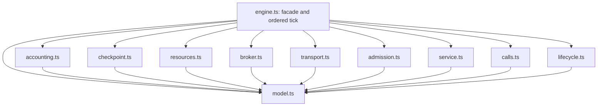

## Engine phase split: lane B proposal (2026-10-25)

**Proposal only; the orchestrator chooses the file map before implementation.** Inventory baseline:
`76253429898cf77c4631a10bcf0afc4fbb1eb879`, `src/sim/engine.ts`, 5,108 lines. All ranges below are
inclusive source lines at that commit, including comments and whitespace; sizes are approximate physical
lines, not statements. This proposal makes no simulation, schema, UI, output or packaging change.

Recommend **ten internal modules and five PRs**. Keep `engine.ts` as the public facade, composition root
and explicit tick scheduler. In particular, calls, retry timers and reply settlement form one concern:
splitting them into three mutually dependent modules would obscure the current ordering contract.

## Inventory: state and clocks

These are mutable object graphs, not independent stores. An edge references its two nodes; a delivery
references its broker, group and edge; a work item references its message, attempt and reservations.
Read/write listings include mutations reached through these references.

| Slice               | Current fields and ownership                                                                                                                                                                                                                                                                                                                  |
| ------------------- | --------------------------------------------------------------------------------------------------------------------------------------------------------------------------------------------------------------------------------------------------------------------------------------------------------------------------------------------- |
| Clock/configuration | `time`, `accumulator`, `speed`, `traffic`, `scale`, `cohort`, `cohortDots`, `capacityMultiplier`, `incomingAt`, `incomingBeforeReleases`; `seed`, `randomState`, `randomCalls`; planning/revision switches, options and `configuration` cache. Wall time advances by `STEP` (10 ms); each eligible node has its own `activeMs`.               |
| Topology            | `nodes`, `edges`, `compiled`, `topology`, `faultIndex`, `faultEdges`, `groupsByConsumer`, `metricGroups`; node resolved/raw props, routes, table, target/quota maps, replicas and group assignments. Iteration/insertion order is observable.                                                                                                 |
| Transit/source      | `injections` heap and `nextInjection`; `trips`, `drawnTrips`, `drawn`, `echoExpiries`, `echoByTime`, `nextParticle`; `sourceRate`, `sourceEmitted`; node traffic/mix credits and deficits, routing streams; edge `active`/`delivered`, node `incoming`/`incomingUnits`.                                                                       |
| Queue/admission     | `admission` buckets, leases, in-flight and retained-excess counts; node `pending`, `resume`, `takeovers`, queue/staged/unit counters, `admitting`/`admissionDirty`, `admittedAt`; group staged queues and held slots; `advancingWork` guard.                                                                                                  |
| Execution/resources | `ledger.state`, `partBudget`, `execution` adapter; work request/thread leases, CPU parts/backlog and deadlines; node working arrays, thread tails, CPU tails, resident/request/thread weights and counts; fleet starts, busy/range/drain state, memory/CPU integrals and controller state.                                                    |
| Calls/timers        | `calls`, `logical` heap, `logicalIndices`, `nextCall`, `nextAttempt`, `nextLogical`; node calls/held/off-thread/waiting counters; edge pool pending heap/indices/leases/usage, branch deadlines, retry windows/streams and breaker state; `earlyPoolWakes`, `releasingEarly`.                                                                 |
| Accounting/faults   | `inSystem`, `nextMessage`, message family identity/alive/parked/route completion, `lineage.state`, `routeCounts`; node outcomes, loss reasons, latency recorders, throughput and per-step completions; `events`/`eventHead`, `latencyBudget`, `latencySinceFault`, `sinceFault`, `faults`; test-only outcome/resource/resilience diagnostics. |

Internal engine interfaces occupy lines **173–478 (~306)**: `Message`, `Group`, `Delivery`, `Work`,
`RouteDecision`, `Node`, `Call`, `Logical`, `Edge`, `Trip`, `EchoExpiry`, `Injection`. Imports and constants
occupy 1–172; `isBroker` and observer/seed/draw-count facade helpers are 480–502. Factory setup and shared
adapters are 504–738 (~235), including the ledger release callback (538–567), occupancy/recount helpers
(589–687), execution reservation wiring (653–674), and lineage lookup (716–734).

## Inventory: actual tick order

`tick()` is **3869–4285 (~417 lines)**. Arrival, admission, settlement and timers are interleaved;
the following is the existing order to preserve, not a proposed reordered pipeline. Helper spans overlap
where one helper serves several phases; their sizes must not be added to estimate total file length.

| Order / phase                                          | Tick lines; functions and helper spans (approximate size)                                        | Reads                                                                                                                                  | Writes / synchronous effects                                                                                                                                                                                                                                                                                                                                  |
| ------------------------------------------------------ | ------------------------------------------------------------------------------------------------ | -------------------------------------------------------------------------------------------------------------------------------------- | ------------------------------------------------------------------------------------------------------------------------------------------------------------------------------------------------------------------------------------------------------------------------------------------------------------------------------------------------------------- |
| 1. Advance clocks                                      | 3870–3874 (~5); `held` 1249–1251                                                                 | Status, failover `holdUntil`, current wall clock                                                                                       | `time += STEP`; eligible up nodes' `activeMs += STEP`. Paused/down/held nodes do not accrue active time.                                                                                                                                                                                                                                                      |
| 2. Fleet startup/drain timers                          | 3875–3887 (~13); existing `advanceFleet`; `assignReplicas` 1341–1397 (~57)                       | Fleet starts/drains, `resourceWork`, wall time, topology and group membership                                                          | Fleet readiness/assignments, replicas, group allocations/limits/staging; collect `fleetChanges`; determine whether **any** fleet enables `resourceClock`.                                                                                                                                                                                                     |
| 3. Early capacity settlement                           | 3888–3894 (~7); ledger callback 538–567 (~30), `ledger.releaseDue`                               | Each node's active clock, reservation scopes/weights, admission keys, edge pool leases                                                 | Reservation/admission ownership, thread/request counts, resource release, pool/in-flight counts; may reenter `admitPending`; defer pool dispatch to `earlyPoolWakes`. Set `incomingBeforeReleases`.                                                                                                                                                           |
| 4. Early arrivals, only without fleets                 | 3895–3898 (~4); `admitIncoming` 3729–3784 (~56), detailed below                                  | Transit/source/call heaps, traffic gates, source rate/mix credit, time                                                                 | Emit due injections and traffic; drain logical events; expire decorative echoes; deliver due trips; run arrival routing/admission/instant completion. Set `incomingAt`.                                                                                                                                                                                       |
| 5. Per-node credits / diagnostics                      | 3900–3935 (~36); `slots`, `ceiling`, occupancy helpers                                           | Revision, role, status, fleet/resources, latency, gateway ceiling, scale                                                               | `cpuTick` diagnostic, legacy processor service credit and gateway rate credit. Preserve node Map order.                                                                                                                                                                                                                                                       |
| 6. Per-node CPU/service, unless paused or held         | 3936–4114 (~179); `spendCpu` 3804–3867 (~64); `executionGraceDeadline` 3540–3544                 | Working/tail sets, fleet replica CPU, memory residence, active leases, retry/backoff clocks, sampled weights                           | Build tick-local CPU budgets; expire grace tails; charge nonyielding/yielding tails, then working first waves, then yielding tails again. Compact `working` in place under `advancingWork`; update remaining service/wait/CPU and message work time. Reacquire or requeue missing ownership; retry admission may reject; invoke `finish`/`settleWork` inline. |
| 7. Per-node integration / autoscaling                  | 4115–4185 (~71); `waitingRequests`, `cloudReads` 3502–3525; `reconcileResources` 3545–3561       | Occupancy captured before work, CPU charges, fleet integrals, controller poll/sync clocks, broker metrics, override/status, multiplier | Release sampled drains; memory credit and resource integrals; evaluate on-demand/KEDA/HPA/cloud controller, reconcile desired fleet, commit scaling change, schedule grace events, add changed assignments. This happens for each node before moving to the next node.                                                                                        |
| 8. Per-node admission without a fleet                  | 4187–4190 (~4); `admitPending`/`admitPendingPass` 3562–3727 (~166)                               | Pending/resume/takeover queues, status, quotas, slots, credit, reservations and deadlines                                              | Shed expired queued work; prioritize owned work/continuations; reserve request/thread/resource capacity; start/finish work; set `admittedAt`. Reentrant attempts set dirty rather than mutating the current service compaction.                                                                                                                               |
| 9. Reassignment, logical settlement, deferred dispatch | 4192–4196 (~5); `drainLogical` 2529–2632 (~104), `dispatchCalls` 2068–2125 (~58)                 | `fleetChanges`, due logical events, call/attempt identities, early pool wake Set                                                       | Assign replicas again; settle replies/deadlines/graces/retries and logical arrivals; then dispatch early pool wakes in Set order; clear wake scratch state.                                                                                                                                                                                                   |
| 10. Late arrivals, only with fleets                    | 4197–4200 (~4); same `admitIncoming`                                                             | Same inputs as phase 4, after service/resource integration                                                                             | Same effects as phase 4, including **another `drainLogical()`** inside it; set `incomingAt`. The nonfleet path also drains logical events twice overall (inside phase 4 and in phase 9).                                                                                                                                                                      |
| 11. Fleet-backed admission                             | 4201–4205 (~5); same `admitPending`                                                              | Post-arrival queues and post-integration fleet/admission capacity                                                                      | Same admission mutations as phase 8; set `admittedAt`.                                                                                                                                                                                                                                                                                                        |
| 12. Broker dispatch, credit expiry, throughput         | 4206–4211 (~6); `pull` 3418–3448 (~31), `planDelivery` 3360–3416 (~57), `consumerRoom` 3328–3340 | Broker status/groups, consumer prefetch/assignments/slots/filter/cut state, group cursor; active clocks; completed counts              | Split/deliver group fronts, update backlog/active/group cursor, enqueue trips; expire ledger credits; EWMA throughput and clear `completedThisStep`. A broker's new trips are not revisited as arrivals this tick.                                                                                                                                            |
| 13. Invariant observers                                | 4212–4284 (~73); `onTheWay`, `liveWork`, `queuedWork`, `resourceWork`, `checkedQueued`           | All live ownership/transit graphs and tick diagnostics                                                                                 | Invoke resource/resilience/ledger/outcome oracles only under test flag; clear resilience arrays and outcome history. Retain the exact post-tick observation point.                                                                                                                                                                                            |

### Arrival, dispatch, service and settlement helpers

| Concern                                   | Functions and source spans (approximate physical size)                                                                                                                                                                                                                                                                                                                                 | Shared reads and writes beyond the tick table                                                                                                                                                                                                                                                                                                                                                                 |
| ----------------------------------------- | -------------------------------------------------------------------------------------------------------------------------------------------------------------------------------------------------------------------------------------------------------------------------------------------------------------------------------------------------------------------------------------- | ------------------------------------------------------------------------------------------------------------------------------------------------------------------------------------------------------------------------------------------------------------------------------------------------------------------------------------------------------------------------------------------------------------- |
| Source and transit scheduling             | Injection `schedule`/`unschedule` 739–766 (~28); `deliver`, `accepts`, `rename` 939–1002 (~64); `cutPush`/`latency` 1094–1106 (~13); `arrived` 1174–1176; `keepEcho` 1228–1241; `travel` 1584–1632 (~49); `injectedRoute`, `emit`, `emitOne` 3263–3298 (~36); `admitIncoming`, `emitMix` 3729–3802 (~74)                                                                               | Read seeded RNG, route definitions and message budgets; write IDs, route sent counts, message/family lifetimes, credits/streams and transit heaps. `deliver` schedules logical request arrivals separately from decorative particles; particle caps must not affect logical execution.                                                                                                                        |
| Arrival routing / queues / admission      | `startAttempt`/`scheduleWork` 1129–1172 (~44); queue operations 1178–1226 (~49); `acknowledge`/lease release 1634–1652 (~19); `admit`/held staging 1654–1716 (~63); `rejectAdmission`, shedding, splits, `reserveAdmission` 2867–3117 (~251); `arrive`, `routeOnArrival`, `refuse` 3119–3261 (~143); pending passes 3562–3727 (~166)                                                   | Read node role/status/table/quotas, fleet capacity, ledger and group slots; write request/thread/queue leases, queue order and unit caches, routing streams/route choice, rejected/shed counts. Call completion/refusal and broker unstage synchronously; these are not deferred command batches.                                                                                                             |
| Broker distribution and forwarding        | `indexGroups`/`readBrokerMetric`/prefetch helpers 1253–1339 (~87); `assignReplicas` 1341–1397 (~57); `forward`, `outputRoutes`, `addressedView`, `publish` 2638–2704 (~67); `returned` through `pull` 3300–3448 (~149)                                                                                                                                                                 | Read topology, assignment and consumer work/pool occupancy; write group queues/limits/cursors/allocations/active counts, node cursor, parked families, delivery/DLQ counters and transit. Filters can draw RNG, so preserve scan order.                                                                                                                                                                       |
| Logical calls, retry and reply settlement | `ended`, `answer`, `attempt`, `decide`, `commitAttempt`, thread/request retirement and `beginCall` 1734–1967 (~234); breaker/probe/dispatch functions 1969–2125 (~157); retry counts/window/cancel/`maybeRetry`/`retryCall`/deadline/pool functions 2127–2316 (~190); delivery suspension, call release and `settleAttempt` 2318–2526 (~209); `drainLogical`, `reply` 2529–2636 (~108) | Read branch/attempt identity, status, revision, active clocks, ledger, retry budgets/breakers and routing; write logical heap/indices, pool queues/leases, attempt outcomes, retry RNG stream, waiting/held counters, continuation CPU/thread ownership and late replies. May immediately dispatch, admit an arrival, or finish/fail work. Retries are due events here, not a standalone once-per-tick phase. |
| Local completion and broker retries       | `canRetain` 1718–1732 (~15); `retryFor`, `fail`, `settleWork`, `finish`, `complete` 2706–2864 (~159)                                                                                                                                                                                                                                                                                   | Read local RNG/failure policy, delivery retry count/backoff, call/revision and ownership; write attempt outcome, retained work/CPU/backoff, request/thread/group ownership, counters/lifetimes; invoke call join, forward/publish, reply or broker-return transit inline. Preserve the distinction between broker redelivery and connection retries.                                                          |
| Resource/controller support               | `initializeFleet`, `resetController`, `scheduleController`, `waitingRequests`, `cloudReads`, `resourceWork`, `executionGraceDeadline`, `reconcileResources` 3474–3561 (~88); `nodeWork` 3466–3468; `spendCpu` 3804–3867 (~64)                                                                                                                                                          | Fleet integrals/ranges/controllers and shared CPU part budget; read queue and broker metrics, write fleet desired/ready/drain state and schedule logical termination events. Existing `resources`, `cloudScaling`, `hpa`, `keda`, execution-reservation and ledger implementations remain in their current files.                                                                                             |
| Accounting, lineage and readouts          | `log`/`processed`/trace `step`/`gone`/route credit/budget/copy/fanout/`drop`/`block` 768–933 (~166); `topWaiting` 1108–1119; public readouts 4605–4662 (~58), `frame`/other readouts/`snapshot` 4856–4978 (~123)                                                                                                                                                                       | Read topology, queues, ledger/fleet and transit; write event ring, message/family/route counts, latency budget/recorders and completion counters. Frame/snapshot readouts preserve ordering, rounding and object shapes. `configuration` remains a lifecycle-invalidated facade cache.                                                                                                                        |

### Recovery, checkpoint and non-tick entry points

Recovery is driven by public edits/status changes, not a final tick phase. `boundaryDown`, `changeStatus`,
`shutdownOwner`, `faultProps` are **1004–1092 (~89)**. They read faults, paused lifecycle clocks and
live work/calls; write statuses, shifted deadlines, fleet/controller clocks, ledger ownership and resume
queues. `setNodePropsBatch` is **1399–1582 (~184)**: allocation preflight, props/routing/admission
reconfiguration, resource reconciliation, group reassignment and failover hold. It also invalidates
configuration and refreshes source rates. Refusal must remain a no-op, including the next replayed step.

`compileNodeRouting`/`refreshSourceRate` are **4288–4312 (~25)**; `reset` is **4314–4434 (~121)**;
`load` is **4663–4847 (~185)**. These rebuild topology, props, indices, queues, fleets, random/ID state
and runtime counters. Preserve reset's existing scope rather than broadening it to all configuration.
`step(dtMs)` **4848–4855 (~8)** owns fractional wall-time accumulation. Injection entry point
**4980–5005 (~26)** either emits synchronously or schedules a spread heap entry. Fault/status/props
entry points **5006–5071 (~66)** and scale/capacity/traffic/speed controls **5072–5101 (~30)** are
also outside tick; `setScale` recounts cached dot units but preserves real represented ownership.

Checkpoint/restore is **4443–4604 (~162)**, not a tick phase. It captures one shared/cyclic graph
containing nodes, edges, budgets, transit, logical events, ledger, calls, injections, events, admission
data, lineage, route counts and faults, plus scalar clock/ID/RNG state. It shares trace recordings and
latency data with copy-on-write semantics; restore clones again, repairs Deque/ShedQueue prototypes and
null-prototype dictionaries, rebuilds group/edge indices and admission configuration, then restores RNG
position. The WeakMap token belongs to one engine/topology. A checkpoint cannot serialize functions or
capture module-local stale copies of graph roots.

## Proposed file map and narrow interfaces

All ten files below are under `src/sim/engine/`. Names/signatures are proposed internal contracts;
the public `SimEngine` in `src/sim/types.ts` and exports from `src/sim/engine.ts` remain compatible.
Existing lower-level simulation modules stay where they are. Avoid a barrel or new lazy chunk boundary.

Factory ports are named, synchronous functions wired once by `engine.ts`. Each module accepts only its
listed slice plus its listed ports, never `SimEngine`, a catch-all engine context, or sibling instances.
Scalar reads use getters; replacement graph roots use typed getter/setter pairs. Stable `nodes`/`edges`
containers retain their current identity. Restore must replace the contents seen by every module.
These slices are views over the same graph, not copies or per-tick allocations. Node/work parameters
retain their identity; detailed `Pick` types limit writable fields where practical, with explicitly
documented full-work mutation for ownership transitions. Do not spread/clamp/recompute state to narrow it.

| Module / move ownership | Inputs and state slice                                                                                                                                                                                                                                                                                                                                                                                    | Output and explicit ports                                                                                                                                                                                                                                                                                                                                                                                                                                                                                                                                         |
| ----------------------- | --------------------------------------------------------------------------------------------------------------------------------------------------------------------------------------------------------------------------------------------------------------------------------------------------------------------------------------------------------------------------------------------------------- | ----------------------------------------------------------------------------------------------------------------------------------------------------------------------------------------------------------------------------------------------------------------------------------------------------------------------------------------------------------------------------------------------------------------------------------------------------------------------------------------------------------------------------------------------------------------- |
| `model.ts`              | Move internal graph interfaces 173–478, `DeliveryPart` near 3342, `isBroker`, structural work iterators (`liveWork`, `nodeWork`, `queuedWork`, `resourceWork`) with an explicit group-index argument. `WorkBudgetError` may move here with its existing facade re-export. No engine instance or mutable singleton.                                                                                        | Export internal types and pure structural queries. No phase calls. Existing imports of the error keep the same constructor identity.                                                                                                                                                                                                                                                                                                                                                                                                                              |
| `accounting.ts`         | Move 768–933 except source allocation orchestration; `topWaiting`, route views/counts, throughput finalization and frame/snapshot/readout builders. Own event-ring/lifetime/route/latency slices and message ID allocation; read clock/scale, topology and tracer.                                                                                                                                        | `log`, `processed`, `traceStep`, `gone`, `copy`, `fanOut`, `addressed`, `creditRoute`, `drop`, `block`, `readFrame`, `readSnapshot`, `finishTickMetrics`. Ports: `spendMessageBudget`, `observeEvent`, occupancy/backlog/resource read functions, live-message lookup for lineage. Return existing messages/readouts; no admission, dispatch or settlement port.                                                                                                                                                                                                  |
| `checkpoint.ts`         | Move clone/repair/capture/restore implementation 4443–4604. Accept an explicit data-only `CheckpointGraph` and `CheckpointClock` matching the existing capture lists, engine/topology token scope and lineage sharing hook. This is the intentional whole-graph boundary.                                                                                                                                 | `capture(): EngineCheckpoint`, `restore(token): void`. Ports: `readGraph`, `readClock`, `installGraph`, `installClock`, `reindexGroups`, `rebuildAdmission`, `invalidateConfiguration`, `resetRandomPosition`. Installation order stays identical. Clone once as a graph, never independently per slice.                                                                                                                                                                                                                                                          |
| `resources.ts`          | Move controller/fleet support 3474–3561, `spendCpu`, fleet advance and per-node resource integration/autoscaling blocks 3875–3881, 3943–4037, 4101–4185. Keep service call sites in their original positions. State: fleet/CPU-tail/part-budget/occupancy data, read clock/scale/multiplier, topology and group metrics.                                                                                  | `advanceFleets(changed)`, `prepareCpu(node)`, `spendCpu`, `finishCpuTails(node, scratch)`, `integrateAndScale(node, scratch, changed)`, init/reconcile/deadline/readout helpers. Ports: `readBrokerMetric`, `assignReplicas`, `scheduleLogical`, `scheduleThreadGrace`, `endResources`. Scratch carries the pre-service occupancy/budgets/tail shares within this node's turn; no rescan between nodes.                                                                                                                                                           |
| `broker.ts`             | Move prefetch/group metrics/assignment 1253–1397, group hold/stage/release 1219–1226 and 1654–1716, delivery suspension/settlement 2318–2340, `publish`, `returned`, `consumerRoom`, `planDelivery`, `pull` 2682–2704 and 3300–3448. State: group/index/allocation/held/off-thread/active counters and broker queues; read consumer status/capacity, scale, topology.                                     | `publish`, `pull`, `returned`, `hold`, `release`, `stage`, `unstage`, `settleDelivery`, `suspendDelivery`, `wakeDelivery`, `assignReplicas`, `readBrokerMetric`, `indexGroups`. Ports: `enqueue`, `scheduleWork`, occupancy/slots queries, `deliver`, `travel`, `accepts`, accounting operations. Return delivery parts/metrics or mutate the listed slots/queues synchronously.                                                                                                                                                                                  |
| `transport.ts`          | Move injection heap, emission/mix, travel/echo, arrival pump and forwarding/filtering: 739–766, 939–1002, 1094–1106, 1174–1176, 1228–1241, 1584–1632, 2638–2681, 3263–3298, 3729–3802; injection facade body. State: transit/source slice, source/routing credits, clock/scale/cohort/RNG reads.                                                                                                          | `admitIncoming`, `inject`, `emit`, `travel`, `deliver`, `forward`, `outputRoutes`, `accepts`, `latency`, `onTheWay`. Ports: `arrive`, `drainLogical`, `scheduleLogical`, `returned`, accounting/lineage hooks, traffic-limit query and logical/particle ID allocators. `admitIncoming` retains injection → traffic → logical → echo → trip order.                                                                                                                                                                                                                 |
| `admission.ts`          | Move queue primitives, unit recounts/slots/ceiling, pending/reentrant admission and arrival table/refusal logic: 597–633 as applicable, 1121–1127, 1163–1226 except broker staging, 1243–1251, 1641–1652, 2867–3261, 3562–3727. State: admission buckets, pending/resume/takeover queues, unit caches, guards, route streams, leases and node admission stamps; read live execution/fleet/group capacity. | `arrive`, `admitPending`, `enqueue`, `dequeue`, `resumeLater`, `scheduleWork`, `reserveAdmission`, lease release, `recountUnits`, `slots`, backlog queries. Ports: broker hold/stage/admit/release, execution acquire/retire/end, `startAttempt`, `finish`, `settleWork`, `answer`, `acknowledge`, accounting operations, `latency`, grace-deadline/occupancy queries. No new admission pass or dispatch queue.                                                                                                                                                   |
| `service.ts`            | Move `startAttempt`, `canRetain`, `acknowledge`, `retryFor`/`fail`/`settleWork`/`finish`/`complete`, and the local working-set advancement 4038–4100. State: working work/message/attempt fields, CPU/retry residence and service counters; shared current-node guard. Read status, RNG, clock, reservations.                                                                                             | `advanceWork(node, cpuScratch)`, `startAttempt`, `finish`, `settleWork`, `complete`, `fail`, `acknowledge`, `retryFor`. Ports: execution reservation operations, admission queue/reserve/release, broker lifecycle operations, calls `attempt`/`commitAttempt`/`beginCall`/`answer`, transport/forward/publish, resource CPU/deadline functions and accounting. Preserve inline callbacks and in-place compaction.                                                                                                                                                |
| `calls.ts`              | Move 1734–2316 and 2340–2636 except broker-only delivery helpers. Own call/attempt/logical heaps, pool, retry, breaker and diagnostic slices; thread/request retirement and ledger-release policy use the existing execution/ledger adapters. Read active/wall clocks, revision, status, scale and routes.                                                                                                | `beginCall`, `answer`, `attempt`, `decide`, `commitAttempt`, `drainLogical`, `dispatchCalls`, `scheduleLogical`, `scheduleThreadGrace`, `retireRequest`, `settleAttempt`, `detachCallThread`, retry-window queries and `releaseReservation` callback. Ports: service `complete`/`fail`/`retryFor`, admission enqueue/resume/schedule operations, broker delivery operations, execution ownership, transport `deliver`/`travel`/arrival/latency, accounting and grace query. Process every due event using the existing heap/comparator; no event-kind regrouping. |
| `lifecycle.ts`          | Move status/shutdown/fault helpers 1004–1092; `setNodePropsBatch` 1399–1582; routing compilation/source refresh/reset 4288–4434; load 4663–4847; fault/status/props and scale/capacity setters. State: topology/configuration/props/faults and explicit resettable roots/scalars.                                                                                                                         | `load`, `reset`, `setFault`, `setNodeStatus`, `setNodePropsBatch`, `setScale`, `setCapacityMultiplier`, allocation validation. Ports: compile/index/assignment/recount, fleet init/reconcile/controller reset, admission reconfigure, execution shutdown/reacquire, call settlement/grace scheduling, queue and accounting cleanup. Preserve allocation preflight before mutation and pause deadline shifts.                                                                                                                                                      |

The small overlap at `releaseCallEdge` (2340 onward) is resolved in favor of `calls.ts`; only
`suspendDelivery`, `wakeDelivery`, `settleDelivery` move to `broker.ts`. `admit` 1667–1680 belongs to
`broker.ts` (group-slot gating plus enqueue), and is passed as a port to admission/service/lifecycle.
`stage` similarly belongs to broker; `enqueue` and queue-unit accounting belong to admission.
`onTheWay` belongs to transport; structural `resourceWork`/`nodeWork` iterators belong to model even
where a broader resource-support range includes them. Occupancy/lease helpers stay beside the ownership
adapter they query.
Explicitly accounting for these small seams avoids duplicate implementations during parallel work.

`engine.ts` retains `createEngine`, option normalization, creation of RNG/ledger/execution/lineage and
data containers, observer/seed/draw WeakMaps, compatible public exports and thin `SimEngine` wrappers.
It retains `step(dtMs)` and the **entire ordering skeleton** of `tick`: clocks, fleet advance, early
release, conditional arrivals, one ordered node loop with credits/service/integration/nonfleet admission,
reassignment/logical drain/deferred dispatch, conditional late arrivals, fleet admission, broker/credit/
throughput finalization, test oracles. Local temporary sets and phase flags remain visible there.
It wires the ledger release callback to `calls.releaseReservation` without changing when it executes.
No per-node callback registry, generic phase runner or command-buffer interpreter is introduced.

## Dependency graph and acyclicity

Arrows mean source imports. Dashed conceptual wiring below is intentionally described in prose rather
than drawn as imports: `engine.ts` supplies every cross-phase function port from the table above.



`model.ts` imports existing graph/helper contracts with `import type`; it has no import of the facade
or any phase. Phase files import model types and their existing lower-level helpers only. **No phase
imports another phase or `engine.ts`, even for types.** Any lower-level helper that already imports the
facade must be made type-only or left in the composition root; do not add a back-edge to accommodate it.
This gives a topological order `engine.ts`, the nine sibling concern modules (in any order), `model.ts`,
then existing lower-level dependencies. Assign ranks 2, 1, 0 respectively to the new internal layers:
every internal import strictly decreases rank, which proves the proposed internal graph acyclic.
An import-boundary check should enforce this during implementation, including transitive helper paths
back to the facade; a drawing alone cannot prove the final implementation obeys it.

The **runtime call graph is deliberately reentrant**: service completion can settle a call and release
capacity, which can request admission. Injection ports preserve that existing control flow; they do not
claim runtime calls form a DAG. Initialize all ports before load/step can run. Read current roots through
accessors after restore; never bind a factory to the old `logical`, `calls`, `admission`, RNG or budget.
Keep `advancingWork`, `admitting`/`admissionDirty` and early pool-wake handling as shared guards.

## Five PRs: lowest risk first

Each PR starts from a synced, green predecessor, moves bodies mechanically, and narrows only their
closure inputs. Keep expression order, iteration order, comparator/tie behavior, arithmetic, rounding,
random draw order, defaults and revision gates. Do not combine a bug fix, cohort accuracy improvement,
algorithm change, field rename, new checkpoint format or engine-version change with these moves.

| PR                               | Files / movement and interfaces introduced                                                                                                                                                                                                                                                                                             | Focused equivalence evidence in addition to the common bar below                                                                                                                                                                                                                                                                                                    |
| -------------------------------- | -------------------------------------------------------------------------------------------------------------------------------------------------------------------------------------------------------------------------------------------------------------------------------------------------------------------------------------- | ------------------------------------------------------------------------------------------------------------------------------------------------------------------------------------------------------------------------------------------------------------------------------------------------------------------------------------------------------------------- |
| 1. Structural types and readouts | Add `engine/model.ts`, `engine/accounting.ts`; move graph declarations, structural iterators, event/lineage/accounting helpers and public readout builders. Keep bodies that require cross-phase ports in the facade until their turn. Introduce data-only graph types, readout inputs, accounting slice and event/budget/query ports. | Existing `engine.test.ts`, lineage/latency/partial-dot tests; snapshots/events/routes and RNG draw count before/after. Run checkpoint replay immediately: moving message IDs, budgets and lineage must not omit captured state. Type moves have no runtime output to normalize away.                                                                                |
| 2. Checkpoint boundary           | Add `engine/checkpoint.ts`; mechanically move the capture/clone/repair/install code while the remaining closures still live in the facade. Introduce `CheckpointGraph`, `CheckpointClock` and explicit install/reindex hooks.                                                                                                          | `checkpoint.test.ts`, `ledger.commands.test.ts`, routing/autoscaling/resilience replay properties. Repeated restore of the same token, foreign/topology rejection, fractional accumulator, queue prototypes and alias identity. This early extraction freezes the replay boundary before moving hot paths.                                                          |
| 3. Resource and broker concerns  | Add `engine/resources.ts`, `engine/broker.ts`; move fleet/controller support, CPU budget/tail/integration blocks and broker assignment/staging/pull/return bodies. Add typed per-node CPU scratch plus resource metrics/lifecycle and broker delivery ports. Facade still schedules every call at its old site.                        | Autoscaling/routing invariant heavy tests, CPU-tail/thread-tail and partial-delivery regressions, broker drain/DLQ cases. Preserve pre-service occupancy and two tail charging positions. Compare resource/ownership oracle observations per internal tick, not only final totals.                                                                                  |
| 4. Transport and admission       | Add `engine/transport.ts`, `engine/admission.ts`; move source/injection/transit/forwarding and arrival/queue/quotas/pending passes. Introduce named arrival/logical-drain/broker ports, queue/admission slice and shared phase-guard view.                                                                                             | Arrival/emission order, source/mix credits, queue shedding/continuation and routing tests; both resource-clock paths, pause/down/restore, scale edits and synchronous zero-service completion. Same RNG counts, event order, particle frames and per-tick ownership observations.                                                                                   |
| 5. Service, calls and lifecycle  | Add `engine/service.ts`, `engine/calls.ts`, `engine/lifecycle.ts`; move local advancement/completion, the coupled call/retry/deadline/settlement kernel, load/reset/status/props/fault paths and remaining ledger callback body. Narrow named ports and leave only facade/composition/tick skeleton.                                   | Existing waits, thread reservations, recovery, outcome/resilience and engine review regressions; call deadline ties, stale replies, retry cancellation, recovery after shrink, held delivery and refusal replay. This is last because continuation settlement and recovery reach the most ownership slices. Review moved-body diffs separately from adapter wiring. |

### Common acceptance bar for every implementation PR

1. `pnpm parity:node` and complete `pnpm parity`: **zero changed, added, missing or stale goldens**.
   Never run `parity:update` for this series. Node parity alone cannot cover particle rendering and the
   generated HTML viewer. No intentional output change or public showcase is part of this refactor.
2. Run the normal `scripts/fc-sweep.mjs` suite with **0 counterexamples**, preserving multipliers,
   generated command suites, waits/sampling/scale/resilience coverage and the pinned seeds below.
   Save reports with seeds/paths and run counts. A timeout or unrun seed is incomplete evidence, not a
   passing sweep. Do not conflate the exploratory `--i1` accuracy lane with the normal invariants lane.

   ```sh
   CI=true node scripts/fc-sweep.mjs --count 100 --multiplier 5 --heavy-count 10 --heavy-multiplier 20 --seed -2104931721 --seed 607376523 --seed -616590097 --seed 20261018 --jobs 2
   ```

3. Preserve the checkpoint replay property: for captured state `S` and the same ordered suffix of
   edits/steps `u`, `observe(run(S, u)) == observe(run(restore(checkpoint(S)), u))`, including repeated
   restoration. Compare snapshots, frames/events, metrics, effective props, RNG draw count and invariant
   observations at matching steps. Existing anchors are `checkpoint.test.ts`, `ledger.commands.test.ts`,
   `routing.invariants.heavy.test.ts`, `autoscaling.invariants.heavy.test.ts` and
   `resilience.invariants.heavy.test.ts`. Add focused characterization only where the extracted seam is
   unobserved; confirm any new assertion with a deliberate ordering/restore mutation. Restore is to the
   same engine/token; cross-engine comparison uses identical diagrams/seeds/action sequences, not foreign tokens.
4. Build the real production and viewer artifacts and run `pnpm size`. Against that PR's merge-base,
   allow **at most 1,000 bytes (1 KB) additional gzip JavaScript per PR**, measured over the total shipped
   app JS and separately over the transitive LiveSession download and viewer payload. Report raw/gzip
   deltas too; do not hide growth by shifting a module to another chunk. Preserve existing entry/viewer
   limits and startup-chunk tests (`src/lib/bundleSplit.build.heavy.test.ts`).
5. `pnpm regen`, then build and test the actual skill ZIP. Current assertion in
   `src/ai/skill/skill.heavy.test.ts:777` is **strictly less than 835,000 bytes**; use that stronger exact
   condition. Generated viewer bytes may change; semantic goldens must not. Commit required generated
   assets, without manifest/version changes or compression-policy changes. Record ZIP bytes/headroom.
6. Run focused benchmarks and normal lint/typecheck/format/unit/build checks; the full push gate follows
   the task's required workflow. All failures and flakes remain visible. Run only a failing unrelated
   spec twice against clean master if needed, not a second full suite. Complete required characterization
   and sweep evidence before calling an implementation PR equivalent; a busy local gate is not proof.

These are acceptance requirements for future code PRs, not claimed results of this documentation lane.
Parity, seed testing and replay are complementary evidence, not a formal proof over every diagram.
Mechanical moved-body review plus a fixed scheduling skeleton closes gaps that final-snapshot equality misses.

## Risks and mitigations

**Hot-path overhead and changed ordering.** Port calls, temporary context objects, copied maps and lost
inlining could cost more than the split removes. Wire functions once, reuse state views, pass existing
objects, and leave tick-local scratch allocation at its old site. Watch `tests/bench/node/sim.bench.ts`:
`sim/engineStep/w1-10000-open-calls`, `ledgerOpenCallsIdleStep`, `sim/engineStep/w2-storm`,
`w2StormAttempts`, ordinary `engineStep`/`engineFrame`/`engineSnapshot`, and `liveFrame` at x1/x10/x100.
Keep the 1,250-to-10,000 same-run input comparison and 24x bound, and the 30,000-attempt/drained-state
checks; do not add a millisecond threshold. Compare medians/p90 on base/head with identical workload,
seed and runner; inspect profiles for port dispatch/getters/allocation becoming material. Browser live
comparison belongs in the **Compare browser benchmarks** Actions workflow, fixed mode/grep/`BENCH_CPU`
as described in `docs/BENCHMARKS.md`, not a heavy local comparison alongside gates.

**Minified-name and ZIP churn.** Moving a closure changes bundler ordering, short names and compression
even with identical statements. Generated viewer diffs can be large without semantic changes; ZIP
headroom is narrow. Regenerate once after a batch, inspect authored and generated diffs separately,
compare actual output/ZIP sizes to the parent, and keep all caps fixed. Avoid namespace objects,
barrels, duplicated helpers, public export expansion and source-name tweaks solely to game compression.
If a move exceeds 1 KB or ZIP cap, revise the seam or reduce adapter overhead in that PR; do not borrow
an unrelated feature's budget or re-record a semantic golden.

**Checkpoint/restore and hidden state.** Independent cloning breaks aliases; closure capture of a
replaced root makes replay silently use old state. Functions inside clone data throw. Keep a single
data-only graph capture and existing scalar list, repair prototypes/indices in order, and install new
roots through explicit accessors. Preserve RNG position, pause/active clocks, event ring head, heap
indices, retained leases and copy-on-write trace/latency behavior. Do not turn scratch phase guards into
persisted state or expand checkpoint coverage accidentally. Use repeated replay and live-edit refusal
properties in every PR, not just the dedicated checkpoint extraction.

**Cohort work parked in [#316](https://github.com/latchkostov/diagrams/pull/316).** Its branch is
`feat/sampling-8b-deadline-cohorts`; the proposal does not adopt its accuracy changes. The PR describes
pooled-deadline cohorts and expected I1 accuracy failures, so normal-sweep equivalence must remain
distinct from exploratory accuracy progress. Keep current branch names/field names/expressions in
`calls.ts`, admission and CPU-tail paths; publish a source-range-to-module map with each move. Land the
five PRs serially, avoid editing cohort algorithms, and refresh the parked branch against each landed
boundary before the next coupled move. Preserve its reduced-seed regressions when resolving future
conflicts. If cohort work resumes first, re-inventory its kernel and rebase this proposal's ranges;
never merge an accuracy fix into a move to make a conflict disappear. No work on that branch is done here.

## UX review and rejected alternatives

The proposal adds no controls, terminology, inspector fields, examples or runtime surface. The UX
contract is unchanged: Live must preserve the same message flow, counts, latency, particles, traces,
pause/restart and replay. Full output parity and existing browser coverage protect that contract.

Rejected: splitting one file for every apparent tick label (arrival/admission/settlement reenter each
other); a generic mutable `EngineContext` passed everywhere (it conceals ownership); a buffered command
pipeline or global service-then-autoscaling passes (they reorder current synchronous effects); separate
call/retry/deadline modules (their shared heap/pool/attempt ownership would create import cycles or broad
callbacks); per-module checkpoint serialization (it breaks shared graph identity); and fixing sampled
cohort accuracy during extraction (it prevents zero-behavior-change review and obstructs #316 rebases).
Ten modules bound the dependency surface while leaving later simplification possible after equivalence.
