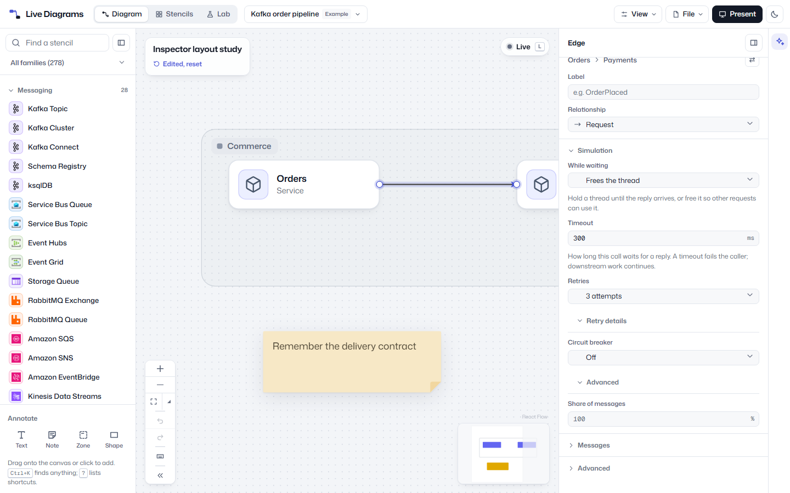
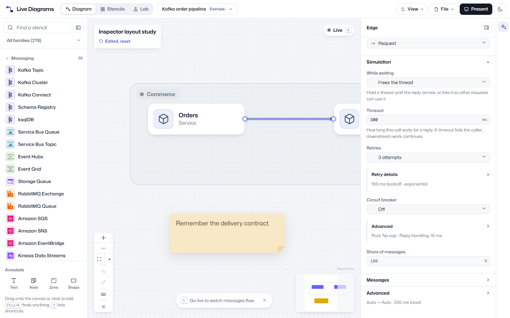
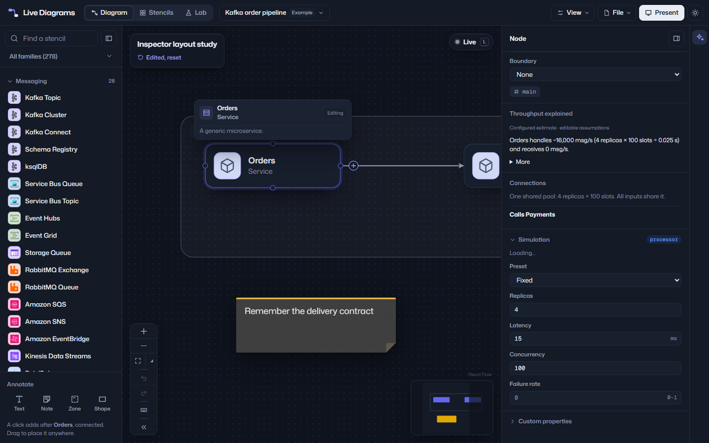
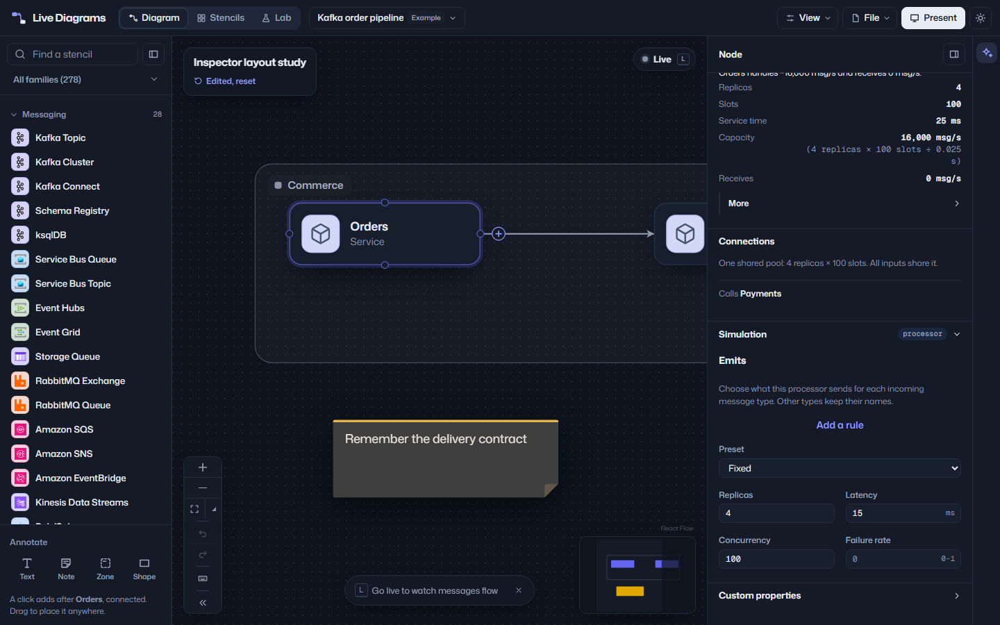

## Inspector layout

The Inspector now gives each complete field 16 px before the next field, with 4 px from label to control and 6 px from control to hint. Sections have stronger headings, right-aligned chevrons and collapsed value summaries. Short fields pair at sheet widths of at least 320 px and stack below that width; retry choices use a labelled fieldset.

Identity, node families, relationships, configuration settings, annotations, boundaries, Diagram, Messages, Autoscaling and Live use the shared layout. Read-only planning numbers reuse Live's definition-list component. Formulas sit below capacity values, and connection verbs are quieter than their targets. Input, select, dropdown, checkbox and toggle styling stays intact.

## Before and after

The complete local screenshot matrix is in `C:\Users\latch\bin\codex-tasks\inspector-layout\`: `before-*.png` and `after-*.png`, covering 21 surfaces at 1440×900 in both themes and 1280×800 in light, plus Simulation detail views. All diagrams are invented.

## Output parity

Only `tests/parity/goldens/node/i18n/catalogs.json` changes: the English catalog gains 24 `workspaceInspector` messages, increasing the catalog size from 2,898 to 2,922. The golden records the new namespace's per-language hash and fallback counts. Existing namespace hashes and all simulation, planning, export, layout and browser goldens are expected to remain unchanged. No translated catalogs were edited.
