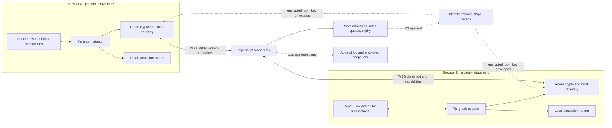

# Real-time collaboration for Live Diagrams

Research checked **15 October 2026**. Docs-only proposal; nothing here is shipped. Repository baseline:
`origin/master` at `16060ab9c4c0d3a5b350c1367cb1a527470c44ab`. All linked external sources were checked on
that date; dated articles retain their publication dates below. Prices are USD unless marked otherwise,
before tax, and are a snapshot rather than a commitment. **U = unverified**, including undocumented
implementation details; U does not mean a feature is absent. **Estimate/proposal** denotes our judgement,
not a vendor claim or a measured result. No competitor accounts, library benchmarks or load tests were
run for this research. Sources are first-party documentation, maintainer code and engineering posts.

## Executive summary — two minutes

**Move collaboration forward, starting with optional, anonymous, end-to-end encrypted rooms. Use Yjs
in the browser and a small TypeScript/Node WebSocket relay that never receives diagram keys or
plaintext. Keep the existing editor, files and browser library usable without an account or network
service.** This is an architecture recommendation, conditional on a short model/crypto prototype.
Yjs supplies mergeable document updates and selective undo; it does not supply our privacy policy,
permissions or encrypted transport. [Updates][y-updates], [undo][y-undo].

**Reliable internet collaboration needs a backend; basic drawing still does not.** WebRTC can avoid
an application data server on favourable networks, but practical discovery needs signalling and
restrictive networks need TURN. A relay is therefore the smallest predictable service, not the start
of a compulsory SaaS product. Add encrypted persistence when people need to return while everyone else
is offline; add accounts only for named invitations and saved workspaces. [WebRTC][webrtc],
[y-webrtc][y-webrtc], [encrypted asynchronous sync][secsync].

**Privacy is the release gate.** Today Private means no links or cloud saves, including password
links. Retain that default. Propose a separate, explicit permission to collaborate encrypted, scoped
to one diagram and relay; retain `private: true`, AI restrictions and export provenance. All rooms,
including non-Private ones, should use E2E encryption. A link grants access to its holder; encryption
does not identify the holder or retract copies already received. [Current gates][ld-gates],
[Share chooser][ld-share], [current privacy policy][ld-policy], [fragment behaviour][fragment].

**Start with Node, one Docker image, one service and no document database.** This matches the existing
Docker/Helm distribution and avoids making self-hosters adopt a cloud runtime. Budget an estimated
**$6–12/month pilot**, plus operations; medium usage needs load-test evidence before sizing. Workers
with Durable Objects is a credible later hosted adapter, with hibernation and metered costs. Do not
choose PartyKit's hosted platform: its October 8 notice schedules shutdown on October 23, 2026.
[Self-host kit][ld-host], [VM prices][vm], [Durable Objects][do-price], [PartyKit notice][party-migrate].

Sequence: **C0 proof and threat model → C1 encrypted co-editing with basic presence → C2 cursors,
follow/presenter mode and portable comments, then opt-in ciphertext storage → C3 optional identity,
workspaces and invites → C4 named versions/history.** Keep simulation execution local: a presenter
distributes a pinned diagram/scenario/seed and ordered controls, not particle positions or shared
counters. Preserve existing output goldens; benchmark 5,000-node editing and reconnect before launch.
[Simulation contract][ld-sim], [parity][ld-parity], [benchmarks][ld-bench].

## Product baseline and constraints

The app is a static browser editor with no application account/backend. Its local library has a
separate original, autosave and save destination per document; a shared-link document has a distinct
slot, and an edited example becomes a library copy. Reads/writes validate the native format and
preserve unknown extension fields. These behaviours must survive adding collaboration.
[Storage implementation][ld-storage], [interchange][ld-interop], [self-hosting][ld-host].

The existing Share chooser lists files and host-supplied embeds first; password links follow, with
public links/embeds folded last. `canShareAsLink` blocks every link for a Private diagram, including
encrypted password links. The existing password-link format encrypts a complete static diagram in
the fragment; it is neither a live room nor a server access-control system. The public policy
currently promises no Live Diagrams server and no uploads during local editing. A collaboration
release must update those statements precisely, while retaining them for ordinary local use.
[Chooser][ld-share], [gates][ld-gates], [link format][ld-links], [policy][ld-policy].

Owner requirements for this proposal: local use remains free and accountless; collaboration is
optional; Private room traffic must be explicitly authorised and E2E-encrypted, with no plaintext
on relay or persistence servers. Existing file exports and host-supplied embeds retain their documented
behaviour. Never accept user API keys. Service credentials
belong to the operator's secret store. Self-hosting remains supported. The roadmap currently treats
collaboration as a decision to make, while the competitive report ranks shared review/co-editing as
a major gap and portable review as an opportunity. This document recommends advancing C0/C1 without
silently rewriting the rest of the roadmap. [Roadmap][ld-roadmap], [landscape][ld-landscape].

## How other collaborative canvases work

Each row is a **2026-10-15 evidence snapshot**. “Server-readable” is an inference where a documented
server merges document properties; TLS and encryption at rest do not establish E2E encryption.
Historical architecture posts describe that version of a system, not a guarantee about every
current feature. Product and SDK are distinguished deliberately.

| Tool                        | Sync model and server role                                                                                                                                                                                                                                                                                                       | Identity and access                                                                                                                                                                                                                                 | Encryption and persistence                                                                                                                                                                                                                                                                                                               | Offline and pricing model                                                                                                                                                                                                                                                                                            |
| --------------------------- | -------------------------------------------------------------------------------------------------------------------------------------------------------------------------------------------------------------------------------------------------------------------------------------------------------------------------------- | --------------------------------------------------------------------------------------------------------------------------------------------------------------------------------------------------------------------------------------------------- | ---------------------------------------------------------------------------------------------------------------------------------------------------------------------------------------------------------------------------------------------------------------------------------------------------------------------------------------- | -------------------------------------------------------------------------------------------------------------------------------------------------------------------------------------------------------------------------------------------------------------------------------------------------------------------- |
| **Excalidraw**              | Client element reconciliation uses versions and a deterministic nonce tie-break; Socket.IO room relay. This is custom reconciliation, not evidence of Yjs/OT. [Code][ex-reconcile], [relay][ex-room].                                                                                                                            | Free editor/room link; accountless baseline. Treat the full link as a bearer secret. [README][ex-readme], [maintainer explanation, 2021-01-14][ex-links].                                                                                           | E2E rooms; decryption key stays client-side in the URL fragment. The maintainer documents encrypted room persistence: the free room is **not necessarily ephemeral**. Current retention/deletion SLA U. [Links][ex-links], [maintainer reply, 2022-02-15][ex-privacy].                                                                   | README documents PWA/offline and browser autosave. Free MIT app; Plus is a separate offering, current Plus price U here. An embedded npm canvas is not the complete hosted collaboration app. [README][ex-readme].                                                                                                   |
| **tldraw / tldraw sync**    | `TLSocketRoom` keeps authoritative document state and distributes WebSocket updates; one room owner per document. Node or Workers hosting, persistence hooks/backends. [Sync][tl-sync].                                                                                                                                          | SDK auth is the integrator's responsibility; no inherent account requirement. Demo links are for prototyping, not a production service. [Sync][tl-sync].                                                                                            | Document-aware server: infer server-readable state, not E2E. Local persistence uses IndexedDB; sync storage must be configured. [Sync][tl-sync], [persistence][tl-persist].                                                                                                                                                              | Offline local persistence exists; verify network disconnect/reload behaviour for a particular sync integration. SDK is source-available under its own licence; production needs an active commercial, trial or discretionary hobby licence. Hosting is additional. [Persistence][tl-persist], [licence][tl-license]. |
| **Figma / FigJam**          | 2019 post: custom CRDT-inspired property merging with server ordering over WebSockets, not a general decentralised CRDT. 2022 post: authoritative validation and write-ahead log plus checkpoints. Code Layers later uses a different text merge algorithm. [2019][fig-multi], [2022][fig-reliability], [Code Layers][fig-code]. | Account-based ownership/editing. Paid/Education FigJam open sessions permit accountless visitors for 24 hours, optional password; visitor comments require login. Do not generalise this exception to all Figma editing. [Open sessions][fig-open]. | Server-readable multiplayer is inferred from documented validation/merging; E2E content encryption not established. Cloud persistence/WAL documented. [Reliability][fig-reliability].                                                                                                                                                    | Limited edits to loaded pages while disconnected, then sync; not full offline operation. Free Starter plus paid seats; displayed Professional Collab seat $3/month, Full $16/month, billing selection must be rechecked at purchase. [Offline][fig-offline], [plans][fig-price].                                     |
| **Miro**                    | Cloud real-time board collaboration and persistence; exact OT/CRDT algorithm **U** in reviewed sources. [Plans][miro-price], [visitors][miro-visitors].                                                                                                                                                                          | Owner needs account; visitors need none. Free-plan visitors view only; paid/Education can comment/edit. Registered guests are a separate private-board role. [Visitors][miro-visitors], [roles][miro-roles].                                        | Vendor documents transport/at-rest encryption; content E2E **U**, not implied by a board password or customer-managed key. [Security policy][miro-security].                                                                                                                                                                             | No offline mode per system requirements. Free 3 editable boards; Starter $8/member/month and Business $20, billed yearly. [Requirements][miro-offline], [plans][miro-price].                                                                                                                                         |
| **draw.io / diagrams.net**  | Real-time editing with shared cursors in supported storage/integration modes: Google Drive, OneDrive, Confluence Cloud and qualifying Nextcloud. Confluence DC's documented mode is slower concurrent editing without shared live cursors. Exact merge algorithm U. [Concurrent editing][draw-sync], [DC post][draw-dc].         | Standalone local editing needs no draw.io account; collaborative access depends on the storage/platform's accounts and permissions. [Product][draw-home], [sync][draw-sync].                                                                        | Storage remains where chosen; current privacy policy says collaboration holds encrypted changes in memory for at most 5 minutes. This alone does **not** establish the key-distribution/E2E properties of every integration; verify per mode. [Privacy][draw-privacy].                                                                   | Local/desktop/offline editor available; live collaboration requires connectivity. [Offline docs][draw-offline]. Standalone editor free; commercial platform integrations have separate licensing. [Product][draw-home].                                                                                              |
| **Lucidchart / Lucidspark** | 2021 engineering post documents OT and a Node proxy that queues saves and resolves conflicts before storage. That is stronger evidence than assuming every whiteboard uses CRDTs. [Engineering, 2021-04-07][luc-sync].                                                                                                           | Account ownership; Team/Enterprise **Lucidspark** supports accountless Guest Collaborators by link, with view/comment/edit permissions. Do not claim that exception for all Lucidchart files. [Guests, updated 2026-07-01][luc-guests].             | Server-readable merge inferred from engineering post; E2E U. Server document storage documented. [Engineering][luc-sync].                                                                                                                                                                                                                | Pre-opened documents can be edited offline, but browser/document must stay open until reconnection. Free/Individual/Team/Enterprise tiers; exact current paid price U here. [Offline, updated 2026-03-05][luc-offline], [plans][luc-plans].                                                                          |
| **IcePanel**                | Shared architecture model, real-time updates across views, cloud versions/history. Wire algorithm and conflict handling U. [Plans][ice-price].                                                                                                                                                                                   | Account editors; read-only share links, unlimited viewers; password/SSO sharing on qualifying paid plans. Resetting a link revokes that version's active share links. [Sharing][ice-share].                                                         | Cloud persistence; E2E and precise client/server key custody **U**. Enterprise custom residency/customer keys are not proof of E2E. [Plans][ice-price].                                                                                                                                                                                  | Offline editing U. Free Starter: 1–5 editors, 100 objects; paid per-editor Growth/Scale and custom Enterprise. Current amount/billing varies; recheck page. [Plans][ice-price].                                                                                                                                      |
| **Eraser**                  | Real-time canvas/document editing, comments and version history. OT/CRDT implementation U. [Plans][er-price].                                                                                                                                                                                                                    | Account-based teams; sharing docs distinguish account-required edit links from accountless public view/edit links. Free guests do not by themselves imply anonymous guests. [Sharing][er-share], [members][er-members].                             | Server persistence; encryption details/E2E U in reviewed security page. Enterprise BYOC/single-tenancy offered. Sharing and older Private-files docs disagree about public links on Private files: use current sharing table provisionally and confirm hands-on. [Security][er-security], [sharing][er-share], [older page][er-private]. | Offline editing U. Free 3 files/7-day history; Starter $15 annually or $20 monthly per member; Business $45 annually or $60 monthly. [Plans][er-price].                                                                                                                                                              |
| **Structurizr**             | Workspace/DSL publication and locking rather than demonstrated simultaneous canvas merging. Cloud locking excludes another editor; server API exposes workspace lock/unlock. Keep legacy cloud and current self-hosted server distinct. [Cloud locking][str-lock], [API][str-api], [server][str-server].                         | Current open-core server has no built-in auth and public workspaces; licensed binaries add authentication/roles and token sharing. Do not expose open core publicly as a private workspace service. [Server][str-server].                           | Filesystem and optional object-store persistence. Current server E2E/key custody U; do not transplant historical cloud encryption claims. [Server][str-server].                                                                                                                                                                          | Local authoring/preview command available, but not evidence of offline multiplayer merge. Build-from-source open core free; prebuilt server licence starts £300/month for 1–20 unique annual users, billed annually. [Local][str-local], [pricing][str-price].                                                       |

**What to borrow (judgement):** Excalidraw's accountless encrypted-room boundary; Figma's property-level
changes and separate presence; Miro/FigJam's visitors versus durable members; IcePanel's model identity;
Eraser's review workflow. Do not borrow another product's meaning of “Private”: Live's existing promise
is stricter. Commercial SaaS feature breadth is not a reason to introduce accounts before co-editing.
[Live privacy][ld-gates], [landscape][ld-landscape].

## Sync technology comparison

The diagram is a graph of typed records, not a single text buffer. A converged CRDT can still contain
a dangling edge, cyclic boundary membership or incompatible simulation settings. Application
invariants, transactions and a deterministic projection remain necessary. This is our design
inference from the [native contract][ld-model] and [shared-type APIs][y-map].

| Approach                                   | Merge and diagram fit                                                                                                                                                                                                                                                                                                                              | Per-user undo and presence                                                                                                                                                                                                                                                                                           | Size/performance evidence, maturity, licence                                                                                                                                                                              | Decision                                                                                                                                                 |
| ------------------------------------------ | -------------------------------------------------------------------------------------------------------------------------------------------------------------------------------------------------------------------------------------------------------------------------------------------------------------------------------------------------- | -------------------------------------------------------------------------------------------------------------------------------------------------------------------------------------------------------------------------------------------------------------------------------------------------------------------- | ------------------------------------------------------------------------------------------------------------------------------------------------------------------------------------------------------------------------- | -------------------------------------------------------------------------------------------------------------------------------------------------------- |
| **Yjs**                                    | Maps, arrays and collaborative text; binary updates merge independent of delivery order and tolerate duplicates. Use maps by stable element ID and fields, never replace a whole diagram on every edit. Concurrent same-field values resolve deterministically, not by human intent or wall-clock “latest”. [Updates][y-updates], [types][y-repo]. | `Y.UndoManager` can track local transaction origins and attach selection metadata. Awareness is ephemeral and outside the document. [Undo][y-undo], [awareness][y-awareness].                                                                                                                                        | Pure JS core, broad provider ecosystem, MIT. Strongest ecosystem fit, not proof of 5,000-node performance. Historical size evidence below. [Repository][y-repo].                                                          | **First choice**, conditional on C0 correctness, lazy-load budget and churn tests.                                                                       |
| **Automerge 2 / 3**                        | JSON-like maps/lists/text, preserved causal history; concurrent field alternatives exposed through `getConflicts`, with deterministic winner. Attractive for inspectable forks/history. [Conflicts][am-conflicts], [repository][am-repo].                                                                                                          | Repository ephemeral messaging supports cursor/presence transport; identity/expiry still app work. Equivalent production-ready scoped canvas undo **U** in reviewed core docs: prototype inverse changes or maintained extension; never restore an old whole document over collaborators. [Ephemeral][am-ephemeral]. | Rust/WASM + JS, MIT, stable library. Automerge 3 keeps v2 file format and reduces history memory substantially; maintainer's text benchmark is not a diagram benchmark. [3.0 announcement][am3], [repository][am-repo].   | **Runner-up** if conflict inspection/history outweigh initial download and integration cost. Prefer 3 over an unmeasured v2 choice.                      |
| **Loro**                                   | LWW maps, text, movable lists and movable trees; promising for boundaries and layer ordering. Semantic edge validity remains our job. [Repository][loro-repo].                                                                                                                                                                                     | Built-in local `UndoManager`, origin exclusion, grouping and cursor callbacks; `EphemeralStore` for presence, separate from durable history. [JS API][loro-api].                                                                                                                                                     | Rust/WASM, MIT; 1.0+ documented. Smaller ecosystem is our assessment, not a reliability score. Snapshot/time-travel facilities documented; present Live workload performance U. [Repository][loro-repo], [API][loro-api]. | Keep as a C0 alternative if concurrent reparent/reorder becomes the dominant complexity.                                                                 |
| **OT, e.g. ShareDB**                       | Server coordinates operations; JSON0 supports JSON operations, other transform types pluggable. Requires correct transformation rules for every operation pair. Standard server processing sees content, conflicting with opaque E2E merging. [Introduction][ot], [types][ot-types].                                                               | Presence and offline reconnect documented; selective undo needs transformed inverse operations/binding, not whole-snapshot replacement. [Introduction][ot].                                                                                                                                                          | ShareDB MIT; Node/browser library. No equivalent 5,000-node comparison or shipped bundle measurement here. [Repository][ot-repo].                                                                                         | Reject for C1: a poor match for client-only plaintext and offline-first graph editing. OT is viable elsewhere, as Lucid demonstrates. [Lucid][luc-sync]. |
| **Custom server-authoritative properties** | Order operations centrally; merge independent properties, validate tree/graph invariants on server. Figma demonstrates this family. Cannot validate encrypted node contents without giving the server keys or a much more elaborate protocol. [Figma 2019][fig-multi].                                                                             | Undo must reverse only the user's surviving changes; presence uses separate ephemeral channels. Both need implementation. [Figma 2019][fig-multi].                                                                                                                                                                   | Potentially lean, but all protocol/offline/inverse semantics are ours to maintain. Bundle size and performance U until built. Our code could remain MIT.                                                                  | Reject for now: privacy mismatch and unnecessary algorithm ownership. Custom **transport/envelopes** are still needed around a proven CRDT.              |

### Bundle size and 5,000-node performance: what is actually known

For C0, pin the stable Yjs v13-compatible ecosystem rather than following repository `main` blindly:
the y-websocket README distinguishes stable `y-websocket`/Yjs v13 from unstable `@y/websocket`/Yjs v14.
Audit the exact selected versions and licences together. [Maintainer version guidance][y-ws-repo].

Loro's published comparison pins **Yjs 13.6.15: 84,017 raw / 25,105 gzip bytes; Automerge 2.1.10:
1,696,176 / 591,049; historical Loro 1.0.0-beta.2: 2,919,363 / 894,460**. These are historical test
artifacts, not current package sizes, the complete encrypted provider, or fair comparisons with
Automerge 3/current Loro. Do not copy these into our bundle budget. [Benchmark methodology/table][crdt-bench].

Automerge's 3.0 announcement reports over 10× memory reductions on history-heavy workloads; its
Moby Dick example is a **maintainer measurement on text**, not evidence for 5,000 nodes. No source
reviewed establishes end-to-end React Flow performance for our graph with any candidate. Memory also
depends on edits/deletions and actor count, not just current node count. [Automerge 3][am3].

**C0 measurement proposal:** identical seeded 625/5,000-node workloads from the existing benchmark
generators, fixed edge/boundary/annotation ratios, and 2/8/20 clients. Measure initial hydrate, single
property edits, drags, deletes, per-user undo, partition/reconnect, snapshot replay and long churn with
many short-lived actors. Record raw/gzip JS and WASM separately, heap after release, ciphertext bytes,
updates/fan-out, pending queue size and React renders. Compare with the same-run local editor baseline.
Gate operation counts and growth ratios (`growth()`, input eighth, limit 24 for intended linear work);
report latency percentiles as trends, never absolute millisecond assertions. Keep the collaboration
module out of entry/canvas startup chunks and use the existing bundle split test. [Quality][ld-quality],
[bench suite][ld-bench], [startup contract][ld-split].

## Transport, hosting and cost comparison

### Cost assumptions, not traffic forecasts

Use one explicit workload to make prices comparable:

- **Small:** 1,000 monthly collaborative participant-hours, up to 20 rooms × 5 clients = 100 concurrent
  connections; 1 stored GB if persistence is enabled.
- **Medium:** 10,000 participant-hours, up to 100 rooms × 5 = 500 connections; 10 stored GB.
- Per participant, average **one 1 KiB encrypted application message/second** while connected, with four
  recipients. That includes coalesced edits/presence, not every pointer event. Result: small **3.6M
  inbound / 14.4M outbound deliveries, 14.75 GB outbound**; medium **36M / 144M, 147.46 GB** (decimal GB).
  Snapshots, retransmissions, WebSocket/TLS overhead, HTTP/API requests and pathological active dragging
  are extra. These are arithmetic assumptions, **not measured usage**. A 20-person room amplifies each
  message to 19 recipients, so peer count and abuse caps matter more than MAU alone.

Estimates below exclude engineering, security review, on-call, taxes, domain registration, email,
backups and redundancy unless stated. Price formulas reference the checked 2026-10-15 pages.
“Scale to zero” distinguishes idle compute from stored bytes and minimum subscriptions.

| Option                                      | Role, E2E fit and operations                                                                                                                                                                                                                                                             | Small / medium monthly cost under these assumptions                                                                                                                                                                                                                                                                                                                             | Idle, self-hosting, lock-in and residency                                                                                                                                                                                                                                                                                |
| ------------------------------------------- | ---------------------------------------------------------------------------------------------------------------------------------------------------------------------------------------------------------------------------------------------------------------------------------------- | ------------------------------------------------------------------------------------------------------------------------------------------------------------------------------------------------------------------------------------------------------------------------------------------------------------------------------------------------------------------------------- | ------------------------------------------------------------------------------------------------------------------------------------------------------------------------------------------------------------------------------------------------------------------------------------------------------------------------ |
| **y-websocket**                             | Yjs sync/awareness server with optional persistence; a normal deployment processes readable Yjs updates. Encrypting entire messages requires replacing/adapting the provider protocol, not a configuration switch. Good reference, not our opaque relay unchanged. [Docs][y-ws].         | Software $0; estimate $6–12 / $12–48 VM infrastructure before HA. VM price points documented, throughput unmeasured. [VM][vm].                                                                                                                                                                                                                                                  | MIT; own Node container possible. No inherent idle scale-to-zero; own host/storage region. Low vendor lock-in; maintain runtime, TLS and scaling. [Repository][y-ws-repo].                                                                                                                                               |
| **Hocuspocus**                              | TypeScript Yjs server with auth hooks and storage/Redis extensions; v4 docs include Node/Bun/Deno/Workers. Normal server merges document state, so not E2E by merely wrapping its socket. [Overview][hocus], [persistence][hocus-store].                                                 | OSS $0; own infra estimate same $6–12 / $12–48 before persistence/HA. Managed Tiptap Platform is a separate paid product; no quote assumed. [OSS/platform][hocus-price], [VM][vm].                                                                                                                                                                                              | MIT core, own Node Docker image possible; residency operator-controlled, more extension/Redis ops when scaling. Scale-to-zero depends on deployment; storage still billed. [Overview][hocus], [platform][hocus-price].                                                                                                   |
| **Y-Sweet**                                 | Rust Yjs store with tokens, S3/filesystem persistence. Excellent readable-Yjs backend; document-aware service is not our opaque E2E relay. [Repository][ys].                                                                                                                             | Self-host software $0 plus estimated $6–12 / $12–48 and storage. Current managed price **U**: Jamsocket pricing redirects to Modal acquisition notice (2025-07-10). Do not reuse historical free tiers. [Notice][ys-host], [VM][vm].                                                                                                                                            | MIT, Linux/container deployment possible; own storage region, relatively low data lock-in. Scale-to-zero needs session orchestration; not inherent to one always-on server. Managed continuity/residency must be reconfirmed. [Repository][ys].                                                                          |
| **PartyKit**                                | Room abstraction over Durable Objects; successor is **PartyServer deployed directly with Wrangler**. Its Yjs integration keeps a Y.Doc; custom opaque broadcast is a different use. [Architecture][party], [Y integration][party-y], [migration][party-migrate].                         | **Do not procure hosted PartyKit.** Notice: no new projects from Oct 9; deploy/export deadline Oct 16; shutdown/deletion Oct 23, 2026. PartyServer costs become direct Cloudflare charges below. [Notice, 2026-10-08][party-migrate].                                                                                                                                           | Hosted platform is winding down. PartyServer avoids that intermediary but remains tied to Workers/DO APIs; not a production Docker backend for our kit. Standard WebSocket protocol helps a separate Node adapter. [Migration][party-migrate].                                                                           |
| **Cloudflare Workers + Durable Objects**    | One object routes a room; hibernating sockets are a good opaque-envelope fit. Low infrastructure ops; protocol, throttles, expiry and key security remain ours. [WebSockets][do-ws].                                                                                                     | Free: 100k requests/day, 13k GB-s/day; paid DO: 1M requests/month then $0.15/M, 400k GB-s then $12.50/M; incoming socket messages count 20:1, outbound messages uncharged. Workers paid starts $5/month. Illustrative small ≈$5, medium ≈$5.15 for request/active duration assumptions below, **not a quote**. [DO pricing][do-price], [Workers][workers-price].                | Hibernation reduces idle duration, not storage or all account charges. Not portable as a production DO cluster in Docker. High runtime lock-in. Jurisdictions constrain DO execution/storage; location hints alone do not; metadata can be logged elsewhere. [Location][do-location], [WebSockets][do-ws].               |
| **Liveblocks**                              | Managed sync/presence/comments/auth integrations; normal service documents TLS and encrypted-at-rest databases, not content E2E. Would need a supported opaque-data design; do not assume stock Yjs/comments meet Private requirements. [Security][lb-security].                         | Free 3,000 collaboration minutes, 3M stored updates, 1 GB, 200 comments. Pro $30/month including $30 credits; collaboration $0.002/participant-minute. Assumed small 60k minutes = **$120**, medium 600k = **$1,200**, before storage/update/comment charges. [Plans][lb-price], [minute counting][lb-faq].                                                                     | Low ops, idle usage falls but paid base remains. Self-hosting is listed as an Enterprise paid add-on, not an OSS Docker option. High feature/API lock-in; multi-region hosting listed Enterprise, verify exact residency contract. [Plans][lb-price], [security][lb-security].                                           |
| **Supabase Realtime**                       | Broadcast/presence plus Postgres/Auth; encrypted application payloads possible, but reliable CRDT catch-up/snapshots remain ours. RLS/channel authorization is access control, not E2E. [Authorization][supa-authz].                                                                     | Free 200 peak sockets/2M messages; Pro from $25, 500 sockets/5M messages, then $2.50/M. Broadcast accounting includes sent/received deliveries: approximate **18M → $57.50** small, **180M → $462.50** medium on Pro, before egress/storage/compute increases. [Plans][supa-price], [metering][supa-messages].                                                                  | Paid Postgres is not scale-to-zero; free pauses after inactivity, not instant economical socket hosting. Docker self-hosting supported but much heavier than a relay. Region choice/own deployment; moderate SDK coupling, portable Postgres data. [Hosting][supa-docker], [regions][supa-regions], [plans][supa-price]. |
| **Firebase**                                | Realtime Database/Firestore offer listeners and persistence, not a drop-in Yjs room. Could store ciphertext updates, but ordering/replay/compaction/roles remain app work. Firestore's offline cache is distinct from CRDT merging. [RTDB][fb-billing], [Firestore offline][fb-offline]. | RTDB Spark: 100 connections, 1 GB stored/10 GB downloaded. Blaze: $5/GB stored, $1/GB downloaded beyond allowance. Approximate small **$4.75 transfer** (or ~$5 with daily allowance) and medium **$182.46 including 9 paid storage GB**, before overhead. Firestore is a different operation-priced model; no substitution assumed. [Prices][fb-price], [billing][fb-billing]. | Managed/serverless, usage billing beyond free. No supported equivalent production Docker service in these docs; emulator is not that promise. High rules/SDK lock-in. Select database region and inspect each ancillary service's location. [Locations][fb-location], [emulator purpose][fb-emulator].                   |
| **y-webrtc + signalling + TURN**            | Direct peer updates, Yjs awareness; signalling password encrypts signalling. WebRTC data transport and signalling authentication are different layers; use a high-entropy secret. Networking/support and group topology become ours. [Provider][y-webrtc], [TURN][webrtc].               | Software $0; signalling host estimate $6–12. TURN example $0.05/outbound GB: if all modelled data relayed, about **$0.74 / $7.37** additional; actual mesh duplication/ICE traffic differs. No universal free TURN allowance assumed. [TURN price][turn-price], [VM][vm].                                                                                                       | Peer links can go idle without app compute but signalling remains; coturn can be self-hosted. Low vendor lock-in, more network ops. Peer IP exposure and TURN region matter. More peers can partition/overload mesh; provider explicitly warns about large collaboration groups. [Provider][y-webrtc], [coturn][coturn]. |
| **Minimal opaque Node relay (recommended)** | Only admits capabilities, routes encrypted envelopes, enforces quotas/expiry; no Y.Doc, keys, semantic merge or plaintext. Custom provider is real engineering work. Protocol design below.                                                                                              | Estimate **$6–12 / $12–48** single-node infrastructure, grounded in VM tiers, not measured capacity. Add backup/HA/persistence separately. [VM][vm].                                                                                                                                                                                                                            | One optional Docker service, no volume in C1; own region, low vendor lock-in. No inherent scale-to-zero. Later shard by room or add a DO adapter behind the same conformance tests. [Existing deployment contract][ld-host].                                                                                             |

**Workers estimate detail (proposal arithmetic):** at 0.125 GB/object, 200 small or 2,000 medium
room-hours/month produce at most 90k/900k GB-s if rooms stay active throughout (five people/room).
Medium's 500k excess GB-s rounds to one million billed, adding $12.50 and making the total **$17.65** rather than
$5.15. Hibernation may lower it substantially; continuous timers and non-hibernating sockets can
defeat that saving. At 20:1, 36M incoming frames become 1.8M DO requests, plus handshakes/HTTP; billed
units are rounded as documented. Budget **$5–20** for a bounded prototype and verify billing with the
actual protocol, including heartbeat behaviour. [DO pricing][do-price], [hibernation][do-ws].

**Cost conclusion (judgement):** availability and egress are cheap at bounded pilot scale; competent
operations, E2E protocol review and abuse handling are the real commitments. Presence-heavy billing
can dwarf storage. Self-hosters should pay only their own infrastructure costs; keep a free bounded
public relay if the owner accepts its budget. Do not promise unlimited free rooms or pay for a managed
suite to obtain basic sockets.

## Do we need a backend? Four separable tiers

| Tier                                 | What works                                                                           | What infrastructure exists                                                                                                                                                                                                                   | Limit / recommendation                                                                                                                                                                                                      |
| ------------------------------------ | ------------------------------------------------------------------------------------ | -------------------------------------------------------------------------------------------------------------------------------------------------------------------------------------------------------------------------------------------- | --------------------------------------------------------------------------------------------------------------------------------------------------------------------------------------------------------------------------- |
| **A. No Live Diagrams backend**      | Existing file/review-bundle exchange; experimental small WebRTC sessions.            | Files need none of ours. WebRTC needs signalling/ICE; a manual out-of-band SDP exchange can remove our signalling server, but is not a practical general invitation flow. TURN may still relay data. [WebRTC][webrtc], [provider][y-webrtc]. | Files are asynchronous. “Zero backend” WebRTC usually means somebody else's infrastructure. No durable join without a peer, predictable corporate connectivity or central immediate revocation. Do not make it the default. |
| **B. Thin E2E relay**                | Accountless simultaneous editing and online peer catch-up.                           | Public/self-hosted WSS service; random room IDs, scoped capabilities, volatile room metadata, rate limits. Proposal: no persisted document bytes.                                                                                            | **C1 recommendation.** If every peer leaves or the relay restarts, no server document can rescue the room. Local recovery remains; room expiry is explicit.                                                                 |
| **C. Relay + encrypted persistence** | Return to a diagram while peers are offline; durable comments and reconnect backlog. | Ciphertext append log, client-created snapshots, capability/epoch metadata, retention/deletion and backups.                                                                                                                                  | Add explicitly in C2b; no accounts technically necessary. Lost key means unreadable content. More durable abuse, storage and deletion obligations. [Design precedent][secsync].                                             |
| **D. Optional accounts/workspaces**  | Named invitations, per-member revocation, cross-device document list and roles.      | Identity sessions, membership/invite DB, encrypted key envelopes, email delivery and audit metadata.                                                                                                                                         | C3, not a prerequisite for B/C. Login authenticates a person; it does not decrypt their diagrams. Key provisioning/recovery is a separate design.                                                                           |

## Recommended architecture

Everything in this section is a **proposal**, informed by [Yjs's custom-provider interface][y-updates]
and [Secsync's signed encrypted snapshot/update design][secsync-spec]. Secsync is beta and leaves key
exchange/rotation outside its protocol; study it rather than declaring it an audited dependency.
Our protocol also needs independent review before making a Private collaboration guarantee.
[Secsync status and scope][secsync].



The relay and later storage are untrusted for content confidentiality. The static app publisher and
each admitted editor's browser are trusted: malicious delivered JavaScript or a browser extension can
read decrypted content. E2E protects against relay/storage disclosure, not a compromised endpoint or
server denial/withholding. Signatures and checkpoint proofs can detect some tampering/rollback, but
do not make a Byzantine service available or prevent all forks. [Threat-model precedent][secsync],
[snapshot proofs][secsync-spec].

### Language, runtime and deployment choice

Use **TypeScript + the repository's Node 24 toolchain + a small WebSocket server**, with separate
server dependencies. The client already speaks TypeScript; Yjs exposes binary provider interfaces;
sharing protocol types/testing tools lowers integration work. The relay itself need not import Yjs:
it should have no reason to understand diagram content. Node delivers a conventional OCI container
for both our pilot and the current Compose/Helm kit. This is an engineering fit judgement, not a claim
that Node is inherently faster or more secure. [Toolchain][ld-quality], [updates][y-updates],
[kit][ld-host].

**Workers/DO is the second deployment choice**, especially if unattended idle rooms make a VM's
operations unattractive. One object per room simplifies routing and hibernating sockets. Keep a
runtime-neutral admission/envelope state machine and a WebSocket wire contract; implement a Workers
adapter only when needed. Do not build two production backends in C1 or assume DO storage semantics
exist in generic Docker. Go/Rust are reasonable relay languages but add a second toolchain without
evidence that this bounded service needs it; Y-Sweet is a valid Rust solution to a different,
document-aware server problem. [DO sockets][do-ws], [Y-Sweet][ys].

### Room creation, joining and recovery

1. An explicit Share action creates a room from a validated, detached copy. No automatic relay
   connection on ordinary startup, local edit, export, example open or sign-in. C1 initially permits
   a proposed maximum 8 participants; larger rooms wait for load evidence. The owner chooses whether
   the session should later save ciphertext; C1 clearly says it does not.
2. Browser generates independent high-entropy room encryption material, owner signing/control keys
   and admission capabilities. Room ID is random and carries no title. Invitation could look like
   `https://www.livediagrams.dev/#room=<opaque-id>&key=<secret>&invite=<capability>`; actual grammar is
   versioned in C0 and must coexist unambiguously with existing `#d=`/`#e=` links. The **owner/admin
   capability is never included in the participant link**. Fragments are not sent in the initial
   HTTP request, but application code can read them. [Fragment specification][fragment].
3. The client consumes the fragment, clears it from the address bar using history replacement, and
   holds secrets in memory. Explicit “remember this room on this device” may store a recovery secret
   locally with an honest device-access warning. A copied link, browser history already recorded,
   extension or chat preview client remains a leakage route; clearing is mitigation, not erasure.
4. Exchange the invitation capability over TLS in an initial authentication frame or short-lived
   same-origin ticket; never send the decryption key, full page URL or capability in query/log fields.
   Relay stores capability hashes and room expiry; C1 metadata is volatile. Bind each connection to
   an admitted session signing key and signed role grant. Announce the real server expiry/limits.
   Admission alone is not content authorship: the relay knows admission tokens. An owner-signed
   role-link credential can carry a separate delegation signing secret only in the fragment;
   holders endorse their session public keys, recipients verify that chain against the owner key
   pinned in the invitation. The relay receives verifiers/signatures, never that delegation secret.
   All holders of one edit link share its authority; they cannot be individually identified or
   securely removed without ending/rotating that link. C3 replaces this with named member grants.
5. Existing peers provide encrypted state-vector/delta responses and a full encoded CRDT state for
   new peers. A late join has no document if no peer survives in C1: offer the local copy/new room,
   not an empty room masquerading as saved work. Relay restart expires C1 rooms; it must not silently
   recreate them from a stale invite. Local edits and an explicit new invitation recover work.
6. C2b instead loads an encrypted checkpoint plus committed tail; client verifies/decrypts/applies
   them. Store CRDT binary state and provenance, **not JSON reconstructed into a new Y.Doc on every
   join**. Reconstructing loses CRDT identity/history and can duplicate edits. [Persistence warning][hocus-store].

## Security, privacy and permission design

### E2E payloads and key lifecycle

**Proposed cryptographic boundary:** use an established AEAD construction, with a versioned protocol,
domain-separated keys for document/presence/comments and authenticated room/epoch/channel/sender/
sequence metadata. AES-256-GCM through WebCrypto is a candidate compatible with existing browser
crypto; its IV must be unique per key. Do not reuse the static password-link token format for a stream.
Review per-sender/session subkeys and nonce allocation, reloads, concurrent tabs and replay windows
before finalising it. [WebCrypto parameters][aes], [existing password format][ld-links].

Encrypt all document updates, state vectors, snapshots, comment bodies, display names, cursors and
presenter controls before the network. Sign envelopes with an admitted sender key; recipients verify
the owner-approved role/epoch and channel before decrypting/applying. A shared symmetric room key
alone proves only that **some member** wrote the message; it cannot distinguish a viewer from an
editor. Owner grants must pin verification keys so an opaque server cannot invent an editor simply
by asserting a role. For C1 all invited participants edit; reserve enforced viewer/comment channels
for C2 once their protocol tests pass. [Signing precedent][secsync-spec].

Removal requires **two different acts**: revoke network admission immediately and rotate encryption
keys for future content. C1's simple operation should be **End room for everyone** and create a new
room/key/link for the remaining people. “Leave” disconnects only oneself. C3 can have membership
epochs, per-recipient encrypted key envelopes and an atomic membership-change/key-rotation barrier.
Never broadcast the new room key under the old shared key. The removed party can still decrypt
anything retained under an old key and retain screenshots/exports. Do not claim retroactive erasure
or forward secrecy merely from one long-lived room key. [Key-rotation design precedent][secsync],
[MLS group key epochs, RFC 9420, July 2023][mls].

Rotating a key while keeping old CRDT tombstones/history inside a new snapshot can reveal deleted
content to newly admitted readers. Define separately who can see current state and historical
versions. For a hard removal/new membership boundary, use a **new document generation from the
validated visible state**, resetting old CRDT history and undo stacks; preserve old history only as
separately authorised encrypted versions. Old offline updates cannot be blindly merged into the new
generation: offer an explicit local recovery fork and reviewed change import. This deliberately
trades automatic cross-epoch merge for confidentiality; C0 must prove the transition. [Yjs GC][y-doc],
[encrypted snapshot considerations][secsync].

### What each party can see

| Observer                                   | Visible in the proposal                                                                                                                                   | Must not be visible                                                                                                          |
| ------------------------------------------ | --------------------------------------------------------------------------------------------------------------------------------------------------------- | ---------------------------------------------------------------------------------------------------------------------------- |
| Relay/operator                             | IP/network metadata, opaque room ID, connection times, message lengths/counts, admission/role/epoch metadata; C3 account/workspace/invite email metadata. | Diagram labels/structure, simulation inputs/results, comment/name/cursor contents, keys/passwords or complete invite URLs.   |
| Ciphertext storage/backup operator         | Ciphertext snapshots/tail, opaque IDs, byte sizes, creation/expiry metadata.                                                                              | Plaintext title, thumbnails, search index, document keys. Encrypt workspace display names/thumbnails too if stored remotely. |
| Admitted reader                            | Decrypted diagram and authorised versions; can copy them.                                                                                                 | No guarantee against copying. Reader should lack editor signing authority and admin capability.                              |
| Static app publisher / compromised browser | Can execute code with access to decrypted state and fragment material.                                                                                    | E2E cannot remove this trust boundary; pinned self-hosted builds reduce exposure to a changing public origin.                |

This visibility table is a proposed threat model, not proof of a completed implementation. Its
metadata/content distinction follows the [Secsync threat model][secsync] and [fragment rules][fragment].

### Passwords, roles, invitations and abuse

- **Room passwords:** optional C2 defence when a link is forwarded, not the root encryption key.
  Wrap a random room key using a password-derived key in the browser; send the password separately.
  A stolen encrypted envelope permits offline guessing, so a weak password is not repaired by a
  rate limit. If adding a server admission password, distinguish its verifier from the E2E key;
  prefer a reviewed PAKE design rather than a reusable plaintext password exchange. Do not make
  unreviewed password protocol invention a C1 dependency. Existing static links already define a
  password KDF, but reusable stream/key wrapping needs its own version and review. [Current format][ld-links].
- **View/comment/edit:** independent random admission capabilities and owner-signed grants, server
  checking rights for every frame, not just join. Separate diagram and comments CRDT documents,
  with distinct channel signing authority; a commenter cannot label a diagram update “comment” and
  have it applied to the diagram. A viewer may send bounded presence, never durable updates. A
  read-only UI alone is not authorization. Role downgrades close existing sockets and rotate grants;
  content-key rotation is needed to remove read access. [Message-level authorization][ws-security].
- **Free relay:** bounded room creation per network/session, per-room participants/bytes, frame size,
  outbound buffers and total aggregate egress; token buckets, backoff and idle/absolute expiry.
  Suggested initial limits are product policy to tune in load tests, not library guarantees. Drop
  stale cursor frames first; never silently drop durable edits. Disconnect/resync slow clients with
  local recovery intact. Reject cross-origin upgrades except explicit configured app origins;
  validate Origin even with cookie authentication. [WebSocket guidance][ws-security].
- **Content abuse:** E2E prevents server-side inspection. Keep anonymous rooms unlisted and
  short-lived, offer closure/reporting by opaque room ID, and document operator deletion/takedown.
  Do not solicit plaintext reports or add a moderation “backdoor”. Durable ciphertext has a bigger
  abuse/cost footprint, which is why retention/quotas precede open-ended storage. [E2E visibility][secsync].
- **Logs/diagnostics:** redacted counters/error codes only; no payloads, tokens, URL fragments,
  document titles, thumbnails or session replay. Logs and edge access records still contain network
  metadata; publish actual retention/region/subprocessor choices before C1. Avoid websocket
  compression of attacker-mixed sensitive traffic by default. [WebSocket guidance][ws-security].

### Fit with Private and Share

Proposal: add **Collaborate encrypted…** to the existing Share chooser, among controlled options,
without adding a permanent toolbar control. First invocation names the relay and explains who can
open the link, that encrypted content leaves the device, persistence/expiry and what “End room” does.
The first action remains the existing safe export. After joining, a compact session indicator can
replace/reuse existing status space; participant actions live there and in context. This is a UX
review proposal against the [chrome budget and Share vocabulary][ld-ux].

Private keeps its flag and every existing gate. Introduce a separate central `canCollaborateEncrypted`
decision: deny by default; allow only a scoped, explicit user grant and an allowed deployment, with
E2E mandatory. The existing no-network provenance category remains an unconditional denial; it must
not inherit this exception. A deployment with sharing disabled stays disabled unless the operator
explicitly enables collaboration separately. Internal/offline builds must never fall back to the
public relay. No relay-origin configuration or key is accepted from an untrusted invitation URL.
[Current centralized gates][ld-gates], [deployment switches][ld-host].

The exception is a **product-contract change**, not something to infer from an encrypted socket.
Before implementation, update Private's dialog/help, Share descriptions, privacy policy, schema
descriptions, agent instructions and self-host documentation together. Make exported/local copies
retain `private: true`, but strip room keys, invite/admin capabilities and the collaboration grant.
Importing/copying a Private diagram never reconnects. Disabling the grant stops local transmission;
it cannot recall others' copies. Explain **Stop sharing with everyone**, **Leave**, and **Keep on this
device** separately. [Current exported privacy field][ld-model], [policy][ld-policy], [gates][ld-gates].

## Identity without compulsory accounts

### Anonymous sessions and controlled links

**Proposal:** generate a room-specific alias and accessible colour; optional display name. Encrypt
those presence fields, expire them on disconnect, and label them unverified. Do not reuse a stable
cross-room anonymous identifier or interpret a display name as an authenticated employee. Yjs
Awareness provides an ephemeral substrate; our provider must encrypt it. [Awareness][y-awareness].

| Invitation mode            | Practical flow                                                                                                                                                       | Revocation/expiry and limits                                                                                                                                                                                                                 |
| -------------------------- | -------------------------------------------------------------------------------------------------------------------------------------------------------------------- | -------------------------------------------------------------------------------------------------------------------------------------------------------------------------------------------------------------------------------------------- |
| **Anonymous link (C1)**    | Owner copies a participant link; recipient joins without registration. Owner control secret stays separate.                                                          | Server expiry ends admission; End room closes all sockets. Anyone receiving the full link can forward it; no trustworthy per-person removal. New room/key/link excludes old holders from future edits.                                       |
| **Role link (C2)**         | Distinct view/comment/edit capabilities. UI states the role before copying.                                                                                          | Revoke that link's capability, invalidate bound sessions, rotate encryption material if read access is removed. Rotating a token alone does not revoke knowledge of a room key.                                                              |
| **Named link invite (C3)** | Single-use, expiring token binds a proposed membership to a logged-in verified identity after acceptance; membership rights granted server-side.                     | Revoke unaccepted invite or accepted membership separately. Recheck rights on reconnect and existing sockets. No automatic upgrade from an old anonymous link.                                                                               |
| **Email invite (C3)**      | Backend sends a one-use acceptance URL with expiry and minimum workspace metadata. After verified login, an authorised client provisions the encrypted key envelope. | Email is an identity/delivery channel, not an E2E key vault. Never send room keys/full secret links through backend-generated mail. If no authorised key holder is online, show “waiting for key access” rather than handing keys to server. |

This is proposed behaviour. Current Miro and Lucid document why link visitors and registered guests
are different, and why expiring a link may not revoke an already-created membership.
[Miro roles][miro-roles], [Lucid sharing controls][luc-sharing].

### Optional sign-in choices and costs

For C3, retain a provider-neutral identity adapter. Preferred direction: an **operator-controlled
OIDC/auth service** on the Node backend, using a maintained library; evaluate Auth.js's maintenance/
Better Auth migration before implementation, or self-host Supabase Auth if the team already needs
its database/service stack. Do not build passwords, session security or OAuth token validation by
hand. A managed provider can be an optional hosted shortcut, not a mandatory self-host dependency.
The [Auth.js documentation][authjs] now links to [Better Auth migration][auth-migrate]; re-evaluate
at C3 rather than prematurely pinning today's choice.

| Option                | Capabilities / fit                                                                                                                                                                                                                                                                                                                     | Checked 2026-10-15 pricing and qualifications                                                                                                                                                                                                                    |
| --------------------- | -------------------------------------------------------------------------------------------------------------------------------------------------------------------------------------------------------------------------------------------------------------------------------------------------------------------------------------- | ---------------------------------------------------------------------------------------------------------------------------------------------------------------------------------------------------------------------------------------------------------------- |
| **Auth.js**           | Free open-source auth integrations including Express; GitHub/Google/Microsoft Entra OAuth, email magic links. Need our own sessions/DB/mail deployment. Passkey guide explicitly calls its provider experimental, not recommended for production. [Home][authjs], [OAuth][auth-oauth], [email][auth-email], [passkeys][auth-passkeys]. | No hosted per-user fee from the library; infrastructure/mail/engineering remain. Licence/maintained successor and production passkey support must be pinned in C3, not assumed from a framework example.                                                         |
| **Clerk**             | Managed UI, social login, magic links, organizations/invites; convenient hosted path. No OSS self-host server established here. [Plans][clerk].                                                                                                                                                                                        | Hobby 50k **MRU**, not MAU; 100 retained orgs, up to 20 members/org. Pro $25 monthly or $20/month annual, 50k MRU included then from $0.02/MRU; organization enhancements extra. Passkeys not included in Hobby table; verify paid availability. [Plans][clerk]. |
| **Supabase Auth**     | Anonymous/social identities and email auth; Docker self-host option. Optional account identity must stay separate from room secrets. [Plans][supa-price], [self-host][supa-docker].                                                                                                                                                    | Free 50k MAU; Pro from $25 includes 100k, then $0.00325/MAU. Hosting/SMTP and other service usage separate. Native passkey status U in reviewed docs; do not advertise it without a verified integration. [Plans][supa-price].                                   |
| **WorkOS AuthKit**    | Managed social auth including Microsoft/Google, passwordless codes, passkeys, MFA/RBAC; enterprise SSO separately priced. [Pricing/features][workos].                                                                                                                                                                                  | Up to 1M MAU free; additional 1M users $2,500/month. Enterprise SSO starts $125/connection/month; custom domain $99/month. Not equivalent to a freely self-hosted auth server. [Pricing][workos].                                                                |
| **Cloudflare Access** | SSO/identity perimeter for an organisation's self-hosted editor/relay; not a replacement for per-document membership, key exchange or cross-organisation consumer accounts. [Access][access].                                                                                                                                          | Advertised free for teams under 50; paid $7/user/month billed annually. Existing proxy/IdP may avoid adding product accounts to an internal deployment; authorize the relay handshake too. [Access][access], [current SSO deployment][ld-host].                  |

**OAuth proposal:** support GitHub and Google initially, Microsoft/Entra where teams request it; use
minimal identity scopes, PKCE/state and server-side sessions, never ask for repository/Drive access
just to collaborate. Login providers may have approval/configuration constraints beyond library
fees. **Magic links:** optional email fallback with short-lived single-use tokens and rate-limited
delivery; provider mail scanners must not consume access merely by GET. **Passkeys:** add through a
production-supported WebAuthn implementation later. Authentication keys are not automatically
document decryption keys; cross-device E2E recovery still needs explicit design.
[Provider options][auth-oauth], [email flow][auth-email], [current passkey limitation][auth-passkeys].

## Map the Live Diagrams model to shared state

The table below is a **proposed CRDT projection**, grounded in the current [native types][ld-model],
[editor/history APIs][ld-editor], [undo capture][ld-history] and [Y.Map][y-map]. The native file remains
the portable source of product semantics; CRDT metadata is an additional session/storage format.

| Current data                                                                        | Proposed shared representation                                                                                                                                             | Local state / conflict policy                                                                                                                                                                                                          |
| ----------------------------------------------------------------------------------- | -------------------------------------------------------------------------------------------------------------------------------------------------------------------------- | -------------------------------------------------------------------------------------------------------------------------------------------------------------------------------------------------------------------------------------- |
| Title, description, background `color`, `direction`                                 | Document metadata map; text types where concurrent text editing is useful.                                                                                                 | Local selection/focus not stored here. Concurrent direction/layout commands are explicit user actions.                                                                                                                                 |
| `nodes`                                                                             | ID-keyed maps of fields; `label`/`sublabel` collaborative text if C0 proves binding/undo. Map individual `props` keys rather than replacing the whole props object.        | Shared drag result uses atomic `{x,y}` at minimum, not independently merged x/y. Local drag preview/pointer samples remain ephemeral; coalesce committed updates.                                                                      |
| `edges`                                                                             | ID-keyed fields; atomic endpoint pair where reconnect must preserve intent; labels/relationship/origin/props preserved.                                                    | Deleting a node and concurrently reconnecting an edge must yield the same projection everywhere. Hide/quarantine dangling edges without losing their recoverable source records; don't independently auto-delete them on every client. |
| `groups` (UI: boundaries), `group` membership                                       | ID-keyed boundary maps with geometry; explicit parent link/coordinate policy.                                                                                              | Deterministic cycle handling and ancestry ordering; never CRDT-merge a relative position from one parent with membership from another. Boundary move/grow/member updates are one local command.                                        |
| `annotations`                                                                       | ID-keyed text/shape/geometry fields; text CRDT for note bodies.                                                                                                            | Annotations stay outside simulation. A shape may remain an edge endpoint; text/note/zone may not.                                                                                                                                      |
| `layerOrder` and file-array ordering                                                | Explicit shared ordering of stable IDs with deterministic de-duplication/tie-breaks.                                                                                       | Preserve existing serialization and simulation iteration order; ID-sorting every import would change behaviour. Concurrent insert/move policy needs C0 tests; Y.Array delete/insert is not a native movable-list CRDT.                 |
| Saved `simulations`, traffic/timeline/expectations                                  | Maps keyed by their stable IDs, plus ordered lists/record IDs where the native format lacks them. Retain seeds, scale, multipliers, setup, duration and planning revision. | Added collaboration IDs are session metadata if not in native schema; don't leak them into exports accidentally. Timeline ordering for equal timestamps must be deterministic and tested.                                              |
| `planning`, shared quotas/allocations; `checks` ignores                             | Shared typed metadata/submaps, validated at command boundaries.                                                                                                            | Derived capacity/check results/caches remain local. No per-frame CRDT writes for metrics.                                                                                                                                              |
| `private` and permissions                                                           | Sticky local/export privacy provenance; encrypted document policy may only raise restrictions automatically. Relay grants/epochs are a separate signed control model.      | A remote edit/undo may never clear local Private policy or activate a network/AI permission. Consent is per device/diagram/relay, never replicated as permission to another browser.                                                   |
| Viewport, selection, inspector, panels, focus, theme/language, hover, fit readiness | **Not document CRDT fields.** Optional encrypted awareness publishes a bounded subset for follow mode.                                                                     | Inspector/view preferences remain each user's own. Presence has no undo/history/export. Follow is opt-in and local input releases it.                                                                                                  |
| AI conversation, save targets, file handles, provider tokens                        | **Never shared.**                                                                                                                                                          | Existing conversation stays browser-local; remote edits may invalidate a local AI action's undo eligibility. Cloud save destinations remain bound to a local document identity.                                                        |

### Command adapter, ordering and undo

Generate globally unique IDs for new collaborative elements (including boundary/annotation/edge IDs),
preserve imported IDs where valid, and remap an imported/pasted batch and all its references in one
transaction when collisions exist. Never use a per-tab incrementing counter alone or reuse deleted
IDs. Concurrent imports, two users adding the same stencil and delete/recreate need dedicated tests;
the CRDT's internal client IDs do not make our application IDs unique. This is a proposal against the
native ID/reference contract. [Native types][ld-model], [Yjs client identity][y-doc].

Do not synchronise React Flow's entire node/edge store or bolt networking onto debounced autosave.
Route semantic editor commands through an adapter: one Yjs transaction for a rename/create/connect,
boundary operation, bulk edit, layout or applied fix, with a stable local origin. Remote transactions
update only changed records in the controlled canvas state and never echo as new local commands.
Source/target inference and geometry repair must be deterministic or represented by the initiating
transaction; running layout independently on every client is not a merge strategy.
[Editor transaction surface][ld-editor], [Yjs transaction origins][y-doc].

Collaborative sessions replace snapshot-based local undo capture with scoped `Y.UndoManager`, tracking
only this user's command origins. Keep the existing local history controller outside rooms. Preserve
“new node + connection + name = one undo step” using explicit command boundaries rather than a timing
heuristic; retain local selection/focus metadata and ignore missing targets. Undo must leave other
people's unrelated edits intact, including when they edit an object I created. Same-field concurrent
edits and undo of delete/recreate need explicit expected outcomes in C0. Per-user undo means **my
operations**, not guaranteed restoration of exactly my prior screen. [Undo API][y-undo],
[current UX contract][ld-ux], [current snapshot capture][ld-history].

Apply size/schema limits before local mutations; bound incoming encrypted frames before decrypting
and decoded allocations before applying. Concurrent individually valid edits may exceed the native
5,000-node limit or temporarily produce invalid references. Do not reject one state-dependent update
on one peer and continue pretending convergence. Specify a deterministic bounded projection and
visible overflow/recovery state; retain source records for explicit recovery export. For malformed/
hostile CRDT input, disconnect/quarantine, keep last good local state and recover from an authorised
checkpoint. E2E plus CRDT is not Byzantine validation; admitted editors can damage shared content.
Never “repair” by order-dependent truncation. [Existing input limits][ld-interop],
[update convergence assumptions][y-updates].

### Simulation: local engines with an optional presenter

The existing engine is pure TypeScript with seeded runs and fixed internal steps; runner checkpoints
are opaque in-memory objects, not a portable network snapshot format. Seed alone is insufficient if
clients use different graph orders, build versions, planning revisions or live actions.
[Runner contract][ld-sim-types], [simulation semantics][ld-sim], [saved scenarios][ld-scenarios].

**C1 proposal:** everyone edits the shared diagram; Go live runs a **local preview** labelled as such.
No expectation of frame-perfect synchronisation. Pin each run's complete validated input/scenario/
seed and engine version; a shared diagram change marks the local run out of date rather than
silently mutating its topology. Allow explicit restart from current shared state. Keep particle state,
logs, traces, scrubbing and recording local.

**C2 proposal:** opt-in **Follow presenter**. Presenter distributes encrypted `{sessionEpoch,
inputHash, scenarioId, seed, engineVersion, commandSequence, tick, action}`. Followers run the same
pinned snapshot locally; controls/injections apply at numbered simulation ticks in sequence. A late
join replays from the beginning or a future versioned portable snapshot; never serialise today's
opaque checkpoint. Verify input and periodic deterministic simulation hashes; mismatch pauses follow
with a recovery action. Local pan/selection doesn't change the presenter. Presenter handoff uses
relay admission ordering and a lease/epoch; disconnect pauses followers rather than electing two
independent drivers. Free-play inputs need the same ordered log. Do not CRDT-merge counters or stream
thousands of particles. [Determinism and checkpoints][ld-sim].

### Comments, offline edits, persistence and history

**Portable review proposal (C2):** separate comment CRDT with stable thread/message IDs, author session
key/display name, optional verified account ID later, resolve/reopen operations and anchors to element
IDs or canvas coordinates plus a document generation/version fingerprint. Deleted targets become
“original target removed”, not silently reattached to a similarly named node. Export/import a
versioned review bundle containing diagram fingerprint and comments; repeated import deduplicates
by ID and surfaces divergent edits. Offer a file-only route without accounts or a relay. Check
backward readers preserve the extension or report deliberate loss. Comments never affect simulation,
image layout, or a normal native export without an explicit inclusion choice. This implements the
landscape opportunity rather than merely adding chat. [Portable review opportunity][ld-landscape],
[extension preservation][ld-interop].

**Offline proposal:** retain CRDT binary updates plus local recovery in IndexedDB for room documents,
namespaced by origin/room/generation; browser-only standalone storage stays unchanged. Show saved
**on this device**, queued for room, and durably saved remotely as separate states. Full/blocked
storage leaves edits in memory with explicit file export recovery. Reconnect merges unacknowledged
updates after reauthorization; no peer/server in C1 means reconnect waits or offers a fork, never
pretends the room was durably saved. New encryption generation or revoked membership cannot upload
old queued writes. New devices cannot recover E2E content with identity alone. [Current autosave
identity checks][ld-storage], [offline persistence substrate][y-idb].

**C2b persistence proposal:** append ciphertext updates before acknowledging durability; idempotent
message IDs and a monotonic transport log cursor, distinct from CRDT causal state. Store client-made
encrypted CRDT checkpoints. Checkpoint publication uses compare-and-swap on generation/log cursor
and an authenticated acknowledgement vector, so a stale client cannot overwrite accepted updates.
Retain the tail after the checkpoint boundary; verify all covered acknowledged writes before pruning.
An opaque relay cannot call `Y.mergeUpdates` on ciphertext or garbage-collect CRDT tombstones. Only
authorised clients can compact. Key-epoch changes freeze/close old writes and require explicit
recovery for stale offline clients. [Encrypted snapshot/update precedent][secsync-spec],
[binary update limitations][y-updates].

**C4 history proposal:** user-named immutable encrypted native snapshots plus generation/log cursor,
author signature, engine revision and optional review bundle. This provides intelligible milestones;
CRDT tombstones and a user's undo stack are not a history UI. Restore creates a new branch/version
and a reviewed current-state command, never silently rewrites other clients' state. Define retention,
deletion from backups, old-key access and whether new members may see old versions before exposing
history. Hash chains can detect rollback relative to a known checkpoint; they don't prove server
completeness to a brand-new client. [Snapshot proofs][secsync-spec], [Yjs GC][y-doc].

### Local library, examples and output parity

Rooms need their own document identity/mount, not reuse of the single Shared slot or a local save
destination. “Save a copy” creates a detached local document without credentials; an example enters a
room only after explicit copy/start. Remote autosave writes must never overwrite an unrelated local
file or allow another tab to reconnect an expired/revoked room. Existing exported unknown fields,
privacy inheritance, local-only AI conversation and blocked/full-storage recovery remain tested.
[Storage][ld-storage], [interchange][ld-interop].

Keep the native model → simulation/planning/export pipeline unchanged. Add parity fixtures for a
converged collaborative document and portable review only when those outputs intentionally exist;
do not change existing goldens for transport/presence work. Preserve existing file order unless a
separately reviewed migration changes it. C0/C1 must compare every current golden unchanged. Future
feature work uses `pnpm parity:update` only for explained additions/intentional output changes.
[Parity contract][ld-parity].

When presenter/review features actually ship, add an invented public “queue incident review” example
and a Lab two-client fixture showing a useful interaction within about ten seconds. Tag feature
metadata, test discovery and record the intentional new goldens then; this research does not add a
runtime feature/example or re-record any golden. [Showcase roadmap rule][ld-roadmap],
[Lab/UX conventions][ld-ux].

## Phased delivery and acceptance gates

All costs and effort below are **planning estimates**, not bids. A phase is incomplete until privacy,
accessibility, docs, failure recovery and the specified tests pass. Engineering time includes tests
and docs but excludes waiting for independent cryptographic review. Each future fix gets a regression
proved by temporarily removing the fix. Production E2E uses `data-testid`, explicit ports and all
required projects; no fixed sleeps or absolute millisecond assertions. [Quality][ld-quality].

| Phase                                               | Scope and backend                                                                                                                                                                                                                                                                                                                  | Rough cost / effort                                                                                                                                                          | Acceptance tests                                                                                                                                                                                                                                                                                                                                                                                                                                                           | Principal risks and exit decision                                                                                                                                                                     |
| --------------------------------------------------- | ---------------------------------------------------------------------------------------------------------------------------------------------------------------------------------------------------------------------------------------------------------------------------------------------------------------------------------- | ---------------------------------------------------------------------------------------------------------------------------------------------------------------------------- | -------------------------------------------------------------------------------------------------------------------------------------------------------------------------------------------------------------------------------------------------------------------------------------------------------------------------------------------------------------------------------------------------------------------------------------------------------------------------- | ----------------------------------------------------------------------------------------------------------------------------------------------------------------------------------------------------- |
| **C0 — design/proof first**                         | Isolated public synthetic Lab/model harness; Yjs adapter, encrypted provider spike, key/role threat model and 5,000-node/churn comparisons. No public service required. Agree Private exception and protocol/version/error semantics.                                                                                              | $0 local infra; disposable VM ≤$12/month if needed. Estimate 1–2 engineer-weeks plus independent review, confidence low until prototype.                                     | Seeded three-client schedules converge through partitions, duplicate/out-of-order delivery and reconnect. Concurrent rename/move/delete/reconnect/reparent/layout; different-property edits survive; own Undo preserves peer changes. Bounds/overflow deterministic. Crypto negative vectors, key/role separation. Measure lazy bytes and same-run ratios. Existing parity unchanged.                                                                                      | Do not begin public C1 until malicious-input strategy, protocol trust model, per-user undo and recovery generation are reviewable. If Yjs mapping fails, compare Loro/Automerge on the same workload. |
| **C1 — anonymous E2E live rooms**                   | Share-only opt-in; edit links, alias/colour, participant list, connected/offline/expired status, scoped Private permission; separate Leave/End room. Local preview simulation. Node relay, admission/expiry/quotas, no persisted document bytes. Pull **basic presence** forward from C2: invisible peers are unsafe confusing UX. | Estimate $6–12/month pilot, $12–48 medium before HA; capacity unproven. 3–5 engineer-weeks after C0, plus independent security review/retest.                                | Separate browser contexts/no accounts co-edit; owner end closes all; participant link cannot administer. Wrong key/capability, tamper/replay/cross-room frames denied. Inspect network/logs for synthetic plaintext/key canaries. Plain local/Private use makes no relay requests; permission changes during async work cancel upload. Disconnect/restart/all peers leave preserve local work and show honest recovery. Docker root/subpath/CSP/disabled deployment smoke. | Availability, key leakage, abuse and rewritten Private promises. Gate a small, bounded beta before allowing larger rooms; no claim of durable storage.                                                |
| **C2a — visible collaboration and portable review** | Encrypted cursors/selections, local opt-in follow, presenter protocol; comments/review bundle, view/comment/edit links with signed channel grants. Same relay plus role checks; file-only review works without it.                                                                                                                 | Relay baseline plus traffic. Estimate 2–4 engineer-weeks; staged scope if presenter is larger.                                                                               | Presence expiry with fake clock; differing viewports/cursors; follow releases on local input; tab cleanup. Malicious viewer/commenter crafts raw updates and cannot edit diagram. Deleted-anchor review roundtrip/import dedup. Presenter late join/handoff/version mismatch and tick/hash parity; local free-play remains independent.                                                                                                                                    | Permission spoofing, cursor clutter, bad anchors, engine drift. UX review at desktop/mobile widths, keyboard and reduced motion. Do not add a global collaboration toolbar.                           |
| **C2b — explicitly saved encrypted rooms**          | Optional ciphertext append log/snapshots and retention; durable capability metadata. No account required. Storage quotas/deletion, backups, client compaction and recovery status.                                                                                                                                                 | Estimate $12–48/month small self-managed deployment; medium $24–96 before HA/backups, strongly workload-dependent. 2–4 engineer-weeks plus recovery review.                  | Crash after append/before acknowledgement; retry dedup; last peer closes and fresh browser with key rejoins; missing key cannot recover. Concurrent snapshot CAS/stale compactor, tail coverage, quota-full and partial-write recovery. Fake-clock expiry plus delete/backup-retention drills. No plaintext storage or server compaction.                                                                                                                                  | Data loss, unbounded log growth, forgotten keys, durable abuse. Retention/deletion and restore drills are release gates, not follow-ups.                                                              |
| **C3 — optional identity/workspaces**               | OAuth/email first, production passkeys later; own DB of users/memberships/invites, encrypted key envelopes, optional mail and OIDC perimeter. Free anonymous/local routes stay accessible.                                                                                                                                         | Estimate $25–100/month small, $50–250 medium for DB/backup/mail plus relay; provider fees from table extra. 4–8 engineer-weeks; key recovery may dominate.                   | Two verified users invite/accept; expiry/replay/wrong identity denied, permissions enforced on active sockets and reconnect. Revocation + new key epoch prevents removed/offline member's future reads/writes; device enrolment/recovery/lost key paths. Email/log/identity service never sees content keys. Signing out does not delete local work or force sign-in to draw.                                                                                              | Recovery escrow versus true E2E, phishing/invite leaks, cross-tenant access, account lifecycle. Choose managed provider only after self-host parity and residency requirements agreed.                |
| **C4 — history and versions**                       | Named encrypted milestones, optional automatic history, review anchors to versions, fork/restore UI, version retention and old-key authorisation. Extend ciphertext storage/index.                                                                                                                                                 | Estimate additional $5–25 small / $10–100 medium storage/backups on assumed modest history; 2–4 engineer-weeks. Actual versions × snapshot size × retention determines cost. | Native/version/review export roundtrips; restoring doesn't erase peers' later work; older clients cannot mutate incompatible versions. Known-checkpoint rollback detection, historical membership boundary, removal/new-member access tests; backup restore and deletion retention.                                                                                                                                                                                        | History confidentiality, migrations, storage costs, misleading audit claims for anonymous authors. Do not call a client-signed alias a verified human audit trail.                                    |

The order deliberately pulls minimal presence into C1 and inserts C2b before accounts: **durable
collaboration and identity are independent decisions**. Portable file review can ship ahead of C1
if the relay/security work needs more time. Keep roadmap labels “collaboration C1–C4” distinct from
the existing architectural C4-view roadmap item. [Current roadmap terminology][ld-roadmap].

## Minimal backend/service layout and self-hosting

**Proposal: keep it in this repository**, independently packaged/deployed, rather than a second repo
whose protocol drifts from the browser. No root dependency or deployment change is made by this
research. A future implementation can add explicit workspace packages:

```text
packages/collab-protocol/      # versioned envelope/types, bounds, grants, deterministic state machine
services/collab-relay/        # own package.json, Node entrypoint, admission/rooms/quotas
services/collab-relay/test/   # unit, protocol conformance, integration, synthetic load clients
services/collab-relay/Dockerfile
src/collab/                  # lazy client adapter, crypto, local recovery, UI bindings
deploy/self-host/collab/     # optional Compose override, proxy examples
deploy/self-host/helm/       # relay.enabled=false; separate deployment/service/ingress
docs/COLLABORATION.md        # future user/operator instructions, threat model, recovery and retention
```

**C1 service:** health/readiness HTTP endpoints, create/end room API and authenticated WSS upgrade;
one process owns each room, bounded in-memory admission state and queues. No plaintext/document
database. Own package lock/workspace integration pins server libraries; no server dependencies in
the static startup bundle. C2b adds a ciphertext storage adapter (single-node SQLite/WAL first if
appropriate; Postgres + object storage for multiple replicas) with explicit durable transactions.
C3 adds auth/membership/invite routes and migrations. These are proposals, not chosen dependencies.

**Deployment:** independently version the image and protocol compatibility range. Pilot can run the
same container on one VM behind HTTPS/WSS. Compose/Helm keeps relay off by default; enable it with an
explicit allowed app origin, room quotas and retention. Use non-root/read-only containers, probes,
resource limits and no public metrics labels containing content/room secrets. Configure the static
build and generated CSP `connect-src` for only the selected relay; no arbitrary invite-supplied
endpoint or silent external fallback. For a subpath such as `/tools/diagrams/`, preserve the proxy
prefix and WebSocket upgrade exactly; internal SSO protects both editor and handshake.
[Current build switches, generated headers and deployment semantics][ld-host].

**Scaling/rollout:** one replica in C1. Merely increasing Helm replicas would split rooms. Add
consistent room routing or a bounded broker/pubsub and shared admission state only after measuring;
pubsub is transport, not durability. Drain sockets on deploy with reconnect notices/local queues,
support a bounded previous protocol version, and document C1 room invalidation. Test rolling restart
and reconnect storms before HA. DO can provide per-room routing later, with the same protocol suite.
[WebSocket scaling patterns][y-ws], [DO sockets][do-ws].

**Residency:** operator selects the relay/database/backup region and access-log retention; keep
self-hosting free of connections to our public relay/auth/email systems. E2E does not eliminate IP,
membership, billing or metadata residency questions. Cloudflare jurisdiction restrictions apply to
the DO, not necessarily every edge/log path; enforce/document each component separately.
[Current provider-free deployment][ld-host], [DO location caveats][do-location].

### How it is tested, including load

Proposed future CI and release evidence:

1. **Model/convergence:** pure Vitest adapters with public synthetic seeded graphs; all clients
   receive equivalent authorised operations in reordered/duplicated batches and converge to the
   same native projection and simulation output. Property-based schedules cover partitions,
   concurrent deletes, reparent cycles, reorder/undo, unknown fields and limits. Test idempotent
   mount/unmount/reconnect under React Strict Mode. Prove regression tests with temporary reversions.
2. **Crypto/protocol:** fixed test vectors, wrong keys/tags/AAD/signatures, sequence replay, missing
   snapshot tail, role/channel substitution, epoch downgrade, unrelated room IDs, oversized payloads,
   nonce/session uniqueness across tabs/reload. Capture relay DB/log/network output using **synthetic**
   canary labels/keys; assert none appear. Test malicious endpoint and C1 no-server-copy boundaries.
3. **Browser:** production build, two/three isolated browser profiles; use test-ID controls for all
   actions. Fake clocks for TTL/presence, explicit sync/ack/idle events for readiness; `gotoLive()` and
   `pauseClock()` for simulation. Keyboard/screen-reader names, colour-independent cursors, reduced
   motion, mobile Share, full/blocked IndexedDB, reconnect and local “Save a copy”.
4. **Deployment:** Docker Compose root/subpath tests and Helm render/lint, WSS proxy/Origin/cookie
   auth, TLS/CSP, relay disabled, SSO denied, no outside-origin requests, process crash and rolling
   version compatibility. Same conformance tests for any future Node/Workers adapter.
5. **Load:** Node WebSocket clients exercising **real authenticated encrypted envelopes**, 20 × 5
   clients and 100 × 5 clients, plus 8/20-person hot rooms. Pin runtime/image/hardware and seeded
   625/5,000-node input; generate edits, text/drag bursts, presence, joins, partitions and restart.
   Simultaneously run a real Chromium editor to measure UI effect. The medium test's 36M inbound
   monthly messages is a cost model, not a required test duration: use fixed operation counts and
   report offered rate, delivered/durable updates, duplicates/gaps, ciphertext bytes, event-loop lag,
   RSS/heap, outbound buffer maxima, reconnect convergence and billing dimensions. Include slow
   readers, quota floods, corrupt frames and snapshot compaction while new writes arrive.
6. **Load gates:** zero acknowledged durable loss, equal final state hashes for authorised clients,
   fixed queue/frame/room caps, bounded growth after repeated connect/disconnect, and operation-count/
   same-run ratio checks. Latency percentiles/CPU are reported against the same-run baseline, not a
   fixed ms pass/fail threshold. Intentionally remove a cap or corrupt tail coverage and prove the
   gate fails. Preserve traces without document/key data. Publish capacity evidence before raising
   room limits or claiming the cost model fits one VM. [Timing policy][ld-quality], [bench method][ld-bench].

Every implementation phase also runs typecheck, lint, formatting, units, production build, startup
size, i18n for UI strings, unchanged-output parity and the whole production E2E gate before push.
The skill viewer is refreshed only if affected/stale. No simulation/stencil/planning feature is
implemented by this research; future presenter examples follow the showcase rule. [Quality][ld-quality],
[parity][ld-parity], [roadmap][ld-roadmap].

## Decisions to make now, later, and questions for the owner

### Decide now

- Advance **C0 then a bounded C1**, with no compulsory accounts, E2E for every room and unchanged
  offline/local editor. Default to Yjs pending evidence; Node/Docker is the first deployable relay.
- Approve the **meaning and wording of the Private exception**, including an always-off network
  deployment mode. If Private must continue to mean absolutely no transmission even with consent,
  limit collaboration to a separately created encrypted-session copy; do not silently change it.
- Choose an explicit pilot operator/region, expiry policy, free budget and maximum room size.
  Suggested starting policy: 8 participants and session-only storage; exact idle/absolute TTL and
  cumulative bandwidth quotas require owner input and load evidence.
- Require crypto/protocol review, recovery/convergence tests and 5,000-node/churn measurements before
  enabling work-diagram collaboration. Publish metadata/retention and honest recovery limitations.

### Decide later

- Whether C2b stores ciphertext by default, retention/quotas, object store and HA topology.
- Auth provider, sign-in methods, workspace billing, organisational SSO and verified identity display.
- Key recovery: recovery file/passphrase, another authorised device/member, or optional enterprise
  escrow. Server escrow that can decrypt **would change the E2E promise** and is not the default here.
- Historical access for newly invited users, passkey-based key wrapping, enterprise audit requirements,
  and whether membership churn justifies MLS rather than simple generation changes.
- Workers adapter versus more Node capacity; WebRTC as an optional transport only after a measured
  connectivity advantage. Avoid a speculative multi-region/peer-to-peer platform build.

### Open questions

1. Is **Private + explicit encrypted-session permission** acceptable, or must Private always remain
   strictly on-device and collaboration require a separate copy? Which wording makes that clear?
2. Is C1's room loss after all peers leave/restart acceptable for a beta, or must C2b persistence be
   included before public release? What idle/absolute expiry should the chooser promise?
3. Is the first target a meeting (2–8 people, presenter) or asynchronous team design review? The latter
   raises portable comments, persistence and identity priority more than cursors.
4. What monthly public-relay budget and operator/on-call commitment are acceptable? Which processing,
   backup and logging regions are required? Are there customers needing a fully disconnected kit?
5. Is losing all device/room keys allowed to make a saved workspace irrecoverable? If not, who is trusted
   for recovery, and how is that authority explained without undermining Private?
6. Must viewers/commenters be adversarially restricted in the first release, or is an all-edit anonymous
   C1 room sufficient? Should individual removal wait for named accounts or use end/recreate initially?
7. Should commenters receive current state only, selected simulation evidence, or historical versions?
   Are anonymous aliases sufficient for reviews, or is verified attribution a requirement?

### Rejected or deferred, with reasons

- **Require login or a paid plan to draw/co-edit:** conflicts with the owner's core constraint; bounded
  anonymous rooms can precede identity. Managed services may still fund optional organisational features.
- **“No backend” as a claim for general WebRTC collaboration:** hides signalling/TURN and unreliable
  corporate connectivity; keep a real zero-service file workflow instead. [WebRTC][webrtc].
- **Stock y-websocket/Hocuspocus/Y-Sweet with TLS called E2E:** these process document state; cannot
  meet the proposed Private rule unchanged. Their designs remain useful references. [Provider][y-ws],
  [Hocuspocus][hocus-store], [Y-Sweet][ys].
- **Hosted PartyKit for a new project:** impending platform shutdown; PartyServer/DO is a different
  deployment choice. [October 8 notice][party-migrate].
- **Liveblocks/Supabase/Firebase as the default C1 stack:** managed convenience does not solve our E2E
  design; broader API coupling/quotas and kit deployment cost outweigh basic-socket savings. Revisit
  identity/database use separately if C3 requirements justify them. [Security][lb-security],
  [Supabase][supa-authz], [Firebase][fb-billing].
- **Replace React Flow with tldraw or invent an OT/graph merge engine:** unnecessary canvas migration,
  licence constraints or protocol ownership; the task is collaboration over the existing product.
  [tldraw licence][tl-license], [OT architecture][ot].
- **Sync particles/counters, whole-snapshot Undo or arbitrary app state:** wrong ownership/semantics,
  excess traffic and risk of overwriting collaborators. Use local simulation and scoped command undo.
  [Runner][ld-sim-types], [undo][y-undo].
- **Guarantee instant deletion of another person's copies, verified anonymous authors, or E2E recovery
  from OAuth alone:** not properties supplied by transport/auth. Design and explain the actual trust
  boundary before making those claims. [Threat model][secsync].

## Evidence and refresh notes

Every external reference below has access date **2026-10-15**, including undated living docs and
maintainer source. Local references were reviewed at baseline `16060ab9`. Dates in prose identify
publication/update dates when established; no search crawl timestamp is treated as a feature release.
Where pages were inaccessible, the corresponding claim is U or supported by another first-party
source: Excalidraw's older encryption blog/Plus comparison were inaccessible, so maintainer answers,
source and README support the qualified row; current Plus price stays U. Eraser sharing contradictions
are retained visibly. No vendor benchmark is represented as a test of Live Diagrams.

Recheck pricing/quotas and provider continuity immediately before C0 vendor selection and each hosted
launch. In particular, recheck PartyKit shutdown, Jamsocket/Modal managed availability, Auth.js/Better
Auth maintenance, production passkey support, current CRDT bundle bytes and exact residency/deletion
contracts. A prototype/security review must settle the marked design gaps; source availability alone
does not establish operational support or cryptographic review.

### Product and local contracts

[ld-roadmap]: ../ROADMAP.md
[ld-landscape]: competitive-landscape.md
[ld-host]: ../SELF-HOSTING.md
[ld-ux]: ../UX-PRINCIPLES.md
[ld-quality]: ../QUALITY.md
[ld-interop]: ../INTEROP.md
[ld-links]: ../INTEROP.md#share-links-and-embeds-srcinteropsharets-srcinteropembed
[ld-policy]: ../../public/privacy.html
[ld-gates]: ../../src/lib/localOnly.ts
[ld-share]: ../../src/interop/ui/ShareChooser.tsx
[ld-storage]: ../../src/lib/diagramIO.ts
[ld-model]: ../../src/model/types.ts
[ld-editor]: ../../src/editor/useEditor.ts
[ld-history]: ../../src/editor/useHistory.ts
[ld-sim]: ../SIMULATION.md
[ld-scenarios]: ../SIMULATIONS.md
[ld-sim-types]: ../../src/sim/types.ts
[ld-parity]: ../PARITY.md
[ld-bench]: ../BENCHMARKS.md
[ld-split]: ../../src/lib/bundleSplit.build.test.ts
[ex-readme]: https://github.com/excalidraw/excalidraw/blob/master/README.md
[ex-reconcile]: https://github.com/excalidraw/excalidraw/blob/master/packages/excalidraw/data/reconcile.ts
[ex-room]: https://github.com/excalidraw/excalidraw-room
[ex-links]: https://github.com/excalidraw/excalidraw/discussions/2787
[ex-privacy]: https://github.com/excalidraw/excalidraw/issues/4698
[tl-sync]: https://tldraw.dev/docs/sync
[tl-persist]: https://tldraw.dev/docs/persistence
[tl-license]: https://tldraw.dev/community/license
[fig-multi]: https://www.figma.com/blog/how-figmas-multiplayer-technology-works/
[fig-reliability]: https://www.figma.com/blog/making-multiplayer-more-reliable/
[fig-code]: https://www.figma.com/blog/building-figmas-code-layers/
[fig-open]: https://help.figma.com/hc/en-us/articles/4410786053911-Invite-visitors-to-an-open-session
[fig-offline]: https://help.figma.com/hc/en-us/articles/360040328553-What-can-I-do-offline-in-Figma
[fig-price]: https://www.figma.com/pricing/
[miro-price]: https://miro.com/pricing/
[miro-visitors]: https://help.miro.com/hc/en-us/articles/360012524559-Collaboration-with-Visitors
[miro-roles]: https://help.miro.com/hc/en-us/articles/7045408248594-Visitors-guests-and-members
[miro-security]: https://miro.com/legal/documents/Miro-Security-Policy.pdf
[miro-offline]: https://help.miro.com/hc/en-us/articles/360017731553-System-requirements
[draw-home]: https://www.drawio.com/
[draw-offline]: https://www.drawio.com/docs/manual/editor/offline/
[draw-sync]: https://www.drawio.com/docs/manual/collaboration/concurrent-editing/
[draw-dc]: https://www.drawio.com/blog/collaborative-editing-confluence-dc/
[draw-privacy]: https://www.drawio.com/trust/
[luc-sync]: https://lucid.co/techblog/2021/04/07/supporting-massive-real-time-collaboration-within-the-lucid-suite
[luc-guests]: https://help.lucid.co/hc/en-us/articles/13592910415380-Guest-Collaborators-in-Lucid
[luc-offline]: https://help.lucid.co/hc/en-us/articles/14756313957268-Edit-offline-in-Lucid
[luc-plans]: https://help.lucid.co/hc/en-us/articles/360056903132-Lucid-Plans
[luc-sharing]: https://help.lucid.co/hc/en-us/articles/360049421752-Lucid-admin-panel-Security-settings
[ice-price]: https://icepanel.io/pricing?billing_currency=usd
[ice-share]: https://docs.icepanel.io/collaboration/sharing
[er-price]: https://www.eraser.io/pricing
[er-share]: https://docs.eraser.io/sharing-a-file
[er-private]: https://docs.eraser.io/private-files
[er-members]: https://docs.eraser.io/managing-users
[er-security]: https://docs.eraser.io/security
[str-lock]: https://docs.structurizr.com/cloud/workspace-locking
[str-api]: https://docs.structurizr.com/java/workspace-api
[str-server]: https://docs.structurizr.com/server
[str-local]: https://docs.structurizr.com/local
[str-price]: https://docs.structurizr.com/server/pricing

### Sync engines and security

[y-repo]: https://github.com/yjs/yjs
[y-map]: https://docs.yjs.dev/api/shared-types/y.map
[y-doc]: https://docs.yjs.dev/api/y.doc
[y-updates]: https://docs.yjs.dev/api/document-updates
[y-undo]: https://docs.yjs.dev/api/undo-manager
[y-awareness]: https://docs.yjs.dev/getting-started/adding-awareness
[y-idb]: https://docs.yjs.dev/getting-started/allowing-offline-editing
[am-repo]: https://github.com/automerge/automerge
[am3]: https://automerge.org/blog/automerge-3/
[am-conflicts]: https://automerge.org/docs/reference/documents/conflicts/
[am-ephemeral]: https://automerge.org/docs/reference/repositories/ephemeral/
[loro-repo]: https://github.com/loro-dev/loro
[loro-api]: https://www.loro.dev/docs/api/js
[crdt-bench]: https://www.loro.dev/docs/performance
[ot]: https://share.github.io/sharedb/
[ot-types]: https://share.github.io/sharedb/types/
[ot-repo]: https://github.com/share/sharedb
[secsync]: https://github.com/nikgraf/secsync
[secsync-spec]: https://www.secsync.com/docs/specification
[fragment]: https://developer.mozilla.org/en-US/docs/Web/URI/Reference/Fragment
[aes]: https://developer.mozilla.org/en-US/docs/Web/API/AesGcmParams
[ws-security]: https://cheatsheetseries.owasp.org/cheatsheets/WebSocket_Security_Cheat_Sheet.html
[mls]: https://www.rfc-editor.org/rfc/rfc9420.html

### Hosting, metering and identity

[y-ws]: https://docs.yjs.dev/ecosystem/connection-provider/y-websocket
[y-ws-repo]: https://github.com/yjs/y-websocket
[hocus]: https://tiptap.dev/docs/hocuspocus/getting-started/overview
[hocus-store]: https://tiptap.dev/docs/hocuspocus/guides/persistence
[hocus-price]: https://tiptap.dev/open-source-to-platform
[ys]: https://github.com/jamsocket/y-sweet
[ys-host]: https://modal.com/blog/jamsocket-is-joining-modal
[party]: https://docs.partykit.io/how-partykit-works/
[party-y]: https://docs.partykit.io/reference/y-partykit-api/
[party-migrate]: https://docs.partykit.io/guides/migrate-to-partyserver/
[do-price]: https://developers.cloudflare.com/durable-objects/platform/pricing/
[do-ws]: https://developers.cloudflare.com/durable-objects/best-practices/websockets/
[do-location]: https://developers.cloudflare.com/durable-objects/reference/data-location/
[workers-price]: https://developers.cloudflare.com/workers/platform/pricing/
[lb-price]: https://liveblocks.io/docs/pricing/plans
[lb-faq]: https://liveblocks.io/docs/pricing/faqs
[lb-security]: https://liveblocks.io/security
[supa-price]: https://supabase.com/pricing
[supa-messages]: https://supabase.com/docs/guides/platform/manage-your-usage/realtime-messages
[supa-authz]: https://supabase.com/docs/guides/realtime/authorization
[supa-docker]: https://supabase.com/docs/guides/self-hosting/docker
[supa-regions]: https://supabase.com/docs/guides/platform/regions
[fb-price]: https://firebase.google.com/pricing
[fb-billing]: https://firebase.google.com/docs/database/usage/billing
[fb-offline]: https://firebase.google.com/docs/firestore/manage-data/enable-offline
[fb-location]: https://firebase.google.com/docs/database/locations
[fb-emulator]: https://firebase.google.com/docs/emulator-suite
[y-webrtc]: https://github.com/yjs/y-webrtc
[webrtc]: https://webrtc.org/getting-started/turn-server
[turn-price]: https://developers.cloudflare.com/realtime/turn/
[coturn]: https://github.com/coturn/coturn
[vm]: https://www.digitalocean.com/pricing/droplets
[authjs]: https://authjs.dev/
[auth-migrate]: https://authjs.dev/getting-started/migrate-to-better-auth
[auth-oauth]: https://authjs.dev/getting-started/authentication/oauth
[auth-email]: https://authjs.dev/getting-started/authentication/email
[auth-passkeys]: https://authjs.dev/getting-started/authentication/webauthn
[clerk]: https://clerk.com/pricing
[workos]: https://workos.com/pricing
[access]: https://www.cloudflare.com/sase/products/access/
